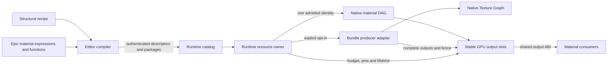
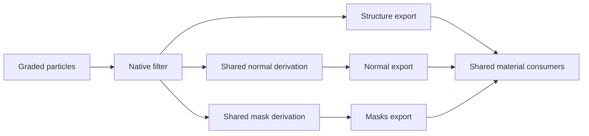

# Main component view

The runtime owner is the only public cache and lifecycle authority. The optional
adapter is an execution implementation, not another output registry or cache.

The filtered profile keeps its private intermediate inside the same owner:

