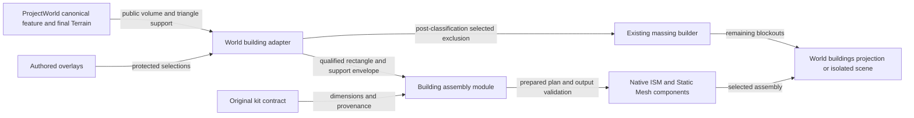

# Building assembly consumption

The adapter belongs to ProjectWorldBuildingEditor. The assembly module has no
ProjectWorld dependency and cannot write Terrain. World owns persistent kit assets,
assembly actors and remaining massing through one buildings-layer manifest and
transaction. Concrete production admission remains separate from the fixture.
