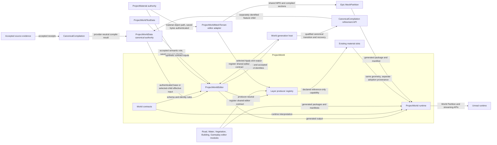

# Main View

This view shows ProjectWorld's boundary between engine-independent authority
and Unreal realization/runtime consumption.

The [refinement-owned views](../../../../../../tools/World/CanonicalCompilation/refinement/docs/architecture/diagrams/README.md)
describe candidate construction and selection internals. The
[World host contract](../../../../../../scripts/ue/world/README.md) owns coordinated
canonical/World commit and recovery; a child pointer change alone cannot certify
saved World output. Pure Ground/platform construction is not an admitted child.
