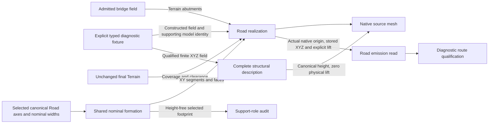

# Road elevation consumption

The [nominal footprint reader](../../../Source/ProjectWorldRoadEditor/Public/ProjectWorldRoadNominalFootprint.h)
uses the same formation as realization, before height projection and native
storage. It can inspect explicit selected axes without Terrain. Aggregate cell
selection work is bounded independently of each feature's subdivision budget.
Its output is
not a saved-width or collision certificate; final clipping and float conversion
remain consumer acceptance boundaries. Oversized formation refuses before
allocation or iteration. The existing Road tuple and profile selection remain
the authority for whether a Road is realized.
