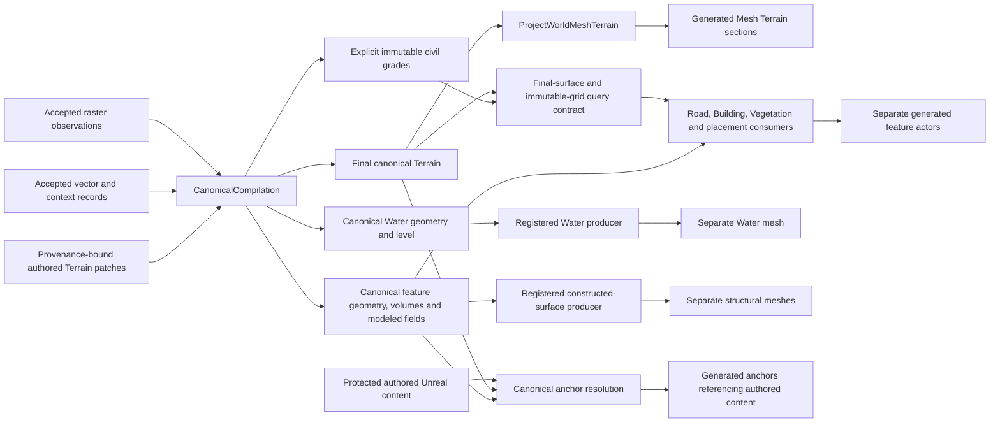

# Terrain and feature consumption

Current representation boundaries. The [territory contract](../../territory_contract.md#terrain-and-feature-separation)
owns their authority and adjustment semantics.

Feature geometry and generated objects do not feed height changes back into
Terrain during Unreal realization. The selected source/model representation,
surface query and consumed input identities determine each consumer's behavior.
Terrain refinement and canonical authored patches remain upstream of realization.

The raster remains evidence for its declared surface kind and accuracy. A DSM
can contain object or canopy heights even when generated object meshes are
separate. This view does not assert a bare-earth extraction capability.
