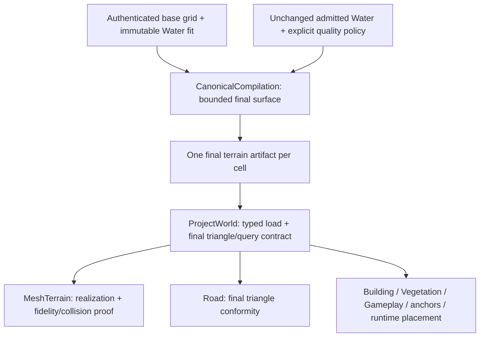

# Road and Water Alignment

**Status:** CURRENT - D17 Bridge/drain rollout and independent packaged material-development proof PASS; bank/fountain geography and final certification remain OPEN
**Scope:** terrain/road/water geometric alignment, intersections, and layering  
**Release:** required 3.0.0 concern; release authority stays in the [release plan](00_release_3.0.0.md#authority-register)  
**Stable documentation owners:** [World territory contract](../../Plugins/World/ProjectWorld/docs/territory_contract.md), [World pitfalls](../../Plugins/World/ProjectWorld/docs/pitfalls.md), and the owner identified by the dedicated investigation

## Remaining work - residual Water correctness

**Current accepted boundary:** Common Check `check-20261017T042825Z`, immutable-base
Matrix `run-20261017T044937Z`, and selected-child target
`refinement-20261017T054131Z` pass their distinct scopes. The lasting transaction
`1d33c88f8ffe47669800348becdcb001` changes three Kazan Road/Water mesh/actor pairs.
Only Road/Water scope manifests advance; cold replay writes zero. Terrain,
Buildings, Manhattan, materials and the Git index remain protected. Retained
execution reading and actual saved-city PIE checks pass. The presentation concern
closes its independent exact packaged material-development proof under D52; this
retains the geographic hold and does not certify a final release.
This closes neither the bank/fountain source ambiguity nor final release acceptance.

**Marker:** D17 continues engineering under the geographic release hold. Complete
the source-aware investigation and independently reviewed correction below;
do not ask again for a blanket defect waiver. Water 5 rollout and bounded runtime
measurements are complete under D16 and release-plan D27. D56 stays accepted.
Q5 geographic correctness and final source-bound certification remain OPEN.
**Resume here:** [Qualified Ground admission and local-surface continuation](#qualified-ground-admission-and-exact-local-collar---active-continuation).
The observed/raster source-admission boundary has 16 GREEN tests and architect
PASS; reuse its current BG1 receipts, not historical unsupported receipts.
The two-quad, twelve-quad and street-face fountain hypotheses remain unadopted
after measured ordinary-footway/interface consequences. The active continuation
below closes the owner-clamped query defect and identifies coarse-grid aliasing
at four real Road witnesses. The five-object native source field, its complete
support, exact seam controls and dependency census are retained; the bounded
fine-grid comparisons below do not yet close real-city neighboring seams or joint
Water containment. The pure Ground constructor and its typed UE query/source-mesh
proof are closed. D60 additionally closes fresh-selection producer binding and
the captured convex-weight edge refusal. Its exact observed-basin/native-CDT
join preserves final wet coverage and passes bounded native collision probes;
the regional Ground policy and city-quality acceptance remain open. The later
Ground-first scene closes actual Road/Building source-consumption proof and its
sampled native collision. Start with the connected-land source gaps and regional
policy at the active continuation, not another narrow zero-interface patch or
replay of the accepted typed-consumer tests. The two fixed park blends fail
measured Road quality; a wider publishable source model is still unselected.
Preserve the explicitly multi-level entrance case as unknown. Older
default-scale heights are different diagnostic evidence; their
four-centre mask is not a certificate for a widened downsampling kernel.
Do not rerun SourceIngestion, build a whole-cell Ground swap or introduce a
maintained publisher before the source-interface and consumer evidence closes.
Low-confidence cases remain
unchanged unless their source policy becomes defensible. The
[D12 implementation proposal](#d12-constrained-canonical-refinement---approved-disposable-scope)
is implemented under D13. D14 authorizes necessary production integration after
its own source/quality and acceptance gates pass; it does not declare them passed.
**Starting evidence recorded:** 2026-10-15, in the earlier documentation-only
stub. D11 supersedes that timing. The knowledge below is the D45-D48 starting
point; the review record separately owns new investigation and implementation.
Current D14 investigation expands the selected Kazan mixed-overlap inventory to
seven positive-area contacts; the older six-contact count below is explicitly
detector-qualified. Native revision-5 replay and independent geometry analysis
resolve those seven and the 39 equal-height contacts. Another 21 Kazan contacts
belong to a different, unequal-height source pair and remain unresolved.
That was the D14 candidate state. D58 adopted Water revision 5; the D17 selected
rollout above subsequently advances only its two affected Kazan Water cells.

**Goal:** resolve the remaining Water overlap/shoreline defects in Kazan and
Manhattan without disturbing accepted materials or unrelated generated layers.

Known starting point:

- D45's dependency-local Road/Water rollout is accepted. D41's competing terrain
  renderer defect and D43's Building winding rollout stay closed.
- The retained detector qualifies 45 Water contacts in two selected cells:
  Kazan 21, Manhattan 24. Native replay matches 318 saved triangles and attributes
  the contacts to exact canonical features. These are not a global contact census.
  Of those contacts, 39 are strictly affine-equal horizontal contacts and six have
  unequal planes; equality does not establish source connectivity.
- The selected same-XY source chain already has terrain above Water in canonical
  data: 7.2047 m in Kazan, 2.9814 m in Manhattan. The latter Water provenance is
  low confidence. Eight broad-water controls have 0.25 m clearance. These source
  samples are not new compiled-collision measurements or accepted carving limits.
- Water's preparation-domain identity correction and output revision 3 pass
  focused native tests and recorded baselines. Production Water outputs still
  retain the prior accepted keys; owner-local revalidation remains outstanding.
- Evidence: `tmp/world/water_source_replay/`,
  `tmp/world/completion_d47/height-chain.json` and that run's `closure.json`.

Remaining work must establish:

1. Correct treatment of equal/unequal contacts, retaining unknown crossings rather
   than inferring bridges, connectivity or automatic merging.
2. The appropriate canonical coverage/terrain-representation correction, with
   explicit source-quality and distortion/cut/fill limits before terrain mutation.
3. Exact affected units, dependency closure, current-revision revalidation, rollback and
   visual/collision acceptance through existing owners and transactions.

The starting stub selected no algorithm. D11's bounded exact-horizontal correction
is recorded below; Q2 grading and Q3 ambiguous crossings
remain separate decisions. No blanket terrain lowering, hidden adapter shaping,
full regeneration or repeated Check/Matrix/cook is authorized by recording it.
Reuse the [Water pitfall](../../Plugins/World/ProjectWorld/docs/pitfalls.md#49-water-preparation-context-changes-output-without-dirtying-its-cell)
and [World layers](../../docs/testing/world_pipeline_layers.md) for ownership/proof.

Current coordination: BrownEarth's bounded city visual checkpoint is accepted
and frozen; remaining surfaces use isolated and transient city previews under
the presentation concern's current authority register. Its D43 Building-only
winding replacement is completed in both cities with retained canonical inputs
and unrelated layers. This is not road/water alignment acceptance or Concrete
material adoption; the native fallback collision residual is recorded there.
D44 adds a verified selected generated-consumer closure for Road/Water/Vegetation
to the existing transaction, with clean external Terrain dependencies. A real
changed Water fixture saves only its two mesh/actor pairs, scope and active set;
saved-child rejection restores all 196 prior files and cold no-op preserves 197
accepted files. Independent architect PASS closes this persistence/locality
boundary, not production alignment. Fresh Check and canonical-authority Matrix
pass; temporary Matrix generation is restored byte-for-byte to the 6754-file
post-D43 baseline. No production canonical compile runs. Presentation concern
D45 authorizes the prepared selected rollout: 306 Kazan and 247 Manhattan
Road/Water mesh/actor pairs update, with four scope entries advancing. Vegetation
is reevaluated without writes; Terrain, Buildings, canonical data and material
resources stay unchanged. Both cold no-ops and real city previews preserve all
6758 accepted files. Native saved-source counts match each producer's receipt.
Manhattan's source Water intersection pairs fall from 319 to 24; Kazan retains
21. D47 subsequently establishes exact emitted-triangle provenance for these
detector-qualified contacts, superseding the centroid-only candidate attribution.
Compatible-plane composition has no demonstrated regression. This closes the
authorized output rollout, not complete alignment or visual acceptance. Road
conformity increases source triangles about 2.7 times, requiring actual packaged
cost measurement. Water conditioning limits and nonconstant crossings remain
separate decisions. Evidence is retained with the presentation concern's D45 record.
D46's bounded diagnosis distinguishes 39 strictly affine-equal contacts from six
unequal contacts, with detector thresholds explicitly retained. Ten lattice-patch
probes measure conservative conditioning proposal costs, not observed intrusion
or accepted limits. D47's native replay matches all 318 source triangles in the
two selected cells and their saved world-space scan: Kazan ways `1290267745` /
`1290267747`, Manhattan ways `1448214217` / `605476565`, with `alis:osm:way:` IDs.
The 39 equal contacts are horizontal; six unequal contacts remain distinct.
Quality/crossing decisions still precede a new geometry algorithm or persistent
conditioning change. A native RED/GREEN proves a separate consumed-input defect:
other-cell preparation bounds can change local triangulation. Water hashing and
realization now share that context; the actual planner dirties affected Water
units without dirtying Terrain. The corrected keys and Water output revision 3
require one-time Water-only revalidation; prior-key cold no-ops do not prove that future boundary. No city
outputs change, and all 6758 accepted files retain their hashes. The presentation
concern owns the completed eight-arm packaged selected-resource comparison and
its independent architect PASS. Forty actual 1280x720 Graphics profiles do not
show a clear Road GPU regression in these selected scenes; they cannot close
whole-city GPU, streaming or gameplay acceptance or justify a speedup claim.
The subsequent existing both-city uncooked product-route replay accepts its
movement, sampled Terrain/Road/Building collision and streaming envelope with
unchanged source/modules/authority during the run. Native PIE frame-budget
receipts fail; packaged city performance and full collision fidelity remain open.
Presentation D48 subsequently closes delegated Concrete visual judgment and
material-only adoption on 312 Building meshes. Both cold no-ops retain exact
geometry identities; real saved-binding city captures pass for default concrete
massing. No Road/Water/Terrain/canonical package changes in that operation.
Apparent foundation gaps/dark shadows remain observations, not an attributed
Road/Water defect. Material acceptance does not close this concern's policies.
D47's subsequent ten-point same-XY source chain confirms selected canonical
terrain already exceeds saved Water by 7.2047 m in Kazan and 2.9814 m in Manhattan.
The Kazan mixed triangle has a high corner outside the footprint; the narrow
Manhattan feature lies between grid samples and retains low-confidence Water
provenance. Eight broad-water controls clear by 0.25 m. These are bounded source
measurements, not new compiled-collision evidence or a conditioning policy.
Keep this todo's correctness, water-policy and grading/
crossing gates separate; material screenshots do not accept geometry or trigger
canonical/World regeneration.

## Contents

- Goal - Authority register - Non-goals
- Verified evidence - Current architecture - Problem and root cause - Decision
- Required invariants - Investigation tasks - Proposed implementation - Test-first and verification plan
- [D12 constrained canonical refinement - approved disposable scope](#d12-constrained-canonical-refinement---approved-disposable-scope)
- Documentation plan - Completion criteria - Review record

## Goal

Make road and water surfaces meet terrain coherently at edges, crossings, and
intersections, without gaps, unintended overlap, or unstable coplanar layering.
Preserve correct geographic meaning, collision, and streamed cell continuity.
Judge whether roads appear coherently constructed on slopes and at junctions,
as well as whether their mesh heights match terrain. Exact drape alone may
preserve an implausible cross-slope; grading remains a candidate, not a requirement.

## Authority register

### Operator decisions

- **D1** Keep geometric alignment and layering separate from material presentation.
  - Reason: its implementation design is not decided yet.
  - Source: operator request, 2026-10-08.
- **D2 [SUPERSEDED IN PART by D5 - read-only investigation timing]** Create a current investigation todo now; agree on the material todo first,
  then conduct this dedicated investigation separately.
  - Reason: not stated.
  - Source: operator request, 2026-10-08.
- **D3 [SUPERSEDED IN PART by D5 - bounded read-only editor evidence]** This step is planning/documentation only; do not implement or run expensive
  verification. Development later uses owner-local tests, scratch previews, and
  focused integration.
  - Reason: avoid repeatedly rebuilding/cooking/regenerating the World for debugging.
  - Source: operator request, 2026-10-08.
- **D4** Audit the attached alignment review against actual code, architecture,
  project goals, and previous agreements; fix these todos and explicitly refute
  incorrect reviewer points.
  - Effect: revise this existing investigation, its presentation handoff, and release
    routing. This source audit does not approve an alignment implementation or
    supersede D2/D3's dedicated-investigation sequence and documentation boundary.
  - Reason: not stated.
  - Source: operator follow-up, 2026-10-08.
- **D5 [SUPERSEDED IN PART by D8 - Q1 implementation]** Update the todo and run the read-only editor investigation now.
  - Supersedes: D2's requirement to wait for material agreement before this bounded
    read-only investigation, and D3's documentation-only limit for this step.
  - Effect: source/candidate comparison and bounded editor geometry/visual evidence
    are authorized now. No implementation, saved asset changes, generation, broad
    gates, or release work is authorized; Q1 remains open.
  - Reason: not stated.
  - Source: operator answer to the scope question, 2026-10-08.
- **D6 [SUPERSEDED IN PART by D8 - Q1 implementation]** Continue investigation and prepare the existing todo for comprehensive
  realization, evaluating the supplied investigation-stage review.
  - Effect: additional owner-local read-only diagnosis and this implementation
    proposal; D5's no-implementation/no-generation boundary remains binding.
    Analytical controls of existing behavior are permitted; candidate geometry
    prototypes and changed algorithms remain behind Q1.
  - Reason: not stated.
  - Source: operator follow-up, 2026-10-08.
- **D7** Critically evaluate the attached simplification review against code,
  architecture, goals and prior agreements; apply valid in-scope corrections and
  explicitly refute incorrect points.
  - Effect: update this existing planning artifact. No Q1 implementation choice or
    asset mutation is approved by the review's proposed Q1-Q3 answers.
  - Reason: not stated.
  - Source: operator follow-up, 2026-10-08.
- **D8** Implement the accepted todo through implement-approved-change for the
  bounded Q1 correctness slice: small RED/GREEN fixtures and owner-local road
  conformity, consumed-input identity and water coverage.
  - Supersedes: D5/D6's no-implementation boundary for this bounded slice only.
  - Effect: Q2 grading and Q3 ambiguous crossing reconstruction remain deferred;
    persistent terrain mutation requires accepted water distortion/source-quality
    limits. No production geography promotion, whole-World rebuild or release work.
  - Reason: not stated.
  - Source: operator skill invocation and accepted alignment todo, 2026-10-08.
- **D9** Inspect reported widespread z-fighting through live Editor MCP and apply
  valid in-scope code/documentation fixes after reviewing D39 feedback.
  - Effect: bounded duplicate/intersection diagnosis and Water-owned constant-plane
    composition with focused fixtures. Preserve accepted materials, canonical inputs
    and city output authority. No new grading, crossing law, terrain-conditioning
    limits, persistent geometry rollout or broad pipeline is inferred.
  - Source: operator follow-up, 2026-10-13.

- **D10** Investigate terrain flicker with short PIE camera movement and fix the
  demonstrated owner-local defect.
  - Effect: reversible near/far rendering controls, Mesh Terrain authoring/runtime
    lifecycle correction and focused native proof. Preserve accepted material
    recipes, all canonical and city output bytes, and the separate Water rollout,
    nonconstant crossing and terrain-conditioning gates.
  - Source: operator follow-up with D40 reviewer attachment, 2026-10-13.

- **D11** Execute the remaining work in one coordinated pass toward moving the
  completed concerns to done.
  - Effect: investigate the retained stub, implement independently justified
    owner-local correctness, prepare measured shoreline alternatives and verify
    the actual consumers. No missing numeric conditioning/source-quality or
    ambiguous-crossing choice is inferred; do not close unresolved criteria by
    changing their meaning. Preserve accepted art and unrelated generated owners.
  - Source: operator "do all remaining in one pass to move todo to done",
    2026-10-15. Supersedes the preceding stub-only timing for this work.

- **D12** Investigate constrained canonical terrain refinement; preserve
  low-confidence cases until their policy is resolved.
  - Effect: investigate the canonical representation, native implementation
    capabilities, bounded influence and exact consumer/neighbor closure. This
    selects the investigation direction, not numeric distortion limits, source-
    quality promotion or persistent terrain mutation. D8's quality boundary stays.
  - Reason: not stated.
  - Source: operator's explicit answer to the shoreline-direction question,
    2026-10-15.

- **D13** Approve Q4's disposable implementation of the sparse canonical terrain
  representation and affected query contract in one-quad/two-cell fixtures.
  - Effect: implement and verify the reviewed D12 boundary. Existing city assets,
    production canonical authority and low-confidence cases stay unchanged. Q5's
    production quality decision remains open.
  - Reason: not stated.
  - Source: operator's explicit answer "Approve disposable implementation",
    2026-10-15.

- **D14** Complete this concern under the release router's D25 FULL GO.
  - Effect: investigate the real source-shaped Q5 candidates, implement necessary
    canonical/Water/consumer corrections, and perform gated dependency-local
    production transactions and packaged acceptance autonomously. Q4 stays closed.
    The release router owns the technical-quality delegation, independent review,
    preserved operator/performance boundaries and final unsigned certification.
    Unresolved source/crossing risks require evidence and explicit disposition;
    neither an exclusion nor a reviewer PASS manufactures release acceptance.
  - Source: operator's FULL GO attachment and autonomous completion request,
    2026-10-16; see [release authority](00_release_3.0.0.md#authority-register).

Release inclusion, the historical R5, final frozen R5/R6, and unchanged performance
policy are owned by release-plan D19-D22, not this investigation.

- **D15** Implement the release router's D26 dependency and recovery correction.
  - Effect: authenticate immutable accepted canonical consumption separately from
    fresh source/base compilation; retain Q4's child identity and correctness
    proof, strict upstream replay and unchanged geographic selection. Preserve
    accepted city outputs, source pins and Q5 limits. Complete the bounded exact
    raw search and durable retention/recovery contract before replacement pins.
    A scoped Water release-exception proposal remains evidence, not acceptance;
    the operator retains the final risk decision.
  - Source: operator's source-recovery reinvestigation and architecture correction,
    2026-10-16; [release authority](00_release_3.0.0.md#authority-register).

- **D16** Resume full completion under release-plan D27. Reuse D56's accepted
  dependency/source boundary and its receipts. Perform the gated revision-5
  Water transaction, actual city consequence checks and independent packaged
  verification. Preserve low-confidence cases, the rejected bank decision and
  the operator's final geographic-risk authority. Do not stop at another
  intermediate PASS or create a duplicate concern.
  - Source: operator's resume-and-complete request, 2026-10-16;
    [release authority](00_release_3.0.0.md#authority-register).

- **D17** Keep the geographic release hold temporarily and continue the original
  FULL GO through source-aware geographic surface reconciliation. Do not accept
  a blanket exception or stop engineering at the hold.
  - Effect: audit the four measured defect classes and their surviving source
    semantics; inspect native UE and established terrain methods; prepare this
    existing todo through investigate-change; obtain independent architect review
    at the canonical/consumer boundary before broad implementation. Implement
    justified general rules, focused fixtures and real-city verification, then
    deploy only affected outputs through the existing acceptance/transaction route.
    Continue independent packaging, collision and performance work. D58's frozen
    proof remains bounded to its recorded candidate until consumed inputs change.
  - Constraints: preserve original sources, provenance, accepted geography,
    materials and Git state during investigation/candidates. Prefer explicit
    evidence, supported topology/geometry, then defensible bounded and identified
    model inference. Never invent elevations/connectivity or unsafe cut/fill
    limits; do not silently reinterpret missing historical tags. No parallel
    terrain authority, generic solver framework without demonstrated need,
    repeated full-city development regeneration or premature publication.
  - Supersedes: D16 review record's proposed hold-versus-waiver next step. Q5
    remains open; escalate only a specific ambiguity demonstrated irreducible
    from available evidence and accepted engineering constraints.
  - Reason: procedural generation should resolve defensible geographic
    relationships automatically rather than request a decision for every crossing.
  - Source: operator's Q5 answer and stages A-E, 2026-10-16.

- **D18** Continue FULL GO by evaluating and applying valid source-model review
  findings, preserving the accepted bounded Ground proofs.
  - Effect: compare an evidence-backed regional Ground/retained-terrain transition
    with broader qualified Ground adoption and any explicitly permitted unsupported
    disposition. Identified deterministic interpolation is a game-world model,
    not surveyed elevation. The historical DSM is immutable input, not a blanket
    requirement to freeze erroneous civil grades or force a tiny matching seam.
    Obtain independent architect review before selecting a regional policy/contract;
    implement and measure through the existing canonical refinement and consumers.
    Audit original-feature binding at its actual acceptance owner and keep generated
    test evidence outside public source. Continue actual geography, transaction and
    technical release verification; no intermediate PASS closes the whole concern.
  - Constraints: D14/D17 quality, source, dependency-local and operator boundaries
    remain. No automatic 47.8 km2 replacement, fabricated waterline, unknown-source
    fill, arbitrary cut/grade relaxation, parallel authority or public R6 action.
  - Source: operator's "do bro fully" request to evaluate/apply the attached review,
    2026-10-17. Technical findings still require repository and measured evidence.

### Operator gates

- **Q1 [CLOSED by D8 - bounded correctness only]:** What implementation should be approved after the dedicated
  investigation identifies the defect and owning boundary? Gates implementation only.
  No alignment design is endorsed by creating this file.
- **Q2 [OPEN - BLOCKING for road grading]:** What derived road crossfall/longitudinal
  grade, maximum cut/fill, corridor/transition extent, and canonical surface contract
  should be accepted? Existing source heights/widths do not supply a road-design law.
  Gates grading prototypes and production changes, not the read-only diagnosis.
- **Q3 [ADMISSION INVESTIGATION AUTHORIZED by D17; ambiguous metric resolution OPEN]:** Should available source crossing
  metadata be admitted through the existing canonical/typed contracts, or should
  ambiguous crossings be explicitly excluded/refused? Do not invent ordinary
  junctions, bridge clearance, or tunnel elevations from XY overlap alone.
- **Q4 [CLOSED by D13 - disposable implementation only]:** Approve the versioned sparse
  final-surface representation, bounded query contract and disposable canonical/
  adapter experiment proposed below? D12 selects investigation, not this contract
  change. Existing Q1 correctness approval does not approve a representation migration.
- **Q5 [OPEN - TECHNICAL SELECTION DELEGATED by D14/D25]:** Which source-accuracy
  classes and numeric maximum cut/fill, changed dry-bank extent, bank gradient,
  continuity/clearance and topology-cost limits are acceptable for each admitted
  use? This records D8's retained production-quality boundary; Q4 fixtures cannot
  supply production acceptance. D12 excludes low-confidence cases until resolved.
  Supported conservative limits may now be selected and challenged independently
  under D14/D25; an unsupported residual quality/risk choice remains a human gate.

Q2/Q3 do not block Q1-approved independent road-consumption/identity and water-
coverage fixtures outside ambiguous crossings. Water terrain mutation has its own
source-quality and distortion acceptance before persistent promotion; it must not
borrow a road grade law. The following are proposals, not closed gates:

| Gate | Proposed resolution for operator review |
|---|---|
| Q1 | Accepted by D8 for staged owner-local correctness fixtures: road full-surface consumption and bounded tangent/neighbor identity, plus independent canonical water coverage. Representative integration and policy acceptance remain required before persistent production output or a representation migration. |
| Q2 | Keep grading optional and separate. A named paved-road visual fixture may compare about 2% normal crossfall only after explicit prototype/input approval. Accept road-class/source-quality-specific longitudinal, transition and cut/fill limits before persistent grading; report infeasible segments. |
| Q3 | Admit available bridge/tunnel/layer/ford distinctions through existing source/canonical/typed seams. Preserve authenticated node connectivity only where present; otherwise keep connectivity unknown. Exclude/report ambiguous features from automatic merging/grading while unrelated correctness proceeds. |

The roughly 2% reference comes from [FHWA's tangent-pavement cross-slope guidance](https://highways.dot.gov/field-offices/missouri/interchange-design-promptlist).
It is not an ALIS surveyed fact, a universal road-class rule, or proof that an admitted
road is paved. [OSM's layer guidance](https://wiki.openstreetmap.org/wiki/Key:layer)
describes crossing order, not metric elevation; coincident XY is not shared-node identity.

### Working assumptions

- **A1 [ACTIVE]:** The reported concerns can be diagnosed using existing maps and a
  small representative fixture before any production geography is regenerated.
- **A2 [ACTIVE]:** Surface color/reflection may make an intersection look wrong;
  final attribution must compare geometry/depth with lit presentation.
- **A3 [SUPERSEDED IN PART by D8]:** Conformity is approved for Q1 owner-local
  fixtures. Bounded feature-driven shaping remains conditional on Q2 and is not
  an automatic second phase.
- **A4 [ACTIVE - proposal, not authority]:** A single versioned final-surface
  artifact per refined cell, using the pinned GEOS native kernel and complete-quad
  query domains, is the smallest viable D12 experiment. It remains conditional on
  Q4 and the refusal/locality proofs below; numeric production policy stays Q5.

## Non-goals

- Shader, texture, palette, roughness, or default-material changes.
- Unapproved grading or crossing reconstruction, a WaterBody system,
  mesh-layering framework, or additional geometry authority.
- Full territory regeneration, packaging, or publication as an investigation step.

## Verified evidence

### Reported concerns before the bounded editor probe

- The operator reports terrain/road and terrain/water alignment concerns, including
  intersections and layering. The probe below establishes four local ordering
  counterexamples; junctions, seams, and broader failure categories remain open.
- The supplied proposal mentions shoreline intersections, z-fighting, and mesh layering
  as separate work. Those descriptions do not prove a current defect in either city.

### Verified repository facts

- [Shared terrain sampling](../../Plugins/World/ProjectWorld/Source/ProjectWorldEditor/Private/ProjectWorldGeneratedGeometry.cpp)
  uses bilinear interpolation and clamps queries to the current cell's core grid.
  [Mesh Terrain construction](../../Plugins/World/ProjectWorldMeshTerrain/Source/ProjectWorldMeshTerrainEditor/Private/ProjectWorldMeshTerrainProducer.cpp)
  authors triangles A,C,B and B,C,D per quad. These are different surfaces on a
  non-planar quad. Analytical control: A=B=C=0 m, D=10 m gives 2.5 m bilinear
  height at the center but 0 m on the shared B,C diagonal. This proves a source-model
  mismatch, not its severity on a loaded city's compiled/rendered/collision surface.
- [Road construction](../../Plugins/World/ProjectWorld/Source/ProjectWorldRoadEditor/Private/ProjectWorldRoadRealization.cpp)
  subdivides centerline segments to a configured maximum, samples endpoints, and
  assigns each endpoint height to both lateral edges. Even a planar cross-slope
  can therefore put one edge below terrain and the other above it. Its offset is
  added to height (vertical Z), not applied along a surface normal. Current
  [Kazan](../../Plugins/World/ProjectWorldData/Data/Profiles/Realization/kazan_territory_v1.realization.json)
  and [Manhattan](../../Plugins/World/ProjectWorldData/Data/Profiles/Realization/manhattan_showcase_v1.realization.json)
  recipes set 0.15 m and 7.5 m, `terrain_drape`, `overlap_same_owner`, Nanite, and
  complex-as-simple collision. Recipe values must be authenticated against the
  loaded map/realization receipt before attributing a reported symptom to them.
- The [road producer](../../Plugins/World/ProjectWorld/Source/ProjectWorldRoadEditor/Private/ProjectWorldRoadLayerProducer.cpp)
  declares a one-cell terrain dependency halo. The existing
  [dirty planner](../../Plugins/World/ProjectWorld/Source/ProjectWorldEditor/Private/ProjectWorldRealizationProfile.cpp)
  propagates dependency dirty units through that halo. This does not make the
  road builder sample adjacent terrain: its current sampler clamps at cell edges.
  Any new neighbor consumption needs authenticated inputs and output identity,
  as well as closure tests; halo declaration alone is not a conformity proof.
- `SampleTerrain` is shared by buildings, vegetation, gameplay placement,
  [anchor placement](../../Plugins/World/ProjectWorld/Source/ProjectWorldEditor/Private/ProjectWorldAnchorPlacement.cpp),
  and [runtime route/anchor realization](../../Plugins/World/ProjectWorld/Source/ProjectWorldEditor/Private/ProjectWorldRuntimeRealization.cpp).
  A global interpolation change would affect these consumers too. The dedicated
  investigation must choose an explicit surface contract and consumer scope;
  a road fix must not silently change their elevations or depend on a private
  Mesh Terrain implementation helper.
- [Water/terrain pitfall 28](../../Plugins/World/ProjectWorld/docs/pitfalls.md#28-a-visible-water-surface-can-still-z-fight-with-terrain)
  documents a previously fixed vertical-order defect and its canonical clearance owner.
  A reflective material did not fix it; a constant offset could not cover arbitrary
  terrain intrusion. Read the existing guard before proposing another correction.
- [Canonical terrain finalization](../../tools/World/CanonicalCompilation/app/terrain_surface.py)
  lowers covered terrain samples using canonical water height and clearance, then
  applies authored patches and rejects a sampled clearance violation. It handles
  water footprint membership and holes; it does not establish continuous clearance
  over every intersecting terrain/water triangle. The current
  [Kazan compilation recipe](../../Plugins/World/ProjectWorldData/Data/Profiles/CanonicalCompilation/kazan_territory_v1.compile.json)
  specifies 30 m sample spacing and 0 m clearance. The realization recipes above
  specify a 0.25 m water lift. These are recipe inputs, not newly measured map state.
- [Water mesh construction](../../Plugins/World/ProjectWorld/Source/ProjectWorldWaterEditor/Private/ProjectWorldWaterMeshBuilder.cpp)
  uses native polygon offset/intersection and constrained Delaunay triangulation.
  It prepares feature/domain triangles, then clips them to cells and evaluates
  heights at the resulting vertices. Standing height is fixed; flowing height is
  quantized nearest-centerline-segment knot interpolation. Actual triangle interiors,
  clipped vertices, seams, and holes must be compared with terrain, not merely
  checked independently. Water remains non-Nanite and has no collision.
- [Territory contract](../../Plugins/World/ProjectWorld/docs/territory_contract.md#layered-regeneration-contract-scale-out-precondition)
  separates canonical water elevation from a bounded realization surface offset.
- The [admitted typed feature](../../Plugins/World/ProjectWorld/Source/ProjectWorldEditor/Public/ProjectWorldCanonicalBundle.h)
  has road class, width, and XY geometry but no bridge/tunnel/vertical-layer field.
  This does not prove upstream sources lack those semantics. Trace raw admission,
  canonical normalization, and realization before proposing crossing behavior.

### Reviewer corrections and remaining hypotheses

- Accept the source-supported road interpolation and full-width test targets.
  Refute the reviewer's "normal offset": the code adds vertical height.
- A narrow water footprint between terrain lattice samples may be occluded despite
  correct sampled lowering. This is a plausible hypothesis, not an established
  cause of the reported blue areas. No screenshot was supplied in this follow-up;
  the reviewer's visual attribution cannot substitute for matched depth evidence.
- Same-owner overlap is a policy, not proof of clean junctions. A declared halo is
  not proof of neighbor sampling. Test both before designing corrections.
- Refute the closing suggestion that this todo becomes CURRENT/required only after
  approval: release D19 already made it required. Reviewer recommendations neither
  approve implementation nor establish a road-only mutation envelope for a shared fix.

The earlier source-only audit inspected recipes and existing test assertions, and checked the
analytical non-planar/control arithmetic. No production regression test, alignment
capture, map clearance measurement, or runtime experiment ran during that audit.
The separately authorized editor probe is recorded below; a source-model
counterexample alone is not real-map acceptance evidence.

### Production references and their limits

- [Erwin Heyms's first-person Wildlands production account](https://80.lv/articles/procedural-world-building-in-ghost-recon-wildlands)
  describes turning a road network into terrain heightmaps, materials, and masks.
  It supports testing infrastructure-driven terrain integration. Its designer-led
  road pathfinding is not authority to redirect ALIS's reconstructed road network.
- [Epic's UE 5.8 City Sample PCG](https://dev.epicgames.com/documentation/unreal-engine/city-sample-pcg-for-unreal-engine)
  solves junctions and partially levels terrain in its roads stage, retriggering
  terrain consumers. Its default demo has streaming disabled and generated actors
  require partitioning. Study geometry/grade decisions, not its generation graph
  or default streaming configuration as an ALIS replacement.
- These examples motivate A3; they do not prove Level B fixes ALIS's reported
  defects. ALIS already has canonical water-driven terrain conditioning. The new
  question is whether its existing surface contract needs bounded road grading
  or finer water coverage, not whether to introduce a second terrain authority.
- [Terrain elevation acceptance](../../Plugins/World/ProjectWorld/docs/territory_contract.md#terrain-elevation-acceptance)
  checks compiled Nanite/fallback samples against canonical elevations and separately
  proves collision. The canonical water seam above requires the adapter to realize
  the immutable final surface. An adapter-only grade change with unchanged input
  identities cannot truthfully retain those fidelity claims.
- Reviewer boundary correction: Level B cannot remain entirely inside the Road,
  Water, and Mesh Terrain adapters while retaining today's canonical contract.
  Changing final terrain elevations also involves the canonical terrain owner and
  its accepted provenance/fidelity contract. Keep native engine dependencies in the
  terrain adapter; this does not justify moving geographic authority there.

### Bounded read-only editor evidence - 2026-10-08

Scope: the existing Kazan territory map, cells `grid_413718bc833994e5:x1:y0`
and `grid_413718bc833994e5:x1:y1`, four loaded source-LOD meshes, eight
owner-isolated vertical collision traces, and four fixed lit captures. No candidate
was implemented. This is partial T0/T1 evidence, not full investigation acceptance.

- Configured launcher engine: 5.8.3. The live map and georeference were queried:
  `/ProjectWorldData/Generated/Territory/L_ProjectWorldKazanTerritory`,
  EPSG:32639, projected origin `(381409, 6185051)`, vertical origin `0 m`.
- The current active bundle was authenticated by size and SHA-256:
  `995fb0fb1d6550925efaf55111a6936e600658d0b9cb3938461a3e6cac47b8dc`;
  authority `kazan_territory_v1:75b8eefd6a99e53ff0db65ad9efaccf029759bd098dbe5e4b8e8651565a287b8`.
  Its georeference matches the live map. This authenticates current inputs, not
  identity with the historical frozen R5 artifact.
- Read the existing meshes through native `StaticMeshDescription`, resolving each
  triangle's three vertex-instance IDs to validated vertex IDs. Compare vertices,
  triangle centroids, and edge midpoints with the owning cell's canonical A,C,B /
  B,C,D terrain surface. 36,752 samples were inside the cells; 82 road samples
  outside their owning cell were excluded, not silently clamped or counted as safe.
  Sampling is diagnostic and does not certify continuous clearance.

Negative clearance below is feature height minus terrain height at the same XY.
Coordinates are Unreal world centimeters; values identify the selected diagnostic
point, not a global minimum. Terrain traces hit `MeshPartitionEditor.PreviewMeshComponent`;
road-only traces independently hit the corresponding generated road mesh.

| Feature / cell | Diagnostic world XY (cm) | Feature Z (cm) | Terrain preview collision Z (cm) | Signed clearance (m) |
|---|---|---|---|---|
| Road x1:y0 | 14061.723, -929.068 | 7941.382 | 8146.826 | -2.0544 |
| Road x1:y1 | -37006.920, -66654.362 | 5615.460 | 5780.483 | -1.6502 |
| Water x1:y0 | 7451.500, 68945.000 | 5555.000 | 5832.325 | -2.7733 |
| Water x1:y1 | -39015.000, -64159.000 | 5025.000 | 5745.470 | -7.2047 |

The road points are triangle edge midpoints. Water x1:y0 is an edge midpoint;
water x1:y1 is a vertex. Water has no collision; its Z comes from the loaded source
mesh, compared with terrain-only collision. Terrain preview hits agree with the
canonical triangle model at these points; this is not packaged/Nanite collision proof.

Fixed 1280x720 oblique captures show interrupted road ribbons and exposed water
fragments among terrain in these neighborhoods. They support investigating geometry
ordering independently of materials; they do not isolate ordinary junction defects,
z-fighting, or the exact contribution of bilinear sampling versus lateral-edge heights.
The native capture receipt reports all 210 terrain subjects drawn and none pending.
Plan/image hashes were checked. The repeat-pose hash differs (temporal state), so these
images are diagnostic views and do not satisfy a deterministic visual gate.

Reproducible local record: `tmp/world/alignment/production-comparison-20261008/`.
`dumps/editor_mesh_read.py`, `dumps/analyze_source.py`, and `dumps/editor_traces.py`
produce `receipts/source-clearance.json` and `receipts/editor-traces.json`;
`dumps/vantages.json` records the exact poses for `ProjectWorld.CaptureEvidence`.
`receipts/capture.json`, `screenshots/`, and `receipts/editor.log` retain the terminal
capture evidence. These disposable diagnostics are not future test inputs or release
authority; the identities, points, measurements, and limitations are recorded above.

No dirty content/map packages were reported before capture. The agent-owned editor
exited normally without saving. Before/after SHA-256 inventories prove all 3,739 files
under ProjectWorldData Data/Content and ProjectMaterial/ProjectTexture Data/Content
are unchanged, with no additions or removals (`receipts/no-mutation.json`).
No PIE, World regeneration, canonical compilation, broad rebuild, cook, or release
gate was run. Manhattan, continuous clearance, seams, semantic crossings, junction
construction, neutral/depth views, and A/B grade/transition quality remain unverified.

### Continued diagnosis and feature attribution - 2026-10-08

Read-only scope: the same two Kazan cells, two Manhattan cells (`x1:y0`, `x1:y1`),
their required neighbor terrain, existing production calculations on disposable
in-memory inputs, and saved source-LOD geometry. No A/B geometry prototype was made.

Current Manhattan authority is
`manhattan_showcase_v1:22db753ab53d21e6355633bc3e0b4d1424549a87e50736b2a6bacd0988b98c40`,
bundle SHA-256 `84b0b6be76427baf31b0087d91e5f88c66cf9237a776acbf59cb92587e032067`.
The live map was `/ProjectWorldData/Generated/Showcase/Manhattan/L_ProjectWorldManhattanShowcase`;
its EPSG:32618 origin is `(585628, 4511322, 0)`.
Both bundles were authenticated by size/hash. Six active road/water/terrain manifests
match their current compile receipts and realization-profile byte hashes; all 2,166
listed artifact byte digests match saved files. Four road unit-input hashes and actor
semantic tags independently match the current canonical features/settings.
This is current-state authentication, not a replay or release gate.

#### Road - first failing calculations

Reconstructing the existing source arithmetic, including local float32 storage,
reproduces all 14,472 road triangles in the four sampled meshes with zero coordinate
delta. This rules out stale road output relative to those authenticated inputs in
these four cells. Terrain preview collision agrees with the triangle surface at the
queried points. It does not establish universal terrain/render/collision correctness.

The builder first substitutes a bilinear surface for the consumed terrain triangles,
then copies each centerline endpoint height to both lateral edges and linearly spans
segments. Both errors contribute; changing interpolation alone is insufficient.
The decomposition below is exact source arithmetic at the selected saved-mesh point:
`clearance = (bilinear - triangle) + lateral/segment error + 0.15 m lift`.

| Map / cell | Canonical road feature | Bilinear minus triangle (m) | Lateral/segment error (m) | Source-mesh clearance (m) |
|---|---|---|---|---|
| Kazan x1:y0 | alis:osm:way:124954339 | -1.1217 | -1.0828 | -2.0544 |
| Kazan x1:y1 | alis:osm:way:195408844 | -1.3594 | -0.4409 | -1.6502 |
| Manhattan x1:y0 | alis:osm:way:5671393 | +0.0007 | -4.6183 | -4.4676 |
| Manhattan x1:y1 | alis:osm:way:195743208 | -2.9459 | -2.7321 | -5.5280 |

Manhattan point XYZ in projected meters: x1:y0
`(585513.106328, 4510602.427891, 62.794041)`; x1:y1
`(585212.744663, 4511611.720859, 36.555161)`.
Terrain-only traces give 67.261659 m and 42.083198 m respectively. At x1:y0,
road-only collision agrees with the selected road. At x1:y1 it first hits a different
overlapping road, `alis:osm:way:1051750427`, at 39.311881 m: 2.756720 m above the
selected saved ribbon and 2.771317 m below terrain. The selected lower ribbon height
there is source-LOD evidence, not an isolated collision result.
This proves multiple road elevations at that XY; it does not prove an ordinary
junction or justify collapsing a bridge/tunnel. The current
[road canonical adapter](../../tools/World/CanonicalCompilation/app/adapters.py)
retains class, inferred width, and name, not bridge/tunnel/layer attributes; the
provider-preserving source adapter retains properties. Q3 owns that unresolved scope.

All 82 previously excluded Kazan road samples are now evaluated against their proper
neighbors: 56 from x1:y0, 26 from x1:y1, across eight distinct neighbor cells.
Their clearances range from -0.6537 to +1.0437 m and -0.8989 to +0.4661 m respectively.
All 82 terrain-only preview collision queries hit; their maximum difference from the
neighbor triangle model is less than 0.000001 cm. Four original-point rechecks also
agree. No out-of-cell sample is treated as safe by clamping.
The two Manhattan meshes have a further 309 out-of-cell samples, all analytically
assigned to authenticated neighbor terrain; they have not all had live collision probes.

The current [road unit hash](../../Plugins/World/ProjectWorld/Source/ProjectWorldRoadEditor/Private/ProjectWorldRoadRealization.cpp)
includes local fragment parts but omits the full feature geometry consumed by
`RoadTangent`. A source-arithmetic control keeps fragment `(0,0)->(10,0)` unchanged
and rotates its continuation: endpoint tangent changes from `(1,0)` to
`(0.707107,0.707107)` while the fields hashed by this unit remain unchanged.
This is a latent consumed-input identity gap, not the demonstrated cause of today's
road heights. Repair it alongside any new neighbor consumption; do not depend on
broader regeneration to cover it.

#### Water - sample coverage versus continuous surface

The selected water triangles' three vertex heights match the corresponding canonical
function, quantization, and 0.25 m lift (maximum difference below 0.000001 m).
Terrain preview collision matches canonical triangle interpolation at each selected
point. For these points the first demonstrated gap is canonical finalization's
lattice-point coverage, not a stale water height or displaced terrain preview.

| Map / cell | Canonical water feature | Function height (m) | Mesh height (m) | Terrain triangle height (m) | Covered quad corners / 4 |
|---|---|---|---|---|---|
| Kazan x1:y0 | alis:osm:relation:3974314 | 55.3 | 55.55 | 58.32325 | 1 |
| Kazan x1:y1 | alis:osm:relation:7493502 | 50.0 | 50.25 | 57.45470 | 2 |
| Manhattan x1:y0 | alis:osm:way:576035677 | 17.8 | 18.05 | 21.03140 | 0 |
| Manhattan x1:y1 | alis:osm:way:702073775 | 24.0 | 24.25 | 26.02780 | 0 |

Kazan's examples are flowing polygons, not narrow ribbon features. Manhattan's are
standing polygons with `low_confidence_point_fallback` height provenance. Their
fitted heights are declared derived inputs; these results do not prove surveyed
water levels or justify refitting them from already-shaped terrain.
Manhattan water points are `(585468.69,4510677.71)` and `(585752.11,4511942.79)`.

An existing-finalizer control uses a flat 12 m, 30 m terrain quad and a constant
10 m water function. A 3 m ribbon at Y=15 m covers no lattice corners; the production
`finalize_terrain_cells` returns normally, leaving terrain 1.75 m above water including
its lift. A 100 m wide control lowers corners to 10 m and gives +0.25 m clearance.
This exercises current production code on in-memory fixture data, not a candidate
algorithm or generated geometry. It establishes the sample-only invariant gap.
Continuous clearance must also cover polygon banks, holes, sloping functions,
quantization, authored patches, and final clipped water-triangle interiors; selected
vertex agreement does not exonerate the water leaf for those other cases.

#### Conformity versus constructed road geometry

Source-only predictions sample the current terrain triangle heights at both ends
and both lateral edges of each attributed road segment. Maximum cross-slope ratios
are 27.9%/32.1% for the Kazan examples and 58.1%/118.0% for Manhattan; selected
centerline longitudinal ratios are 27.2%/14.5% and 42.4%/16.3% respectively.
These are terrain-conformity predictions, not surveyed road grades or prototype
results. They demonstrate why exact conformity alone cannot be assumed to meet
the agreed constructed-appearance goal. Q2 must establish the derived design limits.

Four Manhattan lit captures were hashed and reviewed. Three show terrain/water or
fragmented-road context; `manhattan_road_x1_y0.png` is obstructed by a building and
is excluded from visual conclusions. The native receipt's accepted capture status
does not certify framing or visibility. Repeat-pose hashes differ; no deterministic
visual gate, neutral/depth proof, or packaged proof is claimed.

Receipts and exact coordinates/poses/scripts remain under
`tmp/world/alignment/owner-diagnosis-20261008/`: `receipts/*-attribution.json`,
`road-unit-authentication.json`, `manifest-authentication.json`,
`controls-and-grades.json`, `kazan-neighbor-traces.json`, `manhattan-traces.json`,
and `manhattan-capture.json`, with dumps/screenshots in separate directories.
Disposable diagnostics are not permanent test inputs. Both agent-owned editors
exited normally without saving; dirty package lists are empty. All 3,739 protected
files remain byte-identical, with no added/removed paths.

## Current architecture and source of truth

Start at [World territory generation](../../Plugins/World/ProjectWorld/docs/territory_generation.md).
Follow the owning source/canonical or leaf contract after measuring the failing
representation. Keep these existing black boxes:

| Owner | Responsibility |
|---|---|
| ProjectWorldData / CanonicalCompilation | Concrete geography/provenance and canonical footprints, elevation functions, terrain samples, and admitted semantics |
| ProjectWorld | Shared coordinates/representation contracts, dependency identity, orchestration, and transaction |
| ProjectWorldRoadEditor | Road ribbon construction, drape, intersections, meshes, and collision |
| ProjectWorldWaterEditor | Water preparation, clipping, triangulation, elevation consumption, and meshes |
| ProjectWorldMeshTerrain | Realized terrain topology, compiled sections, and terrain geometry adapter |
| ProjectTexture / ProjectMaterial | Appearance; never geographic elevation, alignment, or geometric truth |

Expected change in this phase: this investigation record only. Production code,
profiles, generated World/canonical packages, Material/Texture outputs, and release
artifacts remain untouched. Declare a narrower CHANGED/UNTOUCHED boundary only after
the investigation identifies the cause.

## Problem and root cause

Localized causes: road bilinear-versus-triangle consumption plus endpoint height
reuse across width/segments; water finalization's sample-only footprint coverage.
Saved road geometry/current inputs and terrain preview agree in the sampled chain.
Full junction/crossing classification, continuous final-water approximation, visual
acceptance, and a grading law remain open. A latent road tangent-input identity gap
must be repaired in the implementation's consumed-input closure.

## Decision

### Simplification review - source-grounded assessment

- Accept the sequencing correction: I0 incorrectly made Q2/Q3 prerequisites for all
  implementation. Independent correctness fixtures need Q1; grading and ambiguous
  crossing reconstruction retain their own gates. The proposed resolutions above
  remain operator proposals, not authorizations from reviewer text.
- Accept triangle-intersection extrema as the continuous height oracle for finite,
  nondegenerate triangles that are height functions over XY. This is exact in the
  planar model, not an exact-arithmetic or compiled-collision guarantee. Coverage,
  holes, missing triangles, degenerate/vertical projections and seam contacts need
  explicit controls; otherwise an empty intersection can falsely pass.
- Accept bounded tangent context as the preferred identity repair. Current
  RoadTangent's whole-feature averaging/fallback must change with that consumption;
  locally hashing its unchanged global reads would preserve the defect.
- Accept separate water quality/distortion acceptance. Manhattan's low-confidence
  examples have 2.9814 m and 1.7778 m intrusion. The 7.2047 m example is Kazan's
  flowing polygon, not Manhattan's low-confidence standing-water case. None of
  those gaps alone authorizes equivalent terrain carving or proves surveyed levels.
- Confirm [terrain-cell-v2](../../tools/World/CanonicalCompilation/contracts/terrain-cell.schema.json)
  has regular-grid core/halo heights and no constrained-triangle field; the
  [typed terrain](../../Plugins/World/ProjectWorld/Source/ProjectWorldEditor/Public/ProjectWorldCanonicalBundle.h)
  agrees. Breaklines/refinement are conditional representation candidates, not a
  requirement or an adapter-only shortcut. A coarse grid can obtain clearance by
  lowering support vertices, but may fail the accepted distortion policy.
- Confirm SourceIngestion preserves exported geometry/properties and canonical
  road admission drops the crossing tags. Its normalized record has no explicit
  original-node connectivity field. Available tags should be preserved through
  the existing seam if Q3 selects admission; shared-node identity remains unknown
  until authenticated source evidence proves it. Do not manufacture connectivity.

### Recommended sequence

Recommendation: staged correctness first. Fix Road's full-ribbon triangle/neighbor
consumption and consumed-input identity; independently correct continuous water
coverage in the canonical final-terrain owner. Compare grading only where corrected
conformity still fails constructed appearance. The predicted extreme terrain grades
justify that comparison, not mandatory grading in the correctness slice.
Q1 gates correctness implementation; Q2 gates road grading and Q3 gates ambiguous
crossing work. All remain open. A water-quality/distortion policy is required before
persistent conditioning; numerical limits are not invented from the measured gaps.
No general compositor, selected topology, prototype or production mutation is approved.

Compare a narrower road surface-sampling contract with a deliberately shared one;
the latter needs evidence for every affected placement consumer. Evaluate bounded
edge sampling/subdivision only if it resolves the measured error, including triangle
interiors; matching a few vertices alone does not prove whole-ribbon clearance.
For water, compare existing-owner input/topology corrections before any modifier
stack. Native [Mesh Terrain](https://dev.epicgames.com/documentation/unreal-engine/mesh-terrain-in-unreal-engine)
and [local remeshing](https://dev.epicgames.com/documentation/unreal-engine/API/Plugins/MeshPartitionEditor/URemeshModifier)
are experimental options, not an approved fix. Validate configured-engine behavior,
influence/section extent, triangle coverage, determinism, and lifecycle before
selecting one. No WaterBody migration or independent elevation authority is implied.

### Conformity versus feature-driven shaping

| Candidate | Owning boundary and moving parts | Capability given up / selection condition |
|---|---|---|
| A - Conform-only | Correct terrain-surface consumption and complete road-ribbon approximation in existing owners; no terrain grade contract or new lifecycle | Gives up grading/bank shaping. First controlled candidate; accept only if geometry and constructed appearance meet the agreed goal |
| B - Bounded feature-driven shaping | Accepted canonical road/water geometry drives derived local grade/channel intent through the existing canonical terrain owner; native modifiers may implement the accepted representation inside the terrain adapter | Adds a derived-surface contract and terrain/consumer invalidation cost. Compare seriously if A cannot meet measured grade/clearance/appearance needs; not an automatic phase |
| C - General terrain composition | New overlay/compositor framework, broad dependency graph, and authoring/runtime lifecycle | Outside demonstrated 3.0.0 need; exclude instead of creating speculative machinery |

For B, first evaluate reuse of canonical terrain finalization and its existing
water-fit/authored-input authority. Preserve admitted road XY, class, width, source
provenance, water footprints/functions, and available crossing distinctions. Label
inferred grading as derived geometry, not surveyed elevation or new source facts.
Define the final surface's one owner, version/hash, derivation, baseline-versus-final
height evidence, geometry/collision expectations, and dependency closure before Q1.
Do not silently shape terrain in the adapter while claiming unchanged canonical
fidelity. A representation-contract extension requires explicit design acceptance.

Keep the flow acyclic: canonical features plus authenticated terrain inputs ->
final derived terrain -> road/water realization and other placement consumers.
Do not derive terrain from already-realized road meshes that depend on that terrain.
Do not independently refit canonical water elevation from newly shaped output.
No Houdini, global PCG, Geometry Scripting orchestration, or modifier-authority
framework is needed merely to compare these two candidates.

## Required invariants

1. One canonical geographic authority and one active terrain realization owner.
2. No presentation parameter becomes an independent road/water elevation authority.
3. Preserve road width/class/XY/provenance, water footprints/holes/elevation meaning,
   coordinate/quantization rules, and admitted crossing semantics.
4. Read-only investigation leaves generated/canonical path/hash sets unchanged.
5. Preserve front-facing winding, normals/tangents, road collision, water no-collision,
   cell ownership, and streaming. Existing verification must be extended where it
   does not measure the proposed contract.
6. Changed-input identity covers every consumed terrain cell/representation. Bound
   dirty closure, output count, topology growth, and cost; preserve unaffected bytes.
7. An approved mutation uses the owning promotion/transaction route, is deterministic
   and idempotent, and restores exact protected state on refusal/injected failure.
8. Derived grading/topology has explicit provenance and an authenticated final-surface
   contract. Canonical-to-realized fidelity remains truthful and dependencies acyclic.

## Investigation tasks

D5 permits the bounded read-only editor investigation now; Q1 still gates changes:

T0-T3 have the diagnosis evidence above. D8 permits Q1 owner-local correctness
fixtures in T1/T2/T4; grading and crossing prototypes remain behind Q2/Q3.

- [ ] **T0 - Existing-map diagnosis, no persistent mutation:** authenticate Kazan and
  Manhattan map/canonical/realization identities. Locate representative feature IDs,
  owning cells, source ribbons/polygons, and loaded actors. Record canonical samples,
  compiled/rendered/collision terrain, road/water surfaces, signed clearances across
  complete footprints, coverage, bounds, and depth ordering. Compare matched lit and
  neutral/depth ground/oblique/overhead/cell-edge views. Classify source absence,
  occlusion, sampling, topology, seams, streaming, or appearance. Put captures and
  receipts separately under `tmp/world/alignment/<run>/`. Do not save World changes.
- [ ] **T1 - Road candidate proof:** reproduce non-planar and planar controls in the
  existing fixture infrastructure; compare the authored triangle diagonal with actual
  Mesh Terrain output. Test full-width cross-slope, steep/diagonal segments, bends,
  cell-edge clamping, and junction overlaps. Derive tolerances from the consumed
  surface/collision contract. Compare narrow versus shared sampling scope, neighbor
  inputs/identity, bounded subdivision, and topology alternatives against measured
  footprint error. Preserve admitted width/XY/provenance; do not increase a global
  offset to conceal mismatch. No road correction is approved by this task list.
  Judge lateral/longitudinal grade and terrain transitions in fixed views: does
  exact drape look constructed, or just reproduce an implausible ribbon accurately?
  Assess ordinary junction topology/overlap separately; sampling cannot alone prove
  a coherent intersection. Keep inferred design choices distinct from sourced facts.
- [ ] **T2 - Water candidate proof:** test a narrow ribbon entirely between terrain
  lattice samples, plus a broad covered-water control, standing polygons/holes,
  sloping flowing knots, overlapping triangle interiors, and adjacent-cell clipping.
  Establish continuous signed clearance and compare prepared triangles with final
  re-heighted vertices. Trace the first failure: missing/wrong canonical footprint ->
  source/compiler owner; terrain intrusion -> canonical/terrain owner; water topology
  or height approximation -> water leaf. If geometry/depth is correct, hand appearance
  back to [World Surface Presentation](../01_done/world/20261008-1543_world_improve_surface_materials.md).
  Compare the smallest existing-owner correction before native local refinement;
  never use masking, blanket lifting/flattening, or render priority as geometric proof.
- [ ] **T3 - Crossing semantics:** trace available bridge/tunnel/layer attributes from
  source through canonical admission and typed realization. Test ordinary junctions
  and supported crossings; preserve sourced distinctions. Record absent/unknown
  metadata instead of inferring bridges or forcing roads above water. Any new
  semantic contract or unsupported-crossing requirement needs a scope decision.
  Include ford distinctions and trace original node/way connectivity separately
  from exported tags/XY; absence of explicit topology remains unknown connectivity.
- [ ] **T4 - Plan and review:** extend this same todo with actual repro/root cause,
  approved public boundary, exact CHANGED/UNTOUCHED owners/consumers, KISS comparison,
  named red/green tests, tolerances, bounded cost, rollout/rollback, and traceability.
  Before Q1, compare A/B analytically on the same authenticated features and terrain
  inputs. Geometry prototypes, measured candidate generation cost, changed artifacts,
  and failure/rollback experiments begin only after approval; baseline metrics and
  source-derived estimates may be recorded now.
  Record signed footprint clearance, grade/transition appearance, junction quality,
  topology/triangle cost, affected cells/sections, generation cost, changed artifacts,
  rollback, and canonical-versus-final/realized surface evidence. Reject B if its
  extra scope is not justified by a demonstrated need or its contract remains unknown.
  If the proven defect requires terrain deformation or local refinement, compare
  native UE 5.8.3 [USplineModifier](https://dev.epicgames.com/documentation/unreal-engine/API/Plugins/MeshPartitionEditor/USplineModifier),
  [USplineRemeshModifier](https://dev.epicgames.com/documentation/unreal-engine/API/Plugins/MeshPartitionEditor/USplineRemeshModifier),
  and `URemeshModifier` before custom geometry algorithms. Verify the public API in
  the configured pinned engine source, not documentation alone. Keep Mesh Partition
  integration/dependencies inside `ProjectWorldMeshTerrainEditor`, with no new
  dependency from ProjectWorld or Road/Water modules and no independent modifier
  authority/lifecycle. Measure affected sections, triangle influence coverage,
  cell seams, deterministic rebuild/cache identity, collision, streaming, cost,
  and rollback before adoption. This is conditional candidate evaluation, not a
  requirement to introduce deformation or remeshing.
  Read [scientific debugging](../../docs/agents/scientific_debugging.md) if real output
  contradicts a green gate or hypotheses repeatedly fail. Obtain independent architect
  review, resolve Q1, and stop for implementation approval.

## Proposed implementation - staged approval

### Premise and KISS

The canonical final-terrain owner handles water coverage; Road consumes that final
surface and owns ribbons. Grading and reconstructed junctions are separately gated
extensions, not prerequisites for independent correctness fixtures. Extend those seams,
using native engine geometry within leaf adapters where it actually helps. Add no
service, compositor graph, geography authority, polling lifecycle, or replacement
WaterBody/PCG/Houdini system. Give up general overlay authoring and automatic bridge
inference. Local remeshing is conditional, not a mandatory phase.

### Expected owners and consumer closure

| Boundary | Expected change after approval | Expected preservation |
|---|---|---|
| CanonicalCompilation | Correctness: water support/quality policy, influence/old-new dirty closure and focused fixtures. Conditional: versioned surface representation if needed; road grade intent after Q2 and crossing admission after Q3 | Sourced XY, admitted widths, immutable pre-shaping water-fit baseline and water functions, provenance/holes |
| ProjectWorld reusable contract | Correctness: plain terrain triangle/neighbor consumption and identity/verification seams. Conditional: D12 final-surface representation and explicit selected-quad queries | No MeshPartition dependency; existing bilinear placement queries outside approved refinement domains |
| ProjectWorldRoadEditor | Correctness: full footprint conformity, bounded tangent context/complete consumed-input hashes, boundary ownership and geometry-consistent shading basis. Junction reconstruction only after Q3 | Road class/width/XY, collision, Nanite and streaming policy; no water/terrain implementation imports |
| ProjectWorldMeshTerrainEditor | Realize the authenticated final surface; contract/fidelity fixtures; native modifier integration only if the accepted representation requires it | Sole terrain adapter; no independent grade authority or geographic edits |
| ProjectWorldWaterEditor | Extend continuous final-output proof; change its builder only if that proof localizes a separate approximation failure | Canonical height function, no collision, footprint/holes and cell ownership |
| ProjectWorldData and existing placements | Approved profiles/contracts, changed canonical and generated authority through existing wrappers; re-realize consumers selected by changed heights | Unaffected path/hash sets, authored content and runtime-state boundaries |
| ProjectTexture / ProjectMaterial | No geometry change | Presentation remains in its separate todo and existing backlog owners |

Terrain-dependent building, vegetation, gameplay/anchor/route placements can change
because final elevations change. Include their existing dependency declarations,
identities and focused output checks; do not claim they are byte-identical consumers
while changing their consumed surface. Their unrelated implementation is out of scope.
An unexpected owner or undeclared dependency is ARCHITECTURAL RED, not permission
for a manual rebuild or a broader workaround.

### Ordered work and gates

Current checkpoint: D45 closes the Road realization rollout and compatible-plane
Water rollout; do not repeat I3 or rebuild their accepted outputs for bookkeeping.
I2's production quality/representation decision and residual nonconstant Water
contacts remain open. D47 closes exact attribution and the consumed-domain
identity defect, with Water-only key revalidation still pending its boundary.
I5/I6 remain partial for complete alignment and final packaged acceptance;
their already-accepted owner-local/transaction proofs are retained.

- [X] **I0 - Approve a bounded correctness slice:** D8 closes Q1 for selected fixtures
  and owners. Establish surface/collision/clearance tolerances, footprint/holes,
  quantization, seam ownership and numerical predicates. I2 water and I3 road
  correctness can be evaluated independently; Q2/Q3 apply only to I4's grading/
  crossing extension. Record unknown crossing exclusions and remaining visual
  coverage explicitly. Before persistent water conditioning accept its cut/fill,
  bank/influence extent and source-confidence exception policy; no road grade law
  is needed. A representation change or wider migration requires explicit acceptance.
- [X] **I1 - Land focused RED proof:** the Q1 checkpoint below records reproduced
  terrain-diagonal/ribbon, tangent identity and between-samples coverage failures.
  Migrate the attributed points/features and
  faithful small controls into owning permanent fixtures. Observe the broken full
  ribbon, neighbor/tangent identity and water-between-samples cases fail on production
  builders/output. Add planar/wide-water positive controls and the continuous oracle
  below. Grade/crossing fixtures are added only under their separate accepted gates.
  Keep diagnostic source arithmetic separate from the acceptance oracle.
- [ ] **I2 - Canonical water coverage (owner-local implementation/proof complete;
  production quality and adapter integration pending):** preserve the original terrain/water-fit
  baseline and fitted functions/provenance. Establish continuous support over terrain
  triangles/corners, including boundaries, holes, sloping functions and authored
  patches. Cover the final realized water triangles, not just lattice membership.
  Use the canonical function plus an accepted realization-error envelope; do not
  derive canonical heights from UE output or refit water from newly shaped terrain.
  Measure maximum/volume cut/fill and bank/influence extent against I0's water policy;
  refuse/report quality exceptions before promotion. Increasing water_clearance_m
  alone does not fix absent lattice coverage. Define old/new shared-border closure.
  First measure bounded existing-grid conditioning in a small fixture. If it distorts
  terrain beyond policy, compare a small canonical constrained-surface/breakline
  fixture. The current terrain-cell-v2 schema and typed terrain contain regular-grid
  heights, not local constrained triangles: version/schema/loader/fidelity/consumer
  work needs explicit acceptance. Native adapter refinement alone is insufficient.
  D12's proposal below owns that comparison; D13 closes Q4 for disposable fixtures,
  while Q5 retains production quality acceptance.
  Do not blanket-lower 30 m cells or select a persistent modifier stack by default.
- [X] **I3 - Road realization and identity (bounded Q1 proof and D45 city rollout
  complete; final packaged cost remains I5/I6):** sample the accepted final triangle
  surface at every consumed ribbon location, including proper neighbors. Clip or
  consistently own width extending across cell boundaries. Partition/subdivide at
  terrain-surface transitions as needed to prove interior conformity, not only
  vertex agreement. Minimize tangent consumption to the fragment's source-part and
  necessary adjacent-segment context, with deterministic boundary continuity and
  explicit identity. Builder and hash must consume the same bounded projection.
  Test remote unrelated edits leave units unchanged and newly relevant/moved segments
  invalidate them. Current RoadTangent scans the full feature, averages nearby
  segments and has a global nearest fallback: simply hashing local parts while
  retaining that algorithm remains unsound. Retain full-feature identity only if
  narrower consumption cannot yet preserve the accepted behavior, and disclose its
  fanout. Authenticate every consumed neighbor/contract; bump the owning output
  revision. Use normals/tangents consistent with geometry (current triangles supply
  fixed +Z/+X); prove the actual
  static-mesh build result. Preserve the old sampler for unrelated consumers.
- [ ] **I4 - Conditional grading/crossings:** after conformity evidence, seek Q2
  only for segments whose grade/transition still fails the constructed-appearance
  goal. Accept crossfall, longitudinal, cut/fill and transition limits; label grade
  intent as derived, preserve the pre-shaping baseline and finalize terrain once.
  Under Q3, admit available bridge/tunnel/layer/ford distinctions; construct ordinary
  junctions only with proven connectivity and accepted semantics. Tags alone do not
  recover node identity, and neither layer numbers nor XY supply bridge heights.
  Unknown cases remain unclassified, excluded/reported, not silently merged or graded.
  The terrain adapter realizes the authenticated final surface for I2/I4; compare
  native spline/remesh only when the accepted representation needs it. Prove section
  influence, lifecycle, render/collision fidelity, determinism and seams.
- [ ] **I5 - Focused integration and cost:** use a small multi-cell fixture with
  attributed Kazan and Manhattan shapes. Prove complete footprint ordering,
  collision, water holes/functions, selected placement elevations,
  neighbor identity and exact unchanged units. Record changed cells/sections,
  triangles, time and memory, then inspect matched lit and neutral/depth views with
  validated unobstructed framing. Grade/transition and reconstructed-junction proof
  applies only if I4 is included; otherwise report the remaining appearance/semantic
  exceptions. A camera receipt alone is insufficient. Correctness acceptance does
  not itself close the required release concern or accept those exceptions for 3.0.0.
- [ ] **I6 - Rollout and acceptance:** review the measured plan before durable
  promotion. Bump owning output/contract revisions, update baselines through owners,
  use the planner's required slice gates once at slice exit, then the existing
  transactional affected-output promotion. Prove refusal leaves authority unchanged,
  injected failure restores exact protected state, save/reload and no-op identity,
  and streaming/collision through the real route. Retain prior authority for the
  existing rollback route. Final frozen R5 remains future release work after both
  visual concerns are accepted; do not debug through packaging.

### D12 constrained canonical refinement - APPROVED DISPOSABLE SCOPE

**Outcome:** remove admitted shoreline intrusions with a measured, continuous
canonical surface, preserving distant terrain and excluded source cases. D12
selected investigation only. D13 subsequently approved Q4 representation/fixture
implementation. Q5 still gates persistent conditioning. This proposal extends I2/I5/I6, not I4 grading or
Q3 crossing reconstruction. It does not close the six residual mixed Water contacts.

#### Verified premise and native feasibility

- The current [terrain schema](../../tools/World/CanonicalCompilation/contracts/terrain-cell.schema.json)
  is terrain-cell-v2: a regular grid plus semantic weights. The
  [typed loader](../../Plugins/World/ProjectWorld/Source/ProjectWorldEditor/Private/ProjectWorldCanonicalBundle.cpp),
  [triangle query](../../Plugins/World/ProjectWorld/Source/ProjectWorldEditor/Private/ProjectWorldTerrainSurface.cpp)
  and [MeshTerrain producer](../../Plugins/World/ProjectWorldMeshTerrain/Source/ProjectWorldMeshTerrainEditor/Private/ProjectWorldMeshTerrainProducer.cpp)
  cannot consume inserted canonical shoreline vertices. A MeshPartition-only
  remesh would therefore change the rendered surface without changing its authority.
- The [pinned toolchain](../../tools/World/ExecutionEnvironment/toolchain.lock.json)
  already contains GEOS 3.14.1 C API 1.20.5. Existing `require_tools` verifies its
  installed hashes. A disposable direct C API probe triangulates a concave polygon
  with a hole into 12 triangles covering exactly 776 m2; the known-bad unconstrained
  control covers 900 m2 and fills excluded space. No new dependency was installed.
  Receipt: `tmp/world/shoreline_refinement_d50/geos-native-probe.json`.
- Availability is installation-specific: pinned GDAL is 3.11.5; OGR's constrained
  triangulation method is documented since 3.12. The installed SpatiaLite 5.1 SQL
  wrapper returns `no such function` for its documented constrained method. Use the
  demonstrated GEOS C API, not an assumed SQL wrapper or a toolchain upgrade.
  Primary references: [GEOS constrained triangulation](https://libgeos.org/doxygen/classgeos_1_1triangulate_1_1polygon_1_1ConstrainedDelaunayTriangulator.html),
  [OGR geometry API](https://gdal.org/en/stable/api/ogrgeometry_cpp.html) and
  [SpatiaLite SQL reference](https://gaia-gis.it/gaia-sins/spatialite-sql-latest.html).
- GEOS constrains polygon boundaries; it supplies neither heights, interior terrain
  constraints, bank design nor provenance. Partition selected base triangles by
  the admitted footprint and finite bank boundary before triangulating each face.
  UE's native constrained triangulation remains suitable for adapter-side checks;
  MeshPartition spline/remesh modifiers are implementations, not height authority.

The source-shaped Kazan diagnostic uses feature `alis:osm:relation:7493502`,
cell `grid_413718bc833994e5:x1:y1`, unchanged canonical Water at 50 m and the
original 450 m2 triangle with elevations 59.9/50/50 m. An unquantized continuous
split creates five triangles and six XY vertices, retaining the original vertices:

| Diagnostic | Measured result | Limit of evidence |
|---|---|---|
| Geometry subdivision without height correction | Selected point remains 7.4547 m above canonical Water | Corresponds to 7.2047 m above the saved Water's separate +0.25 m presentation offset |
| Lower wet region but preserve dry surface exactly | 7.663 m shoreline height jump | Rejected discontinuity control, not a candidate |
| Join wet/dry region continuously | Maximum vertex cut 7.663 m; changed dry area 34.045 m2; dry cut volume 162.100 m3; maximum dry gradient 1.666 m/m | One triangle only, not an accepted bank or city worst case |
| Broad-water controls | Original Kazan and Manhattan triangles retained | Two controls, not global coverage proof |
| Manhattan fallback feature `alis:osm:way:576035677` | Excluded and unchanged | Low-confidence policy remains unresolved under D12 |

The continuous diagnostic's farthest vertex on a changed dry triangle is 5.943 m
outside the footprint. This is a vertex-distance measurement, not a certified
maximum influence distance. No XY/Z quantization, shared-cell seam or compiled
collision proof is implemented. Other source classes, including `derived_not_surveyed`
in the Kazan example, are not promoted by excluding low-confidence fallbacks.
Receipt and reproducible arithmetic: `tmp/world/shoreline_refinement_d50/{shore_bound.py,shoreline-bounds.json}`.
Constrained topology localizes changes; it does not eliminate the height/source
conflict or guarantee an acceptable bank. Do not approve generous limits merely
to make this example pass, and do not reinterpret these cuts as measured preexisting
intrusion throughout the whole triangle.

#### Smallest proposed shape and query contract

[CanonicalCompilation](../../tools/World/CanonicalCompilation/README.md) remains
the sole final-terrain authority. Prefer one new versioned final-surface artifact
for each actually refined cell, referenced by the existing cell manifest's
`terrain_artifact`. It contains an authenticated base-grid descriptor, explicit
replaced whole-quad/base-triangle IDs, complete replacement vertices/triangles/
surface weights, and consumed Water, quality-policy, implementation and shared-edge
identities. One replacement set per cell; no nested overlays. Unrefined cells retain
their current grid artifacts and original lineage byte-for-byte. Both formats are
active representations, not hypothetical legacy compatibility.

The wrapper hash becomes `Terrain.ArtifactHash`; validation and every reader must
understand it explicitly. Unknown schema, missing/corrupt base, invalid replacement
coverage or identity mismatch refuses. Do not add an optional sidecar an old reader
can silently ignore. Preserve the original grid and immutable `water_fit` inputs;
do not refit Water from conditioned terrain. Keep unchanged surface-role semantics
separate from the new representation version. No new service, independent terrain
cache, modifier stack or second compiler is proposed. A global grid-resolution or
terrain-cell-v3 rewrite gives up locality unnecessarily; adapter-only shaping gives
up canonical fidelity and is rejected.



Use complete original grid quads as the **placement-query domain**, even when
physical height changes occupy only part of them. Road/render queries use the
complete final triangulation. Placement queries use that triangulation inside
selected quads and retain current bilinear results outside them; this is a bounded
contract, not a claim of global render/bilinear equivalence. An arbitrary triangular
query domain is unsafe: old bilinear heights need not equal the original diagonal's
triangle heights. At the outer selected-quad boundary, preserve the original
grid-edge height function at every inserted point, not just its corner heights.
Quantization must not independently round that edge away from equality. Shared
selected edges require identical vertices/connectivity. If clearance demands a
change across an untouched edge, expand the declared domain or refuse/report it.
Finite bank boundaries preserve original triangle planes outside physical influence;
placement heights can legitimately change throughout selected quads. Measure both.

The existing [bilinear sampler](../../Plugins/World/ProjectWorld/Source/ProjectWorldEditor/Private/ProjectWorldGeneratedGeometry.cpp)
feeds Buildings, Vegetation, Gameplay, authored anchors, routes and runtime spawn
placement. Audit every use and its consumed-input identity; no raw-grid escape hatch
may silently bypass selected-quad queries. The MeshTerrain producer and current
grid-vertex-only audit must consume/prove replacement interiors, holes and seams.
Road consumes the same final triangles without importing MeshPartition. Water remains
an independent leaf consuming unchanged canonical functions; exact clearance proof
must include actual final Water triangles and their approximation envelope.

#### Lineage and bounded publication

The existing compiler has **no final-surface refinement operation**. Its shared
implementation fingerprint in [lineage.py](../../tools/World/CanonicalCompilation/app/lineage.py)
can invalidate Terrain and Features together. A sparse schema alone cannot make the
current general compile dependency-local. Implement and prove one bounded refinement
operation inside the existing canonical owner, preserving authenticated base outputs
and original lineage and adding separate consumed refinement identity. Reuse existing
artifact validation/promotion and transactions; do not manufacture reuse by skipping
the implementation fingerprint or rewriting old lineage as current. General source/
profile changes retain the current fail-closed path. Base/Water/policy changes and
refinement removal must invalidate the appropriate replacement, never leave it stale.

Closure includes old/new footprint and bank influence, selected query quads, shared
edge subdivisions and all consumer context. Topology-only edge splits can require a
neighbor even when heights match. Authenticate deterministic global XY/height rules,
ordering and seam ownership. Existing cell-level identities may select more consumers
for revalidation than the height-change footprint: census that fanout rather than
promising per-triangle rebuilds. Report unchanged bytes separately from revalidated units.

Expected changes after Q4: canonical schema/publication/validation and focused tests;
a minimal verified native-call boundary in
[ExecutionEnvironment](../../tools/World/ExecutionEnvironment/README.md) if needed;
ProjectWorld typed/query consumers and identities; MeshTerrain realization/fidelity.
Road and placement outputs change only through declared consumed inputs. Expected
untouched: raw sources, admitted Water heights/identities and pre-shaping fit, accepted
material/texture resources, unselected canonical payloads, all saved city assets and
the Git index during disposable development. A later approved promotion may update
the measured affected Terrain and dependent consumers; their bytes are not promised
unchanged when their actual inputs change.

#### Ordered implementation and exact proof after approval

1. **Q4 first.** Approve this representation/query contract and disposable experiment.
   In existing CanonicalCompilation tests, add proposed sibling
   `tests/test_terrain_refinement.py`; use one quad, then two cells with faithful
   narrow-water, concavity/hole, nonplanar quad, flowing-function and excluded-source
   controls. Define fixture-only numeric policy; it is not a production default.
2. **Canonical RED/GREEN.** Prove between-samples intrusion and the known-bad
   unconstrained/hole, wet-only discontinuity and unchanged-grid-audit controls fail.
   Native CDT must cover exactly the partitioned domain without holes/overlap,
   reversed/collapsed triangles or lost constraints. Test deterministic ordering,
   quantization, normalized weights, nonconstant Water envelopes and source/patch
   conflicts. Record maximum cut/fill, volumes, changed dry extent, gradients,
   clearance and triangle/memory cost. Do not use an entire river's minimum knot as
   an automatically accepted local bank height; refuse when a valid bound is absent.
3. **Publication and refusal RED/GREEN.** Round-trip authenticated base + wrapper;
   corrupt base/hash/schema/replacement/seam, native failure, policy exceedance and
   low-confidence cases refuse/report with protected state unchanged. Prove exact
   no-op, removal, old/new neighbor closure and injected rollback through existing
   promotion. Outside selected cells preserve original feature/grid artifact bytes
   and lineage. A policy exclusion must not hide unresolved overlap with admitted
   influence; conflicting constraints refuse the affected candidate.
4. **Typed/adapter/consumer RED/GREEN.** Extend
   `Project.World.Realization.CanonicalContractsFailClosed` and proposed exact
   `Project.World.Realization.MeshTerrain.RefinedSurface` /
   `Project.World.Terrain.RefinedQueries` fixtures. The latter names are planned,
   not existing GREEN tests. Exercise final interiors, holes, shared-cell edges,
   complete-quad query continuity, unchanged outside-domain queries, and Road /
   Building / Vegetation / Gameplay / anchor / runtime consumers. Verify compiled
   Nanite/fallback surface and separately query/physics collision, not grid heights
   alone. Retain D41 single-renderer behavior and accepted material bindings.
5. **Measured candidate, then Q5.** Prepare a read-only affected-unit census and
   disposable source-shaped Kazan comparison; preserve Manhattan's low-confidence
   case. Present calibrated daylight/grazing/depth, short camera motion, source and
   compiled clearance, quality reports and exact changed/unchanged units. Stop for
   accepted numeric/source-quality policy and any still-open Q4 contract decision
   before persistent mutation. Failed limits require a narrower candidate or explicit
   exclusion decision, not automatic widening or blanket lowering.
6. **Only accepted integration.** At I5/I6, use the existing planner's actual required
   boundary once, then an approved transactional affected-output rollout and cold
   reload/no-op/rollback. Revalidate dependent consumers selected by changed final
   identities. Actual packaged collision/GPU and final R5/R6 remain separate release
   gates; neither the native probe nor Editor screenshots close them. No broad
   Check/Matrix/cook or city regeneration is part of this investigation/dev loop.

Before implementing, migrate no contract from this proposal into a second authority.
After verified implementation, update the existing CanonicalCompilation schema/API
README, ExecutionEnvironment native boundary, ProjectWorld territory contract and
MeshTerrain fidelity docs at their current owners; add a pitfall for a reproduced
failure. Stable docs must not link to this todo or diagnostic scratch paths.

### Regeneration estimate and stop conditions

Q1 fixture timing and proof are recorded below; production regeneration time,
triangle growth, adapter cost and memory remain unmeasured. Current inventory provides
a scope ceiling, not a duration estimate: 210 canonical terrain cells per city;
161/132 road output cells and 145/115 water output cells (Kazan/Manhattan).
The four sampled road meshes contain 14,472 triangles. A shared road output-revision
change can select all 293 current road output cells; a shared canonical final-surface
change can require evaluation of all 420 terrain cells and their actual dependency
closure, even if final numeric changes are sparse. Do not promise a four-cell rollout
or unaffected consumer bytes before comparing the resulting consumed identities.

During development use one quad, then a small cell plus neighbors. After approval,
measure an affected fixture and use the real dirty planner to report changed heights,
road/water units, placements and compiled sections, including quantization/border
support. A 30 m quad has a 42.43 m diagonal: support-corner conditioning can reach
beyond a thin footprint; this geometric bound is not an approved influence radius.
Stop if that fanout or cut/fill exceeds I0's envelope. Algorithm provenance changes
alone must not masquerade as geometric change; preserve the existing consumed-input
locality contract rather than adding a second identity/planner.

## Test-first and verification plan

### Continuous triangle clearance oracle

For each actual feature/terrain triangle pair with overlapping XY bounds, compute
the projected intersection polygon using native robust geometry primitives. For
finite nondegenerate projections, each Z is affine in XY, so their difference is
affine and its minimum/maximum over the convex intersection occur at its vertices.
Evaluate those vertices, including newly introduced edge intersections; comparing
only the input mesh vertices is insufficient. Use signed feature-minus-terrain
height and the accepted lift/deviation tolerances. Spatial indexing bounds candidate
pairs; report expected/covered footprint area, pair/vertex counts, worst clearance,
maximum deviation, owning features/cells and numerical tolerance.

Prove coverage of the intended clipped footprint separately, excluding authenticated
holes: missing/empty geometry must not pass by producing no pairs. Include touching
edges/points as seam controls and reject/report non-finite or degenerate/vertical
projections rather than treating them as clear. Use predicates/tolerances appropriate
to the coordinate quantization and storage precision; mathematical linearity does
not make floating-point clipping exact. Controls must include a buried triangle
interior with safe original vertices, disjoint/missing coverage, a hole, cell-edge
contacts, quantized sloping water and an accepted positive-clearance pair.

This proves the planar static-surface relationship for the triangles read, not
Nanite simplification, compiled sections or collision. Retain separate authenticated
native compiled/fallback/render/collision and save/reload proof on their real routes.

| Invariant | Acceptance surface | Execution envelope | Cheapest proof | Final investigation proof | Stop condition |
|---|---|---|---|---|---|
| 1 | Canonical and terrain realization authority | Read-only owner/representation trace | Inspect active contracts | One authority and explicit consumed surface | Competing authority |
| 2 | Canonical versus presentation elevation | Read-only maps plus profiles | Compare heights and offsets | No shader/offset substitution for geometric correction | Unknown cause or fabricated elevation |
| 3 | Width, provenance, footprints, holes, crossings | Named small fixtures and source trace | Bad case plus good control | Supported semantics preserved; unsupported ones explicit | Invented semantics or incorrect coverage |
| 4 | Protected path/hash inventory | Read-only investigation | Before/after inventory | Exact state preserved | Any unintended persistent mutation |
| 5 | Actual surfaces, winding, collision, seams | Normal RHI editor/PIE and owner fixtures | Triangle-interior/edge comparisons | Reproducible error/acceptance oracle on actual output | Vertex-only or mesh-presence-only proof |
| 6 | Input identity, closure, unchanged consumers, cost | Exact fixture tests and focused integration | Input mutation/neighbor/consumer controls | Bounded closure/output cost and unchanged identities/bytes | Unexplained propagation or unbounded subdivision |
| 7 | Persisted state and recovery | Owning transaction in disposable fixture after approval | No-op rerun and injected failure | Deterministic outputs and exact restoration | Promotion/refusal/recovery gap |
| 8 | Derived versus source surface, fidelity, dependency order | Existing canonical contract plus bounded candidate fixture | Input/output/provenance and graph comparison | One truthful final-surface contract and acyclic consumed identities | Unauthenticated adapter deformation or feedback cycle |

The following are required candidate tests, not invented completed regressions:

| Candidate | Failure to reproduce or guard | Control / acceptance oracle |
|---|---|---|
| Non-planar terrain quad | Bilinear differs from A,C,B / B,C,D | Planar quad agrees; actual compiled surface comparison |
| Cross-slope road ribbon | Equal endpoint edge heights bury/float an edge | Full-width and interior signed deviation, bounded topology |
| Exact drape versus local grade | Correct heights still look unnaturally banked/constructed | Matched slope/transition views; grade evidence and explicit derived provenance |
| Road cell edge, bend, junction | Clamping/seam/overlap or unstable coplanarity | Neighbor continuity, winding, valid collision; halo closure |
| Narrow river between samples | Sample-only lowering permits triangle intrusion | Broad covered footprint control; continuous signed clearance |
| Standing hole and sloping flowing water | Wrong footprint, interpolation, clipped heights, or seam | Holes excluded, source elevation function, final mesh continuity |
| Ordinary/supported crossing | Wrong sourced grade or junction collision | Admitted semantics; missing metadata reported |
| New shared/neighbor input | Missed identity or unrelated invalidation | Consumer census and exact changed/unchanged unit set |
| Approved mutation lifecycle | Non-determinism, unsafe refusal, partial outputs | Idempotence, exact inventory, failure restoration |

Reuse existing assertions as guards, not evidence that the missing continuous-surface
property already passes. Candidate starting points (run individually only when the
actual investigation/implementation needs them):

- `Project.World.Realization.Verify.Road`.
- `Project.World.Realization.NativeTwin.WaterGeometryAndSeams`.
- `Project.World.Realization.Water.CanonicalSurfaceMesh`.
- `Project.World.Realization.Layers.PersistentWater`.
- [Terrain surface tests](../../tools/World/CanonicalCompilation/tests/test_terrain_surface.py),
  especially sampled clearance refusal, hole membership, and transition-neighbor dirtying.

### Exact regression targets and deferred integration

The Q1 checkpoint below names implemented tests and bounded results. Other rows
remain proposals, especially production adapter/consumer integration and Q2/Q3.
Permanent tests own their inputs; execution receipts in `tmp/` are not test inputs.

| Proposed exact test ID | Owning test home | RED on current behavior / GREEN after approved change |
|---|---|---|
| `tools.World.CanonicalCompilation.tests.test_terrain_surface.TerrainSurfaceTests.test_narrow_water_between_samples_has_continuous_clearance` | Existing `test_terrain_surface.py` | Current 3 m ribbon remains below 12 m terrain; accepted final surface clears the entire footprint, wide control stays correct |
| `tools.World.CanonicalCompilation.tests.test_water_coverage.WaterCoverageTests.test_hole_flowing_and_shared_halo_support` | `tests/test_water_coverage.py` | Conservative monotonic-flow support, holes and shared halo nodes agree |
| `tools.World.CanonicalCompilation.tests.test_road_surface.RoadSurfaceTests.test_derived_grading_preserves_source_and_water_fit` | Proposed sibling `tests/test_road_surface.py`, conditional I4/Q2 | Current compiler has no approved derived grading guarantee; accepted bounds/transition are met while sourced geometry and immutable water-fit inputs remain identical |
| `tools.World.CanonicalCompilation.tests.test_road_surface.RoadSurfaceTests.test_infeasible_grade_or_crossing_refuses_before_promotion` | Same proposed sibling, conditional I4/Q2/Q3 | Current pipeline has no accepted grading/crossing refusal contract; infeasible/conflicting or unknown intent per Q3 is explicit and protected authority is unchanged |
| `Project.World.Realization.Road.FullFootprintConformity` | Road `Private/Tests/Verify/ProjectWorldRoadVerifyTest.cpp` | Non-planar source, compiled fallback and collision conform over the complete ribbon; save/reload, winding, shading and no-op controls |
| `Project.World.Realization.Road.ConsumedGeometryIdentity` | Same Road test owner | Tangent and consumed neighbor changes invalidate; remote geometry retains identity; indexed batch agrees with single-unit identity; outer clipping and missing interior coverage are explicit |
| `Project.World.Realization.Alignment.WaterTriangleEnvelope` | Water `Private/Tests/Verify/ProjectWorldWaterVerifyTest.cpp` | Final native clipped triangles respect the conservative floor; standing polygon coverage excludes its hole |
| `Project.World.Realization.Water.ContinuousTerrainClearance` | Existing Water native-twin fixture infrastructure, small sibling test file | Current narrow/polygon-bank intrusion fails despite matching vertex functions; final clipped triangle intersections clear terrain, holes/sloping functions and cross-cell seams satisfy the accepted contract |
| `Project.World.Realization.Alignment.FinalSurfaceConsumerClosure` | Existing editor realization-profile fixture infrastructure, small sibling test file | Current full-ribbon/coverage counterexamples fail; small Kazan/Manhattan-shaped fixtures share one final authority, selected placements/neighbor identities and unchanged units agree; no-op/refusal/failure restoration remains exact, I4 exceptions remain explicit |
| `Project.World.Realization.Alignment.TriangleClearanceOracle` | Core `Private/Tests/ProjectWorldTriangleClearanceTests.cpp` | Overlap extrema detect interior burial; canonical-scale translation, disjoint/touching triangles and degenerate/non-finite refusal |
| `tools.World.CanonicalCompilation.tests.test_water_coverage.WaterCoverageTests.test_quality_and_authored_refusal_leave_all_cells_unchanged` | `tests/test_water_coverage.py` | Missing policy, cut/distance/accuracy exceptions and authored-height violations refuse with input cells unchanged |

For Python run `python -B -m unittest <exact-test-ID>`; for UE run
`scripts/ue/test/unit/iterate.ps1 -TestFilter <exact-full-test-name>`, one target
per invocation. Preserve the existing water-fit, authored-clearance refusal,
promotion, material-identity and terrain-fidelity guards as affected by the change.
The conditional grading/crossing tests cannot establish GREEN until their applicable
Q2/Q3 provide the oracle; independent road/water correctness tests do not wait for them.
Do not invent slope/clearance limits inside a test. Cross-owner integration must use
the public fixture route; Road/Water unit tests must not import MeshPartition or a
private terrain adapter helper. Check permanent tests against production builders
and realized output, rather than duplicated diagnostic formulas.
Do not run a suite, Common Check, territory Matrix, raw reacquisition, full World
regeneration, cook, package, or R5 to discover/debug a local defect. A genuinely changed
canonical/terrain contract must use its authoritative compilation and affected-cell
dependency closure. Changes to a shared producer may legitimately invalidate all
its consumers: measure that scope and resolve it explicitly before promotion.
Focused evidence does not bypass the existing
[promotion layers](../../docs/testing/world_pipeline_layers.md) or
[World transaction](../../scripts/ue/world/README.md).

Measure affected triangle count, generation time, memory, streaming, and collision
cost at owner/fixture scale. No numerical budget is invented before the surface
contract and actual workload are known. In T4 name each wrong behavior, representative
input, exact test, expected RED, and GREEN acceptance, then obtain Q1 approval.
Editor/PIE evidence does not certify cooked collision or packaged performance.
Final release evidence remains with release-plan D19-D22.

## Documentation plan

Update the existing stable owner only if a verified contract/operational fact changes.
Use World pitfalls for a reproduced non-trivial failure with its regression. Avoid
copying the already-documented water-clearance mechanism or linking durable docs to
this todo. The release plan alone routes release sequencing and acceptance.

## Completion criteria

Investigation closes when the known visual concerns are reproduced or explicitly
refuted, each defect has a verified owner/root cause, and a reviewed implementation
plan with focused tests and bounded rollout/rollback is ready for Q1. The required
release concern closes only after the subsequently approved correction is implemented
and accepted, or the operator explicitly accepts evidence that no correction is needed.
Creating this file satisfies neither condition.

## D17 source-aware reconciliation - active implementation direction

### Premise and smallest owner

CanonicalCompilation already owns Water modifier admission, grouping, surface
fitting and final terrain conditioning. The review's claim that this responsibility
has no owner is too broad. Extend that owner and its authenticated refinement
child; do not create a second resolver service or make MeshPartition authoritative.
SourceIngestion preserves exported tags on admitted records, not every OSM object.
Road canonical attributes discard crossing tags; Water retains function accuracy
and configured admission outcomes but loses constructed-basin context.

Native review: installed UE 5.8.3 RiverModifier consumes an already positioned
Water spline, width, depth and falloff, then changes mesh vertices. Boolean/Spline
modifiers and native CDT provide geometry, not source interpretation or valid
geographic heights. PCG interop queries selected mesh sections. Reuse these
primitives where their contracts fit; enabling them cannot resolve missing source
evidence. The existing pinned GEOS refinement remains the smallest authoritative
partition route. No new native plugin or generation framework is selected.

```text
accepted immutable canonical + separately pinned source context
    -> CanonicalCompilation/refinement: qualify evidence, classify relationships
    -> explicit supported constraints / unresolved metric requirements
    -> bounded source-shaped candidate using the same canonical authority
    -> existing Terrain / Road / Water consumers and dependency-local transaction
```

The deliberately omitted capability is an unconstrained global elevation solver.
A source-relative `above` relation is useful even when its metric profile remains
unresolved; it must not be misreported as a completed geometry correction.

### A/B evidence and root-cause controls

- Kazan road `197403553`: accepted canonical data has no bridge/layer attributes.
  Current official way version 29 (2024-05-27) has `bridge=yes`, `layer=1`; all
  six current node versions predate the accepted 2026-08-02 snapshot. This is new
  source context, not proof that raw PBF bytes were recovered. The production
  projection's explicit coordinate precision gives exact equality; the generic
  point diagnostic's one-unit mismatch was an execution-envelope difference.
  Its accepted terrain
  endpoints are approximately 59.002 and 60.107 m, while one conditioned interior
  probe is 51.845 m. An endpoint chord is only a candidate, not an approved deck.
- Kazan drains `1290267745` / `167311915`: official versions predate the accepted
  snapshot and share node `11962911386`. Canonical functions at that node are
  53.7 and 53.5 m; the preserved DEM's bilinear sample is about 53.45265 m.
  Existing production polygon/ribbon suppression against lake `3060471`
  reproduces both canonical geometries exactly, including the 0.54 m tail clip.
  A shared node establishes topology, not universal hydraulic equality: a
  weir/drop or conflicting evidence requires unknown/refusal. An equality here
  remains a source-conditioned candidate policy, not permission to snap crossings.
- Manhattan fountain `576035677`: the current official way has
  `amenity=fountain`, `barrier=kerb`, `natural=water`; all element versions predate
  the snapshot and quantized ring vertices match. Historical canonical data
  retains generic Water with a 17.8 m low-confidence fallback. Preserved DEM
  samples around the rim span roughly 16.043-20.763 m. Constructed classification
  alone does not establish a flat basin elevation or authorize deeper carving.
- Kazan bank intrusion remains a separate final-surface representation/source
  conflict. Preserve the rejected 112182.579 m2 dry-bank proposal as counter-
  evidence. Bridge correction must not be advertised as fixing the riverbank.

Evidence: `tmp/world/geographic_reconciliation_d59/source/` contains canonical
case summaries, official version context, geometry comparison and height probes.
No current official record is admitted as unchanged historical source merely
because its timestamp is older. Require correspondence and explicit provenance.

### C/D implementation and verification order

1. Complete exact geometry/topology correspondence through existing projection
   and clipping owners. Search only known retained selected-extract/source caches;
   do not repin snapshots or repeat the historical whole-disk recovery task.
2. Independent architect challenge before changing the canonical/consumer
   boundary. The Stage C review selects a smaller first correction: one shared
   semantic mapper in existing canonical adapters, with source-shaped fixtures.
   Do not productize a standalone report API. Add private correspondence validation
   inside the existing refinement child only with its first actual geometry
   candidate, consuming an authenticated immutable base. Bind exact base
   feature/result hashes, stored sanitized-context hashes, object/node versions,
   projection contract and implementation identity. Distinguish original snapshot
   evidence from separately acquired matching semantic context. Changes to ordinary
   base-compiler behavior retain their full source-replay gate before promotion;
   disposable child experiments cannot certify that changed base compiler.
3. Preserve explicit bridge/tunnel/ford/covered/layer and constructed-water
   distinctions, including unknown/conflicting combinations. `layer` is relative
   order, never metres. Raw `ele` without a qualified vertical datum cannot become
   a canonical height. Shared-node continuity needs authenticated node identity;
   XY coincidence is insufficient. Hash the stored sanitized context itself;
   a hash of discarded unsanitized API bytes is provenance only. Preserve ring
   edges, cyclic order, holes and direction in geometry comparison; equal vertex
   sets are insufficient. `natural=water` does not prove naturally formed Water.
   Acquisition and normalization remain SourceIngestion responsibilities; the
   child validates correspondence of supplied evidence, without a second provider
   parser or a new source-authority claim. Do not expose raw tags as runtime rules.
4. Add focused RED/GREEN tests before admission/resolution behavior. Cover stale
   base/context, changed geometry, later versions, absent/conflicting semantics,
   no numeric height fabrication, deterministic identities, remote-context locality
   and refusal leaving inputs/output authority unchanged. Test actual admitted
   source-shaped cases as disposable candidates, not feature-ID-specific branches.
5. Only after those prerequisites, evaluate deterministic bridge abutment profiles
   and a shared-junction Water fit using existing sampled inputs. Preserve flow
   order, anchors and nonparticipating feature functions; refuse unsupported
   conditions. Record exact missing constraints rather than silently selecting a
   clearance, basin level, cut budget or global vertical precedence. Bilinear DEM
   probes above are source-fit diagnostics. Road profiles and continuity must use
   final canonical triangle queries and the existing presentation offset. The
   corresponding triangle endpoint heights are 58.9796 and 60.1366667 m; one
   interior triangle probe is 51.4613333 m, 0.384 m below its bilinear diagnostic.
6. Test native geometry, collision, fallback, seams and player-visible consequences
   for each justified candidate. Update only affected units through the retained
   transaction after its own acceptance. Keep D56 fail-closed base replay and D58
   accepted outputs/proofs intact. Final changed-candidate gates occur once ready.

Standing guarantees belong in the existing canonical refinement contract and its
README/API route when implemented. This todo records the execution, not a new
architecture authority. Completion still requires actual geography and final
release evidence; admission/classification PASS alone cannot close Q5.

### Next bounded bank branch - disposable only

D17 permits the independently reviewed discontinuous-surface experiment. The
owning black box remains CanonicalCompilation/refinement. Current production
`terrain-refinement-v1`, its native loader, placement queries, MeshTerrain and
accepted city outputs remain UNTOUCHED. Any later production representation or
query change must explicitly extend that same authority and prove its consumers.
No MeshPartition-only deformation or generic solver is selected.

The synthetic GEOS construction and native DynamicMesh/BVH/complex-collision
experiment pass their bounded scope. They preserve the complete dry affine
surface, cap wet terrain at the existing level/clearance and add explicit 3D
shoreline faces. This is an identified game-model experiment, not surveyed bed
or retaining-wall evidence. The two source strips are one native actor; this is
not independent cell serialization, float-seam or streaming acceptance.

The source-shaped discriminator now passes disposable geometry/native
feasibility. A constant 50 m model does NOT close: actual changed-wet samples at
its frontier have varying canonical Water heights. The replacement experiment
derives a conservative local lower bound on the existing nearest-segment Water
function, including ties, then takes the minimum of the fixed incident-quad
bounds at each shared grid vertex. The resulting affine cap is continuous and
does not redefine Water. Its context includes 883 original quads, independent of
the eventual 318-quad connected selection in five cells. The external wet grid
trace closes without an arbitrary buffer or wet endcap.

Pinned GEOS partitions the ORIGINAL affine triangles at `T = local cap`, inside
the retained Water footprint. Dry terrain is retained; wet terrain is
`min(T, cap)`. Explicit 3D faces close the true shoreline jump. This preserves
already-lower terrain only where `T <= cap`; it must not be described as exact
`min(T, Water)` or as preserving every originally Water-clear point. The modeled
cut is 122,750.1 m2 / 112,339.4 m3, maximum 7.663 m, all inside Water. Possible
unnecessary lowering of originally clear terrain is bounded above by 15,364.6 m2
and 3,661.4 m3 using source-height intervals; the maximum local height-bound gap
is 0.5 m. No new cut allowance or source-quality classification is accepted.

The selected subset has complete coverage and closed interior 3D incidence.
The first complete-cell assembly exposed 22 internal singleton edges where
unchanged original faces had not inherited boundary split vertices. The corrected
collar uses native CDT on those unchanged affine faces, preserving heights and
weights. Its complete five-cell payload has zero interior single edges, zero
wrong directed incidence, zero original outer-trace error and no extra original
outer-boundary vertices. The original failing payload remains the RED control.

Current native proof uses five independent transient DynamicMeshes (13,560
triangles), with 116 successful BVH/complex-collision rays: 40 dry, 40 wet and 36
bank. The original selected Terrain artifacts and target Water feature match the
authenticated current child and immutable base. These are not compiled
MeshTerrain, saved Nanite/fallback, streaming-seam or capsule-gameplay proofs.

Actual adopted Water source meshes give 0.25 m minimum clearance over 4,194
positive-area intersections with the proposed wet triangles. Missing native
coverage is still explicitly 0.5468 m2; all but numerical overlay residue is
confined to the 7.1263 mm band derived from existing 0.01 m coordinate
quantization and native float storage. This is bounded edge disagreement, not
exact coverage. An interior missing-coverage control is rejected. The separate
14,066.7 m2 / 3,316.2 m3 already-clear comparison uses SUMMED intersections with
the actual affine Water minus its retained 0.25 m presentation offset; it is not
an exact integral of the unquantized source function or a proven union cost.

Civil context still constrains adoption: 12 Road corridors and one Building
footprint overlap the modeled wet cut in XY. Current source tags explicitly
identify ten of those Roads as bridges; the other two are steps and a path. The
Building has relative `layer=1`, without a metric clearance. These current raw
tags are diagnostic context, not authenticated historical admission or permission
to infer missing heights. Seven invalid civil outlines are excluded only because
their enclosing rectangles have zero overlap with the changed region; their
invalid geometry was not repaired or silently accepted.

Matched city-context images show the intended removal of terrain protrusions,
but also tall sheer banks. They are technical geometry evidence, NOT natural-
shore visual approval. Both arms use exactly one five-cell terrain representation;
the merged Editor preview and original authoring components are hidden in both.
Terrain outside those cells is absent in both arms, so the background cannot
prove full-city completeness. The fixed bank-eye camera starts 0.30 m inside the
original terrain and is not a baseline player-eye proof. Temporary fill lighting
and capture exposure are recorded separately; no accepted material is retuned.

Next, resolve source-supported civil relationships and the bank representation/
quality policy before any production ABI, query or Terrain adoption. Do not
promote the sheer-bank model merely because it is manifold or collision rays
pass. Current `terrain-refinement-v1` remains unchanged and does not admit vertical
faces. The earlier artificial-boundary failure is superseded only for this
closed disposable domain, not by a general permission to add wet endcaps.

Manhattan's constructed basin remains separate. Exact supplementary NOAA COPC
bytes and the explicit GEOID18 processing are now qualified below; the older
range-only limitation is superseded. Ground observations can support an identified
disposable ground-derived model. They do not measure the operating waterline,
basin depth or freeboard, and no source or production model has been admitted.

### Supplementary Ground and bank civil context - current continuation

The complete 2017 NOAA COPC object is retained under
`tmp/world/geographic_reconciliation_d59/source/`: 93,401,003 bytes, SHA-256
`32fee3c2c33271f82ab4858e5e89d721995ee5f92c4f9fb37f733709cee66ddc`.
This is a conditional-ETag acquired-byte pin, not a provider-published checksum.
The LAS header and NOAA delivery metadata identify NAD83(2011)/UTM18N and
NAVD88/GEOID18. Pinned native PROJ/GDAL uses the matching GEOID18 grid and the
existing EGM2008 grid explicitly, with network grids disabled. Do not substitute
the older GEOID12B DEM-probe operation for this delivery. The complete local COPC
query reproduces all 34,143 retained range-query rows exactly.

Inside the mapped fountain are 592 Ground and 423 Unclassified returns, with no
class 9/41 Water return. Converted Ground is 13.14744-13.50747 m EGM2008, median
13.20745 m. Unclassified returns and missing Water classifications establish
neither a waterline nor a dry basin. The inverse-consistency error is below
4e-9 m and omitting the vertical transform changes height by at least 0.87856 m.
These are processing controls, not survey-accuracy proof. PROJ's 2.128 m aggregate
operation accuracy is not a local hard error or a geographic quality allowance.

The existing median/0.1 m mathematics gives a disposable 13.2 m Ground-derived
standing proxy. Its provenance differs from the current canonical-terrain
polygon sampler and must say so. At the same 592 XY positions, current canonical
Terrain is 3.046-7.525 m above the observed Ground. Changing only Water to the
proxy leaves it buried 2.888-7.522 m even with the unchanged presentation offset.
That offset is not a basin depth or freeboard policy.

A native GEOS source-Ground TIN covers the mapped 158.19985 m2 footprint: 1,435
clipped triangles, zero missing/exterior/overlap area; removing a real face
exposes a 0.001767 m2 hole. The longest source-TIN edge touching the footprint is
2.0182 m, an interpolation diagnostic rather than an accuracy bound. Ground
above the raw 13.2 m proxy occupies 100.0195 m2; above its presented 13.45 m plane
it occupies 4.3127 m2. Neither result supplies basin walls, operating state or a
transition back to the accepted coarse Terrain. Continue only a jointly qualified
Ground/constructed-Water model; Water-only replacement cannot close this defect.

Bank civil context now has complete ordered geometry, source-class and pre-release
way/node correspondence for all 12 intersecting Roads. The 72 queried unique
nodes also cover the Building context; its relative layer still supplies no
metric height. Normalized SourceIngestion context SHA-256 is
`0e5ccc7dee3cdf43d1bc6997964dfa7b84020895dda66704ded5f1d825141b60`.
Ten Roads have explicit supported bridge evidence. The existing refinement
operation prepares nine additional disposable bridge profiles while retaining
the accepted bridge and drain corrections. All 210 Terrain artifacts remain
byte-identical. This is supplementary matching context, not recovered raw PBF
history or production adoption. The steps/path without bridge evidence and the
Building remain outside the bridge operation.

Preparing the expanded candidate exposed a genuine numerical failure: a native
intersection of about 6.25e-24 m2 collapsed when restored to canonical float64
coordinates. ExecutionEnvironment's geometry child now removes only exact
collinear restored faces using pinned GEOS's robust orientation predicate. The
measured displacement bound retains the removed face, and all existing partition
and combined coverage guards remain. Real missing regions, invalid predicates
and unknown bounds refuse. No source snapping or tolerance relaxation is added;
the independent arbitrary-polygon validator stays strict. This changes the
consumed geometry execution identity, not the immutable base compiler/source.
The accepted bridge's refreshed producer identities are distinct from an actual
geometry change. Its geometric profile and both accepted drain features are
retained in the disposable comparison.

Evidence: `source/copc-datum/qualification.json`,
`source/fountain-lidar-source-pins.json`, `source/fountain-ground-conflict.json`,
`source/fountain-joint-ground-comparison.json`,
`source/normalized_bank_civil_context/qualification.json` and
`source/bank-civil-candidate.json`. Independent bounded PASS receipts are
`architect/fountain-copc-source-qualification-review.json` and
`architect/geometry-collapsed-roundtrip-review.json`. The numerical RED/GREEN and
37 geometry/refinement-consumer tests are retained in `tests/geometry-collapse-*`.
These stages do not close Q5, authorize source promotion or replace the exact
earlier packaged campaign. The subsequent saved native consumer proof accepts
the additional disposable bridge meshes: 7,050 profiled-cell source/fallback/
collision triangles match exactly, and all 7,813 collision rays hit. Three
incident-only cells retain their existing native fallback simplification. This
does not establish rendered or packaged city adoption. Independent review is
`architect/bank-civil-fountain-integration-review.json`.

#### Immutable civil grades - bounded implementation under D17

**Premise / KISS:** preserve the accepted civil grade while refining Water/Terrain,
using an explicit reference to the original authenticated grid already carried
by the refinement wrapper. This adds no geometry authority, cached heightfield,
service or native ribbon reconstruction. It gives up automatic structural
classification: a preserved path is not thereby declared a bridge or culvert.

Measured consumer gaps are distinct. Existing UV Road profiles compare their
original support hashes with the final wrapper hash and would refuse a changed
bank. Building `Bounds.Center` uses clamped bilinear sampling on a regular grid,
but affine sampling in a refined whole quad. Building `100147225` has a DRY
anchor whose visible Terrain is unchanged, yet that query switch would lower
its anchor by 0.560394 m. The census must therefore include all Building anchors
in selected whole quads, not only the 13 wet-cut civil overlaps.

Owner and changed boundary: CanonicalCompilation's refinement child publishes
explicit immutable civil-grade references; ProjectWorld authenticates separate
base/final identities; Road retains original triangle drape or explicit UV
profiles and checks final clearance; Building retains its existing bilinear
anchor. Unreferenced features keep final-surface query semantics. Road consumes
both grade and final-clearance identities. A preserved Building consumes its
base anchor reference; a final wrapper used only as provenance must not dirty it.
Source/base compilation, Mesh Terrain representation, materials, production
authority, city packages and operator staging remain UNTOUCHED in this slice.

Implement and prove on the existing single-valued one-quad/two-cell Q4 fixture
first. Required controls: missing/stale/wrong-class references; complete bounded
Road support; dry Building anchor; unchanged unreferenced queries; changed base
grade and actual final Road obstruction; correct dependency-local identities;
rejected preparation leaves base/candidate state unchanged. Then review the
completed boundary independently. Vertical bank faces, joint fountain modeling,
geographic quality and persistent selection remain separate unfinished work.

Independent premise/contract review PASS:
`architect/civil-grade-reference-plan-review.json`, SHA-256
`907e1d2af8e4aa55aeda82e15fc7ea41b25c7e569c2ec1ff04e1f2b238143170`.
This verifies the bounded plan under existing D17; it does not create new operator
authority. The completed implementation publishes the explicit reference through
the existing terrain candidate. Original Road vertex sequences and Building
bilinear anchors are retained in actual native mesh-description controls. A
missing reference follows the final Terrain, demonstrating that preservation is
an explicit canonical choice. Missing/stale support and final Road penetration
refuse both planning and building. Road consumes final-clearance identity;
Building's unconsumed final wrapper does not dirty its preserved geometry.

The publisher and actual native Road/Building vertex regressions were RED before
the fix. The first Building test also had incomplete layer settings; those hash
assertions are not valid RED evidence. The valid vertex-change assertion is
retained separately. Exact native Road, Building, UV elevation and reference
admission tests pass. Python's 41 geometry/refinement checks pass in
`tests/civil-grade-python-review-patch-final.log`. Review caught an actual refusal
gap for unsupported mapped crossing tags. A second actual native RED demonstrates
Unreal's coercion of numeric/boolean unresolved values to strings. Both publisher
and native admission now reject unsupported crossing markers; native admission
also requires actual JSON strings. Missing tags remain unknown and permitted.
The same exact native admission test passes after the type guard.

Independent implementation review and finding-only recheck are closed PASS:
`architect/civil-grade-reference-implementation-review.json` and
`architect/civil-grade-reference-cgr1-recheck.json`; final recheck SHA-256
`a179a21842f11e91278c054dc7c104a2d7be1a475052bb638a945613c277806b`.
Do not reopen this boundary. Stable semantics, query rules and diagram are in the
[refinement owner](../../tools/World/CanonicalCompilation/terrain_refinement.md#immutable-civil-grade-references).

The read-only source-shaped census `source/bank-civil-grade-census.json` finds
89 Roads and eight Building owner anchors across the proposed 318 quads in five
cells. A future collar's additional query-changing quads must also enter its
actual census. This is not a published bank candidate or native city proof.
`tests/civil-grade-poststate.json` verifies all 6,768 protected paths, selectors,
HEAD and empty index unchanged. No production geometry, authority, material,
package or release certification changed. The next representation/quality and
joint fountain boundaries remain unfinished.

#### Fountain continuation - observed rim and connected depression

The supplementary matched OSM record has `amenity=fountain`, `barrier=kerb`,
`natural=water`. The Park Conservancy and its fountain contractor confirm a
constructed, three-tier fountain replaced/restored in 2015. Those references
supply structure context, not a metric operating Waterline or source admission.

`source/fountain-rim-returns.json` attributes the pinned observations by native
GEOS distance and inside/outside predicates. Ground and Unclassified returns
both occur around all 24 diagnostic sectors. Near-boundary Ground medians are
about 13.4 m, while some boundary samples are much lower. Unclassified heights
also reach over 23 m and cannot all be relabeled kerb or Water. Diagnostic band
widths and point-count quantiles are not accuracy/admission limits.

The mapped polygon boundary is not the hydraulic rim. A separate minimax escape
calculation across the complete 6,828-vertex / 13,630-triangle Ground TIN finds
the lowest connected route from its lowest interior Ground point to the query
hull at 13.3874167 m EGM2008. The corresponding source-point depression depth is
0.2399768 m. Closed/open synthetic ring controls produce the independently known
10 m and 5 m spills. This supersedes any inference from the earlier clipped
boundary minimum that the complete Ground TIN lacks a basin. That earlier
0.01058 m result is valid only for the mapped-polygon boundary, not the full TIN.

Evidence: `source/fountain-ground-spill.json` and its exact reproducible script.
A PL-TIN spill is not an operating Waterline, guaranteed physical kerb or survey
accuracy. The existing 13.2 m median proxy is below this TIN spill, but its current
rendered 13.45 m plane (including the 0.25 m presentation lift) is above it.
Source fit, constructed-water presentation offset, wet-domain clipping and
ground realization therefore need separate ownership checks. Do not lower only
Water, treat presentation lift as basin depth, or declare this diagnostic a new
accepted geography. Continue a bounded source-shaped joint model under D17.

#### Contained standing construction and exact native Water - bounded continuation

The independently reviewed plan is
`architect/fountain-contained-standing-plan-review.json`, SHA-256
`9bec54f57f7582e0d42adcacf5f70df9a48a4ad30dde7324c8851393b2c3ae71`.
The [stable construction contract](../../tools/World/CanonicalCompilation/terrain_refinement.md#contained-standing-water-construction)
owns the implemented pure operation and its current publication limits.
CHANGED: canonical refinement construction/schema, pinned geometry capability,
native canonical Water admission and Water-owned effective-height consumption,
focused tests and owning docs. UNTOUCHED: production canonical/source authority,
city outputs, materials, operator index, packaged/release receipts.

The public constructor derives a distinctly identified Ground quantile and
connected wet region with pinned GEOS. Class/frame/hash mismatch, conflicting
Ground heights, spill equality, quantization crossing spill, an open component,
point-only connectivity and unsupported mapped-domain departure refuse. It is
pure construction: it does not authenticate raw source bytes, publish a joint
child or claim an observed operating Waterline. Continuous Q4 Terrain and its
source-Ground/collar/publication extension remain unfinished.

Real RED: `fountain_exact/red/tests.log` records the declared 13.2 m model being
emitted at 13.45 m and merged with an ordinary offset plane. The new closed
contained function consumes its exact level; other functions keep their offset.
Emission, grouping and source approximation share this Water-owned rule. Native
admission RED is `fountain_exact/admission-red-v2/tests.log`; the first admission
attempt had missing new-test discovery and is not RED evidence. UBT source
discovery was refreshed through the module build-rule timestamp; no file bytes
or project build arguments were changed for that refresh.

Independent implementation review found CW1: raw level below spill can round
above it in stored float geometry. The actual RED is
`fountain_exact/stored-spill-red/tests.log` for level 13.2000008 m and spill
13.2000009 m. The correction retains/hashes the spill bound and checks the
stored plane in the canonical frame for every grouped source, including a
nonfirst tighter bound. A different height origin that avoids the rounding
crossing passes; refusal emits no partial mesh. Exact native GREEN is
`fountain_exact/spill-green/tests.log`; final admission retention proof is
`fountain_exact/admission-final/tests.log`. The existing source-approximation and
refusal controls pass as the explicitly inventoried two-test boundary in
`fountain_exact/default-approximation-final/tests.log`. Twenty-one Python
construction/native geometry controls pass in `tests/fountain-final-python.log`.
Independent implementation review is PATCH only for CW1; its targeted recheck
is PASS at `architect/fountain-contained-cw1-recheck.json`, SHA-256
`07d1d1a68a50d92c0f10dfae8bc423617647cc882a755a557a2bbf4c1676622c`.
Close this engineering review cycle. Tests cover pure/admission/mesh-description
behavior, not compiled render, collision, packaged or production basin proof.

The real public replay `source/fountain-contained-public-replay.json` refuses
0.5387458241 m2 outside the mapped domain from a 52.3903702304 m2 closed region
at 13.2 m, below the full-TIN spill of 13.3874166619 m. It preserves all 6,830
source Ground observations and their qualified frame; triangulation deduplicates
two identical XY/Z observations. No class1 return is relabeled. The matching
base geography and supplementary evidence remain separately pinned.

`source/fountain-mapped-first-exit.json` independently traces the same full
6,828-vertex / 13,630-face TIN to the convex mapped boundary. The first exit is
13.1974281995 m from seed 13.1474398721 m. Thus no configured 0.1 m level strictly
above the seed remains inside that boundary. The native convexity predicate is
checked; no clipped-vertex welding or arbitrary geometry tolerance is used.
The first attempted clipped-mesh diagnostic encountered unequal interpolation
heights at shared XY and was rejected, not rounded into evidence.

The explicit observed-component comparison is implemented and independently
PASS in `architect/fountain-observed-footprint-implementation-review.json`,
SHA-256 `1d9c07ef4719b898d684031ef115ea8d082cedc38cfd63d4f0de77aa7136c868`.
The strict mapped default remains unchanged; original mapped identity and measured
departure are retained. Twenty-three Python controls, the incremental native
build and exact `ContainedFunctionAdmission` replay pass in
`tests/fountain-observed-model-python.log`,
`tests/fountain-observed-model-build.log` and
`fountain_exact/observed-admission/tests.log`. Do not reopen this closed boundary.
No production selection or Q5 closure follows.

`source/fountain-footprint-departure.json` measures the source-only alternative
without adopting it. At 13.2 m, exterior vertices reach 0.4365653 m from the
mapped polygon; a complete native exterior-triangle Lipschitz bound is 0.7009177 m.
The already diagnostic 13.3 m arm has 144.12854 m2 wet area, 7.8708263 m2 outside,
vertex distance 1.0603414 m and complete bound 1.9813241 m. Neither is a source
accuracy allowance. Both conservative planform AABB censuses retain potential
footway contacts `22986670`, `22986690` and `428567977` for exact qualification;
do not report those broad boxes as proven intersections. Whole-quad/collar scope
is still separate. `tests/fountain-construction-poststate.json` confirms all
6,768 protected paths and the empty operator index remain unchanged.

Primary structure context: [Park Conservancy fountain](https://madisonsquarepark.org/park/park-guide/location/the-fountain/)
and [restoration contractor](https://www.deltafountains.com/portfolio/madison-square-park-fountain-renovation/).

#### Qualified Ground admission and exact local collar - active continuation

**Current continuation (D60 / D18):** Original source-pixel, pure Ground
construction and typed/native source-mesh proofs remain accepted. Do not repeat
them or impose exact DSM equality on another artificially narrow source core.
The immutable DSM is historical input, not universal Ground truth. The current
comparison is an explicitly identified regional composite versus a broader
qualified bare-earth model; no regional source policy has been adopted.
The current discriminator now separates source priority from representation
resolution. The fixed regional model has closed global adjacency; its diagnostic
crop is not independently publishable. Continue with authenticated Ground/composite
provenance and measured affected consumers, rather than reopening closed source
conversion, material artwork or tiny-fountain-seam experiments. Publication and
regional source-quality acceptance remain separate from construction capability.

The wider 81-Road axis screen now falsifies source-only raster agreement as a
quality criterion: three paved footways reach grades 0.747-1.090 in the candidate.
One previously passing Road fixture did not cover them. Qualified classified
observations supported the bounded joint Ground/Road discriminator below; do not publish
the regional field, lift ordinary Roads independently, infer a bridge deck from
Water, or turn a class-2-only hull into a support certificate.

The new evidence is under `source/manhattan-steep-road-context/`:

- The complete retained object `20170504_980200.copc.laz` is 77,948,603 bytes,
  SHA-256 `927b6af830dbbebdd9ebf8fc1cde5c4e37858cc0a1feaa9978c440c1c01c3809`,
  verified in both existing archives. Its local query exactly replays the range
  membership. No accepted source pin or geography was changed.
- The actual compound source frame is EPSG:6347+5703 with GEOID18, distinct from
  the DEM's feet/GEOID12B frame. The retained native offline operation transforms
  112,590 class-2/9 observations; roundtrip and omitted-vertical controls pass.
  These prove processing discrimination, not local survey accuracy.
- The labelled TIN retains 74,203 Ground, 149,275 Water and 1,480 mixed/conflicting
  faces. Two Ground XY conflicts differ by 0.03/0.05 m across flights and have no
  withheld/overlap flag permitting selection. They remain unknown, not averaged.
- `labelled-road-support.json` measures complete native single-segment width
  rectangles and both endpoint cross-sections. Paved footway `1236753479` has
  complete 6.955890 m2 Ground support. Footways `1236753481` and `1171058928`
  retain 0.691358/0.227564 m2 unsupported pieces. Explicit bridge `1171058927`
  has zero Ground support across 42.980852 m2; Water underneath supplies no deck.
  The width is ALIS's inferred 2 m, not a surveyed pavement width.
- The known-bad Ground-only hull would admit 944.417929 m2 of known Water and
  219.238921 m2 of unknown support. It is rejected. No class-1 return is Ground.
- Independent source-policy review is PASS for the next bounded joint prototype,
  not adoption: `architect/steep-road-source-policy-review.json`, SHA-256
  `742541463f96937f1a8945229eb4f1d6deec4ef37b5ed1370b21670f5fd365fc`.
  Protect only supported observed Ground, keep exclusions and provenance explicit,
  and let the ordinary native Road builder drape onto the joint final surface.
  Measure its inferred surround and all affected consumer/end joins before any
  geographic or publication claim. A prototype that cannot close must refuse.

**Latest discriminator and first-height attribution:** Do not repeat the tiny
source-core collar, or assume that falling back to the accepted Terrain gives a
3.5 m paved surface. That was an unchecked inference and the architect falsified
it against the actual canonical artifact. The current blockers are source
relationships and final model quality, not another failed Ground constructor.

- The frozen `joint-ground-road-r6/` candidate has 18,034 actual faces across the
  70,200 m2 diagnostic crop, zero unexpected oriented edges and missing/reversed
  face controls exposing three edges each. Its inherited `triangle_count=17418`
  summary is stale; use `geometry-and-source-proof.json`. That frozen artifact
  is not rewritten. Later candidates recompute their actual count.
- Full-width source intersection error is 9.2e-11 m. The deliberately lifted
  10 cm control fails. Water/unknown changes by at most 1.44e-10 m relative to
  the UNACCEPTED prior regional model, not the accepted base. Its inferred
  surround still reaches gradient 4.183 on a 0.06515 m2 face, so quality is PATCH.
  The exact source core's maximum face gradient is 0.260.
- Actual native Road construction passes for this complete one-cell feature:
  `tests/native-joint-observed-road/tests.log`, 555 faces and maximum stored
  vertex conformity error 0.00006465 m. This is source-description proof.
  Float storage collapses 52 faces to zero XYZ area; total stored XY area is
  6.95592482 m2 versus 6.95588959 m2 source width. No saved/collision defect has
  been demonstrated. Continuous stored coverage and compiled/collision behavior
  require their own representation acceptance once a geographic candidate passes.
- The distinct `joint-ground-road-base-surround/` control uses the actual accepted
  canonical grid, not a fabricated 3.5 m baseline. It closes 516 faces but worsens
  the inferred gradient to 18.026. It is rejected before native/package gates.
- `canonical-water-conditioning-trace.json` authenticates the original result,
  profile and records. At quad `[29,12]` in cell `x-2:y-3`, pre-surface fitted
  corner heights are 1.6/2.5/0/0 m and final heights are all 0 m. Water relation
  `2389611`, level 0 m, covers the complete 900 m2 quad AND all four complete
  modeled Road-width rectangles. The active profile has zero Water clearance.
  Current conditioning explains this recorded change; no historical producer or
  earlier raw DSM stage was replayed. Supplemental observed Ground near 3.5 m
  is a third distinct input, not the recorded fitted or final canonical field.
- The retained current map has nearby open piers and closed bridge areas. The
  four open pier ways share none of these four Road endpoints; neither retained
  closed bridge area contains their axis endpoints. These bounded controls do
  not establish their supporting structure or an applicable closed civil mask.
  The earlier open-pier-footprint refusal applies to its four selected ways,
  not to every structure in the surrounding map.
- Ten matched offscreen captures under `editor/joint-source-preview/` were
  produced; actual context/player-eye images were inspected. The raised path
  and artificial surrounding strip reject promotion. This neutral source-mesh
  diagnostic is not a city-material, Nanite or gameplay acceptance. Six transient
  actors were destroyed, dirty packages stayed empty, and the Editor exited
  normally without saving.
- `architect/joint-observed-source-priority-review.json`, SHA-256
  `fa0c8087be895bd397a075c4abb0776168ac83d6254d60b45f66027ab10932a7`,
  accepts bounded construction and rejects geographic quality/the false base
  premise. The canonical Water trace is subsequent direct evidence.

Next source-policy work must resolve the overlap of observed dry support and
the authenticated Water footprint before selecting raised Ground versus a civil
surface. Do not infer a deck from proximity, silently subtract a guessed pier
footprint from Water, force another collar to zero, or replace the region en masse.
The [official Pier 26 construction history](https://hudsonriverpark.org/pier-26-design-and-construction/)
and [2018 grading addendum](https://hudsonriverpark.org/app/uploads/2020/03/C4891-D-Landscape-Addendum3-FINAL.pdf)
are bounded structure/design context only. The latter refers to survey sheet
V-002 for control; no qualified metric datum/georeferencing or current deck
elevation was admitted from its diagram. Construction/design dates do not make
the 2017 observations a survey of the later completed surface. This is not a
reason to recover old OSM downloads or redo accepted material work.

**Qualified structural parent - latest continuation:** The old context query
selected pier ways but skipped multipolygon relations. Completing both retained
parents changes the surface-role diagnosis; do not try another zero-height
Ground collar for these paths.

- `pier-parent/qualification.json` assembles all seven Pier26 members but
  measures ZERO overlap with all four complete Road widths. Its 2020 opening
  cannot be transferred to another structure by proximity.
- `pier-parent-20784500/qualification-r2.json` supersedes the frozen first Pier25
  receipt, including its incorrect copied 2020 limitation. Pier25 relation
  `20784500` has four complete members, `floating=no`, `start_date=2010` and no
  layer tag. Every retained primitive predates the accepted 2026-08-31 release.
  This is separately qualified supplementary context, not historical OSM replay
  or a current surveyed deck. Canonical projection/0.01 m quantization is reused.
- Footway `1171058928` is completely inside that parent. Inferred-width pieces
  of `1236753481` and `1236753479` remain outside by 0.00299172/0.00854781 m2;
  bridge `1171058927` is predominantly outside. No buffer or invented parent
  expansion closes those differences. The width basis is inferred, so an exact
  source-aware footprint disposition is a distinct future comparison.
- A fixed constructed platform can legitimately have Water below it. The new
  evidence qualifies its role, not an absolute height or a conversion of Water
  returns to Ground. Regional Ground and this civil surface remain distinct.
- The optional pure `refinement/constructed_surface.py` constructs native TIN
  interpolation only from class-2 points covered by the qualified parent. It
  binds the complete Road, parent/context, points/frame, query window and native
  execution. Full requested width, observation-hull coverage, holes, conflicting
  observations and finite outputs fail closed. No canonical schema/publisher or
  native production parser admits this distinct model.
- Eight owner tests pass in `tests/constructed-surface-green-final.log`.
  The architect's finite-input overflow and crossing-evidence findings each have
  real REDs (`constructed-overflow-red.log`, `constructed-crossing-red.log`)
  followed by GREEN. The captured seven-point partition and projected-coordinate
  controls preserve exact parameter/world coverage; the shared native kernel
  and its limits are unchanged.
- Pure real-city comparison: the complete `1171058928` field has 319 faces at
  3.302258-3.602257 m, maximum source face gradient 1.927919 and centerline grade
  0.589942. This is identified interpolation, NOT geographic quality acceptance.
  The other three widths refuse. No Terrain or Water is changed. Native float
  storage, collision, incident joins and final gameplay remain separate proofs.
- Independent pure-owner PASS:
  `architect/observed-constructed-surface-implementation-review.json`, SHA-256
  `ffc0eb9cd7d550024bcb7b0d9d2f96ee771453415fe632bb8eef17765e08174e`.
  The separately reviewed typed-only native Road endpoint-support variant now
  passes the bounded proof below. A path ending on its platform is not an
  immutable-Terrain abutment; existing bridge behavior is retained.

**Typed constructed-endpoint proof - CLOSED PASS, geography remains OPEN:**

- The explicit typed relation binds the constructed supporting model in Road
  input identity. It leaves default bridge identity/abutment behavior exact and
  retains final Terrain coverage/clearance, field continuity, finite/native
  storage and no-partial-output checks. No new model is admitted by the existing
  production JSON reader or canonical publisher.
- `tests/native-constructed-red/tests.log` reproduces the unsupported endpoint
  as an actual immutable-Terrain abutment refusal. The final default synthetic
  proof passes, including changed/missing model identity, unknown relation,
  retained Terrain clearance and no partial mesh after refusal.
- The three final exact native tests each discover/complete/pass one test:
  `Road.ElevationAdmission`, `Road.CanonicalElevation` and
  `Road.ConstructedCanonicalSurface` under `Project.World.Realization.`.
  Their receipts are `tests/native-constructed-admission/`,
  `tests/native-constructed-bridge-regression/` and
  `tests/native-constructed-final/`. This is not a broad World acceptance run.
- The real `1171058928` typed fixture passes in
  `tests/native-constructed-real/tests.log`. Its pure input exactly replays the
  current producer without artifact writes. It consumes the frozen accepted
  canonical base and actual Road; typed test injection is not new authority.
- `constructed-road-final/native-source-proof.json` measures 319 canonical
  field faces -> 401 native stored faces, 9,831 continuous intersection vertices,
  maximum height error 0.0000277774 m after the single 0.15 m Road offset. The
  10 cm lift control differs by at least 0.0999722 m; removing the largest native
  face loses 0.1274 m2. Native union area is 8.55629273 m2; exterior drift versus
  the exact source is 0.0000343543 m2, explicitly NOT zero conversion error.
  The existing native stored-domain conversion proof remains the acceptance
  owner. No geographic tolerance is derived from these diagnostic numbers.
- The constructor artifact SHA-256 is
  `420bcbe3dae78bc3d00076da90ad58afd8cf6cadd360e0f520725de1031456b3`;
  the exact native source description is
  `23ac9c99312ccc177722aae88cca13e81ca535cba469b4e1dde1c6a0e61f25f7`.
- Independent native-boundary PASS:
  `architect/constructed-surface-native-review.json`, SHA-256
  `fbc86211cb196bd87e4020910ecd8e9db8a274264d497a68f1d9b13acbea0385`.
  It does not certify saved/compiled collision, city joins, playability or Q5.
- `tests/protected-constructed-final.log` independently rechecks all 6,768
  protected persistent paths, both active selectors, HEAD and the empty operator
  index unchanged. Syntax/local-document links, ASCII and machine-path checks
  pass. No source pin, city package, canonical authority or material changes.

Continue with measured source-shaped quality and the supporting platform domain,
not a new survey claim, full-pier coverage claim or production rollout. The
retained COPC tile starts east of part of the full parent; local observation
coverage does not prove the entire 12,592 m2 platform is supported. Q5 and final
release acceptance remain OPEN. Do not reopen either accepted constructor or
typed native proof without a changed input or demonstrated regression. Next
compare a complete qualified structural field and incident surface joins; any
inferred-width clipping must use its exact source parent and preserve its
distinct identity, not silently expand that parent or freeze wrong Ground.

The independent preimplementation review found a real fresh-selection origin
gap after initial authority preparation. A candidate could reseal either Road
feature digest and all dependent archive identities without replaying its
claimed producer. The fix reuses one Canonical-owned exact publisher replay at
transition preparation, direct first publication and E2E candidate admission.
Full base/child authority validation and current producers are rechecked after
replay. Frozen reading, no-op and recovery remain producer-free; no provider
acquisition, base compilation or production selection occurs. See the stable
[fresh versus frozen contract](../../tools/World/CanonicalCompilation/terrain_refinement.md#effective-authority-candidates).
This was not a missing duplicate hash check to add to native consumers.

Evidence under `tmp/world/geographic_reconciliation_d60/`:

- `tests/selection-feature-binding-red-product.log`: two faithful resealing
  failures before the fix. Earlier setup-error logs are not product RED.
- `tests/selection-feature-binding-green-final.log`: seven GREEN controls,
  including both digests, direct/E2E admission, input race, producer drift and
  historical no-op/restore. Final owner regressions: 25 GREEN in
  `tests/selection-admission-owner-regression-final.log`.
- `tests/actual-admission-envelope.json`: real accepted Kazan base with its
  three authenticated admission artifacts passes extraction and complete parent
  validation. Only producer replay is stubbed; this is not fresh production
  acceptance. Historical city inputs and selection stay unchanged.
- A real-coordinate Ground edge produced `[1,-1.3878e-17]` by cancellation.
  The captured regression is RED before convex integer-station interpolation;
  all five Ground tests are GREEN afterwards. Invalid weights still refuse.
  `architect/feature-binding-fb1-recheck.json`, SHA-256
  `91f39130b6278cd0c4c836fbd016c37568b4c5466d584c18d510bb97a52b190d`,
  closes these two bounded fixes at PASS, not geographic adoption.
- `source/park-region/inputs.json` pins NYC Parks M052 as a supplemental
  candidate selector, not historical OSM or elevation authority. One- and
  three-quad transition hypotheses select 84/184 quads (75,600/165,600 m2).
  Native cover/seams close, but sampled Road grades reach 2.279/1.004;
  neither is a production candidate. Model-to-model lowering is not a claim of
  physical excavation. These fixed hypotheses are not accepted cut/grade limits.
- `source/broader-ground-comparison.json` measures the retained five-object
  qualified component and incident closure at original 30 m resolution:
  53,140 supported / 54,834 incident quads, 76 cells, 44,838 Road support
  candidates and 37,413 Building anchors. Source-only face-gradient p95 is
  0.1323; exact source-axis Road intervals still show coarse-grid aliasing.
  No automatic adoption of the 47.826 km2 support envelope follows.
- `source/broader-composite-comparison.json` is a fixed four-station
  support-edge smoothstep discriminator. Unknown source remains retained DSM;
  this is an inferred transition, not surveyed Ground. It does not fix
  interior coarse-grid aliasing or select a release policy.
- `source/joint-fountain-topology.json` uses actual final faces, not a new
  Delaunay: 2 m source gives only 7.384 m2 wet at the retained derived 13.2 m.
  A 0.75 m two-quad insertion fits 3,125 triangles per quad and exact coarse
  shared traces, but yields only 11.655 m2. Neither result transfers the
  observed-TIN 52.391 m2 proof to a raster realization.
- The next discriminator preserves the exact observed basin TIN, closing its
  bounded dry holes with original source faces before using the existing
  native constrained collar against one frozen surrounding Ground arm.
  `architect/observed-basin-regional-discriminator-review.json`, SHA-256
  `9bd50740a9e886744f9f973f6ed48c4f53a32a35ffa667054d7ef5742b9c8bcb`,
  identifies 15 holes and six degree-four boundary vertices in the minimal
  688-face support. Do not feed that support to a simple-ring helper unchanged.
- That discriminator now closes the holes with 41 original dry source faces.
  `source/park-comparison/observed_basin_join.json`, SHA-256
  `609c818657b28f9001fec27dd60fc59f340e610b798fd870da39b10da398240b`,
  keeps the exact observed field and uses existing GEOS/CDT against the frozen
  surrounding arm. Its two changed quads have 2,402/942 triangles, below the
  existing 4,096 limit. Actual final topology has zero unexpected internal open
  edges; removing a face exposes three and refuses. Final wet area is
  52.390958261 m2, missing/added area versus the source wet component is below
  1e-7 m2, and final spill is 13.367418685 m at the unchanged derived 13.2 m
  level. This proves the joined field, not approval of the surrounding region.
- The offscreen Manhattan Editor displays this transient complete-cell mesh.
  Native BVH/complex-collision checks hit the intended actor for 160 sampled
  rays; maximum errors are 1.60e-12/0.000439 cm respectively. These are source
  DynamicMesh probes, not compiled Nanite/fallback, navigation or package proof.
  `editor/observed-basin-preview/` retains captures and exact restore receipt.
  Visual inspection rejects promotion: rough basin facets and steep retained
  surroundings remain visible. Source-authoring material reuse is a diagnostic,
  not independent proof of the compiled BrownEarth resource-binding path.
  Neutral gray controls isolate geometry; early overexposed captures establish
  no visual acceptance. Four transient actors are removed, original component
  visibility/collision and viewport/selection restored, dirty-package lists
  remain empty, and the owned Editor exits normally.
- `architect/observed-basin-join-final-review.json`, SHA-256
  `816b64bc6c202a99e1072b58f86315280902a35687b89c7a93198a16b1dad10b`,
  closes that bounded join/native-source probe. It does not accept its region.
- Same-XY attribution in `source/park-road-grade-attribution.json` locates
  the 2.279 grade on footway `1111261419` in the inferred park-boundary blend:
  the qualified grid changes by only 0.01253 there. The old DSM grade is
  0.7556. Extending that failed blend is not the next source policy.
- The official DCP water-excluded borough dataset `gthc-hcne`, version 26b,
  supplies a supplemental geographic selector, not elevation or historical OSM
  authority. `source/manhattan-land-region/report.json` measures 44.4184 km2
  of owned borough land, 44.2773 km2 of complete original four-pixel support
  and 141,083.7754 m2 unknown. Coverage alone selects no terrain model.
- `source/manhattan-land-region/gap-consumers.json` separates 107 frontier
  edges on the actual World exterior from 329 original-NoData witnesses.
  There are 609 true owned-land gaps, with 217 canonical Road centerline,
  62 valid Building footprint and four Water contacts. Native ribbon/anchor
  consequences are separate. Invalid polygons are reported explicitly; their
  bounds are disjoint from the gaps, so they are not counted as known-empty.
  The unsuffixed `gap-attribution.json` used whole-borough area and must not
  be used for owned-gap consequences; `gap-attribution-v2.json` corrects that
  scope and retains the original failed comparison for traceability.
- `source/manhattan-land-region/fountain-land-component-report.json`, SHA-256
  `80b35e2547691ebcd86829f0cd8fd835a58731792cfdff1516d802f3f937fb29`,
  identifies the unique original DCP component containing the fountain, rather
  than inventing connectivity between all 36 components. It contains 41.1023
  km2 of owned land and 5,860.2848 m2 unknown Ground (99.9857% supported).
  Its gap contacts are 51 Road centerlines, two Building footprints and two
  Water footprints. Other components remain outside this comparison, not waived.
- `architect/land-ground-first-policy-next-review.json`, SHA-256
  `0ece0fd55d49b39b3b950c79205d08d3c3550d2e9cab11611082bf9a9f1c803f`,
  accepts a bounded Ground-first scene discriminator before any regional
  publisher or boundary-contract change. A diagnostic crop, land edge or
  source-support edge is never an authenticated territory exterior.
- The first native Road experiment exposed a bad fixture/oracle: the full
  Road crossed the diagnostic crop into unchanged DSM, while the test compared
  its affine triangles with a bilinear placement query. Its 47.945 m error is
  not product RED. `architect/ground-road-oracle-envelope-diagnosis.json`
  independently attributes the worst vertex to that discontinuous crop edge.
  The correction uses the actual Road triangle field and complete source support.
- `source/park-comparison/complete_road_basin_scene.json`, SHA-256
  `5f09197c8c85888fb09ce1186a10b48ad14e8ed5b4e99eb9cfde2b5257e1cfa2`,
  is one fixed 450 x 480 m diagnostic rectangle (240 quads) covering the whole
  tested Road plus its half-width and a declared 30 m halo. Complete original
  support is checked before sampling the retained NOAA 025 bytes. No new DEM
  is downloaded. This is not a proposed internal DSM seam or production region.
  Its exact observed-basin join has 110,444 faces; final wet area remains
  52.390958261 m2 and spill 13.367418685 m at the derived 13.2 m level.
- The self-contained native tests now build actual owner outputs without saving:
  `Project.World.Realization.Road.GroundFinalSurface` and
  `Project.World.Realization.Building.GroundFinalAnchor`. Default controls and
  explicit real-scene replays pass. The actual footway has 2,436 stored vertices
  / 812 faces, maximum affine-support error 0.000003082 m. Building
  `1112578570` has 36 vertices / 12 faces; its final ground anchor is
  13.199795561 m, with bottom error below 0.000000582 m. Both missing-coverage
  controls refuse without partial output. These are typed source descriptions,
  not replacement authority, saved collision, Nanite or packaged acceptance.
- `architect/ground-civil-native-consumer-final-review.json`, SHA-256
  `6f7ff94893a108698a0b244c0dd52aed0f63501172dda46c3f759259c2eafb79`,
  closes that source-consumer boundary at PASS. Do not reopen it merely because
  a later source policy requires wider acceptance.
- `editor/complete-scene-preview/` contains actual player-eye fountain, path
  and Building views. The full diagnostic cell retains DSM outside the source
  crop, which dominates its horizon; those captures are not regional acceptance.
  Native show-only capture isolates the explicitly cropped Ground and actual
  Road/Building source descriptions. Its path is now gently graded and the
  Building is anchored; basin/source facets remain visible. Neutral geometry
  controls do not certify the accepted production material binding or city art.
  Sampled complex-physics/BVH rays pass for 49 Terrain, 51 Road and two roof
  points; maximum physics error is below 0.000050 cm. No saved/compiled,
  capsule, navigation, streaming, motion-performance or package claim follows.
  Six transient actors are destroyed, six original components restored, dirty
  packages remain empty and the owned Editor exits normally. The final protected
  snapshot again contains 6,768 unchanged files and the untouched empty index.

The retained-gap comparison now supplies the missing source-frontier control:

- Complete source support is tested over the whole consumer domain, not only
  clipped DCP land. The 2,097.861 m2 target gap is part of an 18,402.925 m2 unknown
  complement in the 70,200 m2 diagnostic crop. Partial/unknown original quads
  retain both original geometry and original query mode.
- Current exact-matching OSM geometry and park-owner construction history qualify
  six explicit above-ground Roads, not metric deck elevations. The four nearby
  `man_made=pier` objects are open lines; they cannot define a closed exclusion
  footprint. A 2017 bare-earth product does not establish later engineered decks.
- The minimal partial-quad collar closes topology but imposes a 53.3076 m/m
  face on nearly flat source Ground. Reject it. The frozen four-original-station
  BFS model instead gives 23,774 faces, zero unexpected internal edges and zero
  changed unknown-surface error. Its peak 1.661986 m/m face equals the source-only
  face at the same XY. This removes an inferred cliff without accepting all source
  relief or selecting a numeric slope/width policy.
- `fixed_four_station/global-closure.json` below the run's
  `source/retained-gap-discriminator/` derives 53,128 potential changed quads
  across 76 cells from the full immutable base. It proves 1,718 unchanged retained
  internal traces, 200 true World-exterior edges and 105,297 selected shared edges.
  Removing an interior quad produces four invalid traces. Uniform 2 m sampling
  would nominally produce 23,907,600 faces; this estimate is not a performance test
  or permission to deploy 47.8152 km2.
- Actual native replay of the fixed crop covers one complete Road across two
  cells (3,056 faces, maximum support error 0.000006693 m) and one Building
  (ground 3.426068197 m, bottom error below 0.000000083 m). Four changed anchors
  are measured analytically; the fifth local anchor remains on original terrain.
  Do not relabel this as native coverage of all local Roads/Buildings.
- The maintained Road oracle now checks incident neighbor triangles where ribbon
  width extends beyond its source-axis owner. An oblique self-contained control
  reproduces the old oracle failure and passes with real neighbor support. This
  is not a production Road correction.
- `editor/retained-gap-preview/` has matched original/minimal/fixed context and
  player-eye geometry captures. The fixed arm removes the visible collar step;
  source faceting remains. All 202 sampled transient BVH/complex-physics rays
  pass. Seven transient actors are destroyed, dirty lists stay empty and the
  owned Editor exits normally. No compiled/capsule/package or geographic PASS
  follows. `architect/fixed-frontier-source-policy-review.json`, SHA-256
  `cb5d0e34a08d3b09bfd4f0c15105a902f5598d7374924e11ba24c4a0adcf6b89`,
  accepts bounded Ground/composite contract work, not regional adoption.
- The pure Ground constructor now accepts a SHA-bound finite per-quad resolution
  map. Native triangulation shares edge-station unions without forcing coarse
  interiors to full resolution. Ten focused tests pass, including nonnested
  horizontal/vertical seams and refusal/no-mutation controls. The existing strict
  complete-grid/outer-trace contract remains unchanged. One actual consumer-based
  representation comparator reduces the same crop to 17,418 faces; its own
  quality/consumer proof is separate. No Ground publisher or geographic authority
  has been implied by this optional construction capability.

The inherited root `testResults.xml` is generated Pester evidence and is removed
from source, retained only under the run's `tests/`; direct Pester output routing
is documented and the root artifact is ignored. The protected poststate records
6,768 unchanged persistent files and the unchanged empty index. The fixes need
no World generation, Matrix or cook; the later transient Editor probe is
separate from their test evidence. Final joint
scene quality, regional policy, Kazan bank correction, affected publication and
final source-bound packaged/R5 acceptance remain OPEN. Reuse the completed
independent packaged campaign only for its unchanged authenticated inputs.

**Earlier accepted evidence follows.**

The expanded source query uses the same retained COPC object, not new geography
pins or historical OSM recovery. Independent full extraction/frame replay is PASS
at `architect/fountain-expanded-ground-qualification-review.json`, SHA-256
`6b53198b6108e63900b51092bb138f1fb90321134ad9272b3bd9d7dbd62778a2`:
387,732 returns, 61,714 Ground observations; every serialized source row and the
entire native-transformed file agree. Canonical point file SHA-256 is
`1340dfb2a8da2a80bb05edc3a8ea447df05337e9e678aec95c2cb4f4aee2d208`.
All 6,828 original unique Ground points remain, but the expanded TIN and wet
geometry are recomputed and differently identified, not asserted byte-equal.
Both minimum 30 m quads now have complete observed-hull support; no collar or
quality acceptance follows from that coverage.

The native COPC query uses inclusive integer-coordinate selection. Ten Ground
points lie slightly beyond the requested decimal rectangle. The frozen capsule
retains requested/effective LAS envelopes and six-decimal serialization; neither
is a source-accuracy allowance. Class1 remains Unclassified. Absolute local
accuracy stays null, not the inverse-transform error or a project-wide statistic.

[Supplemental SourceIngestion](../../tools/World/SourceIngestion/supplemental/)
now admits this frozen derived product through its own consumed child identity.
It preserves the root source/compiler fingerprints and common dependency lock.
The exact raw object, geoid grids, processing recipes/receipts, runtime capsule,
qualification and provider terms are verified in both existing source archives.
Admission is tmp-only evidence, not fresh raw decoding, production source
selection, a surveyed operating Waterline or a geographic quality decision.

Independent review found and closed DG1 (descriptor changed after parse) and
DG2 (contradictory explicit GeoJSON CRS). Their exact RED logs are
`tests/derived-ground-snapshot-red.log` and
`tests/derived-ground-frame-red.log`; `tests/derived-ground-final-green.log`
contains 11 GREEN controls, including producer drift, both-copy retention,
no-op, artifact tampering and refusal without candidate promotion. Final
architect recheck is PASS at
`architect/fountain-derived-ground-admission-dg-recheck.json`, SHA-256
`338d26f83eebb4cd811647f5b89a7b83a0d5a24513b7c26f9631bda48c0ac27b`.
The r2 admission receipt is
`a5f134e8d28d00d1f0a2eb072880e9eff4a8b79c6f5de70f574ff6910b89e7b1`.
Its real no-op reverified all 16 retained objects without changing that receipt.
The first candidate stays frozen; it is not reused under a changed implementation.

The public admitted-source -> canonical pure-model replay is
`source/fountain-admitted-model-replay.json`: 13.2 m model, source-TIN spill
13.3874165009 m, 52.3909582601 m2 wet footprint, 0.5387544670 m2 outside the
original mapped outline. All are source/model measurements, not adoption.

The full dense TIN would require 10,353/11,328 triangles in the two minimum
quads, exceeding the existing 4,096 limit. Source-subset comparisons fit but
show 0.18-0.24 m maximum continuous differences outside the exact wet region.
No thinning tolerance is selected. The smaller approved discriminator instead
retains exact inner source faces and the complete 126-vertex inner trace, then
uses pinned native CDT for an explicitly derived collar to unchanged outer
grid vertices. Its plan PASS is
`architect/fountain-source-ground-construction-plan-review.json`, SHA-256
`b4228d0fba1ab0b67b47b8997c89550228591fd0516cb3b714db76150614e2c1`.

`source/fountain-exact-collar-probe.json` reports 1,320 inner source faces,
132 collar triangles, 955/643 final per-quad triangles, complete cover, matching
seams, preserved outer trace and no internal open edge in the joined 1,598-face
surface. It is NOT a quality PASS: 1,800 m2 changes, maximum cut 7.7899 m,
4,601.20 m3 cut volume and maximum collar gradient 3.2463 require civil/visual
evaluation. No Water depth, freeboard, carving limit or source confidence is
invented. This is a derived transition, not surveyed Ground outside the inner TIN.

Critically, `source/fountain-final-collar-containment.json` recomputes the FINAL
surface escape at 13.2074212767 m, rather than inheriting 13.3874165009 m from
the original full Ground TIN. At 13.2 m the wet component stays closed and its
approximately 1e-9 m2 overlay residue is reported. The 13.3 m known-bad level
escapes and adds 634.312 m2, proving the old source spill cannot certify this
collar. Any future joint publisher must bind the final-surface constraint.

The whole-quad civil census is 15 Roads and zero Building anchors. All 15 now
have complete matching source versions/class/projected geometry before the
accepted release in `source/normalized_fountain_domain_context/qualification.json`.
One is explicitly three steps with incline=up; missing vertical tags remain
unknown. No automatic bridge label or blanket grade preservation is justified.
Ordinary Road already follows final Terrain; a new native regrade mode is not
needed. Actual corridor, support, slope, native realization/collision and visual
checks remain before any joint publication or adoption. Q5 stays OPEN.

The convex-inner discriminator retains original source triangles instead of
retriangulating concave pockets. It closes 2,046 final faces without internal
open edges, but its maximum transition gradient is still 2.4425. Ninety-five
transient DynamicMesh BVH/complex-physics rays pass and exact restoration is
recorded in `editor/fountain-convex-candidate/restore.json`. This is diagnostic,
not native MeshTerrain/Nanite/fallback or material-consumption acceptance.
The nine-quad arm still reaches gradient 1.1198; widening alone does not solve
the source mismatch. Its preliminary cut/fill area totals include unchanged
faces in both categories and must not be cited as exclusive affected areas.

The accepted Copernicus input is a DSM, including structures and vegetation,
not a bare-earth model. A local forced return to its unchanged samples can
therefore preserve the very obstruction this Ground correction is investigating.
The next discriminator uses separately qualified broader Ground context rather
than selecting a steeper bank allowance.

The exact NOAA 9307 provider bare-earth/hydro-flattened DEM is qualified in
`source/provider-dem/qualification.json` and retained through the existing
two-copy source archive. Its full object is 834,009,931 bytes, SHA-256
`180f5e33895bbd0cd4099e28920c62e43cfed2e8c83b432de191e5bb41137f1b`.
The proper provider metadata is InPort 64732, not the hydro-enforced 64734
product. Its original StatePlane/NAVD88 feet/GEOID12B frame differs from the
GEOID18 COPC frame. Native offline crop and explicit pinned-grid warp match
the conditional remote processing bytes; network-free frame controls reject
disabled or incorrectly unit-scaled vertical conversion. The raster differs
from the 61,714 raw Ground observations by median 0.008435 m, p95 0.026640 m,
maximum 0.118691 m. These are processing differences, not accuracy allowances.
All 20 qualification artifacts are retained. Independent qualification PASS:
`architect/fountain-provider-dem-qualification-review.json`, SHA-256
`912b6ab81271d7426980698a0ef87be5f8a6e093764fc11507e19c4f37ba8a7b`.

The same supplemental SourceIngestion API has a closed, explicit raster-model
basis. It returns a grid without LAS classification; observed Ground remains
strict class 2. There is no second source service, cache or native decoder.
Both descriptor and receipt use their current v2 contracts. Historical v1 and
earlier-implementation candidates stay frozen; a current reader requires a
fresh admission of retained inputs, not a raw-source download or transformation.
Tests live in parent SourceIngestion discovery. The initial raster feature RED
is `tests/raster-ground-admission-red.log`. Independent review additionally
found BG1 (nested datum mistaken for vertical CRS) and BG2 (malformed band unit
not refused through the owned error). Both exact RED tests are GREEN;
`tests/raster-ground-final-green.log` contains 16 passing tests. Recheck PASS:
`architect/fountain-ground-basis-bg1-bg2-recheck.json`, SHA-256
`1472c1618acec6d4eebe6e6daa37635024e2c7abd9e67c194ba0c5898344f1f1`.

Current candidate admissions are `fountain_ground_observed_v2_bg1` and
`fountain_ground_raster_v2_bg1` under `tmp/world/supplemental_source_admission`.
Their receipt hashes are respectively
`faf5bc3194c67ceaf42257833287eb85c77c0126965754820295b833c9798268` and
`e55fe2e8462d7bf9108883e40b4d7ab122719e38e29b8a8c2b6d868306de7782`;
both bind admission implementation
`acaf8d787ba69205e205c962df5d30f22bc6098d88bc90c23bc7651a83ad90b2`.
The public consumer replay `source/ground-basis-consumer-replay_bg1.json`
retains the exact observed content and wet geometry identities, 13.2 m model
and 13.3874165009 m source-TIN spill. Raster evidence is explicitly rejected
by the classified contained-Water constructor. The 1,024-sample provider grid
is context, not a replacement for the fine basin interior. Joint final-surface
construction, final containment, civil consumers and Q5 quality remain open.

The reviewed next discriminator is complete in
`source/fountain-ground-context-collar-candidate.json`, SHA-256
`c7fe2b18445040b58b730e581590e54007b051336f8dcfcfd9efe4489ea91395`.
It replaces the six provider Ground controls surrounding the original two
quads and includes their deterministic 12-quad support closure (10,800 m2),
not a width selected to pass a slope. Native CDT partitions each original
grid triangle so it actually consumes the six controls. Fine observed heights,
original semantic weights and the unchanged outer trace are preserved.
Its plan review is `architect/fountain-ground-context-next-review.json`, SHA-256
`95b7ae63fa2a7fc4bd4d592320d59b8bf33824f134ec10b27d60c6fd952bd0f6`.

Independent checks in `architect/fountain-ground-context-independent.json`,
SHA-256 `12fde63cb287f03ee7ba98d2c885944a17b38bd84e58219a53440e469e9c7dab`,
find 990 vertices, 1,964 faces, 14 outer edges, zero internal open boundaries,
zero missing/exterior/multiplicity area and a maximum 3.52e-10 m difference
from the exact fine-TIN height function over their continuous intersections.
Removing the largest triangle exposes 450 m2, validating the cover check.
The FINAL surface spill is 13.4075670242 m; the 13.2 m model stays closed with
52.3909582603 m2 wet area and roughly 1e-9 m2 overlay residue. The deliberately
higher level 13.5075670242 m escapes and adds 4,421.8781 m2.

Do NOT adopt this candidate: mixed-source transition quality fails. Relative
to the original DSM it cuts at most 22.0840 m and fills at most 2.5193 m;
cut/fill volumes are 42,766.764/3,046.004 m3. The fine core is comparatively
gentle, but 4,500 of the 9,000 m2 closure has gradient above 0.5 and 2,700 m2
above 1. These are descriptive measurements, not newly selected limits.
All 35 conservative Road supports were checked; 30 centerlines intersect.
Footway `297995650` changes maximum longitudinal grade from 0.714 to 1.269,
`22986670` from 0.528 to 1.265, and `297995652` from 0.562 to 1.171.
This is a demonstrated consequence, not just an uncertain broad-box risk.
Those source-centerline measurements do not establish native ribbon, lateral,
collision or gameplay acceptance. Zero Building anchors enter this closure.

The background Editor diagnostic passes 96 DynamicMesh BVH/complex-collision
rays, with actual matched neutral geometry views at
`editor/fountain-ground-context-candidate/native-neutral-{before,after}-{context,eye}.png`.
Initial source-authoring/compiled comparisons and manually flipped-normal
captures are rejected instruments; they are not material regressions. Native
per-face normals already follow the correct convention. The diagnostic does
not bind compiled MeshTerrain semantic channels or authenticate final materials,
Nanite, fallback, capsule movement or package performance. Exact restoration
destroys four temporary actors, restores four components and leaves all packages
clean; `final-state.json` confirms no preview state remains. All 6,768 protected
paths and the operator index remain unchanged in
`tests/ground-context-poststate.json`. Its older cleanup fields refer to the
earlier bank probe; the current Editor restoration is the receipt above.

Next work must resolve the source-shaped Ground/DSM interface and civil
consequences, rather than promote this minimal collar, increase a cut limit,
freeze old DSM-derived footpath grades or repeatedly widen an arbitrary patch.
The retained qualified Ground inputs can be reused without download or native
frame replay. No maintained Ground publisher or Water-labelled Ground wrapper
has been introduced. Q5 and production adoption remain OPEN.
The final independent bounded review is
`architect/fountain-ground-context-collar-review.json`, SHA-256
`e5019d37bb91cc6dab9d469d41e2d1ffb91846bd85312692cd45c2cc0fb531c1`:
diagnostic engineering PASS, geographic premise PATCH. One fixed edge rises
from provider 12.91599 m to preserved DSM 49.3 m over 30 m, forcing grade
1.2128003 regardless of triangulation. No renderer or material fix removes
that height constraint.

`source/fountain-broader-ground-source-scope.json` measures, but does not propose,
the entire already-qualified 864,900 m2 cell as an alternative. It has 1,024
grid nodes/961 quads, with provider-minus-DSM differences -90.3615 to +7.2593 m.
There are 927 owner-clamped Building anchors, whose bilinear height differences
range -75.9629 to +5.4464 m, and 953 conservative Road planform supports.
The source-vertex diagnostics are not continuous Road-grade or actual-write
proof. Owned context also includes 271 foliage points, 20 land-cover areas and
three Water features; that is not a complete downstream dependency/write plan.
No authenticated enclosing park/land-cover AABB candidate surrounds the basin
in this canonical census. A whole-cell source swap is therefore not a harmless
extension of the tiny fountain correction. No such swap is authorized by this
measurement, and no missing enclosing footprint or quality limit is inferred.

Counter-evidence check: the 12-quad rejection does not by itself falsify the
earlier two-quad convex candidate. Its existing geometry was separately checked
without rebuilding. `architect/fountain-convex-two-quad-road-consequences.json`,
SHA-256 `f97fb27c78a414c8d4ba796ee19d6358ff515cbfe126daedc89186922e7c0533`,
finds 15 conservative supports/14 positive source centerlines. Ordinary footway
`297995652` has 21.84174 m inside the patch, all above grade 0.5, maximum
0.817497 versus original maximum 0.52610. `48526564` has a 1.84225 m interval
from original grade 0.000443 to 0.693356. Conversely, the 1.82417 maximum at
`22986670` lasts only 0.04176 m and cannot alone establish general unusability.
Mapped steps `1112808797` remain distinguished from ordinary paths. These are
continuous geometric consequences, not capsule/navigation acceptance or a newly
invented allowable gradient. The compact candidate is not promoted either.

The next source-shaped census uses existing retained street linework, without
asserting missing park semantics. Native planar polygonization finds one
37,367.46035 m2 enclosure around the basin, bounded by East 26th Street,
Madison Avenue, East 23rd Street and 5th Avenue. Exact source attribution and
all 15 contributing feature pins are in
`architect/fountain-street-enclosure-attribution.json`, SHA-256
`042d68b2317c99ec00f5a57016e0640d4a1a48fdb06699ac9102de21b8280d32`.
This is a derived projected face, not a mapped park, kerb, source confidence or
proof of 3D source-node connectivity. No terrain mesh was constructed for it.

`source/fountain-street-ground-scope.json` deterministically selects 41 existing
provider controls inside that face and their 59 incident quads (53,100 m2),
with 186 conservative Road supports and seven Building anchors. Independent
118-plane arithmetic is in `architect/fountain-street-ground-consequences.json`,
SHA-256 `8e645641a8f40c5d5b0f19402cf2481a215d6c0f0336b047e56ae008f52cd102`.
The all-provider core has maximum gradient 0.027169; the mixed transition has
maximum 3.04980. An unchanged 30 m edge from Ground 11.93548 m to DSM 76.8 m
forces grade 2.16215 regardless of triangulation. Eight of the 15 perimeter
street features worsen, including 124.19 m of East 26th Street above descriptive
grade 0.5. This is not just a microscopic bad triangle. Seven current Building
anchor differences range -15.75972 to +0.00653 m, with node changes separated
from the existing bilinear-to-refined-affine query switch. The current native
Building and Road owners already support FinalSurface; no new mode or blanket
old-grade freeze is justified.

Census review PASS is `architect/fountain-street-ground-consequences-review.json`,
SHA-256 `11547708df139ff054959aace08f30b874e5c806e0a2bb23f047c618d10cb8fe`.
The hypothesis is not ready for construction/adoption. Continue the bounded
retained-file provider coverage/source-interface investigation, preserving
unknown coverage and all existing geography. Raster coverage and a street face
alone do not select a permitted outer geographic boundary or transition policy.
No result proves every smaller source-derived representation impossible, and no
whole-cell swap, fine-mesh build, maintained publisher or wider rollout follows.

The retained provider file was then sampled natively across all existing
Manhattan city grid nodes, with the same pinned raw object, explicit vertical
pipeline, bilinear method and network disabled. No new source was downloaded.
`source/provider-dem/coverage-census/coverage.json` reports 210 existing cells:
21 have every core node covered, 43 have partial node coverage and 146 have no
valid sampled node. The 466 x 435 output has zero measured sample-center
alignment error. NoData stays unknown. This is a processing/coverage discriminator,
not complete continuous/halo coverage or source-quality admission outside the
independently qualified fountain window.

The 21 all-node-covered cells contain, by canonical owner, 19,356 Buildings,
16,219 Roads, 180 Water features, 5,469 foliage points, 366 land-cover features
and 97 vegetation areas. These are context counts, not changed units, exact
dependency fanout or an authorized replacement selection. They show why using
all available Ground is a substantial source-model choice, not a tiny fountain
material/mesh correction. The existing raw source, base bundle, all accepted
geography and materials remain immutable. Investigating a supported Ground-first
candidate is covered by D17; do not invent another permission gate for a read-only
census. An unsupported source-quality, interface or residual geographic-risk
choice still belongs to Q5. No new confidence, transition width, cut limit or
whole-cell/city source rebase is selected by these measurements.

**Current source-interface continuation:** Independent authority review confirms
that D14/D17/D25 and Q5 already delegate a qualified Ground-over-DSM disposable
policy. Its receipt is `architect/fountain-ground-policy-authority-review.json`,
SHA-256 `95af03aa6f001de31edece95e56705e4096031f87f452596d31d1948a79c4706`.
The earlier suggestion that further isolated source selection first needs a
human permission decision was too restrictive. Source/coherence evidence, not
permission to investigate, is the next discriminator.

The native original-pixel mask and finite-value census constructs rectangles
between four valid source centres. It includes an observed interior-NoData
refusal control. Native polygonization, the explicit frame transform and
prepared GEOS coverage produce 42,304 supported original-grid quads; the
fountain-connected diagnostic component contains 33,103 quads / 29,792,700 m2
and 33,637 nodes. `source/provider-dem/continuous-support-r2/envelope.json`,
SHA-256 `3fe907bc2160597ee05aba60d034b2d3853aed8386747e3226c5f631cba1ee0b`,
retains the discrete native projected-mask limitation. This is neither an
analytical projection-error certificate nor an adopted footprint.

The corresponding old default-scale height hypothesis needs 34,169 incident
quads in 50 cells. Direct frontier Ground-minus-DSM differences range from
-42.6176 to +9.58288 m. It touches 28,456 conservative Road supports (28,439
positive source centerlines) and 27,207 source-bounds Building anchors. These
are diagnostic consumer counts, not native changed output units or writes.
The corrected report separates 717 outside-owner Building queries, which the
pre-QO1 native implementation routed to original-grid fallback, from the
hypothetical clamped refined anchors. It also separates 188 provider-vertex
triangles outside the supported component from certified support. These two
review findings are fixed; the recheck is
`architect/ground-envelope-ec1-ec2-recheck.json`, SHA-256
`2eb3fa52ce60cd4e242201bcd1e6fadabb08055209b6e545bb9db698450df6ea`.
The final old-field report is
`source/provider-dem/continuous-support-r2/consequences-r2.json`, SHA-256
`e0c77701d977add96682927e7086cebfcde3a7785a4e1df1d94166f62cd28074`.
The later QO1 query correction below supersedes that dispatch; this historical
report stays frozen and does not describe the corrected implementation.

Native inverse-projection and actual four-pixel witnesses classify its 1,066
frontier edges: 283 reach the artificial source-object extent, and 783 have an
original NoData witness. The worst mixed edge, from 11.22313 m Ground to 57.4 m
DSM over 30 m, is at the south boundary of `be_NYC_025`, with same-survey
`be_NYC_020` on its other side. The classification receipt is
`source/provider-dem/continuous-support-r2/frontier-attribution.json`, SHA-256
`5897d11a0bafda6646bad4128eff91936a05423a26583ef601a06423e2bbe5f1`.
NoData is unknown; adjoining metadata is not proof of actual valid coverage.

The bounded adjoining-window experiment exposed a separate native sampling
issue before any production mutation. GDAL 3.11.5's default bilinear
downsampling widens its source kernel using per-chunk scale. The same 50
shared points differed by up to 0.016295433 m when the output window changed.
Therefore the four-centre support construction does NOT certify the complete
kernel of those older default-scale node heights. Those receipts remain frozen
diagnostic measurements; no historical raw replay or accepted city is rewritten.

Explicit native `XSCALE=YSCALE=1`, `-et 0` and `-ovr NONE` select a different,
identified point-bilinear field. Its 50 shared-window float32 values match
exactly; independent interpolation of four original source samples followed by
the qualified frame transform differs by at most 4.56705e-7 m.
`source/provider-dem/sampling-controls/report.json` has SHA-256
`3fb0c1bb84ff96ac956fb4e2d31cd1a147402c2e296626e4e56d88793b08aebf`.
The 0.0001 m check ceiling is processing calibration, not geographic accuracy.

Native same-survey VRT mosaicking then changes the tested artificial join from
grade 1.53922896 to 0.007339255, using point-sampled heights 11.246989 and
11.026812 m. There is no invented transition ramp. One hundred bounded-window
nodes match the later city-extent point-field query exactly. Two queries
directly straddling the original source seam consume the last `025` row and
first `020` row with all four masks valid; their independent maximum error is
2.78440e-7 m. Removing the adjoining source triggers incomplete-support refusal.
The seam receipt is `source/provider-dem/adjoining-020-probe-r4/seam-controls/report.json`,
SHA-256 `fc0933c0902a14e3129abd15541c6056695d7e2e5753cf62e1ebeecb5134d211`.
Crop/VRT band units are preserved explicitly using native GDAL APIs; the proven
feet-to-metres/vertical transform is not inferred from a unitless derived band.

The exact adjoining object is now retained: `be_NYC_020.tif`, 1,049,672,021
bytes, SHA-256 `83fb4ac9188bcd7844726b723c7e89fa6eac0e6a41d317cbcda3cbe11811a5f4`.
This is an acquired checksum, not a provider-published checksum or an accuracy
bound. Its offline crop is byte-identical to the conditional remote crop.
The existing two-copy retention route now preserves the new processing graph:
48 unique source, frame, sampling and seam artifacts are independently verified
in both archives (96 checks). The RP1 retention-only recheck PASS is
`architect/ground-point-bilinear-rp1-recheck.json`, SHA-256
`357c8626f59f80cd6de8f3b7a6761f515237f22ad8774a0b65bf7e2383e12531`.
The fixed point-field input is
`source/provider-dem/point-mosaic-025-020/input.json`, SHA-256
`3b68eda5210b83db50783797d2b60e8007614d2f679f4d1b9e2b46a48acd5bbf`.
Its 202,710 existing-city node queries include 61,253 finite native
outputs before complete-footprint selection. This count does not accept NoData
weight renormalization as complete coverage. Recompute the supported component,
frontier and real consumer consequences using this new sampling identity;
do not transfer the old default-field heights, Water containment proof or Q5
quality verdict to it. No canonical/World generation, source-authority promotion,
new terrain wrapper, city mutation, broad gate, cook or publication occurred.

**QO1 owner-clamped placement correction - CLOSED PASS:** Source-shaped Building
anchors exposed a real shared-query inconsistency. Raw XY outside the owner
skipped refined-quad dispatch and silently sampled the clamped immutable grid.
The shared placement owner now clamps once before selecting and evaluating the
final representation. Missing selected-edge coverage refuses. Building input
identity adds the consumed query variant only for default anchors with a refined
OWNER, including fragments in a different unrefined cell. Global Building
revision 2, unrefined inputs and explicit immutable-grade identities stay intact.
No new query mode or neighbor lookup was introduced.

Exact native `Project.World.Terrain.RefinedQueries` RED reproduced 12 m instead
of the selected 10 m on both owner edges and missed-coverage fallback. GREEN
passes. `Project.World.Realization.Building.RefinedOwnerClampedAnchor` RED
reproduced an actual massing minimum of 1200 cm instead of 1000 cm; GREEN
passes, with explicit immutable grade retained at 1200 cm. A separate identity
RED reproduced stale owner and cross-cell fragment hashes; final GREEN 1/1
retains four exact pre-correction unrefined/immutable-grade hashes. Logs are in
`tests/owner-clamp-{query,building,identity}-{red,green}/` under this run.
These are native query/MeshDescription checks on the Entry map with NullRHI,
not saved-mesh, collision, render or production rollout acceptance.

Independent final architect PASS is
`architect/terrain-owner-clamp-final-review.json`, SHA-256
`abc47239523d23ecd23483ac9eca67c3bb8afdce7546fa5c7151aa4e25af5e1e`.
`tests/owner-clamp-poststate.json` verifies all 6,768 protected files and the
empty operator index unchanged. The Editor was closed normally for compilation;
the poststate check makes no inherited live-Editor cleanup claim. The standing
contract and pitfall 61 own the durable behavior.

**Current source field, not adopted:** Adding the independently pinned northern
same-survey object `be_NYC_029` produces the three-object point-field descriptor
`source/provider-dem/point-mosaic-025-020-029-r2/input.json`, SHA-256
`70431650d86a6f41e693d127233fca06add422b2d91747b74ff4ac75e5710b5c`.
Its connected diagnostic support has 46,429 quads / 41,786,100 m2 and 47,123
provider nodes. The worst remaining mixed edge is grade 0.53180634. Exact native
frontier attribution places that edge outside the consumed object extent, with
same-survey object `030` on its other side. Other measured extent edges identify
`026`. Their acquisition is source investigation, not permission to extrapolate
across actual NoData. The three-object attribution receipt is
`source/provider-dem/continuous-point-025-020-029/frontier-attribution.json`,
SHA-256 `d672477c1a8b46124d72b40fc81040ba7e9d2501b40ebe69c7f2829700695020`.
This field's existing `consequences.json` predicts pre-QO1 Building dispatch;
the next report must use the corrected query and distinguish its legacy control.
The original terrain, Water levels, source pins and accepted lineage stay intact.

**Five-object source diagnostic - CLOSED PASS, not Q5 adoption:** The identified
`030` and `026` objects complete this measured same-survey frontier investigation.
Current input is `source/provider-dem/point-mosaic-025-020-029-030-026/input.json`,
SHA-256 `c1457649da01ace10e1632701f65fba7d8f129ae5455f8eb76e4fc06fefdc911`.
The complete-support envelope is
`source/provider-dem/continuous-point-025-020-029-030-026/envelope.json`, SHA-256
`72582a79cac891d1b8313ead4b22d7dd96136a3c1abb47a2385f265aa17bb696`.
Its fountain-connected component has 53,140 quads / 47,826,000 m2 and 54,102
provider nodes. Minimum incident closure covers 54,834 quads in 76 cells;
these are diagnostic units, not selected production writes. Consumer census
includes 44,838 conservative Road supports, 44,834 positive source centerlines
and 37,413 source-bounds Building anchors. Corrected dispatch separates 1,055
owner-clamped final anchors from ordinary in-owner queries. Actual native
prepared-part pruning, saved meshes and collision are not predicted by this census.

Remaining frontier attribution is 1,738 original NoData witnesses, three outside
the consumed object extents and 199 finite projection/connectivity discriminators,
with no additional provider asset candidate. The worst mixed EDGE grade is
0.317509; the maximum mixed FACE gradient is 0.449026. These are distinct metrics,
not accepted bank limits. Three new seam controls use original pixels from both
adjoining objects and match native transformed outputs within 1.24395e-6 m.
Source accuracy remains unknown locally; this is processing calibration only.

The current source/processing capsule has 45 artifacts verified in both existing
archives (90 checks); its retention receipt SHA-256 is
`1aee6d01ebdaec1864db6666fbea6a16de10f0cf8509b9465b9008a9915be3dc`.
Independent architect PASS is `architect/five-object-ground-diagnostic-review.json`,
SHA-256 `8eeb5c64d2a8953d7010b7384878ab5c7de0b578a36c63e31b07527ed42d441d`.
No further provider acquisition is selected by this evidence.

**Fine civil support and terrain-resolution continuation:** Forty-eight
source-centerline grade witnesses span 23 distinct coarse quads, including
ordinary streets, steps and an elevator. Four distinct source-shaped controls
have complete matching projected geometry/class and supplementary way/node
versions predating the accepted release. This is qualified matching context,
not historical raw-source replay. The actual fine point field changes the four
same-XY interval grades as follows:

| Road way | 30 m affine grade | Original fine point-field grade |
|---|---:|---:|
| 460069727 | 0.751467 | 0.038540 |
| 1211149200 | 0.698799 | 0.002757 |
| 1219684223 | 0.697012 | 0.028236 |
| 1111991581 | 0.693995 | 0.035800 |

All 1,107 center/width-edge probe samples have complete finite four-pixel
support. An actual source NoData witness refuses. This establishes coarse-model
aliasing at these intervals, not a universal fine-grid or Road-quality PASS.
Way `1219684223` has other sharp fine-field changes. Its matching terminal node
`11301575771` explicitly carries `highway=elevator`, `railway=subway_entrance`
and `level=-1;0`. Unknown metric connector geometry remains unknown. Exact native
membership finds zero sample contacts with the two canonical Water bbox candidates;
do not misclassify this as a basin, invent a bridge, or flatten the source.

Twelve independent one-quad source-resolution experiments compare 4/2/1 m grids
through native point sampling and exact native triangle-cover validation. At 2 m,
450 triangles per quad give maximum finite sampled-track height errors of
0.06577, 0.07231, 0.36096 and 0.04173 m respectively. The multi-level case is
separate; 1 m gives 0.03187 m on its tested quad without resolving its whole way.
Dropping a triangle refuses with `native_geometry_coverage`. These independent
quads do not prove selected-neighbor boundary continuity, a complete ribbon
interior, compiled terrain/collision or joint fountain containment. No universal
resolution, cut/fill, grade or triangle-cost policy is selected.

Receipts are `source/provider-dem/road-fine-controls/report.json`, SHA-256
`f5fa36898049bcf536d70eff3ed6874bc91b2e390cdb008fac1f0ad73d772ae8`, and
`source/provider-dem/road-resolution/report.json`, SHA-256
`8ce2ad327a6cb316e06ffc9f8aba60c94efdfd3eab44c6a284341c66fff582e4`.
The semantic/resolution extension retains another 47 artifacts with 94 archive
checks; `source/provider-dem/measured-frontier-retention/road-retention.json`
has SHA-256 `ae40472079d46b5a3516c836f8cf29ae354e55821131ffe8ec6a534e1e84928e`.
The final poststate receipt keeps all 6,768 protected files and the index unchanged.
Next: independently select the smallest source-aware construction through the
existing canonical final-surface boundary; do not fabricate Water identities for
Ground or introduce a parallel terrain owner. Q5 and release acceptance stay OPEN.

**Pure Ground construction - CLOSED PASS:** The independently reviewed optional
`refinement.ground` capability now consumes the exact raster grid/evidence and
selected canonical support. It uses pinned native triangulation separately in
the original affine halves, preserving semantic weights. Selected neighbors must
share complete edge geometry; altered outer heights/weights, new outer
subdivisions, invalid frames/content, extrapolation and excess budgets refuse.
It emits unpublished typed-quad data, not a disguised Water refinement document.

This is an independent capability in the existing canonical owner. The approved
placement review is `architect/source-ground-identity-placement-review.json`,
SHA-256 `db52c47e8edcc8639fcd136b36907785849106dbebc8cb7228e020579b857d2b`.
Existing refinement, base compiler and source-admission identities remain exact:
`30386a0a5bdd2bd8621e8f8b7df889e622e80a995872b1d2f8b17025e5690742`,
`752bb5229244c1a3bb013431001ec2750adcef8012f0820a2d518606342d5bf0`, and
`acaf8d787ba69205e205c962df5d30f22bc6098d88bc90c23bc7651a83ad90b2`.
The new capability has its own consumed implementation/native/input identities;
this is not a gate exemption or an untracked implementation change.

Four focused tests pass in `tests/ground-construction-green-reviewed.log`,
including synthetic two-cell height/topology/weight continuity, nonplanar affine
semantics, exact source nodes, open-edge/missing-neighbor and invalid-input refusal,
unselected-cell locality and changed-own-implementation identity. Feature absence
was recorded before implementation; this is not another historical runtime bug.
No files are written by the constructor.

The actual 256-node 2 m quad is separately admitted through the unchanged source
owner, not obtained by subdividing the admitted 30 m product. A fresh bounded
single-025 decode matches the five-object fixture nodes exactly; native coverage
checks the entire quad against the original complete-pixel support. The existing
two-copy product route retains its 19 artifacts. Admission SHA-256 is
`441d850e7894840b499324d1d8e5336b74c348d57ee94f8cc25f9b6baae34967`;
grid content SHA-256 is
`d0c48f71b53c46cc3e59c6bb3547ecf488983e127d8fef01b4b280cd553a4bec`.
Current-input replay refuses the actual old-DSM outer seam without inventing a
blend (`tests/ground-construction-current-input-replay.json`). This is correct
refusal, not a closed real-city Ground patch.

Final independent architect PASS is
`architect/source-ground-pure-construction-implementation-review.json`, SHA-256
`c7be5e08692e4ea25c086e8330384c972f04d41d7666868caa0ba6f6ab8146a8`.
Two limits remain explicit: Python/GEOS construction is not UE typed loading or
compiled terrain/collision proof; earlier fixed-diagonal grid fidelity numbers
do not transfer to this separate native Delaunay construction. Real domain
closure, honest Ground provenance before loading/publication, joint fountain
containment and Q5 quality still require their own evidence. No city output,
source authority, existing producer key, Matrix, cook or release changed.

**Typed Ground consumption and fixed-domain interface diagnosis - CLOSED PASS:**
The maintained `ground_query_fixture.py` passes the pure constructor's two-cell
payload into `Project.World.Realization.MeshTerrain.GroundTypedQueries` without
pretending to load or authenticate a Water refinement. The exact Entry/NullRHI
test checks 18 source-node queries and ten final triangle centroids, maximum
height difference `1.7763568394e-15 m`. It independently compares actual dynamic
mesh vertex positions, semantic weights and cyclically oriented face multiplicity
against the specifying payload. Missing selected coverage refuses; immutable
queries retain the old grid. Old-grid and corrupted-weight controls fail the
corresponding checks. Architect review identified a missing oriented-topology
control; the reversed-face instrument was first observed falsely accepting twice
in `tests/ground-topology-red/tests.log`, then correctly rejecting in
`tests/ground-topology-green/tests.log`. This fixes test proof, not a demonstrated
production mesh corruption. The final project-script build and exact native test
pass. No Ground loader, compiled fallback/Nanite pixels, collision or cooked proof
is claimed.

The source/base zero-difference discriminator is diagnostic, not a new inference
policy. On the frozen coarse point field, the fountain-seeded negative component
has 88,332 affine faces in 44,416 quads and about `38,802,103.58 m2`. It reaches 306
open consumed-domain edges: 200 have original NoData witnesses, two leave consumed
object footprints, and 104 remain forward-projection/connectivity discriminators.
The latter are not proven missing source data. Receipt:
`source/provider-dem/zero-interface-probe-r3/report.json`, SHA-256
`2b862ac5a84f3a46cb6dc3af4e22e1bf9a6377ec0367da38324192619121af3c`.

The frozen original fountain rectangle remains only the two quads `[9,21]` and
`[10,21]` in the existing owner cell, bounds
`[585433.41,4510662.45,585493.41,4510692.45]`. A separate current source-support
check covers the whole rectangle; no old COPC-hull coverage or collar heights
are transferred. Native fixed point-bilinear resampling at about `0.30303 m`
produces 19,900 nodes. Its fine fixed-diagonal model has a negative fountain-seeded
component of 33,550 faces reaching 428 rectangle-edge intervals. This falsifies a
closed zero-interface for this chosen model/domain, not for every fine native
surface or a larger evidence-backed design. The source/base nodal differences
range from `-21.99609375 m` to `+2.67271854 m`; they are source hypotheses, not
accepted cuts or proof of erroneous geography. Receipt:
`source/provider-dem/fountain-fine-zero-interface/report.json`, SHA-256
`ea39101cdbd58335eddf11ebb44df6614273fd62dcd895ace942235c4f089644`.
The pipeline-definition and containing qualification-document hashes are distinct
and explicitly bound. No geographic precision or Water operating level is inferred.

Independent architect review replays both diagnostic graphs/values read-only and
accepts the corrected typed proof. Receipt:
`architect/ground-typed-and-interface-review.json`, SHA-256
`92684e290d4cd2e7ac18746ce3b179db84c54785d09e45c34f88c8786b2817c6`.
This closes the bounded proof, not Q5. Qualified source/interface selection,
joint Water containment and consumer acceptance still determine the next valid
candidate. Do not repeat these closed tests or expand the source domain automatically.

**Fine extreme attribution - processing control complete:** Three independent
original-025 four-pixel reads and the qualified PROJ pipeline reproduce the
minimum-difference, maximum-difference and near-fountain witnesses, maximum native
processing difference `2.5243519275e-7 m`. All original masks are valid; the pixels
are finite and distinct from the declared NoData. At the most negative witness,
source Ground is about `13.003906 m` while the original canonical DSM face is
`35 m`. Near the fountain seed, the comparison is about `13.204923 m` versus
`17.812121 m`. The large negative difference is not a zero-filled warp or a
PROJ/unit conversion failure at these tested points. It does not identify an
individual tree/building, establish survey accuracy or approve a 22 m cut.
Receipt: `source/provider-dem/fountain-fine-zero-interface/raw-extremes/report.json`,
SHA-256 `86f8d77a004cf9793afcdfa80a0d1b67f4545125f035131675d3fbc8f8aeb9ff`.

Fresh protected-state proof `tests/ground-typed-interface-poststate.json` confirms
all 6,768 persistent files, canonical/World selection and the empty operator index
are unchanged. The fixture commandlets exit normally. Stable docs route the new
typed proof and distinguish it from an authority loader, render/collision or
packaged acceptance. No production writer, SourceIngestion replay, Matrix, cook,
release operation or new geography authority runs in this boundary. Q5 and final
R5/R6 remain OPEN, including the unchanged 16.67 ms target and INCONCLUSIVE policy.

Primary references checked: [Epic Mesh Terrain modifiers](https://dev.epicgames.com/documentation/unreal-engine/crafting-mesh-terrain-in-unreal-engine),
[NOAA bare-earth DEM and original frame](https://www.fisheries.noaa.gov/inport/item/64732/full-list),
[Copernicus surface-model contents](https://dataspace.copernicus.eu/explore-data/data-collections/copernicus-contributing-missions/collections-description/COP-DEM),
[GDAL native vertical transformation](https://gdal.org/en/stable/programs/gdalwarp.html),
[USGS hydro-flattening distinctions](https://www.usgs.gov/ngp-standards-and-specifications/lidar-base-specification-appendix-2-hydro-flattening-reference),
[OSM bridge semantics](https://wiki.openstreetmap.org/wiki/Key:bridge),
[OSM relative layers](https://wiki.openstreetmap.org/wiki/Key:layer),
[OSM2World 2026 terrain roadmap](https://osm2world.org/blog/2026/06/03/ptf-roadmap-2026-osm-3d-terrain/).
The roadmap is evidence of an active problem, not a completed reusable solution.

## Review record

### 2026-10-17 - source-shaped local-bank feasibility and retained source limits

- The local-bound and mixed-triangle construction above replace the falsified
  constant-50 premise. They are disposable implementation under D17; canonical
  selectors, production `terrain-refinement-v1`, World consumers and city outputs
  remain unchanged. No Q5 policy follows from the construction.
- Source receipts under `tmp/world/geographic_reconciliation_d59/source/`:
  `bank-wet-closure-census-v4.json`, `bank-local-caps-census.json`,
  `bank-local-candidate-metrics.json`, `bank-local-candidate-independent.json`,
  `bank-native-city-input-r2-topology.json` and `bank-actual-water-clearance.json`.
  The census refusal guard now rejects empty or unqualified seed selections;
  five actual-AST controls are retained in `tests/census-status-refusal.json`.
- Native R2 input SHA-256 is
  `081a0d745032c56beda910444695f5dc46b5008987c41dea051dd59d26849e90`.
  Native proof and `r2-*-{before,after}.{png,json}` are under
  `editor/local-bank-city/`. Earlier images/rays from another input or a
  competing merged PreviewSection do not certify this payload.
- The new disposable full-cell edge verifier reproduces the 22-edge RED result,
  then accepts the exact collar-corrected input. Independent selected-subset
  coverage reports zero missing/exterior area, approximately 1.14e-13 m2 numerical
  area overlap, maximum dry affine error 5e-9 m and zero outer trace error. Native
  GEOS precision and vertex merge are bounded numeric operations, not geographic
  source accuracy or adopted quality limits.
- Source tags and classified-return probes remain unpromoted:
  `bank-civil-current-tags.json`, `fountain-copc-availability.json` and
  `fountain-copc-footprint-attribution.json`. The current-source bridge tags still
  require full ordered geometry/date/node qualification through SourceIngestion
  before any child can use them as admitted evidence.
- Root inspected actual context, bank and Building images. The near bank remains
  a high vertical wall with planar presentation artifacts; it is not accepted as
  realistic natural shore. No BrownEarth/AsphaltMacro/RiverCalm art cycle reopens.
- The optional diagnostic Light created one new unsaved external-actor package
  in the agent-owned Editor. Destroying all 12 owned actors cleared that package
  without saving. Seven source/preview component states are restored. A fresh
  native cleanup observation has empty dirty map/content sets, no remaining
  DynamicMesh or SceneCapture actors and only the original Sun. Normal Editor
  exit is recorded; no forced termination or discard of operator work.
- `tests/local-bank-poststate.json` recomputes all 6,768 protected persistent
  paths, including additions/removals: zero changes, same HEAD and empty Git
  index, same Canonical and World selectors. Independent source-shaped architect
  PASS: `architect/local-bank-source-shaped-review.json` (33 evidence hashes).
  This experiment is closed; do not reopen its accepted review. No new
  Matrix, cook, World regeneration, source repin, migration or publication.
- Q5, the natural-bank/civil model and constructed fountain remain OPEN. The
  independently accepted material-development/package campaign stays closed.

### 2026-10-17 - D17 independent package closure and disposable bank proof

- Surface Presentation closes its D52 development scope with exact current
  packaged consumption/gameplay/collision/streaming and measured p95 budget,
  strict two-city validator and independent R2. Its task and retained material
  research records move to Done; no geographic waiver or final R5 follows.
- The former D58 road-flood witness belongs to the corrected Bridge way
  `197403553`. At the same XY, the current native-source profile gives
  60.7600 m versus emitted Water 50.25 m; the old source inference was 50.1499 m.
  This is an analytical current-profile/native-source comparison, not a fresh
  packaged collision ray. Actual adopted-Bridge rays and 93 walkable floor
  samples remain the separate native acceptance. The bank witness is 7.8664 m
  from a 5 m-halfwidth Road centerline and remains outside its corrected footprint.
  Evidence: `tmp/world/geographic_reconciliation_d59/tests/current-geographic-attribution.json`.
- Four disposable GEOS controls cover one quad, two source strips, an island and
  uniformly already-lower wet terrain. Dry affine error is zero, total top area
  400 m2, with no changed outer edges or interior open/orientation errors. Missing
  and reversed bank faces, changed dry geometry and an unclosed wet outer domain
  are rejected. These values are synthetic controls, not Kazan quality limits.
- The new fixture-only maximum-incident-top query is face-order independent;
  the known-bad first-containing result changes by 2.55 m at the shore. Vertical
  bank faces do not participate in XY height interpolation. A coplanar vertical
  ray is not an oracle for that new boundary convention. No production query changes.
- UE 5.8.3 GeometryScript realizes the same 3D data in transient DynamicMeshes.
  Twenty positive native BVH/complex-collision rays pass over dry/wet sheets,
  bank faces and island; the omitted-bank transverse ray misses in both systems.
  Maximum tested native collision-position error is zero cm; this does not prove
  compiled/Nanite terrain, independent-cell seams, player capsules or city geography.
  The 1600x1000 technical image was inspected, not treated as material-quality proof.
- Cleanup destroys six transient actors and discards only the agent-owned fresh
  Entry fixture via `NewBlankMap(false)`: empty final dirty map/content sets,
  no saves, normal Editor exit. Source and current-city packages are not edited.
- Evidence: `source/discontinuous-bank-fixture/result.json`,
  `editor/discontinuous-bank-fixture/{native-proof,revert}.json` and `one-quad.png`
  under `tmp/world/geographic_reconciliation_d59/`. Independent architect PASS:
  `architect/discontinuous-bank-completed-fixture-review.json` in that run.
- Bank/fountain source qualification and real wet-domain closure remain the next
  implementation work under D17. The accepted Q4/Bridge/drain/material stages
  stay closed; no terrain authority, quality policy or release gate is waived.

### 2026-10-16 - D17 reconciliation investigation resumed

- Operator retained the geographic hold and explicitly rejected the broad waiver
  questionnaire as the next step. D17 records continued implementation authority
  subject to evidence and independent canonical-boundary review.
- Independent premise review accepts the existing-owner direction and corrects
  the review's overstatement about missing ownership and lost Water confidence.
  Receipt: `tmp/world/completion_d58/architect/source-aware-premise-review.json`.
- No city/canonical/source/material output or Git staging changes in this
  investigation. No Check, Matrix, cook or release run.
- Stage C independent architect selects mapping-first implementation and rejects
  a standalone report-only API as unnecessary. Receipt:
  `tmp/world/geographic_reconciliation_d59/architect/stage-c-minimal-route-review.json`.
- The first bounded correction adds one mapper to canonical adapters and the
  feature schema. Seven new tests first fail on lost semantics/unchanged bridge
  identity, then pass. Fifty focused adapter, Water semantic/incremental and
  canonical compiler tests pass. This preserves source meaning and unknowns;
  it is not an elevated-road/fountain geometry implementation or Q5 completion.
- Production projection exactly matches the bridge and fountain. Existing native
  polygon/ribbon suppression against lake `3060471` exactly reproduces both
  drain geometries, including the apparent 0.54 m mismatch. No tolerance changed.
  Receipt: `tmp/world/geographic_reconciliation_d59/source/suppression-proof.json`.

### 2026-10-17 - D17 selected target and lasting dependency-local rollout

- Fresh Common Check, two-city immutable-base Matrix and selected-child target
  pass. Matrix and target restore their prior World/canonical state exactly.
  Target proof includes saved publication, cold no-op and deliberately failed
  post-CAS publication with paired recovery; it is not a full-source Matrix.
- The already-authorized lasting transaction accepts the same child, saves one
  Road and two Water cell mesh/actor pairs, and passes cold zero-write replay.
  Eight existing protected paths change (six packages and two active selectors);
  exactly two new Road/Water scope manifests appear. All other protected paths,
  including Terrain, Buildings, Manhattan and material resources, remain equal.
  The original 6765-file baseline and the 6766-file immediate pre-census have
  distinct purposes; the latter also includes the installed immutable child.
- World active SHA-256 is
  `8c8982d9853208360fa58a714e7a5e21d6cf368bd415a2ae15f52eef906a30fb`;
  selected Canonical active SHA-256 is
  `3dc19ba77242e8737e41b7aacb7d90bc2cf90ac80549317c20af93ffa520c2fb`.
  The immutable base/source lineage remains unchanged. No raw-source replay,
  base compilation, Terrain regeneration, staging or commit occurs.
- Evidence: `tmp/world/geographic_reconciliation_d59/rollout-selected-v1/`
  (`rollout.json`, `scope-verification.json`, saved/no-op receipts and cold audit),
  and `architect/selected-target-and-rollout-review.json` under the D59 root.
  That review accepts the target and prepared wrapper; completed integration
  review and actual current packaged proof remain separate.
- Completed integration review now passes in
  `architect/completed-selected-rollout-and-reader-review.json`. The installed
  EndToEndValidation final reader passes 20 owning and 13 exact existing-consumer
  tests. It reads the genuine mixed base/child World through 48 retained bindings
  and the cold audit of 3096 artifacts. All 32 original disposable receipt files
  are physically absent during the retained-only proof, then restored byte-for-byte.
  Historical producing and current reader identities stay separate. No new
  producing gate or source replay is claimed by this final-reader proof.
- Actual adopted Kazan PIE verifies the saved Road/Water actors, not replacement
  fixtures. Bridge collision rays hit the expected Road; 93 walking-floor samples
  remain walkable on it. Drain Water retains RiverCalm and NoCollision, without
  the raised junction lip in the inspected views. Each case captures 48 distinct
  motion frames; inspected still/start/end frames do not certify global temporal
  stability. The small approach overlap already measured in disposable scope
  remains a separate limitation; these views are not full shoreline acceptance.
  Both probes restore the pawn and clean packages. Editor exits normally, and
  post-Editor inventory verifies the exact previously accepted scope/index delta.
  Evidence: `rollout-selected-v1/editor/` under the D59 root.

### 2026-10-17 - D17 semantic and numerical implementation; bridge construction

- SourceIngestion now retains native way-node identity in normalized records.
  The native closed-way line/area export needed a narrow metadata merge: only
  identical tags with line-owned node references may merge; contradictory tags,
  node sequences, equal-rank geometries and area-only node metadata still refuse.
  Canonical mapping preserves bridge/tunnel/ford/covered/layer, constructed Water
  context and paired original line nodes. Missing evidence remains unknown.
  This changes future compilation, not immutable accepted city bundles; ordinary
  source/base-compiler replay requirements are retained before base promotion.
- Native GEOS could lose a real thin intersection at UTM coordinates. The
  geometry child now calculates in a deterministic local frame and independently
  validates returned coordinates with their measured float64 round-trip bound.
  A subsequent source-shaped collinear cut exposed contradictory native overlay
  containment. Known nonempty triangle domains now have a separate native
  point-distance/convex-area certificate at the unchanged exterior limit.
  Arbitrary polygons/holes retain their strict path; unknown distances, missing
  coverage and overlaps refuse. Both numerical corrections have focused RED/GREEN
  controls and closed independent architect PASS receipts in the D59 directory.
- `refinement.api.build_bridge_profile` and its child-owned schema construct a
  disposable source-station/lateral affine elevation field. Full endpoint sections
  use final Terrain triangles; source-only sections and a concave support
  envelope avoid reproducing native 7.5 m tessellation. The builder does not
  authenticate supplementary source publication or activate a native Road
  profile. Its six tests include positive lift, layer-not-metres, nonuniform
  abutments, affine interior clearance, malformed values and unsupported crossing
  refusal. Required architect PATCH findings were fixed; construction review is
  closed at PASS, not production acceptance.
- Final focused replay: 120 tests PASS in 263.669 s across SourceIngestion,
  canonical semantics/incremental behavior, native geometry, terrain refinement,
  immutable authority and Road elevation construction. Receipt:
  `tmp/world/geographic_reconciliation_d59/tests/final-focused.log`.
- The source-shaped bridge generates 60 height faces. Diagnostic consumption
  over the characterized original 82 native ribbon faces produces 824 faces,
  minimum final Terrain gap 0.1477993 m, maximum endpoint error about 1.9e-11 m,
  and zero Terrain mutation. This is not the native Road producer. The earlier
  164-face characterization added lateral controls to the ribbon; its results
  must not be relabelled as unchanged original native tessellation. Existing
  original-domain versus subdivided-domain coverage limitations remain recorded.
- Live Editor testing retains a precise numerical limit: one exact thin-face ray
  misses, while adjacent 1 mm controls and five 34/88 cm capsule sweeps pass.
  Native weld/planar cleanup did not remove that ray miss and is not selected as
  a production correction. Separate 20 m-deep PIE probes hit compiled Terrain at
  all 47 points, below the proposed deck, with minimum sampled gap 0.1505954 m.
  The transient Editor fixture is not duplicated into PIE; Editor component
  collision and PIE background are distinct evidence, not an end-to-end PIE
  bridge PASS. The earlier 22.98 cm error was a hit below the deck, not an
  occluder above it. Preserve the failed control rather than hiding it.
- Editor visibility, collision, camera and selection are restored; dirty map and
  content package sets remain empty. The last inventory rehash confirms all 6765
  protected paths and the operator-owned empty index unchanged. Recheck after
  subsequent work. No new city/canonical/source-pin/material mutation, Check,
  Matrix, cook, commit or release was performed in this stage.

The first source-qualified child publisher and native Road consumer are now
implemented in disposable scope. `refinement.api.prepare_bridge_refinement`
consumes a pinned normalized provider document, verifies native provider identity,
way/node versions, source date and exact directed projected geometry, authenticates
the base result and original output inventory, and stages only the Road feature
and its owning manifests. It preserves original source lineage and Terrain bytes.
Native source timestamps are UNIX seconds; qualified ISO timestamps are also
accepted without numeric-string or boolean coercion. Current matching semantic
context is supplementary evidence, not recovered historical PBF replay.

The native optional Road profile binds source ID, ordered points, width, UV height
coverage/continuity and the complete raw Terrain support hashes. Planner and
builder use the same path. Unprofiled output identity and revision stay unchanged.
Admission/consumer defects were caught by negative controls and fixed; the
separate final-clearance check now evaluates the emitted surface after its existing
presentation offset. It does not require the source underlay itself to be above
Terrain. Actual stored vertices are rechecked against final Terrain before writing.

Latest focused Python replay: 128 tests PASS in 266.467 s, recorded in
`tmp/world/geographic_reconciliation_d59/tests/final-refinement-focused.log`.
The real native Osmium normalization produces supplementary context SHA-256
`603d1e4cb213094d41947e77d336910b122ae61f4cf1f75b1328992000c3a7c7`;
the disposable child inputs identity is
`156a32f7096a9c906d40922ce570bc8081ac1b403bfd5d30bca5f4fc67d026f5`.
The eight publisher tests and independent publisher/native-contract reviews pass.

Native source-shaped saved acceptance exposed float-storage collapse of internal UV splits,
plus exactly duplicated mapped fan vertices. `Road.MappedSplit` reproduced the
duplicate-vertex defect RED and passes after omitting only exact equal-XYZ fan
edges, while requiring positive coverage of every original ribbon domain.
Terrain intersections now validate canonical-height Roads without redundantly
subdividing their emission; ordinary terrain draping retains its original cuts.

Conversion is being certified per original native ribbon triangle, not per tiny
internal subdivision. The disposable GEOS census covers 82 original domains,
829 pre-cleanup faces and seven exact float collapses, with connected positive
unions and no holes/multiplicity. Removed-positive-face and duplicate controls
are rejected. This remains diagnostic, not native or production acceptance.
`Road.StoredPolygon`, `Road.StoredGroup`, `Road.MappedSplit` and the strengthened
`Road.CanonicalElevation` pass on the current native candidate. Group tests include
a real height kink, missing/duplicate coverage, whole-domain collapse, a small-area
deep notch and exterior spike. The last two exercise the inward-core and exterior
distance guards. Cross-cell tests compare vertices emitted by both cells.

Native Boolean normalization reported two components for one connected stored
float graph. Installed GeometryCore exact predicates now certify positive-length
shared-edge connectivity on the actual unshifted float coordinates, retaining
native area, hole, inward-core, exterior-distance, height and Terrain guards.
The captured collinear control failed RED and passes GREEN; point-only and real
gap controls still refuse. Independent storage review is closed at PASS.
The source-shaped producer now saves and cold-reloads one disposable actor with
822 source faces and 251/251 collision-face centroid traces. Receipt:
`tmp/world/geographic_reconciliation_d59/editor/native-saved-bridge-auto-fallback.json`.
This is not continuous compiled fidelity or city adoption.

The independent continuous source/fallback/physics census identifies native Auto
fallback reduction: 822 source faces become 251 fallback/physics faces, with
2.960788 m2 missing and 0.503841 m2 exterior footprint, and maximum absolute
height difference 0.0089892 m. Compiled minimum Terrain clearance remains positive
at 0.145662 m. This is expected native simplification, not a Nanite defect or a
buried-deck result. That Auto candidate's abutment fidelity was not accepted.
The subsequent bounded correction retains full native fallback triangles only in profile-containing
Road cell meshes, with the effective variant in consumed unit identity; ordinary
unprofiled cells keep their current identity and settings. All roads sharing one
profile-containing cell share that mesh setting. The saved-output regression
failed RED before the owner correction and passes with actual source/fallback/
physics equality afterward. No geographic simplification tolerance was added.
Receipt: `tmp/world/geographic_reconciliation_d59/editor/native-compiled-fidelity-auto-fallback.json`.

One unrelated warm Editor startup timeout was localized by native debugger to
Slate prepass before automation; explicit `/Engine/Maps/Entry` startup restored
exact-test dispatch. No Matrix, cook, source pin, city geometry or material change
has been performed for this D17 continuation. The completed saved-native bridge
boundary now passes independent architect review: 822 source/fallback/physics
faces and 822/822 collision rays; including both incident approaches gives
1190/1190/1190 faces and 1190/1190 rays. Continuous source-only comparison has zero
missing/exterior area and height error; minimum final Terrain clearance is
0.147799164 m. Real Kazan PIE uses that saved native candidate, not an imported
prototype: all 68 sampled character floors are walkable on the candidate, six
height rays agree, and 52 distinct captured motion frames were inspected. The
64-frame limit was not the actual captured count. Matched captures show the old
flooded dip replaced by a continuous raised deck. The original city actor state,
clean packages and all 6765 protected paths/index were restored unchanged.
Receipt: `tmp/world/geographic_reconciliation_d59/architect/native-road-completed-boundary-review.json`.
This closes the disposable bridge consumer boundary, not city adoption, whole-cell
junction perfection, packaged Nanite pixels or the independent bank problem.

The bank, unequal drains and fountain remain independent. New York's public
2017 bare-earth LiDAR provides useful supplementary data. The original generic
NAD83/GEOID99 probe reports 1.213 m operation accuracy and does not establish the
acquisition's GEOID12B realization. A later conditional check uses the delivery
report's NAD83(2011) frame and an explicit checksum-verified GEOID12B grid through
the installed PROJ/GDAL APIs. Its 6,889 sampled window heights are 13.1585-13.7983 m
in EGM2008, with PROJ-reported aggregate operation accuracy 2.133 m. This proves
the model is available; it does not prove the mosaic's exact processing, survey
accuracy or a later constructed basin level. The
[official delivery metadata](https://www.fisheries.noaa.gov/inport/item/64734)
specifies NAD83(2011). The delivery report explicitly explains the generic NAD83
GIS label despite creation in NAD83(2011); that label alone is not an unresolved
datum contradiction. The explicit 2011/GEOID12B diagnostic has stronger support
than the earlier generic-GEOID99 hypothesis. Exact tile/resampling lineage and
the constructed basin/waterline still are not authenticated geographic authority.
Receipt: `tmp/world/geographic_reconciliation_d59/source/datum-2011/qualification.json`.
Source follow-up: `source/nyc-datum-source-followup.json` under the same run root.
Neither diagnostic can silently replace accepted GLO30 DSM/EGM2008 authority or
supply an invented basin level. Independent remaining-case feasibility review
is UNVERIFIED in `architect/bank-fountain-feasibility-review.json`: an exact
vertical bank would change the canonical/query representation, and constructed
classification alone supplies no basin elevation.
No new geographic/source-risk exception or cut/fill limits are accepted.

Additional current-source attribution narrows the bank investigation. In the
original failing quad, mapped bridge outlines cover 385.205 of 569.054 m2 of
Terrain-above-Water area. The 59.9 m control driving the 59.9/50/50 m triangle
lies inside a mapped bridge, while the observed witness is 0.688 m outside its
outline. The separate 58.0 m control remains outside the outlines. Copernicus
GLO30 is a DSM; these controls cannot automatically be treated as bare ground.
This supports investigating deck contamination, not choosing an inpainted bed,
expanding a bridge footprint or approving the rejected bank cut. Its reported
4 m/90-percent accuracy is not a hard error bound or a cut allowance. Independent
review remains UNVERIFIED for correction in `architect/bank-bridge-attribution-review.json`.
Evidence: `source/bank-current-context.json`, `source/bank-bridge-attribution.json`
and `source/bank-control-attribution.json` under the D59 directory.

The conditional GEOID12B fountain probe has 1,706 interior samples spanning
13.1585-13.4804 m and 365 boundary-near samples spanning 13.1740-13.4947 m.
This further challenges the coarse point fallback; it still supplies no accepted
basin level, freeboard or depth. Retain its source-frame/epoch limitations.

#### Bounded drain reconciliation under D17 - disposable proof PASS

The two connected drains do not have conflicting surveyed levels: both retained
functions explicitly use `canonical_terrain_robust_fit` with
`derived_not_surveyed` accuracy. Independent per-way fitting omitted their shared
source-node constraint. The receiving function already has 53.5 m at the common
node; the tributary ends at 53.7 m. The earlier terminal-only negative control
measures unquantized functions. It does not falsify the existing native Water
contract, which applies the accepted 0.1 m height quantization.

The independent whole-overlap diagnostic bounds a terminal-constrained candidate
within the same 53.5 m quantization bin throughout the retained 1.002070 m2
overlap. An unrounded difference up to 0.008713 m remains explicit. Receipt:
`tmp/world/geographic_reconciliation_d59/architect/drain-terminal-quantized-diagnostic.json`.

The bounded experiment is canonical-owned and disposable: qualify complete
supplementary way/node evidence through SourceIngestion, including any mapped
control tags; preserve receiving heights, original XY, widths, unrelated knots,
Terrain and original source lineage; constrain only the tributary terminal knot
to the receiver's existing value. Record the changed derived model and original
fit diagnostics honestly. Shared-node geometry and absent mapped controls are
evidence for a bounded game-world confluence model, not proof that an unmapped
weir cannot exist.

Replay existing Water 5 source approximation and equal-quantized composition,
then measure actual finite-width native output, saved/fallback/collision behavior,
external sections and affected-unit locality. No new 2D surface ABI, join solver,
radius, terrain cut or hidden Water-leaf snapping is justified unless this route
fails. Admission/refusal tests must cover missing node evidence, source mismatch,
stale inputs and conflicting controls with protected-state invariance.
Independent premise receipt:
`tmp/world/geographic_reconciliation_d59/architect/drain-source-qualified-next-slice-review.json`.

SourceIngestion now qualifies every ordered way/node record and complete properties.
The pure child constructor changes only the tributary terminal knot and records
`constrained_flowing_knots:v1` with the complete original fit as provenance.
Focused RED controls caught missing source-order, underground-channel and
sluice/unknown-control refusals; all five owning Python tests now pass. The
new native function admission test failed RED for the missing family and
coerced numeric inputs; both it and the original Water contract now pass.

The first real native experiment removes 0.995670071 m2 of emitted double-surface
overlap. The two source footprints overlap 1.002070 m2 before native quantization;
these are different measured surfaces, not interchangeable numbers. The unchanged
neighbor cell remains exact. The changed stored union has 0.0000682004 m2 missing
and 0.0000127350 m2 exterior difference, confined to its derived 0.0000552427 m
float-rounding boundary strip, with one component and no holes. Do not report exact
zero footprint difference. Local junction-cell minimum Water/Terrain clearance
remains +0.0354429 m; an unchanged upstream cell retains a separate 0.415369 m
burial and is not certified by this confluence correction.

Retessellation changes a receiving-channel section by about +0.149939 m. The
independent source witness attributes this to an old CDT interpolation error:
error against unchanged receiver height 53.2 + 0.25 m improves from -0.150184 m
to -0.000245 m there. The receiving function is unchanged; its emitted geometry
is not. Constructor/native admission review is closed at PASS, while refreshed
saved-output and visual proofs below close that disposable boundary. Production
authority integration and city adoption remain open.
Receipts: `tmp/world/geographic_reconciliation_d59/architect/drain-disposable-boundary-review.json`,
`tmp/world/geographic_reconciliation_d59/drain_native_fixture/native-independent-measurement.json`.

The refreshed candidate `0adfbcfc2ce2bb51c23087c428b1f2813b80c7b65f404f3507ea1b5217324a6b`
now passes the synthetic and real saved native test. Four complete production-
context cells retain every Water source: 116/192/79/198 faces become
116/309/79/198, with positive overlap 0.995670212 m2 -> 0. Only the two cells
consuming the changed tributary advance input identity; the other two remain equal.
The bounded saved fixture independently passes cold source/compiled equality for
309, 198, 96 and 79 faces, loaded RiverCalm references, no Water collision and
zero-write replay. Its lake preparation domain differs from the full city (96
versus 116 faces in one unchanged context cell); both confluence-axis domains
remain exact. Do not transfer bounded saved bytes to production-cell fidelity.
The initial empty full-city fixture triggered legitimate missing-output repair;
the final fixture explicitly bounds its own canonical cell domain instead of
weakening the production writer. Protected production paths and index remain equal.
Evidence: `tmp/world/geographic_reconciliation_d59/drain_native_final/` and
`tests/drain-bounded-real.log` under the same run root. The complete saved-source/
compiled position multisets match independently; changed-height support closure
is 60.573488258 m2 with continuous minimum Terrain clearance +0.079140807 m.
Independent saved-boundary review is PASS in
`architect/drain-native-saved-final-review.json`. The true Kazan PIE comparison
in `drain_native_final/city-visual-v2/` removes the raised lip, retains RiverCalm,
captures 32 motion frames and restores pawn position, source visibility and clean
packages. The first probe's generic scratch-actor collision setting is excluded;
the second explicitly verifies NoCollision. No packaged performance or global
shoreline/collision claim follows from these local observations.

#### Required effective-authority integration under D17

Premise/KISS: native loading already accepts a genuine `refine` result. The
missing responsibilities sit in the existing canonical authority, acceptance
selection and World transaction owners. Reuse their ZIP, locks, materializer,
native unit hashes and rollback. No second active pointer, loader, framework or
cache is needed. Independent plan judgment is PASS in
`tmp/world/geographic_reconciliation_d59/architect/refinement-production-integration-plan-review.json`.
This is bounded implementation under D17, not new operator authority from a review.

1. Prepare the requested Bridge and Water corrections together from one immutable
   authenticated compile base. Qualify complete source context, reject overlapping
   feature writers, and merge each changed shard/manifest once. Preserve the original
   source/canonical lineage and all unrelated bytes; publish one genuine child result.
2. Extend the existing single canonical `active.json` with an optional authenticated
   selected-refinement descriptor and distinct effective identity. Retain the base
   bundle and compile/admission receipt. Use deterministic child payloads and
   effective-content materialization; base-only authorities retain their route.
   New base compilation must explicitly reconcile an existing child, never silently
   carry or discard it. Candidate admission binds current child/source/native proofs;
   later consumption retains historical producer identities separately from readers.
3. Keep the current immutable-input gate strict. Add explicit child-producing
   acceptance bound to the unchanged historical base and exact candidate/current
   producer evidence, then use the existing selected World legs. Do not misreport
   new refinement promotion as old immutable output or fresh base compilation.
4. Extend selected World admission through authenticated old/effective native
   `HashUnitInputs` equivalence for every unselected owner, unchanged grid/map/
   runtime/presentation/Terrain contracts and exact permitted feature differences.
   Selected owners record the effective receipt; carried owners/map retain genuine
   prior lineage and bytes. Persist compatibility proof for cold audit/reconstruction.
   Do not bypass the current global map-input guard or claim cross-owner atomicity.
5. Regression targets: combined same-shard preservation; stale/overlapping patches;
   base/context/identity drift; source/control refusal; immutable/base change refusal;
   selected owner/unselected-input refusal; failed promotion leaves active bytes;
   child cache correctness; deterministic cold/no-op and actual saved rollback.
   Native cell comparisons and actual city visual/geometry/collision checks precede
   dependency-local adoption. Current geographic hold and bank/fountain limits remain.

Stable documentation owners: CanonicalCompilation refinement/authority contract,
EndToEndValidation acceptance contract and World transaction/territory SOTs. Their
diagrams must show base and effective lineage without making a task file a contract.

Completed preparation boundaries:

- Common feature publication passes independent review after a demonstrated
  provider-class regression was fixed. Complete way/node context, source metric
  guards, same-shard composition and immutable artifact cross-links are covered.
  The combined v3 result is
  `6928d65fd6e2fe6ec7575b408e6a2431d990eaaddb5ed365be5f7c716c9d6d8b`
  with 641 outputs. Source and native producing identities remain separate from
  the immutable base. Reviews are in `architect/common-surface-publication-*.json`.
- The isolated effective-authority API replays the exact current operation,
  retains the base ZIP/compile/admission fields and prepares a closed selected
  child with distinct effective cache identity. Current admission and frozen
  consumption are tested separately. A focused RED exposed acceptance of a
  changed cached receipt; both receipt and payload identity now refuse. Seven
  authority tests and six existing promotion tests pass; the final focused
  authority/publication/Road/Water run passes 26 tests. Independent authority
  preparation review is PASS in `architect/refinement-authority-preparation-review.json`.
  Real candidate: `combined_surface_authority_v1/active.json`, effective identity
  `11bab9b119e56b30dd29fa9c391ce4438865d85c364db768f063729ecb55e6e8`.
  Its original accepted pointer remains byte-identical. The owner selection
  primitives below now exist; this historical candidate is not a selected city
  authority or a shortcut around current World acceptance.
- The actual native Validate/HashUnitInputs census covers all 1,053 units.
  Only Road `x1:y1` and Water `x4:y-6`/`x5:y-6` differ. All six layer contracts and
  dependency-input arrays match; Terrain, Buildings, Vegetation and Gameplay
  canonical inputs match. Unselected current producer fingerprints equal their
  accepted manifests. Vegetation remains in the execution dependency closure.
  This replaces a Build-semantic estimate with native consumer-input proof;
  it is not rollout authorization. Receipts: `native-input-census/`.
- The read-only native evidence route supports `tmp/world/`. Independent review
  found stale negative fixtures and result/input alias risks. Focused native RED
  demonstrated input overwrite only in disposable files. Host and direct native
  writers now guard result/log/tmp files, canonical trees, explicit inputs,
  generated dirty-input files and host manifest authority before writes. Actual
  host receipt/payload/manifest/profile alias refusals preserve bytes. Diagnostics
  review is PASS in `architect/native-diagnostics-final-recheck.json` after four
  exact native tests, ten focused Pester checks and five actual host refusal
  cases. No broad Check/Matrix/cook was used.
- Explicit candidate-input admission retains the unchanged historical base and
  binds the exact effective result, current child/source/native identities and
  final input pins. The actual producer-race RED controls are GREEN; independent
  RS1 recheck is PASS. The previously invalidated immutable-reader test passes its
  exact frozen-reader replay (`tests/immutable-canonical-exact-replay.log`).
  Public `refinement-inputs` and `verify-refinement-inputs` execute successfully
  against the real combined candidate without acquisition, base compilation,
  World execution or promotion. The selection SHA is
  `8f0a3b72dd64a1352363ef1893b0e08dd88d3ae99c74d26b004505febbee017c`.
  Twelve focused candidate/CLI Python tests pass.
- Every native BEFORE canonical/dependency input also matches the accepted layer
  manifests, across all 1,053 units. Compact transition preparation binds the
  original map and layer manifest pins and exact before/after input digests;
  `native-input-census/transition.json` retains no temporary paths as durable inputs.
  The shared serializer's empty-object failure was reproduced and corrected.
  Passive map-scoped compatibility now has a closed active-set schema and cold
  reader checks. Disposable metadata fixtures preserve carried manifests, truthful
  mixed lineage, other-map bindings and unchanged repeated active-set bytes.
  Forged inputs/changed-unit declarations and missing historical evidence refuse.
  Initial focused Pester: 23 PASS; existing manifest/material regressions: 58 PASS.
  Independent review reproduced one persisted unselected-fingerprint gap. Its
  publisher-level RED changed only disposable metadata; the corrected validator
  refuses before candidate writes and retains exact active-set bytes. All seven
  final persistence tests pass. Completed-boundary recheck is PASS in
  `architect/passive-compatibility-pc1-recheck.json`. This adds no host guard bypass,
  canonical activation, production package writes or completed World acceptance.

- Canonical selection preparation/publication/recovery now uses the existing
  profile lock and immutable payload store. Nine focused activation tests and
  six existing promotion regressions pass. Independent review is PASS in
  `architect/canonical-selection-cas-review.json`. Exact old/new pointer bytes,
  conflicting payloads, stale producers, unknown pointers, repeat no-ops and
  qualified reverse publication are covered. These primitives are not World
  acceptance or a two-file atomicity claim.
- Paired World completion/recovery authenticates both pointers, exact committed
  bindings and artifacts. Actual RED controls exposed successful cleanup with
  damaged packages and unsafe missing/corrupt rollback evidence. The corrected
  path authenticates the actual restoration closure, including carried Building
  backups, before mutation and verifies restored bytes before cleanup. Independent
  PR1/PR2 closure is PASS in `architect/paired-world-recovery-closure-recheck.json`.
- Selected-host integration now verifies public candidate admission and real
  native before/after inputs, preserves the map and truly unchanged dependents,
  journals canonical recovery metadata, selects canonical through its owner and
  activates World last. A failed World commit after canonical CAS retains known
  staging for exact-hash recovery; unknown staging refuses. Subsequent accepted
  replay does not require the original temporary selection. Review exposed and
  fixed two consumer defects: material-only adoption blocking later geometry
  replay, and reconstruction/other-owner repair inheriting the initial writer
  restriction. Actual RED/GREEN and 142 focused/existing Pester passes support
  source-review PASS in `architect/selected-host-integration-sh1-sh2-recheck.json`.
  Their owner/native transports are mocked; this is not a real city rollout claim.
- The real public-owner preflight exposed multiple Python applications returned
  by Windows PATH discovery. Both new transports now select the first application;
  two direct subprocess RED/GREEN controls cover duplicate discovery and spaced
  paths. No engine/source/city regeneration was needed for the fix.
- A fresh v4 child, after the canonical activation source was frozen, has result
  `6bc19c8d4eff2f905d03bd7ec2b997f879c6bf65c847e058fad6ebd66170f0a8`
  and 641 outputs. Isolated authority v2 and public input admission are prepared;
  actual native base/effective Validate runs pass in `native-input-census-v4/`.
  The older v3 authority and admission hashes above remain historical evidence;
  they are not current-producing acceptance after the source changes.

- The real public-owner preflight and deliberately failed final World commit now
  pass. The native child saved three updated actors. Canonical selection advanced,
  the held World active-set file rejected replacement, and the saved journal
  recorded the intended `publishing`/canonical-selected/World-prior state. Explicit
  recovery restored both original pointers and all 6,765 protected files; the
  index is unchanged. Cold durable audit is accepted. Receipts are under
  `selected-probe-v4/`; this is actual recovery proof, not successful adoption.
- Selected-target acceptance now composes the existing Common Check, exact
  immutable-base Matrix, supported selected host and generated-content outer
  recovery. It explicitly tests saved publication, cold no-op and failed-commit
  recovery before restoring both original authorities. The optional canonical
  participant shares the existing marker; Material is not fabricated. Independent
  review found an initial-copy authentication gap and an unbound private child
  route. Corrupt initial-copy and wrong-World-owner RED controls are fixed; eight
  outer controls and ten focused candidate/target Python checks pass. Independent
  RT1/RT2 source recheck is PASS. Real target execution remains pending.

Initial acceptance diagnosis (superseded by the accepted gates above): the first Common Check stopped at two lifecycle
tests. The runtime-profile refusal fixture used the newly permitted diagnostic
root; its deliberately forbidden destination now uses an adjacent sibling and
all three exact tests pass. The existing-package suite passes all eleven tests
with tracked source frozen. The replacement Check passes 159 canonical, 184
end-to-end, eight architecture and 308 lifecycle tests, then correctly rejects
stale synthetic native fixture identity. Removing only new `surface_context`
fields exactly restores the prior feature identity. The documented Twin baseline
writer updates one input pin in each of three files and reports zero projection
differences for Map, MeshTerrain and Pipeline. No producer revision or saved
projection changes; all 6,765 protected production files and the index remain
unchanged. Independent input-only baseline review is PASS. The remaining native
Realization suite passes all 93 tests in 111.6 seconds. Ordinary Twin comparison
and final current Check remain required.

Final release provenance also needs the explicit completion-reader handoff in
`architect/refinement-final-provenance-plan-review.json`. Preserve separate base
Matrix, selected target and actual selected rollout evidence, plus each scope's
real carried/effective lineage. Do not label the target a full Matrix or force
unchanged scopes to regenerate for a single compile tuple. Preserve exact tested
input hash tables before acceptance-only reader changes; current-producing
admission stays strict. This missing reader is not a new geographic policy or
permission to skip package/gameplay/GPU gates.

Current continuation: the fresh Common Check, immutable-base Matrix, selected
target and dependency-local three-cell rollout have passed (current evidence
above). Bank/fountain geography and Q5 remain open; no release completion follows.

#### Packaged preflight schema repair - bounded continuation

The first current Development attempt stopped before build/cook. The generic
Data validator correctly rejected the selected Canonical pointer's URL `$schema`.
This is a refinement publication defect, not an OSM, geometry or material defect.
Evidence: `tmp/world/geographic_reconciliation_d59/package/development-package.log`.

CHANGED: Canonical candidate/transition metadata validation; a separate World
metadata operation using existing locks, outer snapshot/CAS and empty-candidate
publication; retained completion's explicit metadata-successor proof. UNTOUCHED:
base/child bundles, features, all generated geometry/materials, scope manifests,
geographic source pins and original gate receipts. No generator is invoked.

1. Require durable-relative references for fresh candidates and first activation.
   Preserve historical reads and qualified restore. The fresh URL-admission RED
   fails as expected; 25 focused authority/activation/schema tests pass.
2. Authenticate a closed schema-only successor ticket under the Canonical owner.
   Use the existing outer marker before CAS; publish World last with only the
   corresponding candidate pointer hash and normal transaction ancestry changed.
3. Prove actual post-CAS World replacement refusal/restoration, saved/cold no-op
   and exact two-selector-only scope before lasting normalization. Retain paired
   bytes before snapshot cleanup; finalize accepted evidence after completion.
4. Verify the historical geometry-to-current-metadata link in the final reader.
   Keep producing execution historical; qualify current metadata separately.
   Then freeze the corrected source and resume independent packaged checks.

Independent design PASS: `architect/schema-reference-outer-only-design-review.json`.
SR3 fresh-admission finding is closed at PASS; actual host acceptance remains
separate from geographic acceptance. The saved/cold no-op/restored control and
same fixed-source lasting normalization now pass. The lasting operation changes
only the Canonical pointer and its World compatibility binding across 6,768
protected paths; all 14 scope entries, artifacts and the empty index remain exact.
Current pointer hashes are `fedbf16a143ec0008926842d16a0df2221afa0689fa548e708bc8c57177e758c`
and `9df5ccf92acefba5800422e33ce067e4314c67f3103d9ddff7301670b738c0aa`.
The child ZIP/result/effective identity and historical producing receipts are
unchanged. Retained proof: `Saved/Validation/WorldAuthority/schema-reference-d59-lasting-v1/repair.json`;
broader census: `schema-repair/lasting-broad-scope.json` under the run root.

The interrupted failure control reached post-CAS Canonical-selected/World-prior
with World staging present. The existing recovery command then verified exact
prior identities and removed its retained marker. This is actual interruption
recovery evidence; its original harness did not finish an IO-specific refusal
receipt. The completed saved/restored control independently restores exact bytes.
The generic inline validator now passes all 547 Data files; it was not weakened.
Six existing base-promotion tests and 13 actual acceptance/material consumers pass.
The 23 current completion tests reject semantic drift, executable helper defaults,
forged pair ancestry, extra writes and removed operation source. Actual retained
reader qualification now passes against all 3,096 artifacts and 14 scopes.
Retained completion SHA:
`3a8fa731d97005600b5dda53eef99cda094ba61486f0c4c129fb836bf49a790e` at
`Saved/Validation/WorldAuthority/completion-d59-schema-v1/completion.json`.
Independent completed integration PASS is recorded in
`architect/schema-reference-completed-integration-review.json` under the run root.
This is implementation within D17/FULL GO, not a geographic decision or exception
to the release hold. The next independent execution is the exact frozen packaged
campaign; it must retain its own source, payload, gameplay and performance pins.

### 2026-10-16 - D16 packaged diagnostics and remaining geographic gate

- The frozen v2 city candidate passes fresh Check/immutable Matrix, six
  Development tours, both Shipping gameplay routes and both native Water pixel
  gates. Original Water 5 adoption remains the only new city-output transaction;
  all 6765 protected paths retain their accepted post-rollout bytes. There is no
  raw-source replay, canonical promotion or terrain update.
- Frame p95 is 16.1709003 ms Kazan and 15.4739991 ms Manhattan against 16.67 ms,
  without host allowance or waiver. Named Building ray/capsule and observed
  streaming checks pass. These prescribed routes do not measure all shores or
  establish the correctness of the retained bank, flooded road or fountain.
- Native exclusive Water/depth counter measurements and shared cache/live-bound
  resource checks are recorded with their limitations in release-plan D27.
  The primary-only cache-proof reader receives a separate focused RED/GREEN17
  correction and independent review. This host-only change postdates the frozen
  package and changes shared proof identity; final gates must follow the final
  accepted geographic/source candidate, without relabelling old receipts.
- Q5 is still a genuine operator decision: retain the geographic release hold,
  or explicitly accept the named retained defects and wider unmeasured shoreline
  risk as 3.0.0 exceptions. The independent proposal recommends retaining the hold.
  The rejected 112182.579 m2 bank modification, source levels, quality limits and
  low-confidence classifications remain unchanged. No exception or final R5 is
  accepted by these technical results. Evidence: `tmp/world/completion_d58/`.

### 2026-10-16 - D16 resumed Water revision 5 rollout

- Release-plan D27 resumes the existing FULL GO. D56 stays accepted; its Check
  and two-city immutable Matrix are input-valid and are not repeated.
- Native validation and the existing Water plus dependent Vegetation transaction
  pass in both cities. Actual writes are only the two changed Water mesh/actor
  pairs (Kazan x4:y-6; Manhattan x6:y6), two Water scope manifests and active_set.
  All other generated owners, source/canonical data and accepted materials are
  byte-identical. Cold repeats are exact zero-write no-ops. The fresh native
  census compares all 145 Kazan plus 115 Manhattan nonempty Water outputs with
  current source geometry and finds zero differences. Pre/post-rollout independent
  architect PASS: `tmp/world/completion_d58/architect/water5-postrollout.json`.
- Source-risk closure remains separate. The residual 21 unequal-height contacts
  have maximum emitted separation 21.2871823854 cm and occupy a compact
  1.5055 m by 1.0171 m region. They are not the full shoreline problem. Q5's
  broader bank controls and low-confidence Manhattan fountain remain unchanged.
- Actual direct-map PIE consequence observations use the production SinglePlayer
  GameMode and DefinitionCharacter; they do not claim ProjectLoading provenance
  or packaged acceptance. Both Kazan controls retain native ground support during
  approach/return and observed streaming cycles. The bank's visible road/Water
  overlap remains. Independent packaged evidence and a measured risk decision
  still follow. Scratch: `tmp/world/completion_d58/`.
- A subsequent test-only WITH_EDITOR guard correction is needed for the exact
  Development package build. It does not invalidate the verified Water geometry
  or trigger another production write. Its changed Common proof identity requires
  fresh current-source acceptance before final certification; release-plan D27
  owns the retained failure, focused build/fixture GREEN and final proof route.
- Independent geographic disposition review authenticates the four local controls
  and retained candidate measurements. It recommends retaining the Q5 release hold:
  local grounded access does not certify wider shores or accept the named visual
  defects. No source levels, distortion limits or confidence classes change.
  The broader bank, wet road, small drain step and incomplete fountain remain
  separate disclosed consequences. Receipt:
  `tmp/world/completion_d58/architect/geographic-disposition-review.json`.
- The complete first frozen Development campaign passes both cities at the
  unchanged 16.67 ms budget without allowance or waiver. A subsequent T6
  observer correction adds actual named-surface capsule/normal evidence; exact
  replay and current-source Check/immutable Matrix follow at their acceptance
  boundary. This verification work does not reopen the accepted Water rollout.

### 2026-10-16 - D15 immutable-base acceptance and retention correction

- Release-plan D26 supersedes the previous assumption that all post-canonical
  edits require historical raw replay. Current authorities and generated outputs
  remain unchanged; the old producer and current compiler are not asserted equal.
- Q4 construction/publication now has a separately authenticated child API and
  result contract. The base compile/promotion boundary stays compile-only. Native
  refined queries and final render/fallback/collision surface tests pass after
  the split, including malformed geometry and wrong receipt-kind controls.
- The existing validation owner provides explicit immutable artifact-consumer
  admission, current identities and strict changed-input refusal. Five current
  immutable and five operation tests pass; real read-only planning selects this
  mode. Independent architect PASS closes its bounded code review. Current
  Common Check is accepted at `check-20261016T110153Z`, including 83 native
  realization tests and the rendered twin. The first Matrix remains rejected
  for a wrong-boundary Manhattan sabotage fixture; its focused RED/GREEN and
  architect-reviewed correction preserve production accuracy and native limits.
  Replacement `run-20261016T112104Z` is accepted for both cities: unchanged
  canonical consumption, no-op/locality, intended rejection/rollback, matching
  cold reconstruction and exact generated-tree restoration. The final guard
  confirms all 6763 protected files and operator Git state unchanged. Release-plan
  D26 owns the exact receipts. Production Water and geographic policy acceptance
  remain open; this Matrix did not promote either.
- Source retention/recovery is proved separately. Four original DEM files have
  two verified durable copies; neither missing historical OSM snapshot was
  recovered or replaced. Evidence: `tmp/world/pipeline_dependency_d56/`.
- Q5 numeric limits, the 21 genuine unequal-height contacts and a measured
  release-exception proposal remain open. The rejected broad bank modification
  is not authorized; Q4's fixture proof does not close those geographic risks.

### 2026-10-16 - D14 source-shaped shoreline and mixed-contact diagnosis

- Authenticated Kazan archive SHA-256
  `995fb0fb1d6550925efaf55111a6936e600658d0b9cb3938461a3e6cac47b8dc`,
  its compile-result and every output. The retained Kazan probe is cell
  `grid_413718bc833994e5:x1:y1`, quad `(10,11)`, XY
  `(381018.85,6185692.59)`, Water `alis:osm:relation:7493502`.
  Its actual globally flowing function has 591 knots over 49.5-51.1 m. A
  nearest-segment whole-domain certificate proves a local 50 m plateau without
  replacing that function or flattening the full feature.
- Native partition measurements below retain original dry grid controls. These
  are open-edge diagnostics, NOT publishable canonical candidates or accepted
  terrain limits. Fill is zero and maximum cut is 7.662962 m in all four.

  | Selected quads | Final triangles | Cut volume m3 | Changed dry area m2 | Maximum dry gradient m/m | Outer height discrepancy m |
  |---|---:|---:|---:|---:|---:|
  | 1 | 8 | 2789.145 | 330.946 | 1.665870 | 7.662962 |
  | 9 | 46 | 9353.116 | 1275.084 | 5.156556 | 4.621937 |
  | 25 | 128 | 15333.709 | 3471.939 | 5.156556 | 2.673597 |
  | 81 | 322 | 21927.222 | 8892.436 | 14.384099 | 4.256090 |

- Complete native coverage checks pass for all 116 measured quads; an analytic
  900 m2 by 2 m prism gives 1800 m3, the known-bad clearance control fails, and a
  nearby different-height knot invalidates the plateau certificate. Reported zero
  source-model Water clearance is not compiled terrain, collision or city proof.
- Independent architect recomputation authenticates all 504 recorded original
  faces and the measurements. Its policy judgment remains PATCH for automatic
  adoption: slopes follow retained dry-control lower bounds, not merely CDT
  slivers. A 54 m control only 0.7757115 m from 50 m Water forces gradient at
  least 5.156556. Smoothing it would mutate actual dry ground. Copernicus GLO30
  DSM's 4 m LE90 is neither surveyed bare ground nor permission to make that cut.
  Larger windows increase affected bank area and do not remove this constraint.
- The subsequent source/control-preserving closure diagnostic flood-fills 315
  changed quads and five unchanged topology-collar quads across six cells. This
  is not a proof of the smallest physical patch. Selected shared seams agree and
  original grid-control height changes are zero, but two outer edges remain open
  and three frontier quads reach genuinely varying Water heights. It is NOT a
  publishable candidate. Measured cut is 177867.092 m3, changed dry area
  112182.579 m2, and maximum dry gradient 186.750904 m/m. The latter agrees with
  the retained-control slope lower bound; triangulation cannot remove it. There
  are 81 modeled civil-feature overlaps and nine invalid building geometries
  whose conflict state is unknown. No continuity endcap or whole-river minimum
  was substituted to manufacture closure.
- Any bank resynthesis must report original dry-control displacement separately,
  protect authored/civil constraints and justify its policy. The selected dry
  control is 5.26085 m from the modeled primary road `alis:osm:way:197403553`
  (Kremlyovskaya dam); inferred width is 10 m. This establishes proximity, not a
  surveyed quay/bridge boundary or permission to lower that road's ground.
- The low-confidence Manhattan feature `alis:osm:way:576035677` remains unchanged.
  A read-only official OSM API check identifies version 1 (2018-04-03) with
  `amenity=fountain`, `barrier=kerb`, `natural=water`; all 23 vertices match the
  canonical footprint within 0.006163 m. This is constructed-water context, not
  a natural river shoreline or surveyed basin elevation. It supports preserving
  the existing low-confidence terrain-conditioning refusal. It does not resolve
  its appearance, justify deleting/raising Water, or authorize release disposition.
  Current compiler classification drops amenity/barrier evidence; any durable
  constructed-water classification must enter through authenticated source
  semantics, never a scratch feature-ID allowlist in an adapter.
- The six previously reported mixed Water contacts are detector-qualified, not a
  complete positive-area inventory. Exact selected-feature analysis finds seven
  overlaps totaling 0.5068924553 m2, maximum emitted mismatch 4.02465318 mm, in
  Kazan cell `(4,-6)`, between `alis:osm:way:1290267745` and
  `alis:osm:way:1290267747`. Both source evaluators quantize to 53.7 m throughout
  those convex overlaps; raw functions differ and connectivity remains unknown.
  Bounded source-evaluated conforming subdivision is implemented. A
  whole-face flatten or overlap-only cut would respectively erase a valid high
  corner or create a seam; neither is accepted.
- Native revision-5 replay and independent GEOS 3.14.1 analysis resolve all seven
  selected mixed contacts and all 39 equal-height contacts. The entire mixed
  overlap retains 5395 cm emitted height, including the separate +25 cm
  presentation offset; the legitimate 5405 cm corner remains exact. Cell-border
  segments are unchanged (34 Kazan, four Manhattan), with no newly detected
  same-height T-junctions. Projected missing/added boundary areas are confined
  to the measured float-emission error band (maximum boundary displacement
  0.002173 cm), not interior holes.
- The unrestricted positive-area inventory also finds 21 real Kazan contacts
  between `alis:osm:way:1290267745` and `alis:osm:way:167311915`. Their local
  canonical functions differ, 53.7 m versus 53.5 m; emitted separation is
  20.0-21.2871823854 cm over 0.9956702123 m2 total pair-overlap area. These are not
  numerical slivers, source equality, or permission to merge connectivity.
  Manhattan has no remaining positive-area contacts in the selected replay cell.
- The native both-city census authenticates all 260 nonempty Water cells.
  Candidate geometry changes only Kazan `(4,-6)` (189 -> 192 triangles) and
  Manhattan `(6,6)` (129 -> 121); the other 258 descriptions remain exact.
  Candidate city totals are 11829 and 13505 triangles. Output identity
  revalidation is distinct from this two-cell mesh-change count. The independent
  architect verdict is PASS for the bounded correction, not global clearance,
  production rollout or final release acceptance.
- A hypothetical one-Terrain-cell change projects 21 DAG reevaluation units
  (Terrain 1, Water 1, Road 9, Vegetation 9, Buildings 1, Gameplay 0). This is not
  an authenticated native write/package plan and excludes any broader changed
  compiler implementation identity. Actual planning remains authoritative.
- Evidence and inspected measurement board are under
  `tmp/world/shoreline_candidate_d52/`; exact mixed-source receipts are under
  `tmp/world/water_mixed_d53/`, including `architect/review-candidate.json`.
  The native all-positive receipt is
  `tmp/world/water_composition_replay/2537CC1443B3644B97CA7C9FCF8C0661/composition-candidate.json`.
  No city output or canonical authority changed.
  Q4 stays closed. Q5 and final integration remain open under FULL GO.

### 2026-10-15 - D13 disposable canonical final-surface implementation

- Q4's approved one-quad/two-cell boundary is implemented. The working API is
  confined to disposable outputs; it does not activate a compiler profile,
  promote production canonical authority or alter accepted city packages.
  The [stable compiler contract](../../tools/World/CanonicalCompilation/terrain_refinement.md)
  owns the schema/API, query semantics, native boundary and diagram.
- CanonicalCompilation partitions original affine triangles through pinned GEOS
  constrained triangulation. Selected complete quads carry final vertices, faces
  and interpolated semantic weights over an authenticated, unchanged grid base.
  Cell manifests authenticate that wrapper. Existing feature/grid artifacts,
  unselected manifests and compiler lineage are preserved. `operation=refine`
  is deliberately refused by ordinary production promotion.
- The synthetic narrow Water crosses two 30 m cells between grid samples.
  Original terrain is 12 m; the admitted constant Water is 10 m. Both final
  interiors query at 10 m, while outer boundaries remain 12 m and shared edges
  have matching topology, heights and weights. One measured cell has ten final
  vertices and twelve triangles. The 2 m cut and other fixture limits are
  synthetic controls, not production quality acceptance.
- Only admitted constant polygon Water is constructed. Holes have focused
  geometric coverage controls. Flowing/ribbon functions, low-confidence sources,
  selected authored-patch cells, other overlapping Water constraints, exceeded
  limits and insufficient neighbor domains refuse. Successful nonconstant
  construction, source-shaped Kazan trials and production policy are unfinished.
- ProjectWorld's typed loader authenticates base and replacement, validates
  complete coverage, unique vertices, conforming interior edges and semantic
  seams, and keeps the final artifact hash. Placement uses final affine faces
  throughout selected quads, retaining historical bilinear behavior outside.
  Road consumes the same final triangles; Building, Vegetation, Gameplay,
  anchor and runtime callers propagate unknown/missing-surface failure.
  Navigation bounds and in-memory fixture identity include refined geometry.
- Mesh Terrain emits the final topology and weights without adapter deformation.
  Its source comparison rejects stale grids and conflicting coincident weights.
  A separate compiled-triangle oracle rejects missing/duplicate coverage and
  incorrect interior heights, including unchanged-corner negative controls.
  Actual native proxy inspection distinguishes rendered Nanite and fallback;
  both depth readbacks measure 2000 cm with zero maximum error over the sampled
  wet interior. Separate compiled collision query error is zero at that point.
  These controls do not establish whole-surface physics, packaged or city fidelity.
- Focused evidence: ten Python tests pass in
  `tmp/world/terrain_refinement_d51/python-accepted.log`. Exact native tests
  `Project.World.Terrain.RefinedQueries`,
  `Project.World.Realization.MeshTerrain.RefinedSurface` and
  `Project.World.Realization.Runtime.RefinedNavigationBounds` pass in that run's
  `native-queries-final/`, `native-surface-green/` and `native-bounds/` logs.
  The initial executable feature control failed because the public constructor
  was absent; the detached native-process control separately reproduced
  WinError 6 with invalid inherited stdin, then passed with disconnected stdin.
  Reauthenticated malformed geometry controls fail at native geometry validation,
  rather than at file-integrity validation. Publication tests cover exact repeat,
  removal, ownership/scope refusal, native failure and injected-promotion recovery.
  Eight existing exact consumer regressions also pass: canonical fail-closed,
  Road footprint conformity and consumed identity, Vegetation placement,
  anchor coordinates, runtime navigation domain, Building exterior facing and
  Gameplay placement lifecycle. Their cold-run completion receipts are under
  `tmp/world/terrain_refinement_d51/consumers/`, summarized in
  `consumer-results.json`. This is a focused consumer envelope, not a Matrix.
- Independent read-only architect review is PASS for this bounded constant-polygon
  implementation. Required shared-weight, interior-topology and navigation
  corrections are resolved. The review's suggested `ShouldCreateNaniteProxy()`
  call is protected in the installed engine; the fixture instead inspects the
  public registered scene proxy. No engine visibility change or access workaround
  is needed. The CPU audit's Nanite-enabled buffers remain fallback geometry,
  separately qualified from actual rendered pixels.
- State protection: `tmp/world/terrain_refinement_d51/protected-and-docs.json`
  records all 6763 protected files unchanged, no inventory additions/removals and
  exact unchanged Git staging. No production canonical compile, World rebuild,
  Matrix, cook, asset adoption, commit or release operation is performed.
  This closes the disposable implementation stage, not this complete concern.
  Q5, six mixed Water contacts, affected-output acceptance and final release
  gates remain open. The next terrain step needs a measured source-shaped
  candidate and accepted source-quality/distortion limits before promotion.
  Final Editor build, ASCII/local-link checks, machine-local-path governance
  and `git diff --check` pass. The larger canonical loader and adapter audit
  retain only dispatch/receipt wiring; new parsing, source construction and
  fidelity algorithms live in sibling files. The existing producer shrinks.

### 2026-10-15 - D12 constrained canonical refinement investigation

- D12 is recorded without interpreting investigation as implementation or numeric
  policy approval. The proposal above is REVIEW REQUIRED; Q4 gates its disposable
  implementation and Q5 retains D8's persistent source-quality/distortion decision.
- Read-only source inspection traced canonical schema, compiler lineage/publication,
  typed loading, triangle/bilinear queries, MeshTerrain realization/audit and direct
  Road/placement consumers. No existing final-surface refinement operation was found.
- Installed native constrained triangulation passes the concavity/hole control;
  the unconstrained negative control is rejected. Installed SQL capability is absent,
  despite upstream documentation. No dependency install or engine change occurs.
- Source-shaped arithmetic demonstrates continuity versus bank deformation, not an
  accepted terrain candidate. Low-confidence Manhattan remains unchanged. The plan
  preserves complete-quad query boundaries, authenticates final-surface identity and
  explicitly accounts for compiler/consumer locality rather than promising it.
- Three exact existing `WaterCoverageTests` pass:
  `test_quality_and_authored_refusal_leave_all_cells_unchanged`,
  `test_between_samples_neighbor_dirty_closure` and
  `test_hole_flowing_and_shared_halo_support`. These retain current refusal/closure
  behavior; they do not prove the proposed representation or compiled surface.
  Log: `tmp/world/shoreline_refinement_d50/canonical-controls.log`.
- Independent read-only architect review is PASS for the D12 investigation plan,
  with no required PATCH. Representation implementation, terrain promotion, the
  six mixed Water contacts and final packaged/release acceptance remain open.
- The only intended tracked edit in this investigation is this todo. Native probes
  and arithmetic remain under `tmp/world/shoreline_refinement_d50/`; no build,
  Editor mutation, canonical compile, World Apply, cook or release action runs.
- Final verification preserves all 6763 protected paths/hashes and the operator
  index. Todo ASCII, local links, D12 navigation, unique authority IDs and diff
  whitespace checks pass. Receipt:
  `tmp/world/shoreline_refinement_d50/protected-and-docs.json`.

### 2026-10-15 - D11 final-piece Water composition candidate

- D11 authorizes the coordinated completion attempt, superseding stub-only
  timing. The owner is ProjectWorldWaterEditor; canonical authority, Mesh Terrain,
  accepted materials and production city packages remain untouched.
- RED: globally nonconstant features can emit coincident horizontal plateaus in
  one cell, bypassing whole-feature constant-plane composition. The focused
  LocalPlateauComposition fixture fails before the correction. Final emission now
  unions triangles at exactly equal float Z through native polygon boolean/CDT
  APIs. True slopes, unequal heights, holes and source identities remain intact.
  No connectivity or terrain-shaping policy is introduced.
- Native CDT success is checked directly. The candidate is promoted only after
  coverage checks; nonfinite input, collapsed/reversed float faces or coverage
  failure refuse without changing the source description. Thin-triangle RED
  evidence exposed float-product cancellation. Double arithmetic over emitted
  float positions corrects it. A subsequent real-city replay measured 2.6316 cm2
  cast-rounding drift in a 1,177,392.49 cm2 union; its allowance is now derived
  from the actual coordinate rounding errors, separately from native CDT coverage.
  This is a numerical bound, not a terrain-quality/cut limit.
- Exact tests GREEN: `Project.World.Water.LocalPlateauComposition`,
  `Project.World.Water.HorizontalPieces`,
  `Project.World.Water.HorizontalFloatPrecision` and
  `Project.World.Water.CoplanarRibbonComposition`. Controls include a retained
  hole, exact shared-border vertices, true slope, repeat byte identity and
  no-mutation refusal. Editor build passes.
- Read-only `Project.World.Water.CompositionCandidateReplay` authenticates the
  canonical bundles and saved packages, builds nonempty candidates in memory and
  leaves their saved bytes/dirty flags exact. Kazan cell (4,-6): 15 qualified
  exact-horizontal contacts -> 0, 183 candidate triangles. Manhattan cell (6,6):
  24 -> 0, 121 triangles. The detector retains its greater-than-1 cm2 overlap
  threshold. This is neither a global census nor proof about smaller/mixed contacts.
  Receipt: `tmp/world/water_composition_replay/7A4940134C578F11B1CCD7B161C940B1/composition-candidate.json`.
- Water output revision is 4. Native owner recording advances Water/Pipeline
  verify identities only; their projection hashes remain unchanged. Water verify
  compare and disposable twin recording pass. No production World Apply or
  canonical compile runs. Pre-composition source ranges are explicitly distinct
  from final composed triangles; strict final saved replay is retained and must
  be rerun after authorized output acceptance, not relabeled as passing old output.
- Independent architect recheck is PASS for composition, candidate accounting and
  the derived precision guard; resolved findings need no additional review loop.
  Logs: `tmp/world/completion_d49/{city-composition-bounded,horizontal-final,float-precision-final}/tests.log`.
- Final `Project.World.Water.CityCandidateCensus` is GREEN across both complete
  210-cell canonical bundles: 145 Kazan and 115 Manhattan nonempty Water outputs.
  It prepares the existing canonical features and builds only Water candidates in
  memory, without World Apply. Exactly two cells change saved source triangle
  positions/order: Kazan (4,-6) and Manhattan (6,6). The other 258 are exact.
  Kazan triangles: 11826 -> 11820; Manhattan: 13513 -> 13505. There are no
  unexpected added/removed outputs or saved-package/dirty-state changes.
  Revision-based identity revalidation still belongs to all affected Water units;
  two changed geometry cells does not authorize silently carrying old unit keys.
  Test wall time is 131.1 seconds; cumulative cell Build calls are about 0.205/
  0.189 seconds, excluding preparation, asset loads and persistence. Neither is
  a transactional regeneration estimate or GPU claim. Receipt:
  `tmp/world/water_candidate_census/7836A25B4C6E84FD5A2B6BBA617DE5AD/candidate-census.json`;
  log: `tmp/world/completion_d49/city-census/tests.log`.
  Independent architect reconciliation against all 260 saved mesh paths/hashes is
  PASS, with no missing/extra outputs or changed saved bytes. This closes the
  candidate-census review, not persistence or rendered geometry acceptance.
- Six mixed Kazan contacts remain. Source-function evaluation at selected overlap
  vertices/centroids quantizes to the same 53.95 m surface while an emitted sloped
  triangle differs by up to about 0.00380014 m. This does not prove conflicting
  authoritative water levels or authorize snapping the triangle. Conforming source-
  function refinement must preserve shared seams and declare every consumed input.
- Shoreline policy remains unresolved. The operator question offers constrained
  canonical refinement versus explicit release deferral; no answer is inferred.
  Existing coarse-grid proposals can lower selected controls by 11.2 m or more.
  Unknown source quality cannot pass a terrain-mutation gate. Saved output rollout,
  six mixed contacts, source-quality/cut/fill acceptance, exact compiled clearance
  and final visual/package evidence remain open. This todo stays CURRENT.
- Final protected inventory is exactly 6763 files, with equal hashes and no added/
  removed protected paths. The operator index is unchanged. JSON schemas,
  PowerShell parsing, changed-doc ASCII/local links and `git diff --check` pass.
  Water/Pipeline baseline content is identical to HEAD except the declared Water
  revision. The read-only planner selects shared L1 proof, Kazan canonical-authority
  Matrix and L4 package acceptance at the final boundary; those are not run as a
  debugging loop. No commit, city rollout or release action is performed.

### 2026-10-13 - D42 remaining integration sweep

- Presentation concern D42 owns the current full-sweep authorization and first
  persistent geometry-rollout gate. The read-only two-city census and exact
  saved Road/Water/Building owner verification are complete; candidate city
  transactions remain unexecuted. Terrain and canonical output bytes are unchanged.
- Selected real-city support-envelope diagnostics call the existing canonical
  guard and retain refusal with unchanged terrain. Conservative minimum-knot
  bounds can require 15.7 m of lowering in the selected Kazan cell, 4 m and 0.1 m
  in selected Manhattan cells, extending about 42 m and 40 m to grid support
  vertices. These are not surveyed requirements or justified cut limits.
  Do not relax production policy to make this representation pass; prefer a
  bounded canonical refinement/segmented envelope proposal where source evidence
  supports it, retaining existing authority and continuous triangle-clearance proof.
- Existing canonical Road attributes expose class/width/name, without crossing
  metadata in this census. Q2 grading, Q3 ambiguous crossings and production
  conditioning policy remain open. No implementation law is approved by this
  diagnostic. Synthetic twin limits belong to TestData only.

### 2026-10-13 - D41 moving PIE authoring/compiled overlap

- Matched actual gameplay viewport shots reproduce near patches and broad distant
  fragmentation with navigation visualization forced off. Keeping Nanite enabled
  and temporarily hiding all 210 authoring DynamicMeshComponents removes both.
  Source/compiled surfaces can coincide at sampled depth while their color competes;
  D40's 49-point static-depth equality did not exclude this path. Its no-exact-asset
  duplicate result remains true but is insufficient for differently represented meshes.
- Nanite-off also removes the symptom; shadow-off and native Material Cache controls
  do not remove the far pattern. Material Cache support is actually disabled, despite
  its runtime enable CVar default. This is not evidence to disable Nanite, change
  budgets, edit the approved soil recipe or rebuild the compiled geometry.
- Native MeshProviderModifier marks source meshes Editor-only without hiding them
  in Game worlds. The adapter correction owns startup/registration suppression of
  tagged source actors' Editor-only primitives, preserves Editor visibility, and
  removes its native world listener at EndPlay. Serialized source tags are shared
  without changing their values. The large producer only substitutes those existing
  constants; no realization algorithm is added. Authoring persistence is its next
  SRP seam if a later change requires one.
- The exact native AuthoringVisibility fixture is RED against the native default
  in both Game and PIE. Initial GREEN exposed two fixture errors: IsVisible includes
  Game hiding, and RouteEndPlay requires actor initialization. The fixture now reads
  the independent Editor visibility flag and performs native actor initialization.
  Final exact AuthoringVisibility replay is GREEN. Independent architect R2 is PASS
  for this adapter boundary; no additional review loop or regeneration is required.
- Both cities passed corrected near/far gameplay viewport checks, 64-sample near
  and 32-sample far continuous camera moves. Re-enabling the source renderers is a
  matched negative control: near patches and distant fragmentation return, then disappear after
  restoring Game hiding. Nanite and the accepted material recipes remain enabled.
  The clips are sampled visual evidence, not gameplay frame-pacing measurements.
- Separate fixed-camera native readbacks isolate compiled terrain with Nanite ON.
  Two repeated BaseColor/depth/world-normal reads have zero deltas at all valid
  sampled pixels: Kazan near/far 37,376/27,377 and Manhattan 37,376/27,033.
  Native Simulate captures and explicit 210-source hidden-state checks pass in
  both cities. Stopping PIE/Simulate restores clean packages and unchanged Editor
  source visibility. The background Editor is left on Kazan with PIE stopped.
- The final protected-byte replay matches 1,458 inventoried resources/manifests
  and 5,958 World packages against the accepted inventory. No persistent asset
  generation, owner realization, canonical compilation, cook, Matrix or release
  was performed. Native preview/DDC activity on map load is not a city-output write.
  Transient streaming performance transitions occurred during diagnostic camera
  teleports; these checks do not certify streaming or GPU performance globally.
  D40 Water rollout, nonconstant crossings and terrain-conditioning gates remain
  separate. This PASS closes the demonstrated competing terrain renderer defect.
- Evidence is under `tmp/world/terrain_flicker_d41/`. Failed/invalid early diagnostic
  probes are not acceptance: the first buffer-view command was rejected, Lighting=0
  was overexposed, and the first Water hide pass did not finish restoration after
  streaming invalidated an actor. PIE was stopped to discard that temporary state.
  Their results do not establish a material, Water or lighting root cause.
- Follow-up review retains bounded PASS and closes this flicker investigation.
  ProjectTexture's Editor-only AssetReferenceRestrictions declaration repairs an
  existing fixture-policy dependency; it is separate from the terrain correction.
  The null-world restoration guard is an unproven load-order concern, not a
  reproduced defect. Existing cold-start visuals and the current restored Editor
  component provide bounded positive evidence; arbitrary load sequences are not
  certified. No retry hook or further C++ patch is justified without a failing case.

### 2026-10-13 - D40 duplicate-plane and rendered-depth diagnosis

- D39 material migration PASS remains valid for geometry preservation and resource
  ownership, not for absence of pre-existing intersections. The reviewer correctly
  leaves alignment and final World appearance open. Packed technical RGB maps are
  not terrain color errors. No supplied reviewer point is independently disproved.
- MCP inspected Kazan (871 Editor actors) and Manhattan (750), with one terrain
  partition per city and no Landscape actors or duplicate main-pass mesh instances.
  Native fallback components disable color/depth/ray-tracing/shadow drawing.
  Hiding authoring meshes leaves 49 sampled SceneDepth values unchanged in each
  actual PIE comparison; repeated fixed poses also have zero sampled depth change.
- Surface-only native captures isolate Water and compiled terrain. At the camera
  pixel near attributed water points, terrain is 6.9166 m above water in Kazan and
  2.4529 m in Manhattan. These are selected rendered samples, not global extrema
  or the earlier exact-XY collision heights. Removing terrain exposes Water.
- Read all 306 Kazan and 247 Manhattan road/water source meshes: 692,566 total
  triangles, no exactly coincident triangle duplicates. Positive-area water
  triangle-pair analysis nevertheless finds 21 Kazan and 319 Manhattan near-plane
  contacts/overlaps. The largest Manhattan pair is about 68.12 m2, attributed against
  authenticated canonical data to river ribbons `alis:osm:way:1447760068` and
  `alis:osm:way:1447760070`, both emitting zero-height planes plus the same offset.
  Thus absence of duplicate actors does not establish absence of double surfaces.
- The Water cell builder independently appends branch surfaces. Architect R1
  accepts native per-cell union for exact compatible constant planes only, preserving
  all source identities. Nonconstant Kazan junctions and terrain burial stay separate.
- Focused RED reproduces 120.1706 m2 overlap in two buffered equal-height branches.
  Water-owned cell composition, retained original footprints and output revision 2
  address that defect without canonical/material changes. Final quantized overlap,
  duplicate coverage/provenance, remote locality, distinct/nonconstant height retention,
  exact standing heights and shared-cell seams pass the initial GREEN. The added
  sub-centimeter/hole control then catches zero-area triangles after quantization;
  exact emitted-float degeneracy is rejected before emission. Final exact replay
  passes, including a malformed-triangle control: failed intersection measurements
  cannot certify either disjointness or preservation.
- Final owner-local build and exact `Project.World.Water.CoplanarRibbonComposition`,
  `Project.World.Realization.Water.CanonicalSurfaceMesh`,
  `Project.World.Realization.Layers.PersistentWater` and
  `Project.World.Water.PreparedPresentation` runs pass. PersistentWater establishes
  save/no-op behavior only; PreparedPresentation exercises native save/reload and
  source/render/collision identity through the real material-reference consumer.
  Independent architect R2 returns PASS for the bounded source correction.
- Protected bytes match the accepted D39 baseline: 1,458 directly inventoried
  resources/manifests and 5,958 World packages including external actors. Producer
  contracts parse (95 files); source diff hygiene passes. The operator's concurrent
  D39 commit was preserved; this investigation did not stage, commit or publish.
- Evidence: `tmp/world/geometry_overlap_d40/receipts/`, surface-only captures and
  RED/GREEN native logs. Current city outputs remain unchanged; the source correction
  is not a claim that every city flicker is fixed. Accepted cut/support/accuracy policy
  still gates continuous terrain conditioning, and production rollout remains I5/I6.

### 2026-10-08 - required concern recorded

- D1-D3 recorded. Dedicated investigation and implementation remain unstarted.
- Stable ownership and previously fixed water-clearance incident linked as context.
- No expensive checks or runtime mutations performed.
- Independent architect R1 returned PASS for this queued investigation boundary;
  it does not approve an alignment implementation or resolve Q1.

### 2026-10-08 - attached review audited against source

- D4 recorded; source-supported road mismatch/width findings promoted to explicit
  fixture targets. Vertical-offset wording corrected; water intrusion remains a
  hypothesis. Recipe values distinguished from loaded-map evidence.
- Added shared-sampler consumer scope, clamping versus dirty-halo distinction,
  feature preparation versus clipped water heights, and crossing admission limits.
- Updated T0-T4 and invariant/test traceability; no implementation chosen, production
  test run, persistent runtime mutation, or release action performed.
- Independent architect re-review returned PASS for this expanded planning scope
  after correcting the Manhattan recipe link. It confirmed source findings,
  diagnostic-versus-acceptance limits, shared-consumer scope, and open Q1/D2 sequence;
  it does not approve an algorithm or certify runtime alignment.
- ASCII, authority IDs, local links/fragments, baseline preservation, and diff
  hygiene checked across the three documents; Git index remains unchanged.

### 2026-10-08 - native spline/remesh clarification

- Added the reviewer's conditional native-candidate clarification to T4. Configured
  launcher/source engines report 5.8.3; the three modifier headers match. Public
  declarations and current module dependency boundaries were inspected.
- The external reviewer's PASS is planning evidence; it does not close Q1 or
  supersede D2. Material-first agreement and dedicated investigation remain queued.
- Documentation checks only; no additional architect cycle, World gates, runtime
  mutation, staging, or release action. Pre-existing staged content is preserved.

### 2026-10-08 - production alternatives and read-only investigation

- D5 records the operator's explicit timing exception; D2/D3 wording retained with
  narrow partial supersessions. Q1 and material implementation approval remain open.
- Added A/B/C comparison, constructed-appearance and independent junction criteria,
  canonical fidelity/provenance, and acyclic feature-to-terrain dependency proof.
  Native modifiers remain conditional adapter choices, not adopted authority.
- Selected first-person production and Epic sample references checked. No claim
  is made that those pipelines establish ALIS's defect or justify a replacement.
- Read-only Kazan probe completed: four source-LOD ordering counterexamples agree
  with terrain-preview collision; road-only collision confirms the road heights.
  Four fixed lit captures reviewed, with temporal-control limitations recorded.
- Protected-byte inventories match for 3,739 files; editor exited without saving.
  No implementation or generation performed. T0/T1 remain partial; Q1 stays open.
- Independent architect returned PASS for the planning diff and separately for
  receipt-grounded evidence reporting. These verdicts do not certify candidate,
  continuous-clearance, compiled/package, or release acceptance.
- ASCII, authority IDs, 54 local links/fragments, unchanged historical/final R5
  definitions, unchanged empty Git index, and diff hygiene checked across the three
  documents. No staging, commit, tag, sign, push, or publication performed.

### 2026-10-08 - continued diagnosis and comprehensive proposal

- D6 recorded; the reviewer's A/B prototype wording clarification is valid and now
  explicit. Reviewer PASS grants no implementation authority.
- Attributed canonical IDs, authenticated current manifests/unit identities, and
  reconstructed all four saved road meshes. Localized water support coverage using
  actual canonical functions/corners and the production narrow/wide-water control.
- Resolved all 82 excluded Kazan samples with neighbor inputs and live preview
  collision; added Manhattan numerical comparison, overlap and grade predictions.
- Proposed the bounded combination and I0-I6 with ownership, consumer closure,
  identity/revision, refusal/recovery and regeneration ceilings. Q1-Q3 remain open.
- Three exact existing terrain-surface tests passed: pre-shaping water-fit preservation,
  authored-height clearance refusal, and line-width cutoff membership. They do not
  cover the new continuous/full-footprint guarantees; I1 must add those regressions.
  Each ran with `python -B -m unittest` and prefix
  `tools.World.CanonicalCompilation.tests.test_terrain_surface.TerrainSurfaceTests.`:
  `test_hand_height_runs_after_hydro_and_preserves_water_fit_base`,
  `test_hand_height_that_breaks_water_clearance_fails_closed`, and
  `test_prepared_distance_preserves_line_width_at_cutoff`.
- Independent architect review returned PASS for the final planning diff against
  source and receipts. It confirms the proposal's boundary and evidence limits,
  not an approved or implemented geometry algorithm.
- ASCII, 88 local links/fragments across the three current documents, stable authority
  IDs, open Q1-Q3, and diff hygiene checked. Only this todo changed; the material todo,
  release router, historical R5/performance definitions and empty Git index are preserved.
- No implementation/prototype, production generation, Common Check/Matrix, cook,
  R5, staging, commit, tag, sign, push or publication. Read-only state proof covers
  the same 3,739 files; both agent-owned editors exited without saving.

### 2026-10-08 - simplification review corrections

- D7 recorded. Proposed Q1-Q3 answers remain unapproved; correctness is staged
  independently of grading/crossing reconstruction. Release completion still requires
  accepted appearance and explicit treatment of any remaining semantic exceptions.
- Replaced mandatory A+B sequencing and whole-feature hashing with scoped correctness,
  matching bounded tangent consumption/identity and conditional grading/representation.
- Added planar intersection-extrema proof with separate coverage/numerical/native
  guards, and water-quality refusal before persistent conditioning. The 7.2047 m
  water example belongs to Kazan; Manhattan's low-confidence cases are smaller.
- Independent architect correction recheck returned PASS for this planning diff;
  no new algorithm or runtime acceptance is certified. No additional architecture
  framework, todo, prototype, editor run, production test run or broad gate was added.
- ASCII, local links/fragments, stable authority IDs, open Q1-Q3, unchanged material/
  release documents and Git index, and diff hygiene checked. Only this todo changed;
  no implementation, staging, commit, generation, cook or release action occurred.

### 2026-10-08 - Q1 implementation checkpoint

- D8 authorizes this correctness implementation. CHANGED owners: Road editor
  realization/identity and its output revision, Core's plain canonical triangle
  geometry, Canonical Compilation's hydro support/profile schema, owner-local
  tests and existing stable documentation. UNTOUCHED: Mesh Terrain implementation,
  Water realization algorithm, other leaf geometry, ProjectMaterial/ProjectTexture,
  production profiles, canonical bundles, generated production packages/manifests,
  material todo, release router and historical R5/performance authority.
- Road ribbon preparation and hashing share bounded tangent context. The global
  nearest fallback is removed. An indexed neighboring-cell projection authenticates
  positive-area width dependencies without building finished meshes during hashing.
  Output splits at canonical terrain triangles; geometry supplies normals/tangents.
  The admitted outer bounding rectangle clips width; missing interior coverage
  refuses without emitting a partial description. Road output revision is 2;
  production revision-1 output has not been regenerated or accepted as revision 2.
- Canonical hydro support constrains incident quads on the existing lattice and
  covers the extra incident support ring needed for shared halo equality. Old/new
  support influence participates in dirty closure. Prepared footprint bounds,
  segments and cached feature height floors are reused. Standing levels and the
  minimum finite flowing knot bound final affine water triangles; no Water refit,
  adapter deformation or constrained-surface schema was introduced.
- Additional conditioning requires explicit maximum cut, support distance and
  accepted function accuracy. Missing policy, exceeded limits and authored-height
  violations refuse before any input terrain cell changes. No production limits
  were selected. A long/sloping feature can therefore be infeasible on this coarse
  lattice; report that result rather than silently choosing a large carve.

RED evidence, against production functions/builders:

| Exact test | Expected failure observed before its fix |
|---|---|
| `Project.World.Realization.Road.FullFootprintConformity` | Continuous road error 2.55555542 m on the terrain-diagonal/ribbon fixture |
| `Project.World.Realization.Road.ConsumedGeometryIdentity` | Consumed tangent continuation changed while unit hash stayed identical |
| `tools.World.CanonicalCompilation.tests.test_terrain_surface.TerrainSurfaceTests.test_narrow_water_between_samples_has_continuous_clearance` | 3 m Water ribbon between 30 m samples left terrain at 12 m over a 10 m water function |
| `tools.World.CanonicalCompilation.tests.test_water_coverage.WaterCoverageTests.test_between_samples_neighbor_dirty_closure` | Neighbor water edit omitted the incident-support cell from the dirty set |

Additional coverage control caught and corrected a polygon contained wholly inside
a quad whose corners were outside water. This was an intermediate implementation
defect, distinct from the baseline ribbon RED. Refusal tests assert exact in-memory
cell equality, not only an error code. The permanent fixtures contain their own
inputs and do not read investigation receipts.

GREEN execution uses exact UE IDs through
`scripts/ue/test/unit/run_cpp_tests_safe.ps1 -TestFilter <one-exact-ID>` with normal
RHI, `-TimeoutSeconds 180`, and a per-test `-LogDirectory` under
`tmp/world/alignment/q1-correctness/receipts/`. Python uses
`python -B -m unittest <exact-test-ID>` or the scratch runner loading only the
12 explicitly named owning tests; no module discovery/suite wildcard.

- `Road.ConsumedGeometryIdentity`: tangent and consumed-neighbor invalidation,
  remote geometry invariance, batch/single identity agreement, outer clipping and
  missing interior coverage refusal. 200 indexed fixture unit hashes took
  0.020491 seconds; this is a two-cell fixture cost, not a territory/runtime budget.
- `Road.FullFootprintConformity`: full source-ribbon height ordering, actual
  StaticMesh build, disposable save/reload, compiled fallback and collision
  triangle ordering, winding/normals, and three cooked collision hits. Height
  tolerance is 0.0001 m for this fixture. Complete analytic footprint area and
  unchanged-input no-op checks are included in the final run.
- `Alignment.TriangleClearanceOracle`: overlap-intersection burial, canonical-scale
  translation, disjoint and point-touch controls, degenerate/non-finite refusal.
- `Alignment.WaterTriangleEnvelope`: final native standing/flowing triangulation
  and cell clipping, positive coverage, hole exclusion and the conservative floor.
- Twelve focused Python checks cover narrow/polygon interior coverage, monotonic
  flow and shared halos, dirty neighbor closure, quality/authored refusal and exact
  unchanged inputs, schema limits and existing sampled/semantic guards.
- The narrow fixture declares maximum cut 2 m, maximum support distance 45 m,
  and accuracy `fixture`. Its 30 m x 30 m core lowers uniformly by 2 m: core cut
  volume 1,800 m3, no fill. This conservative fixture result is not a production
  bank-shaping policy or approval to flatten production cells.

Stable contracts are in World territory contract/pitfalls and Canonical Compilation
README. Producer descriptors parse; incremental builds use the project wrapper.
ASCII/local link targets, diff hygiene, machine-path and reusable-name governance
are checked. The same 3,739 protected production Data/Content paths remain
byte-identical and the Git index remains empty. Independent non-author final
review returned PASS for the bounded Q1 source and receipts with no required
gap within this slice. All four exact native targets and 12 Python checks passed.

Remaining acceptance stays explicit: I2's production water quality policy and
compiled terrain/collision comparison, I5's representative city/placement/visual
integration and measured production cost, and I6's transactional rollout remain
open. Grading and ambiguous crossing reconstruction remain Q2/Q3. Q1 fixtures do
not close this release concern, authorize production promotion, change the
16.67 ms/INCONCLUSIVE policy, or authorize final frozen R5/R6/publication.
