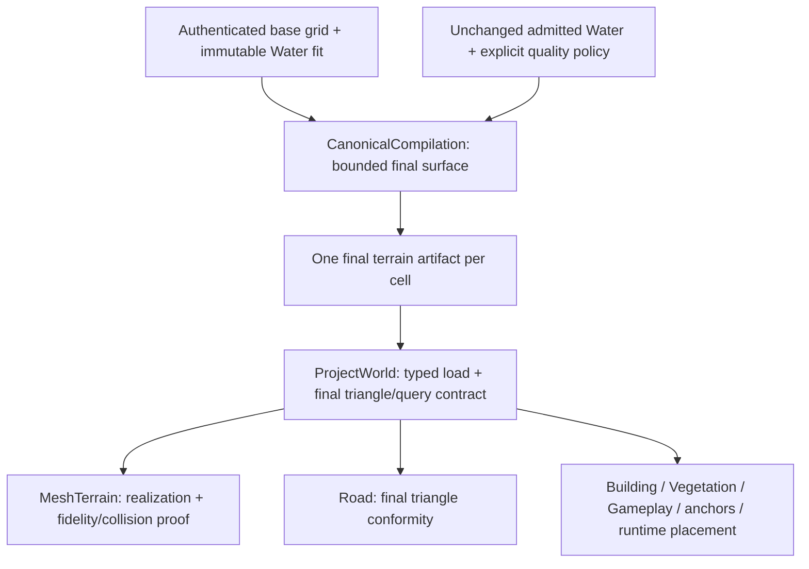

# Road and Water Alignment

**Status:** CURRENT - Q4 disposable constant-polygon refinement verified; production Water acceptance, I5/I6 and Q2/Q3/Q5 remain open
**Scope:** terrain/road/water geometric alignment, intersections, and layering  
**Release:** required 3.0.0 concern; release authority stays in the [release plan](00_release_3.0.0.md#authority-register)  
**Stable documentation owners:** [World territory contract](../../Plugins/World/ProjectWorld/docs/territory_contract.md), [World pitfalls](../../Plugins/World/ProjectWorld/docs/pitfalls.md), and the owner identified by the dedicated investigation

## Remaining work - residual Water correctness

**Marker:** IN PROGRESS under D11/D12 - constrained canonical refinement is the
selected investigation direction; low-confidence cases remain unchanged. The
[D12 implementation proposal](#d12-constrained-canonical-refinement---approved-disposable-scope)
is approved for disposable implementation by D13. Accepted production stays frozen; remaining policy and
exact output acceptance are not assumed complete.
**Starting evidence recorded:** 2026-10-15, in the earlier documentation-only
stub. D11 supersedes that timing. The knowledge below is the D45-D48 starting
point; the review record separately owns new investigation and implementation.

**Goal:** resolve the remaining Water overlap/shoreline defects in Kazan and
Manhattan without disturbing accepted materials or unrelated generated layers.

Known starting point:

- D45's dependency-local Road/Water rollout is accepted. D41's competing terrain
  renderer defect and D43's Building winding rollout stay closed.
- The retained detector qualifies 45 Water contacts in two selected cells:
  Kazan 21, Manhattan 24. Native replay matches 318 saved triangles and attributes
  the contacts to exact canonical features. These are not a global contact census.
  Of those contacts, 39 are strictly affine-equal horizontal contacts and six have
  unequal planes; equality does not establish source connectivity.
- The selected same-XY source chain already has terrain above Water in canonical
  data: 7.2047 m in Kazan, 2.9814 m in Manhattan. The latter Water provenance is
  low confidence. Eight broad-water controls have 0.25 m clearance. These source
  samples are not new compiled-collision measurements or accepted carving limits.
- Water's preparation-domain identity correction and output revision 3 pass
  focused native tests and recorded baselines. Production Water outputs still
  retain the prior accepted keys; owner-local revalidation remains outstanding.
- Evidence: `tmp/world/water_source_replay/`,
  `tmp/world/completion_d47/height-chain.json` and that run's `closure.json`.

Remaining work must establish:

1. Correct treatment of equal/unequal contacts, retaining unknown crossings rather
   than inferring bridges, connectivity or automatic merging.
2. The appropriate canonical coverage/terrain-representation correction, with
   explicit source-quality and distortion/cut/fill limits before terrain mutation.
3. Exact affected units, dependency closure, current-revision revalidation, rollback and
   visual/collision acceptance through existing owners and transactions.

The starting stub selected no algorithm. D11's bounded exact-horizontal correction
is recorded below; Q2 grading and Q3 ambiguous crossings
remain separate decisions. No blanket terrain lowering, hidden adapter shaping,
full regeneration or repeated Check/Matrix/cook is authorized by recording it.
Reuse the [Water pitfall](../../Plugins/World/ProjectWorld/docs/pitfalls.md#49-water-preparation-context-changes-output-without-dirtying-its-cell)
and [World layers](../../docs/testing/world_pipeline_layers.md) for ownership/proof.

Current coordination: BrownEarth's bounded city visual checkpoint is accepted
and frozen; remaining surfaces use isolated and transient city previews under
the presentation concern's current authority register. Its D43 Building-only
winding replacement is completed in both cities with retained canonical inputs
and unrelated layers. This is not road/water alignment acceptance or Concrete
material adoption; the native fallback collision residual is recorded there.
D44 adds a verified selected generated-consumer closure for Road/Water/Vegetation
to the existing transaction, with clean external Terrain dependencies. A real
changed Water fixture saves only its two mesh/actor pairs, scope and active set;
saved-child rejection restores all 196 prior files and cold no-op preserves 197
accepted files. Independent architect PASS closes this persistence/locality
boundary, not production alignment. Fresh Check and canonical-authority Matrix
pass; temporary Matrix generation is restored byte-for-byte to the 6754-file
post-D43 baseline. No production canonical compile runs. Presentation concern
D45 authorizes the prepared selected rollout: 306 Kazan and 247 Manhattan
Road/Water mesh/actor pairs update, with four scope entries advancing. Vegetation
is reevaluated without writes; Terrain, Buildings, canonical data and material
resources stay unchanged. Both cold no-ops and real city previews preserve all
6758 accepted files. Native saved-source counts match each producer's receipt.
Manhattan's source Water intersection pairs fall from 319 to 24; Kazan retains
21. D47 subsequently establishes exact emitted-triangle provenance for these
detector-qualified contacts, superseding the centroid-only candidate attribution.
Compatible-plane composition has no demonstrated regression. This closes the
authorized output rollout, not complete alignment or visual acceptance. Road
conformity increases source triangles about 2.7 times, requiring actual packaged
cost measurement. Water conditioning limits and nonconstant crossings remain
separate decisions. Evidence is retained with the presentation concern's D45 record.
D46's bounded diagnosis distinguishes 39 strictly affine-equal contacts from six
unequal contacts, with detector thresholds explicitly retained. Ten lattice-patch
probes measure conservative conditioning proposal costs, not observed intrusion
or accepted limits. D47's native replay matches all 318 source triangles in the
two selected cells and their saved world-space scan: Kazan ways `1290267745` /
`1290267747`, Manhattan ways `1448214217` / `605476565`, with `alis:osm:way:` IDs.
The 39 equal contacts are horizontal; six unequal contacts remain distinct.
Quality/crossing decisions still precede a new geometry algorithm or persistent
conditioning change. A native RED/GREEN proves a separate consumed-input defect:
other-cell preparation bounds can change local triangulation. Water hashing and
realization now share that context; the actual planner dirties affected Water
units without dirtying Terrain. The corrected keys and Water output revision 3
require one-time Water-only revalidation; prior-key cold no-ops do not prove that future boundary. No city
outputs change, and all 6758 accepted files retain their hashes. The presentation
concern owns the completed eight-arm packaged selected-resource comparison and
its independent architect PASS. Forty actual 1280x720 Graphics profiles do not
show a clear Road GPU regression in these selected scenes; they cannot close
whole-city GPU, streaming or gameplay acceptance or justify a speedup claim.
The subsequent existing both-city uncooked product-route replay accepts its
movement, sampled Terrain/Road/Building collision and streaming envelope with
unchanged source/modules/authority during the run. Native PIE frame-budget
receipts fail; packaged city performance and full collision fidelity remain open.
Presentation D48 subsequently closes delegated Concrete visual judgment and
material-only adoption on 312 Building meshes. Both cold no-ops retain exact
geometry identities; real saved-binding city captures pass for default concrete
massing. No Road/Water/Terrain/canonical package changes in that operation.
Apparent foundation gaps/dark shadows remain observations, not an attributed
Road/Water defect. Material acceptance does not close this concern's policies.
D47's subsequent ten-point same-XY source chain confirms selected canonical
terrain already exceeds saved Water by 7.2047 m in Kazan and 2.9814 m in Manhattan.
The Kazan mixed triangle has a high corner outside the footprint; the narrow
Manhattan feature lies between grid samples and retains low-confidence Water
provenance. Eight broad-water controls clear by 0.25 m. These are bounded source
measurements, not new compiled-collision evidence or a conditioning policy.
Keep this todo's correctness, water-policy and grading/
crossing gates separate; material screenshots do not accept geometry or trigger
canonical/World regeneration.

## Contents

- Goal - Authority register - Non-goals
- Verified evidence - Current architecture - Problem and root cause - Decision
- Required invariants - Investigation tasks - Proposed implementation - Test-first and verification plan
- [D12 constrained canonical refinement - approved disposable scope](#d12-constrained-canonical-refinement---approved-disposable-scope)
- Documentation plan - Completion criteria - Review record

## Goal

Make road and water surfaces meet terrain coherently at edges, crossings, and
intersections, without gaps, unintended overlap, or unstable coplanar layering.
Preserve correct geographic meaning, collision, and streamed cell continuity.
Judge whether roads appear coherently constructed on slopes and at junctions,
as well as whether their mesh heights match terrain. Exact drape alone may
preserve an implausible cross-slope; grading remains a candidate, not a requirement.

## Authority register

### Operator decisions

- **D1** Keep geometric alignment and layering separate from material presentation.
  - Reason: its implementation design is not decided yet.
  - Source: operator request, 2026-10-08.
- **D2 [SUPERSEDED IN PART by D5 - read-only investigation timing]** Create a current investigation todo now; agree on the material todo first,
  then conduct this dedicated investigation separately.
  - Reason: not stated.
  - Source: operator request, 2026-10-08.
- **D3 [SUPERSEDED IN PART by D5 - bounded read-only editor evidence]** This step is planning/documentation only; do not implement or run expensive
  verification. Development later uses owner-local tests, scratch previews, and
  focused integration.
  - Reason: avoid repeatedly rebuilding/cooking/regenerating the World for debugging.
  - Source: operator request, 2026-10-08.
- **D4** Audit the attached alignment review against actual code, architecture,
  project goals, and previous agreements; fix these todos and explicitly refute
  incorrect reviewer points.
  - Effect: revise this existing investigation, its presentation handoff, and release
    routing. This source audit does not approve an alignment implementation or
    supersede D2/D3's dedicated-investigation sequence and documentation boundary.
  - Reason: not stated.
  - Source: operator follow-up, 2026-10-08.
- **D5 [SUPERSEDED IN PART by D8 - Q1 implementation]** Update the todo and run the read-only editor investigation now.
  - Supersedes: D2's requirement to wait for material agreement before this bounded
    read-only investigation, and D3's documentation-only limit for this step.
  - Effect: source/candidate comparison and bounded editor geometry/visual evidence
    are authorized now. No implementation, saved asset changes, generation, broad
    gates, or release work is authorized; Q1 remains open.
  - Reason: not stated.
  - Source: operator answer to the scope question, 2026-10-08.
- **D6 [SUPERSEDED IN PART by D8 - Q1 implementation]** Continue investigation and prepare the existing todo for comprehensive
  realization, evaluating the supplied investigation-stage review.
  - Effect: additional owner-local read-only diagnosis and this implementation
    proposal; D5's no-implementation/no-generation boundary remains binding.
    Analytical controls of existing behavior are permitted; candidate geometry
    prototypes and changed algorithms remain behind Q1.
  - Reason: not stated.
  - Source: operator follow-up, 2026-10-08.
- **D7** Critically evaluate the attached simplification review against code,
  architecture, goals and prior agreements; apply valid in-scope corrections and
  explicitly refute incorrect points.
  - Effect: update this existing planning artifact. No Q1 implementation choice or
    asset mutation is approved by the review's proposed Q1-Q3 answers.
  - Reason: not stated.
  - Source: operator follow-up, 2026-10-08.
- **D8** Implement the accepted todo through implement-approved-change for the
  bounded Q1 correctness slice: small RED/GREEN fixtures and owner-local road
  conformity, consumed-input identity and water coverage.
  - Supersedes: D5/D6's no-implementation boundary for this bounded slice only.
  - Effect: Q2 grading and Q3 ambiguous crossing reconstruction remain deferred;
    persistent terrain mutation requires accepted water distortion/source-quality
    limits. No production geography promotion, whole-World rebuild or release work.
  - Reason: not stated.
  - Source: operator skill invocation and accepted alignment todo, 2026-10-08.
- **D9** Inspect reported widespread z-fighting through live Editor MCP and apply
  valid in-scope code/documentation fixes after reviewing D39 feedback.
  - Effect: bounded duplicate/intersection diagnosis and Water-owned constant-plane
    composition with focused fixtures. Preserve accepted materials, canonical inputs
    and city output authority. No new grading, crossing law, terrain-conditioning
    limits, persistent geometry rollout or broad pipeline is inferred.
  - Source: operator follow-up, 2026-10-13.

- **D10** Investigate terrain flicker with short PIE camera movement and fix the
  demonstrated owner-local defect.
  - Effect: reversible near/far rendering controls, Mesh Terrain authoring/runtime
    lifecycle correction and focused native proof. Preserve accepted material
    recipes, all canonical and city output bytes, and the separate Water rollout,
    nonconstant crossing and terrain-conditioning gates.
  - Source: operator follow-up with D40 reviewer attachment, 2026-10-13.

- **D11** Execute the remaining work in one coordinated pass toward moving the
  completed concerns to done.
  - Effect: investigate the retained stub, implement independently justified
    owner-local correctness, prepare measured shoreline alternatives and verify
    the actual consumers. No missing numeric conditioning/source-quality or
    ambiguous-crossing choice is inferred; do not close unresolved criteria by
    changing their meaning. Preserve accepted art and unrelated generated owners.
  - Source: operator "do all remaining in one pass to move todo to done",
    2026-10-15. Supersedes the preceding stub-only timing for this work.

- **D12** Investigate constrained canonical terrain refinement; preserve
  low-confidence cases until their policy is resolved.
  - Effect: investigate the canonical representation, native implementation
    capabilities, bounded influence and exact consumer/neighbor closure. This
    selects the investigation direction, not numeric distortion limits, source-
    quality promotion or persistent terrain mutation. D8's quality boundary stays.
  - Reason: not stated.
  - Source: operator's explicit answer to the shoreline-direction question,
    2026-10-15.

- **D13** Approve Q4's disposable implementation of the sparse canonical terrain
  representation and affected query contract in one-quad/two-cell fixtures.
  - Effect: implement and verify the reviewed D12 boundary. Existing city assets,
    production canonical authority and low-confidence cases stay unchanged. Q5's
    production quality decision remains open.
  - Reason: not stated.
  - Source: operator's explicit answer "Approve disposable implementation",
    2026-10-15.

Release inclusion, the historical R5, final frozen R5/R6, and unchanged performance
policy are owned by release-plan D19-D22, not this investigation.

### Operator gates

- **Q1 [CLOSED by D8 - bounded correctness only]:** What implementation should be approved after the dedicated
  investigation identifies the defect and owning boundary? Gates implementation only.
  No alignment design is endorsed by creating this file.
- **Q2 [OPEN - BLOCKING for road grading]:** What derived road crossfall/longitudinal
  grade, maximum cut/fill, corridor/transition extent, and canonical surface contract
  should be accepted? Existing source heights/widths do not supply a road-design law.
  Gates grading prototypes and production changes, not the read-only diagnosis.
- **Q3 [OPEN - BLOCKING for ambiguous crossings]:** Should available source crossing
  metadata be admitted through the existing canonical/typed contracts, or should
  ambiguous crossings be explicitly excluded/refused? Do not invent ordinary
  junctions, bridge clearance, or tunnel elevations from XY overlap alone.
- **Q4 [CLOSED by D13 - disposable implementation only]:** Approve the versioned sparse
  final-surface representation, bounded query contract and disposable canonical/
  adapter experiment proposed below? D12 selects investigation, not this contract
  change. Existing Q1 correctness approval does not approve a representation migration.
- **Q5 [OPEN - BLOCKING for persistent terrain conditioning]:** Which source-accuracy
  classes and numeric maximum cut/fill, changed dry-bank extent, bank gradient,
  continuity/clearance and topology-cost limits are acceptable for each admitted
  use? This records D8's retained production-quality boundary; Q4 fixtures cannot
  supply operator acceptance. D12 excludes low-confidence cases until resolved.

Q2/Q3 do not block Q1-approved independent road-consumption/identity and water-
coverage fixtures outside ambiguous crossings. Water terrain mutation has its own
source-quality and distortion acceptance before persistent promotion; it must not
borrow a road grade law. The following are proposals, not closed gates:

| Gate | Proposed resolution for operator review |
|---|---|
| Q1 | Accepted by D8 for staged owner-local correctness fixtures: road full-surface consumption and bounded tangent/neighbor identity, plus independent canonical water coverage. Representative integration and policy acceptance remain required before persistent production output or a representation migration. |
| Q2 | Keep grading optional and separate. A named paved-road visual fixture may compare about 2% normal crossfall only after explicit prototype/input approval. Accept road-class/source-quality-specific longitudinal, transition and cut/fill limits before persistent grading; report infeasible segments. |
| Q3 | Admit available bridge/tunnel/layer/ford distinctions through existing source/canonical/typed seams. Preserve authenticated node connectivity only where present; otherwise keep connectivity unknown. Exclude/report ambiguous features from automatic merging/grading while unrelated correctness proceeds. |

The roughly 2% reference comes from [FHWA's tangent-pavement cross-slope guidance](https://highways.dot.gov/field-offices/missouri/interchange-design-promptlist).
It is not an ALIS surveyed fact, a universal road-class rule, or proof that an admitted
road is paved. [OSM's layer guidance](https://wiki.openstreetmap.org/wiki/Key:layer)
describes crossing order, not metric elevation; coincident XY is not shared-node identity.

### Working assumptions

- **A1 [ACTIVE]:** The reported concerns can be diagnosed using existing maps and a
  small representative fixture before any production geography is regenerated.
- **A2 [ACTIVE]:** Surface color/reflection may make an intersection look wrong;
  final attribution must compare geometry/depth with lit presentation.
- **A3 [SUPERSEDED IN PART by D8]:** Conformity is approved for Q1 owner-local
  fixtures. Bounded feature-driven shaping remains conditional on Q2 and is not
  an automatic second phase.
- **A4 [ACTIVE - proposal, not authority]:** A single versioned final-surface
  artifact per refined cell, using the pinned GEOS native kernel and complete-quad
  query domains, is the smallest viable D12 experiment. It remains conditional on
  Q4 and the refusal/locality proofs below; numeric production policy stays Q5.

## Non-goals

- Shader, texture, palette, roughness, or default-material changes.
- Unapproved grading or crossing reconstruction, a WaterBody system,
  mesh-layering framework, or additional geometry authority.
- Full territory regeneration, packaging, or publication as an investigation step.

## Verified evidence

### Reported concerns before the bounded editor probe

- The operator reports terrain/road and terrain/water alignment concerns, including
  intersections and layering. The probe below establishes four local ordering
  counterexamples; junctions, seams, and broader failure categories remain open.
- The supplied proposal mentions shoreline intersections, z-fighting, and mesh layering
  as separate work. Those descriptions do not prove a current defect in either city.

### Verified repository facts

- [Shared terrain sampling](../../Plugins/World/ProjectWorld/Source/ProjectWorldEditor/Private/ProjectWorldGeneratedGeometry.cpp)
  uses bilinear interpolation and clamps queries to the current cell's core grid.
  [Mesh Terrain construction](../../Plugins/World/ProjectWorldMeshTerrain/Source/ProjectWorldMeshTerrainEditor/Private/ProjectWorldMeshTerrainProducer.cpp)
  authors triangles A,C,B and B,C,D per quad. These are different surfaces on a
  non-planar quad. Analytical control: A=B=C=0 m, D=10 m gives 2.5 m bilinear
  height at the center but 0 m on the shared B,C diagonal. This proves a source-model
  mismatch, not its severity on a loaded city's compiled/rendered/collision surface.
- [Road construction](../../Plugins/World/ProjectWorld/Source/ProjectWorldRoadEditor/Private/ProjectWorldRoadRealization.cpp)
  subdivides centerline segments to a configured maximum, samples endpoints, and
  assigns each endpoint height to both lateral edges. Even a planar cross-slope
  can therefore put one edge below terrain and the other above it. Its offset is
  added to height (vertical Z), not applied along a surface normal. Current
  [Kazan](../../Plugins/World/ProjectWorldData/Data/Profiles/Realization/kazan_territory_v1.realization.json)
  and [Manhattan](../../Plugins/World/ProjectWorldData/Data/Profiles/Realization/manhattan_showcase_v1.realization.json)
  recipes set 0.15 m and 7.5 m, `terrain_drape`, `overlap_same_owner`, Nanite, and
  complex-as-simple collision. Recipe values must be authenticated against the
  loaded map/realization receipt before attributing a reported symptom to them.
- The [road producer](../../Plugins/World/ProjectWorld/Source/ProjectWorldRoadEditor/Private/ProjectWorldRoadLayerProducer.cpp)
  declares a one-cell terrain dependency halo. The existing
  [dirty planner](../../Plugins/World/ProjectWorld/Source/ProjectWorldEditor/Private/ProjectWorldRealizationProfile.cpp)
  propagates dependency dirty units through that halo. This does not make the
  road builder sample adjacent terrain: its current sampler clamps at cell edges.
  Any new neighbor consumption needs authenticated inputs and output identity,
  as well as closure tests; halo declaration alone is not a conformity proof.
- `SampleTerrain` is shared by buildings, vegetation, gameplay placement,
  [anchor placement](../../Plugins/World/ProjectWorld/Source/ProjectWorldEditor/Private/ProjectWorldAnchorPlacement.cpp),
  and [runtime route/anchor realization](../../Plugins/World/ProjectWorld/Source/ProjectWorldEditor/Private/ProjectWorldRuntimeRealization.cpp).
  A global interpolation change would affect these consumers too. The dedicated
  investigation must choose an explicit surface contract and consumer scope;
  a road fix must not silently change their elevations or depend on a private
  Mesh Terrain implementation helper.
- [Water/terrain pitfall 28](../../Plugins/World/ProjectWorld/docs/pitfalls.md#28-a-visible-water-surface-can-still-z-fight-with-terrain)
  documents a previously fixed vertical-order defect and its canonical clearance owner.
  A reflective material did not fix it; a constant offset could not cover arbitrary
  terrain intrusion. Read the existing guard before proposing another correction.
- [Canonical terrain finalization](../../tools/World/CanonicalCompilation/app/terrain_surface.py)
  lowers covered terrain samples using canonical water height and clearance, then
  applies authored patches and rejects a sampled clearance violation. It handles
  water footprint membership and holes; it does not establish continuous clearance
  over every intersecting terrain/water triangle. The current
  [Kazan compilation recipe](../../Plugins/World/ProjectWorldData/Data/Profiles/CanonicalCompilation/kazan_territory_v1.compile.json)
  specifies 30 m sample spacing and 0 m clearance. The realization recipes above
  specify a 0.25 m water lift. These are recipe inputs, not newly measured map state.
- [Water mesh construction](../../Plugins/World/ProjectWorld/Source/ProjectWorldWaterEditor/Private/ProjectWorldWaterMeshBuilder.cpp)
  uses native polygon offset/intersection and constrained Delaunay triangulation.
  It prepares feature/domain triangles, then clips them to cells and evaluates
  heights at the resulting vertices. Standing height is fixed; flowing height is
  quantized nearest-centerline-segment knot interpolation. Actual triangle interiors,
  clipped vertices, seams, and holes must be compared with terrain, not merely
  checked independently. Water remains non-Nanite and has no collision.
- [Territory contract](../../Plugins/World/ProjectWorld/docs/territory_contract.md#layered-regeneration-contract-scale-out-precondition)
  separates canonical water elevation from a bounded realization surface offset.
- The [admitted typed feature](../../Plugins/World/ProjectWorld/Source/ProjectWorldEditor/Public/ProjectWorldCanonicalBundle.h)
  has road class, width, and XY geometry but no bridge/tunnel/vertical-layer field.
  This does not prove upstream sources lack those semantics. Trace raw admission,
  canonical normalization, and realization before proposing crossing behavior.

### Reviewer corrections and remaining hypotheses

- Accept the source-supported road interpolation and full-width test targets.
  Refute the reviewer's "normal offset": the code adds vertical height.
- A narrow water footprint between terrain lattice samples may be occluded despite
  correct sampled lowering. This is a plausible hypothesis, not an established
  cause of the reported blue areas. No screenshot was supplied in this follow-up;
  the reviewer's visual attribution cannot substitute for matched depth evidence.
- Same-owner overlap is a policy, not proof of clean junctions. A declared halo is
  not proof of neighbor sampling. Test both before designing corrections.
- Refute the closing suggestion that this todo becomes CURRENT/required only after
  approval: release D19 already made it required. Reviewer recommendations neither
  approve implementation nor establish a road-only mutation envelope for a shared fix.

The earlier source-only audit inspected recipes and existing test assertions, and checked the
analytical non-planar/control arithmetic. No production regression test, alignment
capture, map clearance measurement, or runtime experiment ran during that audit.
The separately authorized editor probe is recorded below; a source-model
counterexample alone is not real-map acceptance evidence.

### Production references and their limits

- [Erwin Heyms's first-person Wildlands production account](https://80.lv/articles/procedural-world-building-in-ghost-recon-wildlands)
  describes turning a road network into terrain heightmaps, materials, and masks.
  It supports testing infrastructure-driven terrain integration. Its designer-led
  road pathfinding is not authority to redirect ALIS's reconstructed road network.
- [Epic's UE 5.8 City Sample PCG](https://dev.epicgames.com/documentation/unreal-engine/city-sample-pcg-for-unreal-engine)
  solves junctions and partially levels terrain in its roads stage, retriggering
  terrain consumers. Its default demo has streaming disabled and generated actors
  require partitioning. Study geometry/grade decisions, not its generation graph
  or default streaming configuration as an ALIS replacement.
- These examples motivate A3; they do not prove Level B fixes ALIS's reported
  defects. ALIS already has canonical water-driven terrain conditioning. The new
  question is whether its existing surface contract needs bounded road grading
  or finer water coverage, not whether to introduce a second terrain authority.
- [Terrain elevation acceptance](../../Plugins/World/ProjectWorld/docs/territory_contract.md#terrain-elevation-acceptance)
  checks compiled Nanite/fallback samples against canonical elevations and separately
  proves collision. The canonical water seam above requires the adapter to realize
  the immutable final surface. An adapter-only grade change with unchanged input
  identities cannot truthfully retain those fidelity claims.
- Reviewer boundary correction: Level B cannot remain entirely inside the Road,
  Water, and Mesh Terrain adapters while retaining today's canonical contract.
  Changing final terrain elevations also involves the canonical terrain owner and
  its accepted provenance/fidelity contract. Keep native engine dependencies in the
  terrain adapter; this does not justify moving geographic authority there.

### Bounded read-only editor evidence - 2026-10-08

Scope: the existing Kazan territory map, cells `grid_413718bc833994e5:x1:y0`
and `grid_413718bc833994e5:x1:y1`, four loaded source-LOD meshes, eight
owner-isolated vertical collision traces, and four fixed lit captures. No candidate
was implemented. This is partial T0/T1 evidence, not full investigation acceptance.

- Configured launcher engine: 5.8.3. The live map and georeference were queried:
  `/ProjectWorldData/Generated/Territory/L_ProjectWorldKazanTerritory`,
  EPSG:32639, projected origin `(381409, 6185051)`, vertical origin `0 m`.
- The current active bundle was authenticated by size and SHA-256:
  `995fb0fb1d6550925efaf55111a6936e600658d0b9cb3938461a3e6cac47b8dc`;
  authority `kazan_territory_v1:75b8eefd6a99e53ff0db65ad9efaccf029759bd098dbe5e4b8e8651565a287b8`.
  Its georeference matches the live map. This authenticates current inputs, not
  identity with the historical frozen R5 artifact.
- Read the existing meshes through native `StaticMeshDescription`, resolving each
  triangle's three vertex-instance IDs to validated vertex IDs. Compare vertices,
  triangle centroids, and edge midpoints with the owning cell's canonical A,C,B /
  B,C,D terrain surface. 36,752 samples were inside the cells; 82 road samples
  outside their owning cell were excluded, not silently clamped or counted as safe.
  Sampling is diagnostic and does not certify continuous clearance.

Negative clearance below is feature height minus terrain height at the same XY.
Coordinates are Unreal world centimeters; values identify the selected diagnostic
point, not a global minimum. Terrain traces hit `MeshPartitionEditor.PreviewMeshComponent`;
road-only traces independently hit the corresponding generated road mesh.

| Feature / cell | Diagnostic world XY (cm) | Feature Z (cm) | Terrain preview collision Z (cm) | Signed clearance (m) |
|---|---|---|---|---|
| Road x1:y0 | 14061.723, -929.068 | 7941.382 | 8146.826 | -2.0544 |
| Road x1:y1 | -37006.920, -66654.362 | 5615.460 | 5780.483 | -1.6502 |
| Water x1:y0 | 7451.500, 68945.000 | 5555.000 | 5832.325 | -2.7733 |
| Water x1:y1 | -39015.000, -64159.000 | 5025.000 | 5745.470 | -7.2047 |

The road points are triangle edge midpoints. Water x1:y0 is an edge midpoint;
water x1:y1 is a vertex. Water has no collision; its Z comes from the loaded source
mesh, compared with terrain-only collision. Terrain preview hits agree with the
canonical triangle model at these points; this is not packaged/Nanite collision proof.

Fixed 1280x720 oblique captures show interrupted road ribbons and exposed water
fragments among terrain in these neighborhoods. They support investigating geometry
ordering independently of materials; they do not isolate ordinary junction defects,
z-fighting, or the exact contribution of bilinear sampling versus lateral-edge heights.
The native capture receipt reports all 210 terrain subjects drawn and none pending.
Plan/image hashes were checked. The repeat-pose hash differs (temporal state), so these
images are diagnostic views and do not satisfy a deterministic visual gate.

Reproducible local record: `tmp/world/alignment/production-comparison-20261008/`.
`dumps/editor_mesh_read.py`, `dumps/analyze_source.py`, and `dumps/editor_traces.py`
produce `receipts/source-clearance.json` and `receipts/editor-traces.json`;
`dumps/vantages.json` records the exact poses for `ProjectWorld.CaptureEvidence`.
`receipts/capture.json`, `screenshots/`, and `receipts/editor.log` retain the terminal
capture evidence. These disposable diagnostics are not future test inputs or release
authority; the identities, points, measurements, and limitations are recorded above.

No dirty content/map packages were reported before capture. The agent-owned editor
exited normally without saving. Before/after SHA-256 inventories prove all 3,739 files
under ProjectWorldData Data/Content and ProjectMaterial/ProjectTexture Data/Content
are unchanged, with no additions or removals (`receipts/no-mutation.json`).
No PIE, World regeneration, canonical compilation, broad rebuild, cook, or release
gate was run. Manhattan, continuous clearance, seams, semantic crossings, junction
construction, neutral/depth views, and A/B grade/transition quality remain unverified.

### Continued diagnosis and feature attribution - 2026-10-08

Read-only scope: the same two Kazan cells, two Manhattan cells (`x1:y0`, `x1:y1`),
their required neighbor terrain, existing production calculations on disposable
in-memory inputs, and saved source-LOD geometry. No A/B geometry prototype was made.

Current Manhattan authority is
`manhattan_showcase_v1:22db753ab53d21e6355633bc3e0b4d1424549a87e50736b2a6bacd0988b98c40`,
bundle SHA-256 `84b0b6be76427baf31b0087d91e5f88c66cf9237a776acbf59cb92587e032067`.
The live map was `/ProjectWorldData/Generated/Showcase/Manhattan/L_ProjectWorldManhattanShowcase`;
its EPSG:32618 origin is `(585628, 4511322, 0)`.
Both bundles were authenticated by size/hash. Six active road/water/terrain manifests
match their current compile receipts and realization-profile byte hashes; all 2,166
listed artifact byte digests match saved files. Four road unit-input hashes and actor
semantic tags independently match the current canonical features/settings.
This is current-state authentication, not a replay or release gate.

#### Road - first failing calculations

Reconstructing the existing source arithmetic, including local float32 storage,
reproduces all 14,472 road triangles in the four sampled meshes with zero coordinate
delta. This rules out stale road output relative to those authenticated inputs in
these four cells. Terrain preview collision agrees with the triangle surface at the
queried points. It does not establish universal terrain/render/collision correctness.

The builder first substitutes a bilinear surface for the consumed terrain triangles,
then copies each centerline endpoint height to both lateral edges and linearly spans
segments. Both errors contribute; changing interpolation alone is insufficient.
The decomposition below is exact source arithmetic at the selected saved-mesh point:
`clearance = (bilinear - triangle) + lateral/segment error + 0.15 m lift`.

| Map / cell | Canonical road feature | Bilinear minus triangle (m) | Lateral/segment error (m) | Source-mesh clearance (m) |
|---|---|---|---|---|
| Kazan x1:y0 | alis:osm:way:124954339 | -1.1217 | -1.0828 | -2.0544 |
| Kazan x1:y1 | alis:osm:way:195408844 | -1.3594 | -0.4409 | -1.6502 |
| Manhattan x1:y0 | alis:osm:way:5671393 | +0.0007 | -4.6183 | -4.4676 |
| Manhattan x1:y1 | alis:osm:way:195743208 | -2.9459 | -2.7321 | -5.5280 |

Manhattan point XYZ in projected meters: x1:y0
`(585513.106328, 4510602.427891, 62.794041)`; x1:y1
`(585212.744663, 4511611.720859, 36.555161)`.
Terrain-only traces give 67.261659 m and 42.083198 m respectively. At x1:y0,
road-only collision agrees with the selected road. At x1:y1 it first hits a different
overlapping road, `alis:osm:way:1051750427`, at 39.311881 m: 2.756720 m above the
selected saved ribbon and 2.771317 m below terrain. The selected lower ribbon height
there is source-LOD evidence, not an isolated collision result.
This proves multiple road elevations at that XY; it does not prove an ordinary
junction or justify collapsing a bridge/tunnel. The current
[road canonical adapter](../../tools/World/CanonicalCompilation/app/adapters.py)
retains class, inferred width, and name, not bridge/tunnel/layer attributes; the
provider-preserving source adapter retains properties. Q3 owns that unresolved scope.

All 82 previously excluded Kazan road samples are now evaluated against their proper
neighbors: 56 from x1:y0, 26 from x1:y1, across eight distinct neighbor cells.
Their clearances range from -0.6537 to +1.0437 m and -0.8989 to +0.4661 m respectively.
All 82 terrain-only preview collision queries hit; their maximum difference from the
neighbor triangle model is less than 0.000001 cm. Four original-point rechecks also
agree. No out-of-cell sample is treated as safe by clamping.
The two Manhattan meshes have a further 309 out-of-cell samples, all analytically
assigned to authenticated neighbor terrain; they have not all had live collision probes.

The current [road unit hash](../../Plugins/World/ProjectWorld/Source/ProjectWorldRoadEditor/Private/ProjectWorldRoadRealization.cpp)
includes local fragment parts but omits the full feature geometry consumed by
`RoadTangent`. A source-arithmetic control keeps fragment `(0,0)->(10,0)` unchanged
and rotates its continuation: endpoint tangent changes from `(1,0)` to
`(0.707107,0.707107)` while the fields hashed by this unit remain unchanged.
This is a latent consumed-input identity gap, not the demonstrated cause of today's
road heights. Repair it alongside any new neighbor consumption; do not depend on
broader regeneration to cover it.

#### Water - sample coverage versus continuous surface

The selected water triangles' three vertex heights match the corresponding canonical
function, quantization, and 0.25 m lift (maximum difference below 0.000001 m).
Terrain preview collision matches canonical triangle interpolation at each selected
point. For these points the first demonstrated gap is canonical finalization's
lattice-point coverage, not a stale water height or displaced terrain preview.

| Map / cell | Canonical water feature | Function height (m) | Mesh height (m) | Terrain triangle height (m) | Covered quad corners / 4 |
|---|---|---|---|---|---|
| Kazan x1:y0 | alis:osm:relation:3974314 | 55.3 | 55.55 | 58.32325 | 1 |
| Kazan x1:y1 | alis:osm:relation:7493502 | 50.0 | 50.25 | 57.45470 | 2 |
| Manhattan x1:y0 | alis:osm:way:576035677 | 17.8 | 18.05 | 21.03140 | 0 |
| Manhattan x1:y1 | alis:osm:way:702073775 | 24.0 | 24.25 | 26.02780 | 0 |

Kazan's examples are flowing polygons, not narrow ribbon features. Manhattan's are
standing polygons with `low_confidence_point_fallback` height provenance. Their
fitted heights are declared derived inputs; these results do not prove surveyed
water levels or justify refitting them from already-shaped terrain.
Manhattan water points are `(585468.69,4510677.71)` and `(585752.11,4511942.79)`.

An existing-finalizer control uses a flat 12 m, 30 m terrain quad and a constant
10 m water function. A 3 m ribbon at Y=15 m covers no lattice corners; the production
`finalize_terrain_cells` returns normally, leaving terrain 1.75 m above water including
its lift. A 100 m wide control lowers corners to 10 m and gives +0.25 m clearance.
This exercises current production code on in-memory fixture data, not a candidate
algorithm or generated geometry. It establishes the sample-only invariant gap.
Continuous clearance must also cover polygon banks, holes, sloping functions,
quantization, authored patches, and final clipped water-triangle interiors; selected
vertex agreement does not exonerate the water leaf for those other cases.

#### Conformity versus constructed road geometry

Source-only predictions sample the current terrain triangle heights at both ends
and both lateral edges of each attributed road segment. Maximum cross-slope ratios
are 27.9%/32.1% for the Kazan examples and 58.1%/118.0% for Manhattan; selected
centerline longitudinal ratios are 27.2%/14.5% and 42.4%/16.3% respectively.
These are terrain-conformity predictions, not surveyed road grades or prototype
results. They demonstrate why exact conformity alone cannot be assumed to meet
the agreed constructed-appearance goal. Q2 must establish the derived design limits.

Four Manhattan lit captures were hashed and reviewed. Three show terrain/water or
fragmented-road context; `manhattan_road_x1_y0.png` is obstructed by a building and
is excluded from visual conclusions. The native receipt's accepted capture status
does not certify framing or visibility. Repeat-pose hashes differ; no deterministic
visual gate, neutral/depth proof, or packaged proof is claimed.

Receipts and exact coordinates/poses/scripts remain under
`tmp/world/alignment/owner-diagnosis-20261008/`: `receipts/*-attribution.json`,
`road-unit-authentication.json`, `manifest-authentication.json`,
`controls-and-grades.json`, `kazan-neighbor-traces.json`, `manhattan-traces.json`,
and `manhattan-capture.json`, with dumps/screenshots in separate directories.
Disposable diagnostics are not permanent test inputs. Both agent-owned editors
exited normally without saving; dirty package lists are empty. All 3,739 protected
files remain byte-identical, with no added/removed paths.

## Current architecture and source of truth

Start at [World territory generation](../../Plugins/World/ProjectWorld/docs/territory_generation.md).
Follow the owning source/canonical or leaf contract after measuring the failing
representation. Keep these existing black boxes:

| Owner | Responsibility |
|---|---|
| ProjectWorldData / CanonicalCompilation | Concrete geography/provenance and canonical footprints, elevation functions, terrain samples, and admitted semantics |
| ProjectWorld | Shared coordinates/representation contracts, dependency identity, orchestration, and transaction |
| ProjectWorldRoadEditor | Road ribbon construction, drape, intersections, meshes, and collision |
| ProjectWorldWaterEditor | Water preparation, clipping, triangulation, elevation consumption, and meshes |
| ProjectWorldMeshTerrain | Realized terrain topology, compiled sections, and terrain geometry adapter |
| ProjectTexture / ProjectMaterial | Appearance; never geographic elevation, alignment, or geometric truth |

Expected change in this phase: this investigation record only. Production code,
profiles, generated World/canonical packages, Material/Texture outputs, and release
artifacts remain untouched. Declare a narrower CHANGED/UNTOUCHED boundary only after
the investigation identifies the cause.

## Problem and root cause

Localized causes: road bilinear-versus-triangle consumption plus endpoint height
reuse across width/segments; water finalization's sample-only footprint coverage.
Saved road geometry/current inputs and terrain preview agree in the sampled chain.
Full junction/crossing classification, continuous final-water approximation, visual
acceptance, and a grading law remain open. A latent road tangent-input identity gap
must be repaired in the implementation's consumed-input closure.

## Decision

### Simplification review - source-grounded assessment

- Accept the sequencing correction: I0 incorrectly made Q2/Q3 prerequisites for all
  implementation. Independent correctness fixtures need Q1; grading and ambiguous
  crossing reconstruction retain their own gates. The proposed resolutions above
  remain operator proposals, not authorizations from reviewer text.
- Accept triangle-intersection extrema as the continuous height oracle for finite,
  nondegenerate triangles that are height functions over XY. This is exact in the
  planar model, not an exact-arithmetic or compiled-collision guarantee. Coverage,
  holes, missing triangles, degenerate/vertical projections and seam contacts need
  explicit controls; otherwise an empty intersection can falsely pass.
- Accept bounded tangent context as the preferred identity repair. Current
  RoadTangent's whole-feature averaging/fallback must change with that consumption;
  locally hashing its unchanged global reads would preserve the defect.
- Accept separate water quality/distortion acceptance. Manhattan's low-confidence
  examples have 2.9814 m and 1.7778 m intrusion. The 7.2047 m example is Kazan's
  flowing polygon, not Manhattan's low-confidence standing-water case. None of
  those gaps alone authorizes equivalent terrain carving or proves surveyed levels.
- Confirm [terrain-cell-v2](../../tools/World/CanonicalCompilation/contracts/terrain-cell.schema.json)
  has regular-grid core/halo heights and no constrained-triangle field; the
  [typed terrain](../../Plugins/World/ProjectWorld/Source/ProjectWorldEditor/Public/ProjectWorldCanonicalBundle.h)
  agrees. Breaklines/refinement are conditional representation candidates, not a
  requirement or an adapter-only shortcut. A coarse grid can obtain clearance by
  lowering support vertices, but may fail the accepted distortion policy.
- Confirm SourceIngestion preserves exported geometry/properties and canonical
  road admission drops the crossing tags. Its normalized record has no explicit
  original-node connectivity field. Available tags should be preserved through
  the existing seam if Q3 selects admission; shared-node identity remains unknown
  until authenticated source evidence proves it. Do not manufacture connectivity.

### Recommended sequence

Recommendation: staged correctness first. Fix Road's full-ribbon triangle/neighbor
consumption and consumed-input identity; independently correct continuous water
coverage in the canonical final-terrain owner. Compare grading only where corrected
conformity still fails constructed appearance. The predicted extreme terrain grades
justify that comparison, not mandatory grading in the correctness slice.
Q1 gates correctness implementation; Q2 gates road grading and Q3 gates ambiguous
crossing work. All remain open. A water-quality/distortion policy is required before
persistent conditioning; numerical limits are not invented from the measured gaps.
No general compositor, selected topology, prototype or production mutation is approved.

Compare a narrower road surface-sampling contract with a deliberately shared one;
the latter needs evidence for every affected placement consumer. Evaluate bounded
edge sampling/subdivision only if it resolves the measured error, including triangle
interiors; matching a few vertices alone does not prove whole-ribbon clearance.
For water, compare existing-owner input/topology corrections before any modifier
stack. Native [Mesh Terrain](https://dev.epicgames.com/documentation/unreal-engine/mesh-terrain-in-unreal-engine)
and [local remeshing](https://dev.epicgames.com/documentation/unreal-engine/API/Plugins/MeshPartitionEditor/URemeshModifier)
are experimental options, not an approved fix. Validate configured-engine behavior,
influence/section extent, triangle coverage, determinism, and lifecycle before
selecting one. No WaterBody migration or independent elevation authority is implied.

### Conformity versus feature-driven shaping

| Candidate | Owning boundary and moving parts | Capability given up / selection condition |
|---|---|---|
| A - Conform-only | Correct terrain-surface consumption and complete road-ribbon approximation in existing owners; no terrain grade contract or new lifecycle | Gives up grading/bank shaping. First controlled candidate; accept only if geometry and constructed appearance meet the agreed goal |
| B - Bounded feature-driven shaping | Accepted canonical road/water geometry drives derived local grade/channel intent through the existing canonical terrain owner; native modifiers may implement the accepted representation inside the terrain adapter | Adds a derived-surface contract and terrain/consumer invalidation cost. Compare seriously if A cannot meet measured grade/clearance/appearance needs; not an automatic phase |
| C - General terrain composition | New overlay/compositor framework, broad dependency graph, and authoring/runtime lifecycle | Outside demonstrated 3.0.0 need; exclude instead of creating speculative machinery |

For B, first evaluate reuse of canonical terrain finalization and its existing
water-fit/authored-input authority. Preserve admitted road XY, class, width, source
provenance, water footprints/functions, and available crossing distinctions. Label
inferred grading as derived geometry, not surveyed elevation or new source facts.
Define the final surface's one owner, version/hash, derivation, baseline-versus-final
height evidence, geometry/collision expectations, and dependency closure before Q1.
Do not silently shape terrain in the adapter while claiming unchanged canonical
fidelity. A representation-contract extension requires explicit design acceptance.

Keep the flow acyclic: canonical features plus authenticated terrain inputs ->
final derived terrain -> road/water realization and other placement consumers.
Do not derive terrain from already-realized road meshes that depend on that terrain.
Do not independently refit canonical water elevation from newly shaped output.
No Houdini, global PCG, Geometry Scripting orchestration, or modifier-authority
framework is needed merely to compare these two candidates.

## Required invariants

1. One canonical geographic authority and one active terrain realization owner.
2. No presentation parameter becomes an independent road/water elevation authority.
3. Preserve road width/class/XY/provenance, water footprints/holes/elevation meaning,
   coordinate/quantization rules, and admitted crossing semantics.
4. Read-only investigation leaves generated/canonical path/hash sets unchanged.
5. Preserve front-facing winding, normals/tangents, road collision, water no-collision,
   cell ownership, and streaming. Existing verification must be extended where it
   does not measure the proposed contract.
6. Changed-input identity covers every consumed terrain cell/representation. Bound
   dirty closure, output count, topology growth, and cost; preserve unaffected bytes.
7. An approved mutation uses the owning promotion/transaction route, is deterministic
   and idempotent, and restores exact protected state on refusal/injected failure.
8. Derived grading/topology has explicit provenance and an authenticated final-surface
   contract. Canonical-to-realized fidelity remains truthful and dependencies acyclic.

## Investigation tasks

D5 permits the bounded read-only editor investigation now; Q1 still gates changes:

T0-T3 have the diagnosis evidence above. D8 permits Q1 owner-local correctness
fixtures in T1/T2/T4; grading and crossing prototypes remain behind Q2/Q3.

- [ ] **T0 - Existing-map diagnosis, no persistent mutation:** authenticate Kazan and
  Manhattan map/canonical/realization identities. Locate representative feature IDs,
  owning cells, source ribbons/polygons, and loaded actors. Record canonical samples,
  compiled/rendered/collision terrain, road/water surfaces, signed clearances across
  complete footprints, coverage, bounds, and depth ordering. Compare matched lit and
  neutral/depth ground/oblique/overhead/cell-edge views. Classify source absence,
  occlusion, sampling, topology, seams, streaming, or appearance. Put captures and
  receipts separately under `tmp/world/alignment/<run>/`. Do not save World changes.
- [ ] **T1 - Road candidate proof:** reproduce non-planar and planar controls in the
  existing fixture infrastructure; compare the authored triangle diagonal with actual
  Mesh Terrain output. Test full-width cross-slope, steep/diagonal segments, bends,
  cell-edge clamping, and junction overlaps. Derive tolerances from the consumed
  surface/collision contract. Compare narrow versus shared sampling scope, neighbor
  inputs/identity, bounded subdivision, and topology alternatives against measured
  footprint error. Preserve admitted width/XY/provenance; do not increase a global
  offset to conceal mismatch. No road correction is approved by this task list.
  Judge lateral/longitudinal grade and terrain transitions in fixed views: does
  exact drape look constructed, or just reproduce an implausible ribbon accurately?
  Assess ordinary junction topology/overlap separately; sampling cannot alone prove
  a coherent intersection. Keep inferred design choices distinct from sourced facts.
- [ ] **T2 - Water candidate proof:** test a narrow ribbon entirely between terrain
  lattice samples, plus a broad covered-water control, standing polygons/holes,
  sloping flowing knots, overlapping triangle interiors, and adjacent-cell clipping.
  Establish continuous signed clearance and compare prepared triangles with final
  re-heighted vertices. Trace the first failure: missing/wrong canonical footprint ->
  source/compiler owner; terrain intrusion -> canonical/terrain owner; water topology
  or height approximation -> water leaf. If geometry/depth is correct, hand appearance
  back to [World Surface Presentation](20261008-1543_world_improve_surface_materials.md).
  Compare the smallest existing-owner correction before native local refinement;
  never use masking, blanket lifting/flattening, or render priority as geometric proof.
- [ ] **T3 - Crossing semantics:** trace available bridge/tunnel/layer attributes from
  source through canonical admission and typed realization. Test ordinary junctions
  and supported crossings; preserve sourced distinctions. Record absent/unknown
  metadata instead of inferring bridges or forcing roads above water. Any new
  semantic contract or unsupported-crossing requirement needs a scope decision.
  Include ford distinctions and trace original node/way connectivity separately
  from exported tags/XY; absence of explicit topology remains unknown connectivity.
- [ ] **T4 - Plan and review:** extend this same todo with actual repro/root cause,
  approved public boundary, exact CHANGED/UNTOUCHED owners/consumers, KISS comparison,
  named red/green tests, tolerances, bounded cost, rollout/rollback, and traceability.
  Before Q1, compare A/B analytically on the same authenticated features and terrain
  inputs. Geometry prototypes, measured candidate generation cost, changed artifacts,
  and failure/rollback experiments begin only after approval; baseline metrics and
  source-derived estimates may be recorded now.
  Record signed footprint clearance, grade/transition appearance, junction quality,
  topology/triangle cost, affected cells/sections, generation cost, changed artifacts,
  rollback, and canonical-versus-final/realized surface evidence. Reject B if its
  extra scope is not justified by a demonstrated need or its contract remains unknown.
  If the proven defect requires terrain deformation or local refinement, compare
  native UE 5.8.3 [USplineModifier](https://dev.epicgames.com/documentation/unreal-engine/API/Plugins/MeshPartitionEditor/USplineModifier),
  [USplineRemeshModifier](https://dev.epicgames.com/documentation/unreal-engine/API/Plugins/MeshPartitionEditor/USplineRemeshModifier),
  and `URemeshModifier` before custom geometry algorithms. Verify the public API in
  the configured pinned engine source, not documentation alone. Keep Mesh Partition
  integration/dependencies inside `ProjectWorldMeshTerrainEditor`, with no new
  dependency from ProjectWorld or Road/Water modules and no independent modifier
  authority/lifecycle. Measure affected sections, triangle influence coverage,
  cell seams, deterministic rebuild/cache identity, collision, streaming, cost,
  and rollback before adoption. This is conditional candidate evaluation, not a
  requirement to introduce deformation or remeshing.
  Read [scientific debugging](../../docs/agents/scientific_debugging.md) if real output
  contradicts a green gate or hypotheses repeatedly fail. Obtain independent architect
  review, resolve Q1, and stop for implementation approval.

## Proposed implementation - staged approval

### Premise and KISS

The canonical final-terrain owner handles water coverage; Road consumes that final
surface and owns ribbons. Grading and reconstructed junctions are separately gated
extensions, not prerequisites for independent correctness fixtures. Extend those seams,
using native engine geometry within leaf adapters where it actually helps. Add no
service, compositor graph, geography authority, polling lifecycle, or replacement
WaterBody/PCG/Houdini system. Give up general overlay authoring and automatic bridge
inference. Local remeshing is conditional, not a mandatory phase.

### Expected owners and consumer closure

| Boundary | Expected change after approval | Expected preservation |
|---|---|---|
| CanonicalCompilation | Correctness: water support/quality policy, influence/old-new dirty closure and focused fixtures. Conditional: versioned surface representation if needed; road grade intent after Q2 and crossing admission after Q3 | Sourced XY, admitted widths, immutable pre-shaping water-fit baseline and water functions, provenance/holes |
| ProjectWorld reusable contract | Correctness: plain terrain triangle/neighbor consumption and identity/verification seams. Conditional: D12 final-surface representation and explicit selected-quad queries | No MeshPartition dependency; existing bilinear placement queries outside approved refinement domains |
| ProjectWorldRoadEditor | Correctness: full footprint conformity, bounded tangent context/complete consumed-input hashes, boundary ownership and geometry-consistent shading basis. Junction reconstruction only after Q3 | Road class/width/XY, collision, Nanite and streaming policy; no water/terrain implementation imports |
| ProjectWorldMeshTerrainEditor | Realize the authenticated final surface; contract/fidelity fixtures; native modifier integration only if the accepted representation requires it | Sole terrain adapter; no independent grade authority or geographic edits |
| ProjectWorldWaterEditor | Extend continuous final-output proof; change its builder only if that proof localizes a separate approximation failure | Canonical height function, no collision, footprint/holes and cell ownership |
| ProjectWorldData and existing placements | Approved profiles/contracts, changed canonical and generated authority through existing wrappers; re-realize consumers selected by changed heights | Unaffected path/hash sets, authored content and runtime-state boundaries |
| ProjectTexture / ProjectMaterial | No geometry change | Presentation remains in its separate todo and existing backlog owners |

Terrain-dependent building, vegetation, gameplay/anchor/route placements can change
because final elevations change. Include their existing dependency declarations,
identities and focused output checks; do not claim they are byte-identical consumers
while changing their consumed surface. Their unrelated implementation is out of scope.
An unexpected owner or undeclared dependency is ARCHITECTURAL RED, not permission
for a manual rebuild or a broader workaround.

### Ordered work and gates

Current checkpoint: D45 closes the Road realization rollout and compatible-plane
Water rollout; do not repeat I3 or rebuild their accepted outputs for bookkeeping.
I2's production quality/representation decision and residual nonconstant Water
contacts remain open. D47 closes exact attribution and the consumed-domain
identity defect, with Water-only key revalidation still pending its boundary.
I5/I6 remain partial for complete alignment and final packaged acceptance;
their already-accepted owner-local/transaction proofs are retained.

- [X] **I0 - Approve a bounded correctness slice:** D8 closes Q1 for selected fixtures
  and owners. Establish surface/collision/clearance tolerances, footprint/holes,
  quantization, seam ownership and numerical predicates. I2 water and I3 road
  correctness can be evaluated independently; Q2/Q3 apply only to I4's grading/
  crossing extension. Record unknown crossing exclusions and remaining visual
  coverage explicitly. Before persistent water conditioning accept its cut/fill,
  bank/influence extent and source-confidence exception policy; no road grade law
  is needed. A representation change or wider migration requires explicit acceptance.
- [X] **I1 - Land focused RED proof:** the Q1 checkpoint below records reproduced
  terrain-diagonal/ribbon, tangent identity and between-samples coverage failures.
  Migrate the attributed points/features and
  faithful small controls into owning permanent fixtures. Observe the broken full
  ribbon, neighbor/tangent identity and water-between-samples cases fail on production
  builders/output. Add planar/wide-water positive controls and the continuous oracle
  below. Grade/crossing fixtures are added only under their separate accepted gates.
  Keep diagnostic source arithmetic separate from the acceptance oracle.
- [ ] **I2 - Canonical water coverage (owner-local implementation/proof complete;
  production quality and adapter integration pending):** preserve the original terrain/water-fit
  baseline and fitted functions/provenance. Establish continuous support over terrain
  triangles/corners, including boundaries, holes, sloping functions and authored
  patches. Cover the final realized water triangles, not just lattice membership.
  Use the canonical function plus an accepted realization-error envelope; do not
  derive canonical heights from UE output or refit water from newly shaped terrain.
  Measure maximum/volume cut/fill and bank/influence extent against I0's water policy;
  refuse/report quality exceptions before promotion. Increasing water_clearance_m
  alone does not fix absent lattice coverage. Define old/new shared-border closure.
  First measure bounded existing-grid conditioning in a small fixture. If it distorts
  terrain beyond policy, compare a small canonical constrained-surface/breakline
  fixture. The current terrain-cell-v2 schema and typed terrain contain regular-grid
  heights, not local constrained triangles: version/schema/loader/fidelity/consumer
  work needs explicit acceptance. Native adapter refinement alone is insufficient.
  D12's proposal below owns that comparison; D13 closes Q4 for disposable fixtures,
  while Q5 retains production quality acceptance.
  Do not blanket-lower 30 m cells or select a persistent modifier stack by default.
- [X] **I3 - Road realization and identity (bounded Q1 proof and D45 city rollout
  complete; final packaged cost remains I5/I6):** sample the accepted final triangle
  surface at every consumed ribbon location, including proper neighbors. Clip or
  consistently own width extending across cell boundaries. Partition/subdivide at
  terrain-surface transitions as needed to prove interior conformity, not only
  vertex agreement. Minimize tangent consumption to the fragment's source-part and
  necessary adjacent-segment context, with deterministic boundary continuity and
  explicit identity. Builder and hash must consume the same bounded projection.
  Test remote unrelated edits leave units unchanged and newly relevant/moved segments
  invalidate them. Current RoadTangent scans the full feature, averages nearby
  segments and has a global nearest fallback: simply hashing local parts while
  retaining that algorithm remains unsound. Retain full-feature identity only if
  narrower consumption cannot yet preserve the accepted behavior, and disclose its
  fanout. Authenticate every consumed neighbor/contract; bump the owning output
  revision. Use normals/tangents consistent with geometry (current triangles supply
  fixed +Z/+X); prove the actual
  static-mesh build result. Preserve the old sampler for unrelated consumers.
- [ ] **I4 - Conditional grading/crossings:** after conformity evidence, seek Q2
  only for segments whose grade/transition still fails the constructed-appearance
  goal. Accept crossfall, longitudinal, cut/fill and transition limits; label grade
  intent as derived, preserve the pre-shaping baseline and finalize terrain once.
  Under Q3, admit available bridge/tunnel/layer/ford distinctions; construct ordinary
  junctions only with proven connectivity and accepted semantics. Tags alone do not
  recover node identity, and neither layer numbers nor XY supply bridge heights.
  Unknown cases remain unclassified, excluded/reported, not silently merged or graded.
  The terrain adapter realizes the authenticated final surface for I2/I4; compare
  native spline/remesh only when the accepted representation needs it. Prove section
  influence, lifecycle, render/collision fidelity, determinism and seams.
- [ ] **I5 - Focused integration and cost:** use a small multi-cell fixture with
  attributed Kazan and Manhattan shapes. Prove complete footprint ordering,
  collision, water holes/functions, selected placement elevations,
  neighbor identity and exact unchanged units. Record changed cells/sections,
  triangles, time and memory, then inspect matched lit and neutral/depth views with
  validated unobstructed framing. Grade/transition and reconstructed-junction proof
  applies only if I4 is included; otherwise report the remaining appearance/semantic
  exceptions. A camera receipt alone is insufficient. Correctness acceptance does
  not itself close the required release concern or accept those exceptions for 3.0.0.
- [ ] **I6 - Rollout and acceptance:** review the measured plan before durable
  promotion. Bump owning output/contract revisions, update baselines through owners,
  use the planner's required slice gates once at slice exit, then the existing
  transactional affected-output promotion. Prove refusal leaves authority unchanged,
  injected failure restores exact protected state, save/reload and no-op identity,
  and streaming/collision through the real route. Retain prior authority for the
  existing rollback route. Final frozen R5 remains future release work after both
  visual concerns are accepted; do not debug through packaging.

### D12 constrained canonical refinement - APPROVED DISPOSABLE SCOPE

**Outcome:** remove admitted shoreline intrusions with a measured, continuous
canonical surface, preserving distant terrain and excluded source cases. D12
selected investigation only. D13 subsequently approved Q4 representation/fixture
implementation. Q5 still gates persistent conditioning. This proposal extends I2/I5/I6, not I4 grading or
Q3 crossing reconstruction. It does not close the six residual mixed Water contacts.

#### Verified premise and native feasibility

- The current [terrain schema](../../tools/World/CanonicalCompilation/contracts/terrain-cell.schema.json)
  is terrain-cell-v2: a regular grid plus semantic weights. The
  [typed loader](../../Plugins/World/ProjectWorld/Source/ProjectWorldEditor/Private/ProjectWorldCanonicalBundle.cpp),
  [triangle query](../../Plugins/World/ProjectWorld/Source/ProjectWorldEditor/Private/ProjectWorldTerrainSurface.cpp)
  and [MeshTerrain producer](../../Plugins/World/ProjectWorldMeshTerrain/Source/ProjectWorldMeshTerrainEditor/Private/ProjectWorldMeshTerrainProducer.cpp)
  cannot consume inserted canonical shoreline vertices. A MeshPartition-only
  remesh would therefore change the rendered surface without changing its authority.
- The [pinned toolchain](../../tools/World/ExecutionEnvironment/toolchain.lock.json)
  already contains GEOS 3.14.1 C API 1.20.5. Existing `require_tools` verifies its
  installed hashes. A disposable direct C API probe triangulates a concave polygon
  with a hole into 12 triangles covering exactly 776 m2; the known-bad unconstrained
  control covers 900 m2 and fills excluded space. No new dependency was installed.
  Receipt: `tmp/world/shoreline_refinement_d50/geos-native-probe.json`.
- Availability is installation-specific: pinned GDAL is 3.11.5; OGR's constrained
  triangulation method is documented since 3.12. The installed SpatiaLite 5.1 SQL
  wrapper returns `no such function` for its documented constrained method. Use the
  demonstrated GEOS C API, not an assumed SQL wrapper or a toolchain upgrade.
  Primary references: [GEOS constrained triangulation](https://libgeos.org/doxygen/classgeos_1_1triangulate_1_1polygon_1_1ConstrainedDelaunayTriangulator.html),
  [OGR geometry API](https://gdal.org/en/stable/api/ogrgeometry_cpp.html) and
  [SpatiaLite SQL reference](https://gaia-gis.it/gaia-sins/spatialite-sql-latest.html).
- GEOS constrains polygon boundaries; it supplies neither heights, interior terrain
  constraints, bank design nor provenance. Partition selected base triangles by
  the admitted footprint and finite bank boundary before triangulating each face.
  UE's native constrained triangulation remains suitable for adapter-side checks;
  MeshPartition spline/remesh modifiers are implementations, not height authority.

The source-shaped Kazan diagnostic uses feature `alis:osm:relation:7493502`,
cell `grid_413718bc833994e5:x1:y1`, unchanged canonical Water at 50 m and the
original 450 m2 triangle with elevations 59.9/50/50 m. An unquantized continuous
split creates five triangles and six XY vertices, retaining the original vertices:

| Diagnostic | Measured result | Limit of evidence |
|---|---|---|
| Geometry subdivision without height correction | Selected point remains 7.4547 m above canonical Water | Corresponds to 7.2047 m above the saved Water's separate +0.25 m presentation offset |
| Lower wet region but preserve dry surface exactly | 7.663 m shoreline height jump | Rejected discontinuity control, not a candidate |
| Join wet/dry region continuously | Maximum vertex cut 7.663 m; changed dry area 34.045 m2; dry cut volume 162.100 m3; maximum dry gradient 1.666 m/m | One triangle only, not an accepted bank or city worst case |
| Broad-water controls | Original Kazan and Manhattan triangles retained | Two controls, not global coverage proof |
| Manhattan fallback feature `alis:osm:way:576035677` | Excluded and unchanged | Low-confidence policy remains unresolved under D12 |

The continuous diagnostic's farthest vertex on a changed dry triangle is 5.943 m
outside the footprint. This is a vertex-distance measurement, not a certified
maximum influence distance. No XY/Z quantization, shared-cell seam or compiled
collision proof is implemented. Other source classes, including `derived_not_surveyed`
in the Kazan example, are not promoted by excluding low-confidence fallbacks.
Receipt and reproducible arithmetic: `tmp/world/shoreline_refinement_d50/{shore_bound.py,shoreline-bounds.json}`.
Constrained topology localizes changes; it does not eliminate the height/source
conflict or guarantee an acceptable bank. Do not approve generous limits merely
to make this example pass, and do not reinterpret these cuts as measured preexisting
intrusion throughout the whole triangle.

#### Smallest proposed shape and query contract

[CanonicalCompilation](../../tools/World/CanonicalCompilation/README.md) remains
the sole final-terrain authority. Prefer one new versioned final-surface artifact
for each actually refined cell, referenced by the existing cell manifest's
`terrain_artifact`. It contains an authenticated base-grid descriptor, explicit
replaced whole-quad/base-triangle IDs, complete replacement vertices/triangles/
surface weights, and consumed Water, quality-policy, implementation and shared-edge
identities. One replacement set per cell; no nested overlays. Unrefined cells retain
their current grid artifacts and original lineage byte-for-byte. Both formats are
active representations, not hypothetical legacy compatibility.

The wrapper hash becomes `Terrain.ArtifactHash`; validation and every reader must
understand it explicitly. Unknown schema, missing/corrupt base, invalid replacement
coverage or identity mismatch refuses. Do not add an optional sidecar an old reader
can silently ignore. Preserve the original grid and immutable `water_fit` inputs;
do not refit Water from conditioned terrain. Keep unchanged surface-role semantics
separate from the new representation version. No new service, independent terrain
cache, modifier stack or second compiler is proposed. A global grid-resolution or
terrain-cell-v3 rewrite gives up locality unnecessarily; adapter-only shaping gives
up canonical fidelity and is rejected.

Use complete original grid quads as the **placement-query domain**, even when
physical height changes occupy only part of them. Road/render queries use the
complete final triangulation. Placement queries use that triangulation inside
selected quads and retain current bilinear results outside them; this is a bounded
contract, not a claim of global render/bilinear equivalence. An arbitrary triangular
query domain is unsafe: old bilinear heights need not equal the original diagonal's
triangle heights. At the outer selected-quad boundary, preserve the original
grid-edge height function at every inserted point, not just its corner heights.
Quantization must not independently round that edge away from equality. Shared
selected edges require identical vertices/connectivity. If clearance demands a
change across an untouched edge, expand the declared domain or refuse/report it.
Finite bank boundaries preserve original triangle planes outside physical influence;
placement heights can legitimately change throughout selected quads. Measure both.

The existing [bilinear sampler](../../Plugins/World/ProjectWorld/Source/ProjectWorldEditor/Private/ProjectWorldGeneratedGeometry.cpp)
feeds Buildings, Vegetation, Gameplay, authored anchors, routes and runtime spawn
placement. Audit every use and its consumed-input identity; no raw-grid escape hatch
may silently bypass selected-quad queries. The MeshTerrain producer and current
grid-vertex-only audit must consume/prove replacement interiors, holes and seams.
Road consumes the same final triangles without importing MeshPartition. Water remains
an independent leaf consuming unchanged canonical functions; exact clearance proof
must include actual final Water triangles and their approximation envelope.

#### Lineage and bounded publication

The existing compiler has **no final-surface refinement operation**. Its shared
implementation fingerprint in [lineage.py](../../tools/World/CanonicalCompilation/app/lineage.py)
can invalidate Terrain and Features together. A sparse schema alone cannot make the
current general compile dependency-local. Implement and prove one bounded refinement
operation inside the existing canonical owner, preserving authenticated base outputs
and original lineage and adding separate consumed refinement identity. Reuse existing
artifact validation/promotion and transactions; do not manufacture reuse by skipping
the implementation fingerprint or rewriting old lineage as current. General source/
profile changes retain the current fail-closed path. Base/Water/policy changes and
refinement removal must invalidate the appropriate replacement, never leave it stale.

Closure includes old/new footprint and bank influence, selected query quads, shared
edge subdivisions and all consumer context. Topology-only edge splits can require a
neighbor even when heights match. Authenticate deterministic global XY/height rules,
ordering and seam ownership. Existing cell-level identities may select more consumers
for revalidation than the height-change footprint: census that fanout rather than
promising per-triangle rebuilds. Report unchanged bytes separately from revalidated units.

Expected changes after Q4: canonical schema/publication/validation and focused tests;
a minimal verified native-call boundary in
[ExecutionEnvironment](../../tools/World/ExecutionEnvironment/README.md) if needed;
ProjectWorld typed/query consumers and identities; MeshTerrain realization/fidelity.
Road and placement outputs change only through declared consumed inputs. Expected
untouched: raw sources, admitted Water heights/identities and pre-shaping fit, accepted
material/texture resources, unselected canonical payloads, all saved city assets and
the Git index during disposable development. A later approved promotion may update
the measured affected Terrain and dependent consumers; their bytes are not promised
unchanged when their actual inputs change.

#### Ordered implementation and exact proof after approval

1. **Q4 first.** Approve this representation/query contract and disposable experiment.
   In existing CanonicalCompilation tests, add proposed sibling
   `tests/test_terrain_refinement.py`; use one quad, then two cells with faithful
   narrow-water, concavity/hole, nonplanar quad, flowing-function and excluded-source
   controls. Define fixture-only numeric policy; it is not a production default.
2. **Canonical RED/GREEN.** Prove between-samples intrusion and the known-bad
   unconstrained/hole, wet-only discontinuity and unchanged-grid-audit controls fail.
   Native CDT must cover exactly the partitioned domain without holes/overlap,
   reversed/collapsed triangles or lost constraints. Test deterministic ordering,
   quantization, normalized weights, nonconstant Water envelopes and source/patch
   conflicts. Record maximum cut/fill, volumes, changed dry extent, gradients,
   clearance and triangle/memory cost. Do not use an entire river's minimum knot as
   an automatically accepted local bank height; refuse when a valid bound is absent.
3. **Publication and refusal RED/GREEN.** Round-trip authenticated base + wrapper;
   corrupt base/hash/schema/replacement/seam, native failure, policy exceedance and
   low-confidence cases refuse/report with protected state unchanged. Prove exact
   no-op, removal, old/new neighbor closure and injected rollback through existing
   promotion. Outside selected cells preserve original feature/grid artifact bytes
   and lineage. A policy exclusion must not hide unresolved overlap with admitted
   influence; conflicting constraints refuse the affected candidate.
4. **Typed/adapter/consumer RED/GREEN.** Extend
   `Project.World.Realization.CanonicalContractsFailClosed` and proposed exact
   `Project.World.Realization.MeshTerrain.RefinedSurface` /
   `Project.World.Terrain.RefinedQueries` fixtures. The latter names are planned,
   not existing GREEN tests. Exercise final interiors, holes, shared-cell edges,
   complete-quad query continuity, unchanged outside-domain queries, and Road /
   Building / Vegetation / Gameplay / anchor / runtime consumers. Verify compiled
   Nanite/fallback surface and separately query/physics collision, not grid heights
   alone. Retain D41 single-renderer behavior and accepted material bindings.
5. **Measured candidate, then Q5.** Prepare a read-only affected-unit census and
   disposable source-shaped Kazan comparison; preserve Manhattan's low-confidence
   case. Present calibrated daylight/grazing/depth, short camera motion, source and
   compiled clearance, quality reports and exact changed/unchanged units. Stop for
   accepted numeric/source-quality policy and any still-open Q4 contract decision
   before persistent mutation. Failed limits require a narrower candidate or explicit
   exclusion decision, not automatic widening or blanket lowering.
6. **Only accepted integration.** At I5/I6, use the existing planner's actual required
   boundary once, then an approved transactional affected-output rollout and cold
   reload/no-op/rollback. Revalidate dependent consumers selected by changed final
   identities. Actual packaged collision/GPU and final R5/R6 remain separate release
   gates; neither the native probe nor Editor screenshots close them. No broad
   Check/Matrix/cook or city regeneration is part of this investigation/dev loop.

Before implementing, migrate no contract from this proposal into a second authority.
After verified implementation, update the existing CanonicalCompilation schema/API
README, ExecutionEnvironment native boundary, ProjectWorld territory contract and
MeshTerrain fidelity docs at their current owners; add a pitfall for a reproduced
failure. Stable docs must not link to this todo or diagnostic scratch paths.

### Regeneration estimate and stop conditions

Q1 fixture timing and proof are recorded below; production regeneration time,
triangle growth, adapter cost and memory remain unmeasured. Current inventory provides
a scope ceiling, not a duration estimate: 210 canonical terrain cells per city;
161/132 road output cells and 145/115 water output cells (Kazan/Manhattan).
The four sampled road meshes contain 14,472 triangles. A shared road output-revision
change can select all 293 current road output cells; a shared canonical final-surface
change can require evaluation of all 420 terrain cells and their actual dependency
closure, even if final numeric changes are sparse. Do not promise a four-cell rollout
or unaffected consumer bytes before comparing the resulting consumed identities.

During development use one quad, then a small cell plus neighbors. After approval,
measure an affected fixture and use the real dirty planner to report changed heights,
road/water units, placements and compiled sections, including quantization/border
support. A 30 m quad has a 42.43 m diagonal: support-corner conditioning can reach
beyond a thin footprint; this geometric bound is not an approved influence radius.
Stop if that fanout or cut/fill exceeds I0's envelope. Algorithm provenance changes
alone must not masquerade as geometric change; preserve the existing consumed-input
locality contract rather than adding a second identity/planner.

## Test-first and verification plan

### Continuous triangle clearance oracle

For each actual feature/terrain triangle pair with overlapping XY bounds, compute
the projected intersection polygon using native robust geometry primitives. For
finite nondegenerate projections, each Z is affine in XY, so their difference is
affine and its minimum/maximum over the convex intersection occur at its vertices.
Evaluate those vertices, including newly introduced edge intersections; comparing
only the input mesh vertices is insufficient. Use signed feature-minus-terrain
height and the accepted lift/deviation tolerances. Spatial indexing bounds candidate
pairs; report expected/covered footprint area, pair/vertex counts, worst clearance,
maximum deviation, owning features/cells and numerical tolerance.

Prove coverage of the intended clipped footprint separately, excluding authenticated
holes: missing/empty geometry must not pass by producing no pairs. Include touching
edges/points as seam controls and reject/report non-finite or degenerate/vertical
projections rather than treating them as clear. Use predicates/tolerances appropriate
to the coordinate quantization and storage precision; mathematical linearity does
not make floating-point clipping exact. Controls must include a buried triangle
interior with safe original vertices, disjoint/missing coverage, a hole, cell-edge
contacts, quantized sloping water and an accepted positive-clearance pair.

This proves the planar static-surface relationship for the triangles read, not
Nanite simplification, compiled sections or collision. Retain separate authenticated
native compiled/fallback/render/collision and save/reload proof on their real routes.

| Invariant | Acceptance surface | Execution envelope | Cheapest proof | Final investigation proof | Stop condition |
|---|---|---|---|---|---|
| 1 | Canonical and terrain realization authority | Read-only owner/representation trace | Inspect active contracts | One authority and explicit consumed surface | Competing authority |
| 2 | Canonical versus presentation elevation | Read-only maps plus profiles | Compare heights and offsets | No shader/offset substitution for geometric correction | Unknown cause or fabricated elevation |
| 3 | Width, provenance, footprints, holes, crossings | Named small fixtures and source trace | Bad case plus good control | Supported semantics preserved; unsupported ones explicit | Invented semantics or incorrect coverage |
| 4 | Protected path/hash inventory | Read-only investigation | Before/after inventory | Exact state preserved | Any unintended persistent mutation |
| 5 | Actual surfaces, winding, collision, seams | Normal RHI editor/PIE and owner fixtures | Triangle-interior/edge comparisons | Reproducible error/acceptance oracle on actual output | Vertex-only or mesh-presence-only proof |
| 6 | Input identity, closure, unchanged consumers, cost | Exact fixture tests and focused integration | Input mutation/neighbor/consumer controls | Bounded closure/output cost and unchanged identities/bytes | Unexplained propagation or unbounded subdivision |
| 7 | Persisted state and recovery | Owning transaction in disposable fixture after approval | No-op rerun and injected failure | Deterministic outputs and exact restoration | Promotion/refusal/recovery gap |
| 8 | Derived versus source surface, fidelity, dependency order | Existing canonical contract plus bounded candidate fixture | Input/output/provenance and graph comparison | One truthful final-surface contract and acyclic consumed identities | Unauthenticated adapter deformation or feedback cycle |

The following are required candidate tests, not invented completed regressions:

| Candidate | Failure to reproduce or guard | Control / acceptance oracle |
|---|---|---|
| Non-planar terrain quad | Bilinear differs from A,C,B / B,C,D | Planar quad agrees; actual compiled surface comparison |
| Cross-slope road ribbon | Equal endpoint edge heights bury/float an edge | Full-width and interior signed deviation, bounded topology |
| Exact drape versus local grade | Correct heights still look unnaturally banked/constructed | Matched slope/transition views; grade evidence and explicit derived provenance |
| Road cell edge, bend, junction | Clamping/seam/overlap or unstable coplanarity | Neighbor continuity, winding, valid collision; halo closure |
| Narrow river between samples | Sample-only lowering permits triangle intrusion | Broad covered footprint control; continuous signed clearance |
| Standing hole and sloping flowing water | Wrong footprint, interpolation, clipped heights, or seam | Holes excluded, source elevation function, final mesh continuity |
| Ordinary/supported crossing | Wrong sourced grade or junction collision | Admitted semantics; missing metadata reported |
| New shared/neighbor input | Missed identity or unrelated invalidation | Consumer census and exact changed/unchanged unit set |
| Approved mutation lifecycle | Non-determinism, unsafe refusal, partial outputs | Idempotence, exact inventory, failure restoration |

Reuse existing assertions as guards, not evidence that the missing continuous-surface
property already passes. Candidate starting points (run individually only when the
actual investigation/implementation needs them):

- `Project.World.Realization.Verify.Road`.
- `Project.World.Realization.NativeTwin.WaterGeometryAndSeams`.
- `Project.World.Realization.Water.CanonicalSurfaceMesh`.
- `Project.World.Realization.Layers.PersistentWater`.
- [Terrain surface tests](../../tools/World/CanonicalCompilation/tests/test_terrain_surface.py),
  especially sampled clearance refusal, hole membership, and transition-neighbor dirtying.

### Exact regression targets and deferred integration

The Q1 checkpoint below names implemented tests and bounded results. Other rows
remain proposals, especially production adapter/consumer integration and Q2/Q3.
Permanent tests own their inputs; execution receipts in `tmp/` are not test inputs.

| Proposed exact test ID | Owning test home | RED on current behavior / GREEN after approved change |
|---|---|---|
| `tools.World.CanonicalCompilation.tests.test_terrain_surface.TerrainSurfaceTests.test_narrow_water_between_samples_has_continuous_clearance` | Existing `test_terrain_surface.py` | Current 3 m ribbon remains below 12 m terrain; accepted final surface clears the entire footprint, wide control stays correct |
| `tools.World.CanonicalCompilation.tests.test_water_coverage.WaterCoverageTests.test_hole_flowing_and_shared_halo_support` | `tests/test_water_coverage.py` | Conservative monotonic-flow support, holes and shared halo nodes agree |
| `tools.World.CanonicalCompilation.tests.test_road_surface.RoadSurfaceTests.test_derived_grading_preserves_source_and_water_fit` | Proposed sibling `tests/test_road_surface.py`, conditional I4/Q2 | Current compiler has no approved derived grading guarantee; accepted bounds/transition are met while sourced geometry and immutable water-fit inputs remain identical |
| `tools.World.CanonicalCompilation.tests.test_road_surface.RoadSurfaceTests.test_infeasible_grade_or_crossing_refuses_before_promotion` | Same proposed sibling, conditional I4/Q2/Q3 | Current pipeline has no accepted grading/crossing refusal contract; infeasible/conflicting or unknown intent per Q3 is explicit and protected authority is unchanged |
| `Project.World.Realization.Road.FullFootprintConformity` | Road `Private/Tests/Verify/ProjectWorldRoadVerifyTest.cpp` | Non-planar source, compiled fallback and collision conform over the complete ribbon; save/reload, winding, shading and no-op controls |
| `Project.World.Realization.Road.ConsumedGeometryIdentity` | Same Road test owner | Tangent and consumed neighbor changes invalidate; remote geometry retains identity; indexed batch agrees with single-unit identity; outer clipping and missing interior coverage are explicit |
| `Project.World.Realization.Alignment.WaterTriangleEnvelope` | Water `Private/Tests/Verify/ProjectWorldWaterVerifyTest.cpp` | Final native clipped triangles respect the conservative floor; standing polygon coverage excludes its hole |
| `Project.World.Realization.Water.ContinuousTerrainClearance` | Existing Water native-twin fixture infrastructure, small sibling test file | Current narrow/polygon-bank intrusion fails despite matching vertex functions; final clipped triangle intersections clear terrain, holes/sloping functions and cross-cell seams satisfy the accepted contract |
| `Project.World.Realization.Alignment.FinalSurfaceConsumerClosure` | Existing editor realization-profile fixture infrastructure, small sibling test file | Current full-ribbon/coverage counterexamples fail; small Kazan/Manhattan-shaped fixtures share one final authority, selected placements/neighbor identities and unchanged units agree; no-op/refusal/failure restoration remains exact, I4 exceptions remain explicit |
| `Project.World.Realization.Alignment.TriangleClearanceOracle` | Core `Private/Tests/ProjectWorldTriangleClearanceTests.cpp` | Overlap extrema detect interior burial; canonical-scale translation, disjoint/touching triangles and degenerate/non-finite refusal |
| `tools.World.CanonicalCompilation.tests.test_water_coverage.WaterCoverageTests.test_quality_and_authored_refusal_leave_all_cells_unchanged` | `tests/test_water_coverage.py` | Missing policy, cut/distance/accuracy exceptions and authored-height violations refuse with input cells unchanged |

For Python run `python -B -m unittest <exact-test-ID>`; for UE run
`scripts/ue/test/unit/iterate.ps1 -TestFilter <exact-full-test-name>`, one target
per invocation. Preserve the existing water-fit, authored-clearance refusal,
promotion, material-identity and terrain-fidelity guards as affected by the change.
The conditional grading/crossing tests cannot establish GREEN until their applicable
Q2/Q3 provide the oracle; independent road/water correctness tests do not wait for them.
Do not invent slope/clearance limits inside a test. Cross-owner integration must use
the public fixture route; Road/Water unit tests must not import MeshPartition or a
private terrain adapter helper. Check permanent tests against production builders
and realized output, rather than duplicated diagnostic formulas.
Do not run a suite, Common Check, territory Matrix, raw reacquisition, full World
regeneration, cook, package, or R5 to discover/debug a local defect. A genuinely changed
canonical/terrain contract must use its authoritative compilation and affected-cell
dependency closure. Changes to a shared producer may legitimately invalidate all
its consumers: measure that scope and resolve it explicitly before promotion.
Focused evidence does not bypass the existing
[promotion layers](../../docs/testing/world_pipeline_layers.md) or
[World transaction](../../scripts/ue/world/README.md).

Measure affected triangle count, generation time, memory, streaming, and collision
cost at owner/fixture scale. No numerical budget is invented before the surface
contract and actual workload are known. In T4 name each wrong behavior, representative
input, exact test, expected RED, and GREEN acceptance, then obtain Q1 approval.
Editor/PIE evidence does not certify cooked collision or packaged performance.
Final release evidence remains with release-plan D19-D22.

## Documentation plan

Update the existing stable owner only if a verified contract/operational fact changes.
Use World pitfalls for a reproduced non-trivial failure with its regression. Avoid
copying the already-documented water-clearance mechanism or linking durable docs to
this todo. The release plan alone routes release sequencing and acceptance.

## Completion criteria

Investigation closes when the known visual concerns are reproduced or explicitly
refuted, each defect has a verified owner/root cause, and a reviewed implementation
plan with focused tests and bounded rollout/rollback is ready for Q1. The required
release concern closes only after the subsequently approved correction is implemented
and accepted, or the operator explicitly accepts evidence that no correction is needed.
Creating this file satisfies neither condition.

## Review record

### 2026-10-15 - D13 disposable canonical final-surface implementation

- Q4's approved one-quad/two-cell boundary is implemented. The working API is
  confined to disposable outputs; it does not activate a compiler profile,
  promote production canonical authority or alter accepted city packages.
  The [stable compiler contract](../../tools/World/CanonicalCompilation/terrain_refinement.md)
  owns the schema/API, query semantics, native boundary and diagram.
- CanonicalCompilation partitions original affine triangles through pinned GEOS
  constrained triangulation. Selected complete quads carry final vertices, faces
  and interpolated semantic weights over an authenticated, unchanged grid base.
  Cell manifests authenticate that wrapper. Existing feature/grid artifacts,
  unselected manifests and compiler lineage are preserved. `operation=refine`
  is deliberately refused by ordinary production promotion.
- The synthetic narrow Water crosses two 30 m cells between grid samples.
  Original terrain is 12 m; the admitted constant Water is 10 m. Both final
  interiors query at 10 m, while outer boundaries remain 12 m and shared edges
  have matching topology, heights and weights. One measured cell has ten final
  vertices and twelve triangles. The 2 m cut and other fixture limits are
  synthetic controls, not production quality acceptance.
- Only admitted constant polygon Water is constructed. Holes have focused
  geometric coverage controls. Flowing/ribbon functions, low-confidence sources,
  selected authored-patch cells, other overlapping Water constraints, exceeded
  limits and insufficient neighbor domains refuse. Successful nonconstant
  construction, source-shaped Kazan trials and production policy are unfinished.
- ProjectWorld's typed loader authenticates base and replacement, validates
  complete coverage, unique vertices, conforming interior edges and semantic
  seams, and keeps the final artifact hash. Placement uses final affine faces
  throughout selected quads, retaining historical bilinear behavior outside.
  Road consumes the same final triangles; Building, Vegetation, Gameplay,
  anchor and runtime callers propagate unknown/missing-surface failure.
  Navigation bounds and in-memory fixture identity include refined geometry.
- Mesh Terrain emits the final topology and weights without adapter deformation.
  Its source comparison rejects stale grids and conflicting coincident weights.
  A separate compiled-triangle oracle rejects missing/duplicate coverage and
  incorrect interior heights, including unchanged-corner negative controls.
  Actual native proxy inspection distinguishes rendered Nanite and fallback;
  both depth readbacks measure 2000 cm with zero maximum error over the sampled
  wet interior. Separate compiled collision query error is zero at that point.
  These controls do not establish whole-surface physics, packaged or city fidelity.
- Focused evidence: ten Python tests pass in
  `tmp/world/terrain_refinement_d51/python-accepted.log`. Exact native tests
  `Project.World.Terrain.RefinedQueries`,
  `Project.World.Realization.MeshTerrain.RefinedSurface` and
  `Project.World.Realization.Runtime.RefinedNavigationBounds` pass in that run's
  `native-queries-final/`, `native-surface-green/` and `native-bounds/` logs.
  The initial executable feature control failed because the public constructor
  was absent; the detached native-process control separately reproduced
  WinError 6 with invalid inherited stdin, then passed with disconnected stdin.
  Reauthenticated malformed geometry controls fail at native geometry validation,
  rather than at file-integrity validation. Publication tests cover exact repeat,
  removal, ownership/scope refusal, native failure and injected-promotion recovery.
  Eight existing exact consumer regressions also pass: canonical fail-closed,
  Road footprint conformity and consumed identity, Vegetation placement,
  anchor coordinates, runtime navigation domain, Building exterior facing and
  Gameplay placement lifecycle. Their cold-run completion receipts are under
  `tmp/world/terrain_refinement_d51/consumers/`, summarized in
  `consumer-results.json`. This is a focused consumer envelope, not a Matrix.
- Independent read-only architect review is PASS for this bounded constant-polygon
  implementation. Required shared-weight, interior-topology and navigation
  corrections are resolved. The review's suggested `ShouldCreateNaniteProxy()`
  call is protected in the installed engine; the fixture instead inspects the
  public registered scene proxy. No engine visibility change or access workaround
  is needed. The CPU audit's Nanite-enabled buffers remain fallback geometry,
  separately qualified from actual rendered pixels.
- State protection: `tmp/world/terrain_refinement_d51/protected-and-docs.json`
  records all 6763 protected files unchanged, no inventory additions/removals and
  exact unchanged Git staging. No production canonical compile, World rebuild,
  Matrix, cook, asset adoption, commit or release operation is performed.
  This closes the disposable implementation stage, not this complete concern.
  Q5, six mixed Water contacts, affected-output acceptance and final release
  gates remain open. The next terrain step needs a measured source-shaped
  candidate and accepted source-quality/distortion limits before promotion.
  Final Editor build, ASCII/local-link checks, machine-local-path governance
  and `git diff --check` pass. The larger canonical loader and adapter audit
  retain only dispatch/receipt wiring; new parsing, source construction and
  fidelity algorithms live in sibling files. The existing producer shrinks.

### 2026-10-15 - D12 constrained canonical refinement investigation

- D12 is recorded without interpreting investigation as implementation or numeric
  policy approval. The proposal above is REVIEW REQUIRED; Q4 gates its disposable
  implementation and Q5 retains D8's persistent source-quality/distortion decision.
- Read-only source inspection traced canonical schema, compiler lineage/publication,
  typed loading, triangle/bilinear queries, MeshTerrain realization/audit and direct
  Road/placement consumers. No existing final-surface refinement operation was found.
- Installed native constrained triangulation passes the concavity/hole control;
  the unconstrained negative control is rejected. Installed SQL capability is absent,
  despite upstream documentation. No dependency install or engine change occurs.
- Source-shaped arithmetic demonstrates continuity versus bank deformation, not an
  accepted terrain candidate. Low-confidence Manhattan remains unchanged. The plan
  preserves complete-quad query boundaries, authenticates final-surface identity and
  explicitly accounts for compiler/consumer locality rather than promising it.
- Three exact existing `WaterCoverageTests` pass:
  `test_quality_and_authored_refusal_leave_all_cells_unchanged`,
  `test_between_samples_neighbor_dirty_closure` and
  `test_hole_flowing_and_shared_halo_support`. These retain current refusal/closure
  behavior; they do not prove the proposed representation or compiled surface.
  Log: `tmp/world/shoreline_refinement_d50/canonical-controls.log`.
- Independent read-only architect review is PASS for the D12 investigation plan,
  with no required PATCH. Representation implementation, terrain promotion, the
  six mixed Water contacts and final packaged/release acceptance remain open.
- The only intended tracked edit in this investigation is this todo. Native probes
  and arithmetic remain under `tmp/world/shoreline_refinement_d50/`; no build,
  Editor mutation, canonical compile, World Apply, cook or release action runs.
- Final verification preserves all 6763 protected paths/hashes and the operator
  index. Todo ASCII, local links, D12 navigation, unique authority IDs and diff
  whitespace checks pass. Receipt:
  `tmp/world/shoreline_refinement_d50/protected-and-docs.json`.

### 2026-10-15 - D11 final-piece Water composition candidate

- D11 authorizes the coordinated completion attempt, superseding stub-only
  timing. The owner is ProjectWorldWaterEditor; canonical authority, Mesh Terrain,
  accepted materials and production city packages remain untouched.
- RED: globally nonconstant features can emit coincident horizontal plateaus in
  one cell, bypassing whole-feature constant-plane composition. The focused
  LocalPlateauComposition fixture fails before the correction. Final emission now
  unions triangles at exactly equal float Z through native polygon boolean/CDT
  APIs. True slopes, unequal heights, holes and source identities remain intact.
  No connectivity or terrain-shaping policy is introduced.
- Native CDT success is checked directly. The candidate is promoted only after
  coverage checks; nonfinite input, collapsed/reversed float faces or coverage
  failure refuse without changing the source description. Thin-triangle RED
  evidence exposed float-product cancellation. Double arithmetic over emitted
  float positions corrects it. A subsequent real-city replay measured 2.6316 cm2
  cast-rounding drift in a 1,177,392.49 cm2 union; its allowance is now derived
  from the actual coordinate rounding errors, separately from native CDT coverage.
  This is a numerical bound, not a terrain-quality/cut limit.
- Exact tests GREEN: `Project.World.Water.LocalPlateauComposition`,
  `Project.World.Water.HorizontalPieces`,
  `Project.World.Water.HorizontalFloatPrecision` and
  `Project.World.Water.CoplanarRibbonComposition`. Controls include a retained
  hole, exact shared-border vertices, true slope, repeat byte identity and
  no-mutation refusal. Editor build passes.
- Read-only `Project.World.Water.CompositionCandidateReplay` authenticates the
  canonical bundles and saved packages, builds nonempty candidates in memory and
  leaves their saved bytes/dirty flags exact. Kazan cell (4,-6): 15 qualified
  exact-horizontal contacts -> 0, 183 candidate triangles. Manhattan cell (6,6):
  24 -> 0, 121 triangles. The detector retains its greater-than-1 cm2 overlap
  threshold. This is neither a global census nor proof about smaller/mixed contacts.
  Receipt: `tmp/world/water_composition_replay/7A4940134C578F11B1CCD7B161C940B1/composition-candidate.json`.
- Water output revision is 4. Native owner recording advances Water/Pipeline
  verify identities only; their projection hashes remain unchanged. Water verify
  compare and disposable twin recording pass. No production World Apply or
  canonical compile runs. Pre-composition source ranges are explicitly distinct
  from final composed triangles; strict final saved replay is retained and must
  be rerun after authorized output acceptance, not relabeled as passing old output.
- Independent architect recheck is PASS for composition, candidate accounting and
  the derived precision guard; resolved findings need no additional review loop.
  Logs: `tmp/world/completion_d49/{city-composition-bounded,horizontal-final,float-precision-final}/tests.log`.
- Final `Project.World.Water.CityCandidateCensus` is GREEN across both complete
  210-cell canonical bundles: 145 Kazan and 115 Manhattan nonempty Water outputs.
  It prepares the existing canonical features and builds only Water candidates in
  memory, without World Apply. Exactly two cells change saved source triangle
  positions/order: Kazan (4,-6) and Manhattan (6,6). The other 258 are exact.
  Kazan triangles: 11826 -> 11820; Manhattan: 13513 -> 13505. There are no
  unexpected added/removed outputs or saved-package/dirty-state changes.
  Revision-based identity revalidation still belongs to all affected Water units;
  two changed geometry cells does not authorize silently carrying old unit keys.
  Test wall time is 131.1 seconds; cumulative cell Build calls are about 0.205/
  0.189 seconds, excluding preparation, asset loads and persistence. Neither is
  a transactional regeneration estimate or GPU claim. Receipt:
  `tmp/world/water_candidate_census/7836A25B4C6E84FD5A2B6BBA617DE5AD/candidate-census.json`;
  log: `tmp/world/completion_d49/city-census/tests.log`.
  Independent architect reconciliation against all 260 saved mesh paths/hashes is
  PASS, with no missing/extra outputs or changed saved bytes. This closes the
  candidate-census review, not persistence or rendered geometry acceptance.
- Six mixed Kazan contacts remain. Source-function evaluation at selected overlap
  vertices/centroids quantizes to the same 53.95 m surface while an emitted sloped
  triangle differs by up to about 0.00380014 m. This does not prove conflicting
  authoritative water levels or authorize snapping the triangle. Conforming source-
  function refinement must preserve shared seams and declare every consumed input.
- Shoreline policy remains unresolved. The operator question offers constrained
  canonical refinement versus explicit release deferral; no answer is inferred.
  Existing coarse-grid proposals can lower selected controls by 11.2 m or more.
  Unknown source quality cannot pass a terrain-mutation gate. Saved output rollout,
  six mixed contacts, source-quality/cut/fill acceptance, exact compiled clearance
  and final visual/package evidence remain open. This todo stays CURRENT.
- Final protected inventory is exactly 6763 files, with equal hashes and no added/
  removed protected paths. The operator index is unchanged. JSON schemas,
  PowerShell parsing, changed-doc ASCII/local links and `git diff --check` pass.
  Water/Pipeline baseline content is identical to HEAD except the declared Water
  revision. The read-only planner selects shared L1 proof, Kazan canonical-authority
  Matrix and L4 package acceptance at the final boundary; those are not run as a
  debugging loop. No commit, city rollout or release action is performed.

### 2026-10-13 - D42 remaining integration sweep

- Presentation concern D42 owns the current full-sweep authorization and first
  persistent geometry-rollout gate. The read-only two-city census and exact
  saved Road/Water/Building owner verification are complete; candidate city
  transactions remain unexecuted. Terrain and canonical output bytes are unchanged.
- Selected real-city support-envelope diagnostics call the existing canonical
  guard and retain refusal with unchanged terrain. Conservative minimum-knot
  bounds can require 15.7 m of lowering in the selected Kazan cell, 4 m and 0.1 m
  in selected Manhattan cells, extending about 42 m and 40 m to grid support
  vertices. These are not surveyed requirements or justified cut limits.
  Do not relax production policy to make this representation pass; prefer a
  bounded canonical refinement/segmented envelope proposal where source evidence
  supports it, retaining existing authority and continuous triangle-clearance proof.
- Existing canonical Road attributes expose class/width/name, without crossing
  metadata in this census. Q2 grading, Q3 ambiguous crossings and production
  conditioning policy remain open. No implementation law is approved by this
  diagnostic. Synthetic twin limits belong to TestData only.

### 2026-10-13 - D41 moving PIE authoring/compiled overlap

- Matched actual gameplay viewport shots reproduce near patches and broad distant
  fragmentation with navigation visualization forced off. Keeping Nanite enabled
  and temporarily hiding all 210 authoring DynamicMeshComponents removes both.
  Source/compiled surfaces can coincide at sampled depth while their color competes;
  D40's 49-point static-depth equality did not exclude this path. Its no-exact-asset
  duplicate result remains true but is insufficient for differently represented meshes.
- Nanite-off also removes the symptom; shadow-off and native Material Cache controls
  do not remove the far pattern. Material Cache support is actually disabled, despite
  its runtime enable CVar default. This is not evidence to disable Nanite, change
  budgets, edit the approved soil recipe or rebuild the compiled geometry.
- Native MeshProviderModifier marks source meshes Editor-only without hiding them
  in Game worlds. The adapter correction owns startup/registration suppression of
  tagged source actors' Editor-only primitives, preserves Editor visibility, and
  removes its native world listener at EndPlay. Serialized source tags are shared
  without changing their values. The large producer only substitutes those existing
  constants; no realization algorithm is added. Authoring persistence is its next
  SRP seam if a later change requires one.
- The exact native AuthoringVisibility fixture is RED against the native default
  in both Game and PIE. Initial GREEN exposed two fixture errors: IsVisible includes
  Game hiding, and RouteEndPlay requires actor initialization. The fixture now reads
  the independent Editor visibility flag and performs native actor initialization.
  Final exact AuthoringVisibility replay is GREEN. Independent architect R2 is PASS
  for this adapter boundary; no additional review loop or regeneration is required.
- Both cities passed corrected near/far gameplay viewport checks, 64-sample near
  and 32-sample far continuous camera moves. Re-enabling the source renderers is a
  matched negative control: near patches and distant fragmentation return, then disappear after
  restoring Game hiding. Nanite and the accepted material recipes remain enabled.
  The clips are sampled visual evidence, not gameplay frame-pacing measurements.
- Separate fixed-camera native readbacks isolate compiled terrain with Nanite ON.
  Two repeated BaseColor/depth/world-normal reads have zero deltas at all valid
  sampled pixels: Kazan near/far 37,376/27,377 and Manhattan 37,376/27,033.
  Native Simulate captures and explicit 210-source hidden-state checks pass in
  both cities. Stopping PIE/Simulate restores clean packages and unchanged Editor
  source visibility. The background Editor is left on Kazan with PIE stopped.
- The final protected-byte replay matches 1,458 inventoried resources/manifests
  and 5,958 World packages against the accepted inventory. No persistent asset
  generation, owner realization, canonical compilation, cook, Matrix or release
  was performed. Native preview/DDC activity on map load is not a city-output write.
  Transient streaming performance transitions occurred during diagnostic camera
  teleports; these checks do not certify streaming or GPU performance globally.
  D40 Water rollout, nonconstant crossings and terrain-conditioning gates remain
  separate. This PASS closes the demonstrated competing terrain renderer defect.
- Evidence is under `tmp/world/terrain_flicker_d41/`. Failed/invalid early diagnostic
  probes are not acceptance: the first buffer-view command was rejected, Lighting=0
  was overexposed, and the first Water hide pass did not finish restoration after
  streaming invalidated an actor. PIE was stopped to discard that temporary state.
  Their results do not establish a material, Water or lighting root cause.
- Follow-up review retains bounded PASS and closes this flicker investigation.
  ProjectTexture's Editor-only AssetReferenceRestrictions declaration repairs an
  existing fixture-policy dependency; it is separate from the terrain correction.
  The null-world restoration guard is an unproven load-order concern, not a
  reproduced defect. Existing cold-start visuals and the current restored Editor
  component provide bounded positive evidence; arbitrary load sequences are not
  certified. No retry hook or further C++ patch is justified without a failing case.

### 2026-10-13 - D40 duplicate-plane and rendered-depth diagnosis

- D39 material migration PASS remains valid for geometry preservation and resource
  ownership, not for absence of pre-existing intersections. The reviewer correctly
  leaves alignment and final World appearance open. Packed technical RGB maps are
  not terrain color errors. No supplied reviewer point is independently disproved.
- MCP inspected Kazan (871 Editor actors) and Manhattan (750), with one terrain
  partition per city and no Landscape actors or duplicate main-pass mesh instances.
  Native fallback components disable color/depth/ray-tracing/shadow drawing.
  Hiding authoring meshes leaves 49 sampled SceneDepth values unchanged in each
  actual PIE comparison; repeated fixed poses also have zero sampled depth change.
- Surface-only native captures isolate Water and compiled terrain. At the camera
  pixel near attributed water points, terrain is 6.9166 m above water in Kazan and
  2.4529 m in Manhattan. These are selected rendered samples, not global extrema
  or the earlier exact-XY collision heights. Removing terrain exposes Water.
- Read all 306 Kazan and 247 Manhattan road/water source meshes: 692,566 total
  triangles, no exactly coincident triangle duplicates. Positive-area water
  triangle-pair analysis nevertheless finds 21 Kazan and 319 Manhattan near-plane
  contacts/overlaps. The largest Manhattan pair is about 68.12 m2, attributed against
  authenticated canonical data to river ribbons `alis:osm:way:1447760068` and
  `alis:osm:way:1447760070`, both emitting zero-height planes plus the same offset.
  Thus absence of duplicate actors does not establish absence of double surfaces.
- The Water cell builder independently appends branch surfaces. Architect R1
  accepts native per-cell union for exact compatible constant planes only, preserving
  all source identities. Nonconstant Kazan junctions and terrain burial stay separate.
- Focused RED reproduces 120.1706 m2 overlap in two buffered equal-height branches.
  Water-owned cell composition, retained original footprints and output revision 2
  address that defect without canonical/material changes. Final quantized overlap,
  duplicate coverage/provenance, remote locality, distinct/nonconstant height retention,
  exact standing heights and shared-cell seams pass the initial GREEN. The added
  sub-centimeter/hole control then catches zero-area triangles after quantization;
  exact emitted-float degeneracy is rejected before emission. Final exact replay
  passes, including a malformed-triangle control: failed intersection measurements
  cannot certify either disjointness or preservation.
- Final owner-local build and exact `Project.World.Water.CoplanarRibbonComposition`,
  `Project.World.Realization.Water.CanonicalSurfaceMesh`,
  `Project.World.Realization.Layers.PersistentWater` and
  `Project.World.Water.PreparedPresentation` runs pass. PersistentWater establishes
  save/no-op behavior only; PreparedPresentation exercises native save/reload and
  source/render/collision identity through the real material-reference consumer.
  Independent architect R2 returns PASS for the bounded source correction.
- Protected bytes match the accepted D39 baseline: 1,458 directly inventoried
  resources/manifests and 5,958 World packages including external actors. Producer
  contracts parse (95 files); source diff hygiene passes. The operator's concurrent
  D39 commit was preserved; this investigation did not stage, commit or publish.
- Evidence: `tmp/world/geometry_overlap_d40/receipts/`, surface-only captures and
  RED/GREEN native logs. Current city outputs remain unchanged; the source correction
  is not a claim that every city flicker is fixed. Accepted cut/support/accuracy policy
  still gates continuous terrain conditioning, and production rollout remains I5/I6.

### 2026-10-08 - required concern recorded

- D1-D3 recorded. Dedicated investigation and implementation remain unstarted.
- Stable ownership and previously fixed water-clearance incident linked as context.
- No expensive checks or runtime mutations performed.
- Independent architect R1 returned PASS for this queued investigation boundary;
  it does not approve an alignment implementation or resolve Q1.

### 2026-10-08 - attached review audited against source

- D4 recorded; source-supported road mismatch/width findings promoted to explicit
  fixture targets. Vertical-offset wording corrected; water intrusion remains a
  hypothesis. Recipe values distinguished from loaded-map evidence.
- Added shared-sampler consumer scope, clamping versus dirty-halo distinction,
  feature preparation versus clipped water heights, and crossing admission limits.
- Updated T0-T4 and invariant/test traceability; no implementation chosen, production
  test run, persistent runtime mutation, or release action performed.
- Independent architect re-review returned PASS for this expanded planning scope
  after correcting the Manhattan recipe link. It confirmed source findings,
  diagnostic-versus-acceptance limits, shared-consumer scope, and open Q1/D2 sequence;
  it does not approve an algorithm or certify runtime alignment.
- ASCII, authority IDs, local links/fragments, baseline preservation, and diff
  hygiene checked across the three documents; Git index remains unchanged.

### 2026-10-08 - native spline/remesh clarification

- Added the reviewer's conditional native-candidate clarification to T4. Configured
  launcher/source engines report 5.8.3; the three modifier headers match. Public
  declarations and current module dependency boundaries were inspected.
- The external reviewer's PASS is planning evidence; it does not close Q1 or
  supersede D2. Material-first agreement and dedicated investigation remain queued.
- Documentation checks only; no additional architect cycle, World gates, runtime
  mutation, staging, or release action. Pre-existing staged content is preserved.

### 2026-10-08 - production alternatives and read-only investigation

- D5 records the operator's explicit timing exception; D2/D3 wording retained with
  narrow partial supersessions. Q1 and material implementation approval remain open.
- Added A/B/C comparison, constructed-appearance and independent junction criteria,
  canonical fidelity/provenance, and acyclic feature-to-terrain dependency proof.
  Native modifiers remain conditional adapter choices, not adopted authority.
- Selected first-person production and Epic sample references checked. No claim
  is made that those pipelines establish ALIS's defect or justify a replacement.
- Read-only Kazan probe completed: four source-LOD ordering counterexamples agree
  with terrain-preview collision; road-only collision confirms the road heights.
  Four fixed lit captures reviewed, with temporal-control limitations recorded.
- Protected-byte inventories match for 3,739 files; editor exited without saving.
  No implementation or generation performed. T0/T1 remain partial; Q1 stays open.
- Independent architect returned PASS for the planning diff and separately for
  receipt-grounded evidence reporting. These verdicts do not certify candidate,
  continuous-clearance, compiled/package, or release acceptance.
- ASCII, authority IDs, 54 local links/fragments, unchanged historical/final R5
  definitions, unchanged empty Git index, and diff hygiene checked across the three
  documents. No staging, commit, tag, sign, push, or publication performed.

### 2026-10-08 - continued diagnosis and comprehensive proposal

- D6 recorded; the reviewer's A/B prototype wording clarification is valid and now
  explicit. Reviewer PASS grants no implementation authority.
- Attributed canonical IDs, authenticated current manifests/unit identities, and
  reconstructed all four saved road meshes. Localized water support coverage using
  actual canonical functions/corners and the production narrow/wide-water control.
- Resolved all 82 excluded Kazan samples with neighbor inputs and live preview
  collision; added Manhattan numerical comparison, overlap and grade predictions.
- Proposed the bounded combination and I0-I6 with ownership, consumer closure,
  identity/revision, refusal/recovery and regeneration ceilings. Q1-Q3 remain open.
- Three exact existing terrain-surface tests passed: pre-shaping water-fit preservation,
  authored-height clearance refusal, and line-width cutoff membership. They do not
  cover the new continuous/full-footprint guarantees; I1 must add those regressions.
  Each ran with `python -B -m unittest` and prefix
  `tools.World.CanonicalCompilation.tests.test_terrain_surface.TerrainSurfaceTests.`:
  `test_hand_height_runs_after_hydro_and_preserves_water_fit_base`,
  `test_hand_height_that_breaks_water_clearance_fails_closed`, and
  `test_prepared_distance_preserves_line_width_at_cutoff`.
- Independent architect review returned PASS for the final planning diff against
  source and receipts. It confirms the proposal's boundary and evidence limits,
  not an approved or implemented geometry algorithm.
- ASCII, 88 local links/fragments across the three current documents, stable authority
  IDs, open Q1-Q3, and diff hygiene checked. Only this todo changed; the material todo,
  release router, historical R5/performance definitions and empty Git index are preserved.
- No implementation/prototype, production generation, Common Check/Matrix, cook,
  R5, staging, commit, tag, sign, push or publication. Read-only state proof covers
  the same 3,739 files; both agent-owned editors exited without saving.

### 2026-10-08 - simplification review corrections

- D7 recorded. Proposed Q1-Q3 answers remain unapproved; correctness is staged
  independently of grading/crossing reconstruction. Release completion still requires
  accepted appearance and explicit treatment of any remaining semantic exceptions.
- Replaced mandatory A+B sequencing and whole-feature hashing with scoped correctness,
  matching bounded tangent consumption/identity and conditional grading/representation.
- Added planar intersection-extrema proof with separate coverage/numerical/native
  guards, and water-quality refusal before persistent conditioning. The 7.2047 m
  water example belongs to Kazan; Manhattan's low-confidence cases are smaller.
- Independent architect correction recheck returned PASS for this planning diff;
  no new algorithm or runtime acceptance is certified. No additional architecture
  framework, todo, prototype, editor run, production test run or broad gate was added.
- ASCII, local links/fragments, stable authority IDs, open Q1-Q3, unchanged material/
  release documents and Git index, and diff hygiene checked. Only this todo changed;
  no implementation, staging, commit, generation, cook or release action occurred.

### 2026-10-08 - Q1 implementation checkpoint

- D8 authorizes this correctness implementation. CHANGED owners: Road editor
  realization/identity and its output revision, Core's plain canonical triangle
  geometry, Canonical Compilation's hydro support/profile schema, owner-local
  tests and existing stable documentation. UNTOUCHED: Mesh Terrain implementation,
  Water realization algorithm, other leaf geometry, ProjectMaterial/ProjectTexture,
  production profiles, canonical bundles, generated production packages/manifests,
  material todo, release router and historical R5/performance authority.
- Road ribbon preparation and hashing share bounded tangent context. The global
  nearest fallback is removed. An indexed neighboring-cell projection authenticates
  positive-area width dependencies without building finished meshes during hashing.
  Output splits at canonical terrain triangles; geometry supplies normals/tangents.
  The admitted outer bounding rectangle clips width; missing interior coverage
  refuses without emitting a partial description. Road output revision is 2;
  production revision-1 output has not been regenerated or accepted as revision 2.
- Canonical hydro support constrains incident quads on the existing lattice and
  covers the extra incident support ring needed for shared halo equality. Old/new
  support influence participates in dirty closure. Prepared footprint bounds,
  segments and cached feature height floors are reused. Standing levels and the
  minimum finite flowing knot bound final affine water triangles; no Water refit,
  adapter deformation or constrained-surface schema was introduced.
- Additional conditioning requires explicit maximum cut, support distance and
  accepted function accuracy. Missing policy, exceeded limits and authored-height
  violations refuse before any input terrain cell changes. No production limits
  were selected. A long/sloping feature can therefore be infeasible on this coarse
  lattice; report that result rather than silently choosing a large carve.

RED evidence, against production functions/builders:

| Exact test | Expected failure observed before its fix |
|---|---|
| `Project.World.Realization.Road.FullFootprintConformity` | Continuous road error 2.55555542 m on the terrain-diagonal/ribbon fixture |
| `Project.World.Realization.Road.ConsumedGeometryIdentity` | Consumed tangent continuation changed while unit hash stayed identical |
| `tools.World.CanonicalCompilation.tests.test_terrain_surface.TerrainSurfaceTests.test_narrow_water_between_samples_has_continuous_clearance` | 3 m Water ribbon between 30 m samples left terrain at 12 m over a 10 m water function |
| `tools.World.CanonicalCompilation.tests.test_water_coverage.WaterCoverageTests.test_between_samples_neighbor_dirty_closure` | Neighbor water edit omitted the incident-support cell from the dirty set |

Additional coverage control caught and corrected a polygon contained wholly inside
a quad whose corners were outside water. This was an intermediate implementation
defect, distinct from the baseline ribbon RED. Refusal tests assert exact in-memory
cell equality, not only an error code. The permanent fixtures contain their own
inputs and do not read investigation receipts.

GREEN execution uses exact UE IDs through
`scripts/ue/test/unit/run_cpp_tests_safe.ps1 -TestFilter <one-exact-ID>` with normal
RHI, `-TimeoutSeconds 180`, and a per-test `-LogDirectory` under
`tmp/world/alignment/q1-correctness/receipts/`. Python uses
`python -B -m unittest <exact-test-ID>` or the scratch runner loading only the
12 explicitly named owning tests; no module discovery/suite wildcard.

- `Road.ConsumedGeometryIdentity`: tangent and consumed-neighbor invalidation,
  remote geometry invariance, batch/single identity agreement, outer clipping and
  missing interior coverage refusal. 200 indexed fixture unit hashes took
  0.020491 seconds; this is a two-cell fixture cost, not a territory/runtime budget.
- `Road.FullFootprintConformity`: full source-ribbon height ordering, actual
  StaticMesh build, disposable save/reload, compiled fallback and collision
  triangle ordering, winding/normals, and three cooked collision hits. Height
  tolerance is 0.0001 m for this fixture. Complete analytic footprint area and
  unchanged-input no-op checks are included in the final run.
- `Alignment.TriangleClearanceOracle`: overlap-intersection burial, canonical-scale
  translation, disjoint and point-touch controls, degenerate/non-finite refusal.
- `Alignment.WaterTriangleEnvelope`: final native standing/flowing triangulation
  and cell clipping, positive coverage, hole exclusion and the conservative floor.
- Twelve focused Python checks cover narrow/polygon interior coverage, monotonic
  flow and shared halos, dirty neighbor closure, quality/authored refusal and exact
  unchanged inputs, schema limits and existing sampled/semantic guards.
- The narrow fixture declares maximum cut 2 m, maximum support distance 45 m,
  and accuracy `fixture`. Its 30 m x 30 m core lowers uniformly by 2 m: core cut
  volume 1,800 m3, no fill. This conservative fixture result is not a production
  bank-shaping policy or approval to flatten production cells.

Stable contracts are in World territory contract/pitfalls and Canonical Compilation
README. Producer descriptors parse; incremental builds use the project wrapper.
ASCII/local link targets, diff hygiene, machine-path and reusable-name governance
are checked. The same 3,739 protected production Data/Content paths remain
byte-identical and the Git index remains empty. Independent non-author final
review returned PASS for the bounded Q1 source and receipts with no required
gap within this slice. All four exact native targets and 12 Python checks passed.

Remaining acceptance stays explicit: I2's production water quality policy and
compiled terrain/collision comparison, I5's representative city/placement/visual
integration and measured production cost, and I6's transactional rollout remain
open. Grading and ambiguous crossing reconstruction remain Q2/Q3. Q1 fixtures do
not close this release concern, authorize production promotion, change the
16.67 ms/INCONCLUSIVE policy, or authorize final frozen R5/R6/publication.
