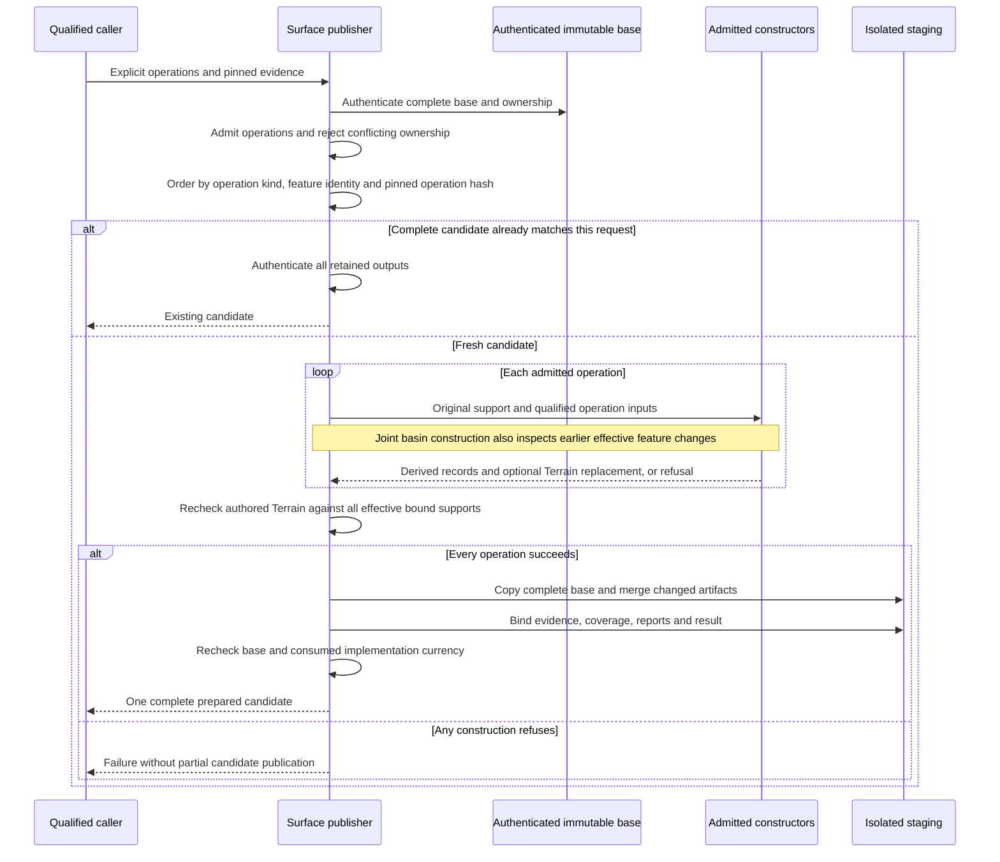

# Candidate preparation and refusal

This view shows the implemented lifecycle of admitted operations. The
[combined-preparation contract](../../../../terrain_refinement.md#combined-feature-preparation)
owns supported operation combinations, ordering and reuse semantics.

Candidate preparation does not activate canonical authority or mutate a World.
Selection and World coordination follow the separate
[effective-authority view](effective_authority.md).
