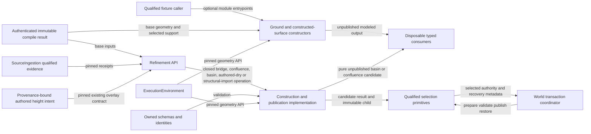

# Refinement boundary relationships

This view represents current capabilities. Pure Ground or constructed-platform
output has no production-publication edge. Model-specific semantics belong to
the [surface contract](../../../../terrain_refinement.md).
The [candidate-preparation view](candidate_preparation.md) owns the current
multi-operation lifecycle.
