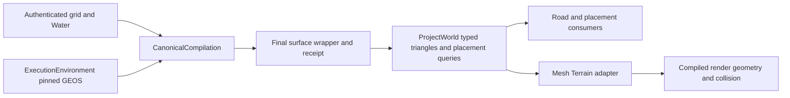

# Sparse canonical terrain refinement

CanonicalCompilation owns the final surface. The optional
`terrain-refinement-v1` document replaces complete selected grid quads with
explicit canonical triangles and interpolated `ground`/`hydro_transition`
weights. Other quads retain their original grid triangles. A refinement wraps
one authenticated `terrain-cell-v2` base; wrappers cannot be stacked.

## API and authority

`api.refine_terrain_cells(repo_root, cells, water, policy, selected)` constructs
payloads without modifying its inputs. `selected` maps cell IDs to explicit
quad coordinates. `api.prepare_terrain_refinement(repo_root, base_result_path,
output_root, water, policy, selected)` authenticates an accepted base, validates
the requested unchanged Water feature, and publishes a disposable bundle under
repository `tmp/`. The base and candidate directories must be disjoint.

The result operation is `refine`, distinct from `compile`. Production promotion
accepts only `compile`; neither an accepted disposable result nor its fixture
limits grant production authority. There is no production refinement CLI or
automatic profile activation.

The candidate retains original grid/feature files and compiler lineage. Selected
cell manifests point at wrapper artifacts. Their hashes include the final
surface, unchanged base, Water, explicit policy, implementation, execution
environment and bounded neighboring domain. No global compiler fingerprint is
reinterpreted as incremental reuse. Preparation uses existing atomic staging;
authenticated repeat requests are no-ops, failed promotion removes staging, and
repreparing from the original base with an empty selection removes refinement.

## Geometry and refusal

The implemented construction supports admitted constant polygon Water, including
holes. Pinned GEOS partitions each original affine terrain triangle and performs
constrained triangulation. Wet and shoreline vertices are lowered only when
needed for the requested clearance; dry triangles connect to original boundary
corners. This is a bounded prototype, not a source-derived bank-design law.

Policy explicitly supplies accepted source accuracy, maximum cut/fill, dry-bank
distance, bank gradient, triangle budget and Water clearance. Low-confidence
Water is excluded regardless of the supplied list. Flowing/ribbon functions,
overlapping additional Water influences, invalid topology, unavailable native
geometry and exceeded limits refuse. No automatic relaxation or minimum-knot
substitute is permitted. Production source-quality and numeric limits require
separate acceptance.
Selected cells carrying authored terrain patch IDs also refuse until their
conflict policy is explicit; the prototype does not overwrite authored intent.

Selected neighbors must share complete edge topology, heights and semantic
weights. An outer edge retains its original endpoint geometry and weights;
additional boundary vertices or changed heights require an expanded selected
neighbor domain. Vertex XY coordinates and affine heights remain float64;
independent rounding must not break shared constraints. Validation rejects
missing/overlapping coverage, duplicate vertices, cracks, reversed faces,
invalid indices and conflicting shared attributes.

## Consumers and proof

ProjectWorld loads the authenticated base and final replacement into one typed
surface. Triangle consumers use final faces. Placement queries use those affine
faces throughout a selected quad and fail if coverage is missing. Outside
selected quads the existing clamped bilinear query is retained. Navigation bounds
include final vertices; fixture identities include the new typed fields.

Mesh Terrain realizes these triangles without additional deformation. Source
fidelity, compiled CPU triangle coverage/interior heights, actual Nanite/fallback
pixels and native collision are distinct checks. Matching old grid vertices
cannot certify a changed interior. CPU fallback buffers of a Nanite-enabled mesh
do not prove Nanite cluster rendering or packaged behavior.

Focused tests are `test_terrain_refinement.py`, `test_refinement_artifacts.py`,
`Project.World.Terrain.RefinedQueries`,
`Project.World.Realization.MeshTerrain.RefinedSurface` and
`Project.World.Realization.Runtime.RefinedNavigationBounds`. Native tests create
their own disposable inputs through the public compiler API.
