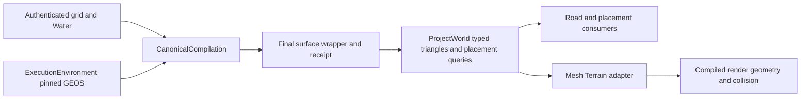
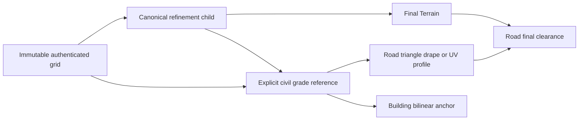
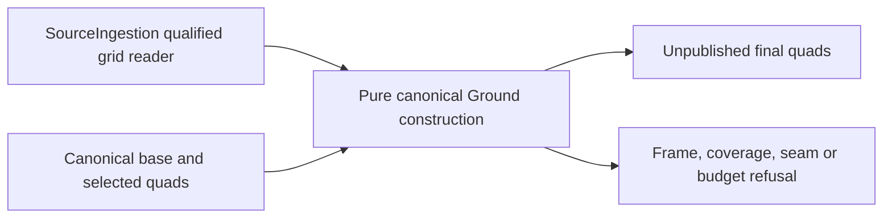
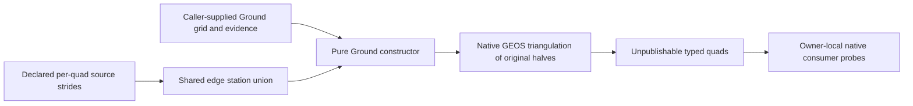
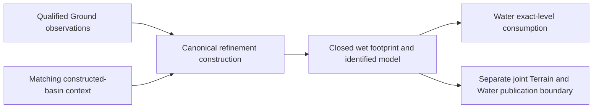
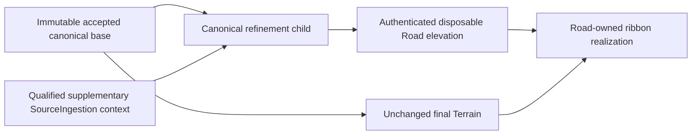
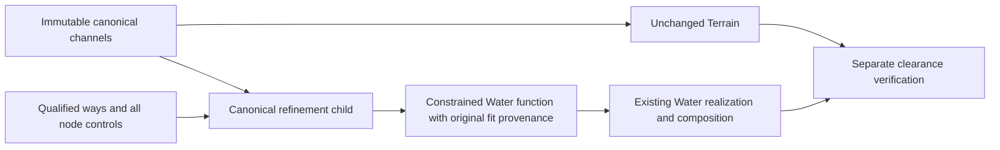
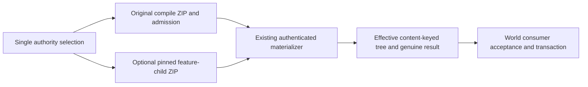

# Sparse canonical terrain refinement

CanonicalCompilation owns the final surface. The optional
`terrain-refinement-v1` document replaces complete selected grid quads with
explicit canonical triangles and interpolated `ground`/`hydro_transition`
weights. Other quads retain their original grid triangles. A refinement wraps
one authenticated `terrain-cell-v2` base; wrappers cannot be stacked.

## API and authority

`refinement.api.refine_terrain_cells(repo_root, cells, water, policy, selected)` constructs
payloads without modifying its inputs. `selected` maps cell IDs to explicit
quad coordinates. `refinement.api.prepare_terrain_refinement(repo_root, base_result_path,
output_root, water, policy, selected)` authenticates an accepted base, validates
the requested unchanged Water feature, and publishes a disposable bundle under
repository `tmp/`. The base and candidate directories must be disjoint.

The child owns its schemas and `refinement_result.json`. Its result operation is
`refine`, distinct from the base compiler's `compile_result.json`. Base compiler
promotion accepts only `compile`; neither an accepted disposable result nor its
fixture limits grants generic Terrain activation. Feature-child selection uses
the separately authenticated authority path below. Terrain construction has no
automatic production activation.

The child implementation and consumed parent helpers have their own fingerprint.
Its native geometry capability is provided by ExecutionEnvironment's geometry
child. Refinement implementation edits do not change the unused base compiler or
base execution-environment identities. Changes to consumed base helpers still
invalidate refinement proof. Current child execution never rewrites the frozen
base producing identity or establishes a historical raw-source replay.

The candidate retains original grids and compiler lineage. Selected civil
features gain explicit grade references; other feature content is unchanged. Selected
cell manifests point at wrapper artifacts. Their hashes include the final
surface, unchanged base, Water, explicit policy, implementation, execution
environment and bounded neighboring domain. No global compiler fingerprint is
reinterpreted as incremental reuse. Preparation uses existing atomic staging;
authenticated repeat requests are no-ops, failed promotion removes staging, and
repreparing from the original base with an empty selection removes refinement.

## Geometry and refusal

The implemented construction supports admitted constant polygon Water, including
holes. Pinned GEOS partitions each original affine terrain triangle and performs
constrained triangulation. Wet and shoreline vertices are lowered only when
needed for the requested clearance; dry triangles connect to original boundary
corners. This is a bounded prototype, not a source-derived bank-design law.

Policy explicitly supplies accepted source accuracy, maximum cut/fill, dry-bank
distance, bank gradient, triangle budget and Water clearance. Low-confidence
Water is excluded regardless of the supplied list. Flowing/ribbon functions,
overlapping additional Water influences, invalid topology, unavailable native
geometry and exceeded limits refuse. No automatic relaxation or minimum-knot
substitute is permitted. Production source-quality and numeric limits require
separate acceptance.
Selected cells carrying authored terrain patch IDs also refuse until their
conflict policy is explicit; the prototype does not overwrite authored intent.

Selected neighbors must share complete edge topology, heights and semantic
weights. An outer edge retains its original endpoint geometry and weights;
additional boundary vertices or changed heights require an expanded selected
neighbor domain. Vertex XY coordinates and affine heights remain float64;
independent rounding must not break shared constraints. Validation rejects
missing/overlapping coverage, duplicate vertices, cracks, reversed faces,
invalid indices and conflicting shared attributes.
This is a single-valued height surface: repeated XY positions with different
heights and vertical faces are outside `terrain-refinement-v1`. Such a surface
requires a distinct canonical representation and explicit height-query versus
3D realization/collision contracts; weakening this validator is not an extension.

## Consumers and proof

ProjectWorld loads the authenticated base and final replacement into one typed
surface. Triangle consumers use final faces. Placement queries use those affine
faces throughout a selected quad and fail if coverage is missing. Outside
selected quads the existing clamped bilinear query is retained. Navigation bounds
include final vertices; fixture identities include the new typed fields.

Mesh Terrain realizes these triangles without additional deformation. Source
fidelity, compiled CPU triangle coverage/interior heights, actual Nanite/fallback
pixels and native collision are distinct checks. Matching old grid vertices
cannot certify a changed interior. CPU fallback buffers of a Nanite-enabled mesh
do not prove Nanite cluster rendering or packaged behavior.

Focused tests are `test_terrain_refinement.py`, `test_refinement_artifacts.py`,
`Project.World.Terrain.RefinedQueries`,
`Project.World.Realization.MeshTerrain.RefinedSurface` and
`Project.World.Realization.Runtime.RefinedNavigationBounds`. Native tests create
their own disposable inputs through the public compiler API.

## Immutable civil grade references

Terrain refinement preserves accepted civil grades through the optional
[civil-grade reference](refinement/contracts/civil-grade-reference.schema.json)
in canonical feature attributes. The refinement child selects this model and
authenticates the original grid artifacts already carried by the wrapper.
It is grade preservation, not a claim that an unclassified path is a bridge,
or that a Building has physically verified foundations.

The influence census uses complete selected quads, including their dry portions.
Road support uses source-segment bounds expanded by half the admitted width;
Building influence uses the full-footprint bounds center clamped to its OWNER
grid. A neighboring cell does not change that owner's query. Conflicting
relationships, explicit ford/tunnel evidence, unsupported crossing markers,
unavailable support or a nested
grid reference refuse. Missing source tags remain unknown.

ProjectWorld retains separate authenticated base-grid and final-surface
identities. Named immutable-grid queries reuse the existing grid and native
math: Road consumes affine grid triangles; Building retains clamped bilinear
sampling at its existing bounds center. Ordinary query defaults remain final.
No grid copy, second terrain writer, alternative collision surface or native
ribbon reconstruction is introduced.

Road preserves its native planform, tangents and presentation offset. An explicit
UV profile remains authoritative and qualifies against its original grid support;
its abutments use that same support. Both ordinary preserved grades and profiles
must independently clear the authenticated final Terrain, including stored float
geometry. Planner and builder consume the same grade and final-clearance inputs.
The final Terrain identity therefore remains a Road generation dependency.

A preserved Building consumes its base anchor reference. Its generator does not
evaluate final footprint support, so the final wrapper is not a generation input
for this mode. An owner performing a separate support or civil-relationship
verification must consume that final context itself. This boundary does not add
a new foundation, clearance or structural-design law to Building realization.

The public terrain publisher prepares these references inside its existing
tmp-only candidate transaction. Reference identities, owning feature manifests,
coverage and the result advance together. A no-op authenticates all outputs;
preparing an empty selection from the original base removes both refinement and
preservation references. Neither route activates production authority.

Focused consumer regressions are `test_civil_grade.py`,
`Project.World.Terrain.CivilGradeAdmission`,
`Project.World.Realization.Road.ImmutableCivilGrade` and
`Project.World.Realization.Building.ImmutableCivilGrade`. Geometry preservation,
stale-input refusal and dependency locality do not establish a natural bank,
basin operating level, physical support or production visual acceptance.

This preservation policy belongs to the Water-conditioning publisher above.
It is not a default for replacing DSM with qualified Ground. An accepted DSM
remains immutable historical input; its elevations can include objects and are
not automatically a better terrain model. Ordinary Road and Building queries
consume the final surface. Retaining a base grade during source replacement
needs an explicit qualified civil constraint and separate final-clearance proof.

## Raster Ground construction

The optional `refinement.ground` capability constructs unpublished final-quad
geometry from an exact qualified raster Ground grid. Its public entrypoint is
[`build_ground_surface`](refinement/ground.py). The caller authenticates that
specific product through the SourceIngestion reader; a coarse admitted product
cannot substitute for a separately qualified fine grid. Pure construction checks
the content/frame identity but does not establish admission or source quality.

The source grid must cover the explicit selected quads without extrapolation and
share their half-diagonal node stations. Native triangulation operates separately
inside each original affine half, retaining original semantic weights. All source
nodes participate except redundant points on unchanged outer lines.
Source-station semantic interpolation uses nonnegative integer barycentric
numerators over the original half. This preserves the original affine field
without subtractive cancellation at zero/one edges; invalid source weights still
refuse. It does not clamp malformed inputs or change geographic heights.
Changed outer heights/weights refuse; new outer subdivisions are not silently introduced.
Selected neighbors must agree in topology, height and weights. Missing/nonfinite
Ground, wrong basis/frame, incomplete support and excess triangle budget refuse.
The operation neither blends an open edge nor selects a geographic quality limit.

A region-to-region composite is a separate geographic model choice inside this
owner. Keep qualified source-derived and inferred transition geometry distinct;
bind both source fields, selected domain, interpolation and boundary conditions.
Continuity alone does not establish reasonable slopes, civil relationships or
playability. A continuous inferred transition may be valid game-world geometry,
but is not surveyed Ground or a reason to relabel unknown source support.
A finite bare-earth value establishes neither an elevated civil surface nor a
surface constructed after the source survey. Regional selection must consider
source epoch and surface meaning alongside coverage. Explicit structural
relationships still need metric support; an old DSM is not automatically a
correct deck elevation either. Do not turn missing or temporally unsuitable
evidence into an implicit Ground, bridge or zero-height decision.

Classified observations and a provider-derived raster are distinct source models.
A continuous raster can still misrepresent a paved Ground surface. Source-only
agreement is therefore not sufficient consumer-quality evidence. With classified
observations, retain Water, mixed-class and conflicting-return exclusions when
establishing support; a Ground-only convex hull can interpolate across those
internal exclusions. Never average conflicting observations implicitly. Finite
axis samples do not prove an entire Road width or its endpoint sections.
An ordinary Ground-supported Road consumes a joint final-Ground correction;
a Road-only lift must not hide an unsupported Ground model or manufacture an
elevated relationship. A separate deck requires its own qualified civil evidence.
Distinguish the recorded pre-surface fitted grid from the accepted final Terrain:
Water conditioning may already have lowered the latter. Neither is interchangeable
with raw DSM observations or later Ground evidence. A classified Ground observation
above a mapped Water polygon does not by itself distinguish reclaimed land, a
constructed platform or an inaccurate Water footprint. Resolve that relationship
before selecting Ground replacement or a separate civil surface; proximity to a
pier and partial point containment are insufficient evidence.

Evaluate source support over the complete consumer domain. Subtracting support
from a land selector can clip a larger unknown region at the shoreline; its
complement is not thereby qualified Ground. Open tagged pier lines establish no
closed exclusion footprint or metric deck height. Distinguish retained historical
terrain, qualified source and modeled transition in evidence and identities.
Only the complete authenticated canonical cell inventory can establish a true
territory exterior. A crop, omitted neighbor, land edge or source frontier cannot
remove an internal seam obligation. The current pure builder conservatively
preserves every selected outer trace; it does not select a regional boundary law.

Its implementation identity is independent of the existing feature/Water child
and includes the shared helpers and contracts it consumes. The result separately
binds exact Ground evidence, selected base support and native geometry identity.
Adding this unused capability changes neither base compiler nor existing child
identity. This does not waive normal acceptance of changes to consumed code.

The result is not a loadable `terrain-refinement-v1` document. That Water envelope
does not authenticate Ground by relabelling it as Water. No Ground publication,
World activation, civil grade choice or joint fountain containment follows from
pure construction. `test_ground_surface.py` owns focused two-cell construction,
affine semantics, identity locality and unchanged-input refusal controls.
The test-only `ground_query_fixture.py` carries that construction into
`Project.World.Realization.MeshTerrain.GroundTypedQueries`. It checks typed final
queries and the dynamic source mesh against specifying vertices, semantic weights
and oriented face multiplicities, with stale-grid, missing-coverage, corrupted-weight
and reversed-face controls. This bypasses authority admission deliberately; it
establishes no Ground loader, compiled render geometry, collision or packaged proof.

`ground_consumer_fixture.py` supplies self-contained typed Ground to
`Project.World.Realization.Road.GroundFinalSurface` and
`Project.World.Realization.Building.GroundFinalAnchor`. The actual owners build
source mesh descriptions without saving packages; missing final coverage must
refuse without partial output. Their shared test-only projection does not admit
a replacement authority. An explicit `PROJECT_WORLD_GROUND_SCENE_FIXTURE` can
instead supply a disposable real-base scene; it must not point at production
outputs or be a required input to ordinary test execution.

Road vertex conformity is checked against the affine triangles it consumes.
The oracle includes incident neighbor-cell triangles for the actual Road ribbon:
the ribbon can extend past its axis owner's bounds. An oblique fixture requires
such vertices and rejects owner-cell-only height checks.
Outside selected replacements, the placement sampler's retained bilinear field
is deliberately different and cannot serve as a Road conformity oracle. A
diagnostic Ground crop must contain the complete tested Road footprint and
consumed halo; otherwise its discontinuous edge cannot certify a whole Road.
These probes do not certify continuous saved triangles, collision, navigation,
regional boundary conditions or packaged behavior.

The pure Ground constructor accepts an optional complete `resolution` list of
`cell_id`, `quad` and positive integer source-grid `stride` records. Each stride
must divide its original quad's source stations. Native triangulation retains
the original affine halves and the union of both neighbors' requested edge
stations; a coarse interior does not force an adjacent fine interior. Unknown,
duplicate, incomplete or excessive selections refuse before producing output.
The normalized map and its implementation are consumed identities. This chooses
a declared nodal approximation, not an accuracy guarantee or source-priority
policy. The default still consumes all source stations. Complete source-grid,
frame, convex-semantic and unchanged outer-trace guards remain in force.
This unpublishable constructor establishes no Ground authority or replacement
of the Water-specific refinement provenance contract.

## Contained standing Water construction

`refinement.api.build_contained_water` is a pure disposable construction operation,
separate from source admission and joint Terrain/Water publication. Its caller
must authenticate the supplementary Ground observations, processing/frame evidence
and matching constructed-basin context. Hashes supplied to this pure operation
do not establish source authenticity by themselves.
Frozen processed Ground products can be authenticated through
[SourceIngestion supplemental admission](../SourceIngestion/supplemental/).
That receipt proves the retained qualified product and its processing scope;
it does not select a terrain approximation or approve production quality.
Provider point samples and their coarse affine terrain representation have
different fidelity. Source-quality evidence must distinguish interpolation across
local breaklines from a civil feature's actual vertical relationship. Inspect
qualified way AND node context: a multi-level elevator or entrance cannot be
classified as ordinary ground-following solely because the way lacks a bridge
or tunnel tag. Finite source support supplies neither a metric connector design
nor permission to smooth away an observed sharp transition.

The operation reuses the configured quantile and quantization primitives on
distinct Ground XY observations inside the mapped polygon. Pinned GEOS triangulates
the observations. The lowest interior observation selects a seed; minimax escape
over the observed TIN establishes its spill. The quantized level must be strictly
above the seed and below spill. The actual connected sublevel footprint must have
positive area and avoid the observed hull. The default `mapped_containment`
model also requires complete containment inside the mapped domain.
Unknown frame/class, conflicting duplicate elevations, open/equality/rounding
cases, point-only connectivity and unsupported footprint models refuse.
No freeboard, wall height, operating Waterline or source accuracy is inferred.

The explicit `observed_ground_component` comparison uses the closed observed
component as its derived footprint and measures departure from the mapped domain.
It retains the original mapped-geometry identity and cannot reinterpret explicit
mapped holes or disconnected source regions. It does not change quantile,
quantization, seed or spill rules to make a failed mapped candidate pass. This
is a separately identified game-model candidate, not a correction to the original
OSM geometry or permission to publish an expanded Water footprint. Source quality,
civil consequences and complete joint Terrain/collar support remain prerequisites
of publication and adoption.

The [contained Water function](refinement/contracts/contained-water.schema.json)
records the derived model and input/geometry identities. It is not the existing
canonical-grid polygon estimator and does not promote the base low-confidence fit.
The existing native Water writer consumes this function at its exact canonical
level, with zero presentation lift. Other function families retain their layer
offset. One Water-owned offset rule is shared by emission, grouping and source
approximation; ordinary input/semantic identities already consume function IDs,
versions, levels and geometry.
ProjectWorld also retains the spill constraint as a consumed typed input. Water
checks the actual float-stored plane back in the canonical height frame against
every contributing contained source before composition or emission. A raw level
below spill does not suffice when storage rounds it to or above spill. The bound
participates in input identity; ordinary function identities remain unchanged.

The current pure operation does not construct a terrain collar or publish a
canonical child. Exact Water emission alone cannot fix a basin buried by unchanged
Terrain. Continuous Q4 top triangles remain the intended representation for this
joint boundary; no second terrain authority or 3D bank representation is implied.
Focused controls are `test_contained_water.py`,
`Project.World.Water.ContainedFunctionAdmission` and
`Project.World.Water.ExactCanonicalLevel`.

## Observed constructed-surface candidates

The optional [constructed-surface constructor](refinement/constructed_surface.py)
models a straight Road on one source-qualified fixed pier. It associates
classified height observations with the exact parent footprint, including its
holes. A spatial query halo supplies context; observations outside the parent
cannot establish its surface. Ground classifications retain their source meaning:
using them to model a separately qualified platform does not turn underlying
Water into Ground or supply a surveyed current deck.

The requested full width must remain inside the parent and the associated
observation hull. No extrapolation, boundary buffering, implicit conflict
averaging or crossing reinterpretation is permitted. Explicit bridge, tunnel,
ford or unresolved crossing evidence needs its own support relationship. The
constructor checks finite inputs and interpolation outputs, frame/content pins,
query bounds, complete parameter/projected coverage and a bounded face count.
Native point triangulation and polygon partition remain ExecutionEnvironment
capabilities. Its optional identity binds consumed helpers without changing the
unconsumed feature publisher or base compiler.

This is pure construction. The caller must authenticate source admission,
complete parent evidence, source epoch and processing. Its separately identified
observation model leaves Terrain and Water untouched. Constructed endpoints are
on their supporting surface; they are not automatically immutable-Terrain
abutments. The current production Road parser and feature publisher do not admit
this model. Source association and coverage do not establish acceptable slopes,
incident joins, compiled geometry, collision or geographic adoption.
Typed native diagnostic consumption follows ProjectWorld's
[Road elevation consumption](../../../Plugins/World/ProjectWorld/docs/territory_contract.md#road-elevation-consumption).

## Road elevation candidates

`refinement.api.build_bridge_profile(repo_root, road, cells)` constructs a
disposable source-abutment model. Explicit nonconflicting bridge evidence and a
single finite source way are required. Missing tags, conflicting crossing modes,
repeated/reversing stations and incomplete Terrain refuse. This construction API
does not authenticate supplementary source admission, publish a refinement,
activate a profile in ProjectWorld or authorize production adoption.

`refinement.api.prepare_bridge_refinement` admits a separately byte-pinned
normalized provider document through SourceIngestion's public contract. Shared
OSM namespace qualification preserves distribution-channel provenance. A complete
ordered projection must match the immutable base Road, and qualified way/node
versions must not postdate the accepted source release. Complete node evidence
is mandatory. Explicit source elevations require their own qualified vertical
interpretation rather than silently using Terrain-derived bridge construction.
This is supplementary
context, not a historical raw-source replay. Unknown metadata or unsupported
crossing modes refuse. The base result and every consumed document are bound to
one authenticated byte snapshot; changes during preparation refuse.

Publication uses the same tmp-only staging and distinct refinement result as
Terrain refinement. It updates only the selected feature artifact, its manifest
and derived coverage, retaining original geometry, source references and base
lineage. Terrain bytes remain unchanged. Constructor JSON-content hashes and raw
Terrain artifact hashes are distinct domains; the native consumer authenticates
the latter. Context bytes and child/source-admission/execution identities bind
replay and no-op admission. A changed dependency cannot reuse an old candidate.

The [Road elevation schema](refinement/contracts/road-elevation.schema.json)
owns the payload shape. Coordinates are cumulative source arclength and signed
left lateral metres; explicit parameter-space triangles define affine absolute
height, excluding the Road presentation offset. They do not define native XY
mesh ownership. Full abutment sections come from final Terrain triangles, with
breaks at crossed triangle edges. Source-only sections and a nonnegative concave
support envelope construct a candidate; no native segment-length/tangent
tessellation is reproduced in the compiler. Terrain remains unchanged.

The finite support census includes each source-segment bounding box expanded by
half-width. This contains the native ribbon without determining its internal
tessellation. Consumed Terrain and feature content, implementation and native
execution identities are recorded. These hashes identify supplied construction
inputs; they do not establish historical source correspondence or producer
promotion. Existing compiler/source replay requirements remain intact.

Parameter-domain coverage and unchanged input tests are construction proof only.
Native Road must retain its original XY triangles, map their source
station/lateral coordinates, subdivide against the affine elevation field and
add its presentation offset once. Final emitted triangles, abutment/incident
joins, Water clearance, compiled geometry and collision require independent
acceptance. A candidate failing those checks refuses; a source-only support
estimate is not an excuse to relax them. The native Road consumer admits the
optional profile explicitly, including its exact directed-source binding and
complete finite Terrain-support census. Malformed or stale fields refuse rather
than falling back to draping. City adoption uses the authenticated selected-child
and World transaction boundary below. Native source, compiled geometry,
collision and incident joins remain separate acceptance surfaces.

## Water confluence candidates

`refinement.api.build_confluence_constraint(features, context, projected)`
constructs a disposable terminal constraint for two independently derived
flowing channels. SourceIngestion must qualify complete ordered way/node records.
Their native versions must not postdate the accepted source release; the full
directed projection must occur in the accepted fit's knot order. Forward
projection and the existing polygon-suppression route must separately reproduce
the immutable visible geometry before publication or adoption.

Admission requires exactly one shared source node, one tributary downstream end
and a continuing receiving channel. Existing finite monotone terrain-derived
fits and a unique receiving knot at the shared node are required. Only the
tributary's terminal knot is lowered to that existing value. Raising Water,
unknown source locations, unsupported waterway/control tags, mapped hydraulic
controls or elevations, covered crossings and conflicting layers refuse. This
is a traceable free-flow game-world model, not surveyed hydraulic equality or
proof that no unmapped control exists. No feature ID selects the rule.

The [confluence schema](refinement/contracts/water-confluence.schema.json) owns
`constrained_flowing_knots:v1`. The complete original estimator and diagnostics
remain under `baseline_function`; the new model records the node, receiver
function/context identities, affected interval and lowering. Original geometry,
source references, other knots, receiving function and Terrain remain unchanged.
Keeping the original estimator name after applying a constraint would misstate
the model. The child construction API is not a production publisher or an
authentication substitute.

Native Water evaluates the admitted knots with the existing height quantization.
Equal quantized regions may reuse its source-approximation and horizontal-union
operations; unrounded functions need not be identical. Retessellation can change
incident receiving triangles even when that function is unchanged. Verify actual
stored coverage, exterior sections, Terrain clearance, cell seams, saved/compiled
geometry and loaded materials independently. Attribute an improvement to an old
interpolation error explicitly; do not report byte-identical receiving geometry.
Existing Water has no collision surface, so Terrain/gameplay collision remains
a separate check. No terrain conditioning, surveyed-level snapping or global
network solver follows from this operation.

## Combined feature preparation

`refinement.api.prepare_surface_refinement(repo_root, base_result_path,
output_root, operations)` prepares Bridge and Water constraints together from
one authenticated compile base. Its closed operations are `bridge_elevation`
and `water_confluence`; this is not a rule language. Each operation supplies
feature IDs and an explicitly byte-pinned normalized source document within the
repository. Complete primitive context is qualified before construction.
Water source projection and the admitted native ribbon/polygon suppression
contract must reproduce the base visible geometry exactly.

Operations with interacting feature ownership refuse. Independent corrections
to one owned shard are merged before writing that shard, manifest and coverage
once, preserving both results. Distinct contexts have content-qualified evidence
paths; shared identical context is stored once. The
[surface request](refinement/contracts/surface-refinement-request.schema.json)
binds base/feature hashes, normalized context, source admission, current child
implementation and native execution identities. Replay authenticates every
output; changed dependencies cannot reuse the old result. Base artifact
descriptors must agree with the authenticated payloads, not only parse as JSON.

The bridge-specific public entrypoint delegates to this same publisher. There
is one feature-publication authority and no sequential application of sibling
full trees, which could otherwise discard an earlier correction. Candidate
staging remains tmp-only and retains original source lineage, Terrain and
unrelated artifacts. A genuine `refinement_result.json` is the output; production
selection and World transactions are separate acceptance boundaries.

## Effective-authority candidates

`refinement.api.prepare_surface_authority(repo_root, active_path, profile_path,
result_path, output_root)` prepares a reversible authority candidate under
repository `tmp/`. It authenticates the existing base authority and exactly
replays the closed surface operations against its immutable compile result.
Admission requires current child, source-context and native execution identities;
every output and the result bytes must equal that replay. Terrain refinements
with unresolved quality policy cannot enter this feature-only route.

The existing authority schema has one optional `selected_refinement` descriptor.
All base identity, external inputs, admission and compile-result fields remain
intact. The original immutable ZIP remains independently addressable. The child
has its own deterministic ZIP, genuine refinement receipt, frozen producer
identities and effective identity derived from both base and child. Normalized
qualified source context is retained; raw provider payloads are excluded.

The existing materializer locks and keys the tree by effective identity for a
selected child, and returns `refinement_result.json`. Base-only selection retains
its original cache key and result name. A cached receipt with altered bytes or
an altered output refuses. Frozen child validation authenticates historical
producer identities without calling current source admission or native producers;
new candidate preparation always requires those current identities.

Fresh selection also replays producer origin. Matching archive hashes and producer
labels alone establish retained integrity, not that the claimed original feature
or modeled consumed feature actually produced those bytes. The public
`validate_current_surface_selection` authenticates the complete base and child,
extracts their declared results in disposable storage, and replays the existing
closed publisher. Exact result/output bytes must match. Full authority validation
and producing identities are checked again after replay. Base ZIP admission
records remain owned by base authority validation; the child alone has a closed
result-only ZIP inventory. Neither operation reacquires provider data or runs the
base compiler.

Candidate preparation never changes the accepted pointer. It publishes the
isolated candidate only after full archive validation and a final unchanged-base
check. The production compile promoter refuses to erase or carry a selected
child implicitly. Explicit child acceptance, selected-owner compatibility and
coordinated recovery remain separate requirements. Existing immutable-input and
shared-map guards remain strict; copying a candidate pointer is not a valid
adoption route.

## Qualified selection publication

The refinement owner supplies narrow primitives for a coordinating World
transaction. `prepare_selection_transition` derives the active target from its
compiler profile, authenticates an unchanged-base candidate and current producing
contracts, and installs the immutable child ZIP without selecting it. A conflicting
existing payload refuses. Its [transition contract](refinement/contracts/canonical-selection-transition.schema.json)
retains the exact old/new pointer bytes and identities; no historical source
acquisition or base compilation is executed.

`publish_selection_transition` serializes with ordinary base promotion through the
same profile lock and compares the expected prior pointer before atomic replacement.
Transition preparation, direct first activation and E2E candidate admission use
the same fresh-origin check before accepting new bytes. Frozen reading, repeated
selection and recovery deliberately retain their historical contracts; they
authenticate original bytes without asserting current producer equivalence.
First activation requires current producers. Repeated selection is a no-op;
qualified reverse publication restores the exact prior bytes. Frozen validation,
recovery and an already-selected no-op do not rerun unused current producers.
Wrong derived targets, changed profiles, damaged payloads, forged recovery bytes
and pointers matching neither known state refuse without overwriting the pointer.

The public compiler CLI exposes `prepare-selection-transition` and
`selection-transition --action validate|publish|restore`. Recovery input files
belong under repository `tmp/`; the coordinating journal owns their retained
metadata. These primitives change one canonical selection only. They neither
accept World output nor make canonical and World publication jointly atomic.
The World coordinator must retain its journal and snapshots until both accepted
states validate. Production World integration and its required acceptance remain
separate from these isolated primitives.

### Durable schema reference repair

New candidates carry the relative owned-schema reference for their final durable
location, even while their payloads are staged under `tmp/`. Both fresh transition
preparation and first publication reject URL annotations. Historical read and
reverse publication still authenticate their original exact bytes.

The closed `prepare-schema-reference-transition` operation can normalize the
demonstrated URL annotation on an already selected child. It changes only
`$schema`, retains the complete base/child identities and requires the exact prior
pointer. It uses the same CAS/restore primitives. It cannot admit a new source,
compiler, child, elevation or output. Its historical handoff reader binds the
original selected publication to the exact metadata successor.

World must update its corresponding accepted pointer binding through the existing
outer recovery and authority publication. This does not invoke a realization
writer. Retained old/new pointer bytes qualify historical geometry receipts;
they never relabel historical producer fingerprints as current execution.
