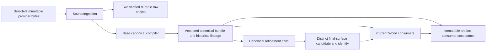

# World End-to-End Validation

Gate selection is defined by
[World Pipeline Test Layers](../../../docs/testing/world_pipeline_layers.md).
`check` and `run` are slice gates and never package. `accept` is the L4
milestone/release gate and is the only command here that packages.

For a saved World with carried base scopes and selected-child scopes, use the
[frozen execution evidence reader](frozen_evidence.md) before final acceptance.

Owns profile-scoped cross-layer acceptance runs. It composes the public Source
Ingestion and Canonical Compilation commands with the supported Unreal world
commandlet and release packager. It does not implement ingestion, compilation,
realization, or packaging logic.

## Commands

```powershell
python -S tools/World/EndToEndValidation/bootstrap.py plan --base HEAD
python -S tools/World/EndToEndValidation/bootstrap.py check
python -S tools/World/EndToEndValidation/bootstrap.py run `
  --profile Plugins/World/ProjectWorldData/Data/Profiles/EndToEndValidation/kazan_territory_v1.validation.json `
  --check-result <common-check-result.json> `
  --from-canonical-authority --changed-base <slice-base>
python -S tools/World/EndToEndValidation/bootstrap.py enroll `
  --run <accepted-territory-run-id> `
  --profile Plugins/World/ProjectWorldData/Data/Profiles/EndToEndValidation/kazan_territory_v1.validation.json
python -S tools/World/EndToEndValidation/bootstrap.py accept `
  --run <accepted-territory-run-id> `
  --profile Plugins/World/ProjectWorldData/Data/Profiles/EndToEndValidation/kazan_territory_v1.validation.json
```

`plan` reads tracked and untracked changed paths and reports the minimum gate
layers affected by the static SOT table. It performs no bootstrap, test,
package, or generated-content mutation. `--base` names the commit before the
current slice; use `HEAD` only while the slice remains uncommitted.
Matrix selection follows the transitive inputs of executable validation
profiles. Unreferenced future profiles and controls select no existing Matrix.
The plan also prints `canonical_authority` or `full` for each Matrix. The
canonical route requires the base before every unaccepted change in the
candidate. Use `HEAD` for uncommitted work only after any earlier committed
upstream change has its own accepted boundary and nonproducing proof. Record
the original base and complete path set for a multi-commit review; a later
World-only Matrix does not prove source replay for the earlier commits. Omit
both optional run flags for the full source-to-World replay.
L3 output names candidate owners only; promotion still requires an intentional
generated-package or manifest change.

## Immutable artifact-consumer acceptance

The explicit `immutable_canonical` operation accepts current downstream behavior
against an unchanged, authenticated canonical baseline. It is separate from
certifying today's source-to-canonical compiler. Select it with:

```powershell
python -S tools/World/EndToEndValidation/bootstrap.py plan --base <slice-base> --from-immutable-canonical
python -S tools/World/EndToEndValidation/bootstrap.py run `
  --profile <validation-profile> --check-result <current-common-check-result> `
  --from-immutable-canonical --changed-base <slice-base>
```

Admission verifies the selected source/compiler profiles, controls, budgets and
active authority against the true slice base, then authenticates every bundle
output and the frozen producing result/run contract. The strict selection
contract records historical producer identities separately from the current
reader identity. The current two-city profile needs both current World legs;
old single-city receipts cannot cover it. Changed geographic inputs, authority,
missing history, altered payloads or stale consuming implementation refuse.

Acquisition, base compilation and canonical promotion are neither executed nor
certified by this operation. Current Common Check and the same isolated World
Apply/no-op/locality/rejection/reconstruction/restoration requirements still
apply. A post-canonical refinement additionally owns its own result, consumed
identities and focused native correctness proof. This operation does not activate
refinement, accept source-quality policy, or authorize geography mutation.

The existing `canonical_authority` guard and default `full` selection remain
strict. Use `full` whenever accepting fresh ingestion/base-compiler output or
changed geographic inputs. An unused producer edit can coexist with immutable
artifact consumption, but receives no producer certification from that receipt.
Unavailable historical raw bytes remain a gap for fresh historical replay.

The base-only immutable reader refuses a selected refinement rather than
recording only its original compile identity. `refinement-inputs` admits explicit repository-tmp child
candidates against the same unchanged historical base selection. It authenticates
the effective archive/result and current child/source/native identities, then
freezes base and candidate pins separately. Source acquisition, base compilation
and production promotion are not performed. This input snapshot is not a World
acceptance result: selected-owner integration and coordinated recovery remain
required before activation. Existing `run` modes cannot silently use that snapshot
as a completed immutable or full compiler gate.

```powershell
python -S tools/World/EndToEndValidation/bootstrap.py refinement-inputs `
  --profile <validation-profile> --changed-base <slice-base> `
  --candidate <profile-name>=<tmp-authority-candidate>
python -S tools/World/EndToEndValidation/bootstrap.py verify-refinement-inputs `
  --profile <validation-profile> --selection <tmp-input-selection.json>
```

The first command emits the [input selection](contracts/refinement-candidate-selection.schema.json)
on stdout; the caller retains it under repository `tmp/`. Verification reconstructs
that selection and returns its exact byte hash only after final pin and producer
checks. Neither command runs World, Common Check, Matrix or promotion. Duplicate
candidate names, another validation profile and changed selection bytes refuse.

### Selected-refinement target acceptance

`refinement-target` requires the exact current input selection, current Common Check
and an accepted immutable-base Matrix from that same Check. It runs only the selected
World dependency closure on the existing accepted map through the supported host.
The [target request](contracts/refinement-target-request.schema.json) binds those
inputs. Verification runs before mutation and again after complete restoration.

```powershell
python -S tools/World/EndToEndValidation/bootstrap.py refinement-target `
  --profile <validation-profile> --selection <tmp-input-selection.json> `
  --check-result <current-check-result> --base-run <immutable-base-run-id> `
  --execute-layer <owner> --execute-layer <dependent-owner>
```

The target proves a real post-canonical-CAS failed-commit recovery, successful saved
pair publication, cold authority audit, and cold no-op without a new child selection.
It uses the existing [outer recovery owner](../../../scripts/ue/generated_content/README.md#canonical-selection-participant)
to restore both original pointers and the complete World path/byte inventory. An
interrupted target retains the existing outer marker and snapshots for its normal
recovery entry point. It requires project Unreal processes to be closed during saved
acceptance; ordinary material preview remains an independent live-Editor loop.

An accepted `refinement_selected` result certifies this bounded target. It does not
replace the unchanged-base regression envelope, authorize geographic policy, certify
packaged performance or count as a full Matrix/package provenance receipt. Existing
base-only `run` and final acceptance commands remain strict about their own modes.
Do not relabel the target as fresh base compilation or source replay.



Current proof identities are conservative over the maintained reader/helper
closure. They may invalidate checks for an unused implementation edit; that does
not authorize acquisition or regeneration. An exact call-graph dependency engine
is not required for this separation.

## Execution and evidence

`check` bootstraps the pinned environment and runs the common Python,
PowerShell lifecycle, architecture, failure, and Unreal realization suites
once. Each `run` verifies and pins that same accepted check receipt and refuses
it if any covered code, package/world script, contract, or test changed
afterward. The Check hash includes project/plugin descriptors, relevant project
configuration, C++ Build.cs, pinned tool locks, immutable TestData inputs and
authored fixtures, plus the exact territory Matrix input closure that
the current suites read. It does not hash the whole future production profile
namespace. Generated packages and durable manifests are excluded because
Matrix and L3 own those lifecycles. The full route then runs isolated synthetic,
Kazan and Manhattan source/compile matrices, and executes six realization legs: full Apply,
unchanged Apply, road-locality Apply, one-cell incremental Apply, deliberately
rejected overlay resolution, and clean reconstruction. It compares D0-D3 semantics, requires
the generated tree to roll back byte-for-byte after rejection, and requires
every protected authored package hash to remain identical across all legs.
The canonical-authority route selects the production entries only. It
validates and materializes the current promoted bundle, then executes full
Apply, unchanged Apply, road-locality Apply, deliberately rejected overlay
resolution, and clean reconstruction. It performs no source acquisition or
fresh compilation, and its receipt reports those upstream proofs as absent.
The promoted bundle omits the compiler's observational `metrics.json`; the
canonical byte budget derives from the authenticated compile-result output
inventory.

Matrix isolation uses scratch manifest authority and an outer backup/recovery
transaction. Generated candidate packages temporarily occupy the profile's actual
content/package root; this is not a separate permanent city copy. The route restores
the exact pre-run generated tree before returning, including on rejection, and
authenticates the restoration. Do not inspect the active city tree as an accepted
baseline during that window. Run Matrix once at its required slice boundary; use
owner-local fixtures and live material previews for ordinary development.
On a builder run, the child receipt records producer artifacts before the
post-apply Mesh Partition builder. The final manifest also owns its compiled
section artifacts. The Matrix profile records both counts. An isolated clean
reconstruction may allocate new Mesh Partition actor package paths; the Matrix
requires the same scope and artifact counts, equal producer semantics, equal
World semantic fingerprint, and equal saved producer projections after the
post-apply builder. Mesh Terrain covers compiled section geometry, collision,
and role tags. Map and Building Massing cover saved partition/presentation state
and building actor, mesh, material, and collision state. Their clean comparison
omits allocation-only actor GUIDs, names, and labels from the authenticated
saved projections. Only external actor
package paths in the affected map and terrain scopes may be reallocated on the
clean leg; other paths and all paths on unchanged and locality Applies stay fixed.
The changed-path gate refuses the canonical route for shared source, compiler
or execution-environment implementation changes, and for consumed upstream
profiles, source files, controls, budgets or promoted authority changes. The
planner and CLI use the same selected canonical-authority input closure for
each Matrix. A synthetic-only compiler input still invalidates L1 and Common
Check, but does not require production source replay when the selected authority
does not consume it. There is no TestData exemption: an authority that references
that input requires full replay. Missing history or an unreadable authority
input selects full replay or refusal. Promoted data under each selected authority
owner remains conservatively protected, including newly added bundle files.
Upstream component `tests/` edits invalidate the common proof identity rather
than production generation; shared implementation and contract edits still
require full replay.
All routes require the current common Check and exact
generated-tree restoration.
The canonical route does not scan or apply a budget to the unused raw-source
cache. Its World-only check name does not claim source or compiler replay.
For a changed End-to-End validation profile, the gate compares source/compiler
references and upstream budgets with `--changed-base`. World-only expectation
edits may still use the canonical route; an unavailable base profile or an
upstream field edit requires the full route.
Canonical-mode coverage expectations describe the promoted bundle used by the
current World manifests. A historical full source replay can disagree until
the exact pinned raw source is recovered and its candidate is compared with
that promoted authority; do not alter the source pin to make the counts match.
The Matrix outer transaction always restores the exact pre-run generated file
path/hash set before returning, including after successful validation work;
accepted Matrix evidence never leaves candidate UE packages in the worktree.
`accept` requires one accepted territory Matrix with a current common check receipt, then
audits the enrolled production tree, packages once, verifies the exact IoStore
entry, runs the packaged rendered gate, and audits the unchanged tree again.
Receipts are written under
`Saved/Validation/WorldPipeline/<operation-id>/result.json`; disposable work
stays under `tmp/world/end_to_end_validation/`. Each invocation prunes only
its own evidence kind to five receipts and its own disposable Matrix work to
two runs. It never sweeps another tool's `tmp/` ownership.

The supported `kazan_territory_v1.validation.json` Matrix binds the Mesh
Terrain twin to both production cities and their exact generated-layer inventories.
Its Kazan and Manhattan entries authenticate their own source, compiler, canonical
authority, runtime and authored-overlay inputs. They share the data owner's one
presentation contract. Each rejection leg uses the city's own grid and an absent
semantic feature so it reaches anchor resolution rather than a wrong-grid refusal.
Full replay applies the provider-payload ceiling separately to each profile's
authenticated consumed source snapshots. Unrelated cache residency does not define
admission; cache-size and acquisition-growth metrics remain bootstrap diagnostics.
`enroll` authenticates its
accepted Matrix and current transitive profile closure, then executes the one
recoverable L3 transaction that may persist those exact production packages
and manifests. Unreal child evidence is emitted only
under `Saved/Validation/WorldRealization/EndToEnd/` before being copied into
the pipeline evidence tree. Its pre-audit may cross stale producer
fingerprints only for exact target map/layer scopes that this Matrix proves
and enrollment replaces; integrity, ownership, references, journals, and all
unrelated producer fingerprints remain strict. The post-audit has no
exception. Stale layer fingerprints mark those layers identity-dirty during
Apply without propagating a content dirty unit to dependent layers. Enrollment
cannot publish a current fingerprint over artifacts that the current producer
did not refresh.

The full territory Matrix also compiles the current production inputs and compares
their geographic semantic contract with the promoted canonical authority used
by Unreal. Grid/cell topology, coverage semantic hash, and every terrain and
feature artifact hash must match exactly. Implementation-only provenance drift
is recorded but does not force a new immutable authority generation when those
semantics are unchanged; a real terrain, feature, grid, or population change
rejects.

Layered profiles also run a road-locality leg against one canonical cell that
actually contains road data. The road layer and its declared dependent-layer
closure must report exactly that dirty unit, unrelated layers must remain
clean, and all sibling artifact path/digest records must equal the preceding
no-op leg. No geometry or
vegetation instances may be rewritten for
this content-identical reevaluation. Together with the producer revision and
verify checks in common Check, this proves a road implementation or road dirty
input cannot advance terrain or water authority.

Each world entry pins its `world_data_plugin`, source/compiler identities,
optional explicit source/compiler paths, presentation profile, valid and
sabotage authored-overlay profiles, optional runtime profile, and generated
map. Paths and maps must belong to the declared plugin. Runtime behavior is applied only to the
world entry that declares it. The package section pins the exact map that must
appear once in IoStore.

Each Matrix receipt pins the repository-relative validation profile and the
SHA-256 of every referenced source, compiler, presentation, runtime, authored
overlay, compiler control/fixture, and repository source fixture. The closure
is frozen before execution, checked again afterward, and rehashed by
Acceptance. Changing any transitive input under an unchanged profile ID
invalidates old evidence. Acceptance also validates the recorded profile and
requires its declared profile ID to match the Matrix claim. The territory
run must match the explicitly supplied Acceptance profile. Entries that share one
world-data owner must resolve to the same presentation profile ID and hash;
one world-data owner admits only one active presentation scope.

Material-only adoption deliberately preserves original geometry-profile lineage.
Acceptance supplies the pinned current presentation profile to both read-only
authority audits. The existing World host authenticates original profile bytes,
unchanged protected fields and accepted material destinations, then exports a
map/scope-specific compatibility bridge. Provenance accepts a presentation-digest
difference only through that exact original/current pair. Shared presentation
requires evidence for every consumer. Compile, runtime, authored and map inputs,
producer freshness and artifact integrity remain strict. This does not admit an
ungated map or authorize regenerating geometry to update a provenance hash.

For every world-data owner, explicit source and compiler paths are mandatory
and must resolve inside the owning plugin's descriptor-derived `Data/`
directory. Validation cross-checks the
source ID/path pair, compiler ID/owner, and compiler-declared source ID/path
before starting a run. The package `required_map` identifies the one production
owner; the validation profile itself must live under that owner's `Data/`
root. Final acceptance derives the durable authority owner
from `package.required_map`, passes it to both audits, and records it in
`acceptance_chain.json`.

Commandlet realization is structural evidence. The selected terrain adapter can
require a rendering RHI even for commandlet geometry checks; that does not make
those checks gameplay frame-performance measurements.
Rendered performance acceptance must use the packaged non-NullRHI map, a pinned
camera and resolution, a fixed warmup and sample window, and p95 frame time. Its
receipt records the executable, build, machine, GPU, driver, RHI, scalability,
camera, sample count, measured p95, and the runtime profile budget it checked.

The rendered route launches the staged project bootstrap and passes
`-ProjectSkipFrontEnd` so ALIS does not replace the requested validation map
with its normal Main Menu experience. It discovers the exact inner Shipping
executable, hashes it, and requires the gate receipt's self-reported process
identity to be that Shipping executable, built as Shipping, for the same
operation id. The gate refuses to sample until the viewport owns the exact
packaged map and the profile-owned cameras. Runtime-role ownership is
inspected on every warmup and sampling tick: observed roles accumulate as the
fixed viewpoints advance, the complete route set is required by the final
viewpoint, and stale or duplicated ownership rejects the run at whichever
tick it appears. Each camera samples a full unfiltered frame window; an
invalid frame timing rejects the run rather than extending the window, and
every camera writes a hashed PNG beside the structured gate receipt. The
package log must show the
cook map list at both AutomationTool layers: the parsed `-MapsToCook`
argument and the cook commandlet's translated `-Map` list. The cook must also
carry `-NoAssetRegistryCache` and is rejected if generated World Partition
external actors report stale descriptors; regenerated actors must be
discovered from the current content tree. IoStore inspection also requires
zero `ProjectWorldTestData` entries, proving that editor-only synthetic
fixtures never enter the shipping container.

## Release impact planning

`app/planning.py::plan_release_impact` accepts the complete changed-path set and
resolved base from release preparation. It delegates production impact to the
ordinary planner after excluding known test/docs surfaces and the exact focused
preflight entrypoint. Source, production scripts/tool implementations, generated
packages/manifests, data and schemas remain visible regardless of extension;
tool dependency `.txt` files and production package scripts are retained.
Unknown non-documentation paths are retained too. The code owns the exclusion set.

For retained paths, the result is the ordinary planner's complete result, including
Matrix replay mode and candidate owners. Proof-only input sets have no World plan;
mixed changes retain all production requirements. This release projection changes
neither ordinary `plan` behavior nor the common Check input identity. Reporting
requirements executes no gate. Focused release contract checks cannot certify
the planner's full L1, Matrix, promotion or packaged acceptance.

## Ownership

| Path | Responsibility |
|---|---|
| `contracts/` | Validation profile and final receipt contracts |
| `app/checks.py` | One authenticated common test/toolchain check |
| `app/immutable_canonical.py` | Explicit unchanged-artifact admission and current consumer proof |
| `app/refinement_selection.py` | Explicit new-child input admission with retained immutable base lineage |
| `app/refinement_target.py` | Current selected-child saved/cold/recovery acceptance over the immutable-base gate |
| `app/completion.py` | Retained base/selected-target/actual-rollout handoff for final acceptance |
| `app/completion_metadata.py` | Closed schema-only successor and exact producing-source equivalence |
| `app/execution.py` | Profile matrices and owned map/material backup lifecycle |
| `app/layered_validation.py` | Layer topology, dirty locality, and exact artifact evidence |
| `app/enrollment.py` | Authenticated, locked L3 durable enrollment and audit |
| `app/package_gate.py` | Final package, fresh cook, and IoStore proof |
| `app/validation.py` | D0-D3, budget, notice, and distribution audits |
| `app/presentation.py` | Staged rendered launch and gate evidence collection |
| `app/cli.py` | Structured command lifecycle and final receipt commit |
| `tests/` | Pure comparison, threshold, and fail-closed regressions |

The profile is the stable acceptance SOT. Generated receipts are evidence,
never editable inputs. Raw provider payloads, normalized caches, compiler
outputs, package staging, and logs remain ignored.

City sabotage profiles must pass the native overlay loader before testing the
missing-feature refusal. JSON Schema acceptance alone does not prove that a
control reaches its intended guard. The focused native regression is
`Project.World.Realization.Authored.SabotageContracts`; it reads both selected
city controls and requires the exact missing-feature resolution error.

Clean-map validation derives each owner from its validated UE plugin
descriptor and owns the selected generated maps and declared layer artifacts.
Failure restoration returns their prior files together. Generated terrain
materials are owned and restored by ProjectMaterial.

The realization wrapper makes each individual map mutation transactional. The
end-to-end backup remains a separate outer transaction because Matrix is
destructive internally but observational externally. It restores the pre-run
state after success or failure; L3 is the first layer allowed to persist a
generated-world mutation.

Every invocation records whether the isolated Python/native environment,
source cache, compiler/validation outputs, and generated maps existed before
bootstrap. The final receipt reports `prepared-machine` or `clean-bootstrap`;
only the latter closes the one-time clean-machine acceptance gate.
