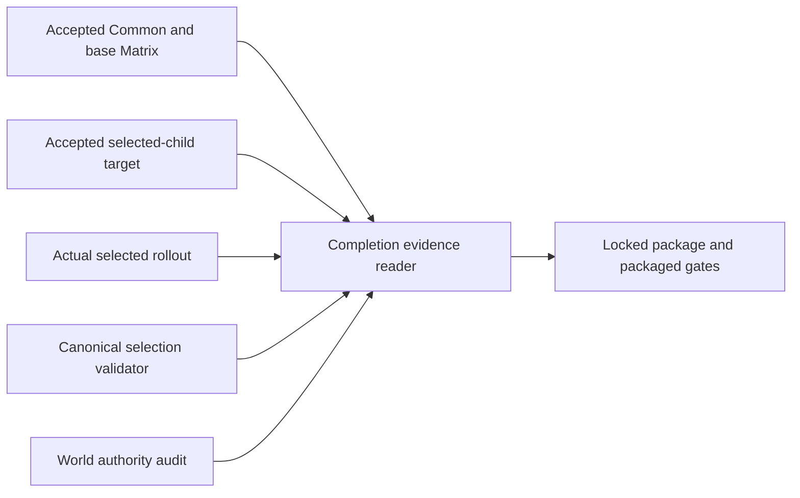
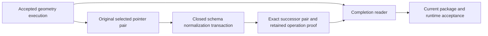

# Frozen execution evidence

End-to-End Validation authenticates past producing executions separately from
admission of a new producing request. This permits a final acceptance reader to
consume already tested geometry without changing its lineage or repeating
unaffected generation. The [evidence contract](contracts/completion-evidence.schema.json)
owns the request and retained-record shapes.

## Boundaries

Fresh Check, Matrix, refinement-input selection and selected-target operations
continue to require their exact current producing inputs. A frozen completion
record cannot admit a new source, compiler, child, runtime, host or budget change.
An actual change to those inputs requires the affected new proof.

The completion reader consumes three distinct records:

- The immutable-base Matrix proves the accepted canonical artifact-consumer
  regression envelope.
- The selected-child target proves its exact changed inputs, saved publication,
  cold replay, post-CAS failure recovery and restoration. Its mode remains
  selected-target evidence; it does not become a full Matrix.
- The actual selected rollout and its cold authority audit identify the final
  saved World. A temporary target transaction and a lasting rollout need not
  have identical operation IDs or active-set hashes.

The [Canonical refinement owner](../CanonicalCompilation/refinement/README.md)
authenticates the retained base-to-child selection through its public frozen
transition reader. The [World authority audit](../../../scripts/ue/world/README.md)
authenticates live manifests, producers and saved artifacts. Completion reads
compatibility only from the exact active-set bytes pinned by that audit; it is
not another Canonical or World authority.

## Proof reuse

Frozen execution retains the exact input-file hash tables whose canonical hashes
were recorded by the accepted Check and immutable-base selection. Original
receipts remain byte-identical. Copies of the two existing entrypoint sources
bind their import and dispatch behavior to those tested bytes.

All producing, native, runtime, host, profile, budget and data inputs must retain
their tested identities. The only accepted differences belong to the closed
final-consumer seam in `app/completion_replay.py`: the new reader and its contract
and focused tests, final acceptance body, and exact inert CLI wiring. Existing
entrypoint imports and producing branches remain unchanged. Function definition
metadata, including defaults, decorators and annotations, remains checked because
it can execute during import. This is not a configurable file-ignore mechanism.

A selected authority's schema-only normalization is a separate qualified operation,
not a new geometry execution. Its retained proof binds the original and successor
Canonical/World pointer bytes, actual completed save/cold no-op, current operation
sources and unchanged artifacts. The Canonical owner verifies the exact original
selection-to-successor link. World permits only the corresponding pointer hash
and ordinary transaction ancestry to change; every scope manifest remains exact.

The reader accepts this one closed delta through `app/completion_metadata.py`.
Original source preimages must match the producing gate's frozen file hashes.
Explicit metadata-fragment reversals must reproduce the complete original AST;
existing geometry calls, guards, imports and executable definition metadata remain
compared. New metadata helpers are tied to the actual operation source closure.
Any other producing/runtime/host/data drift requires its affected proof. Historical
receipts and producer identities remain unchanged.

The current reader has its own identity and focused acceptance/refusal tests.
Reusing geometry execution is not reusing an older package or GPU measurement.
Packaging, executable identity, gameplay, collision and performance still use
their normal current acceptance routes.

## Mixed scope lineage

Carried scopes retain their exact prior manifests, artifacts and base-input
lineage. Changed scopes must bind the selected child and the same native
producer, normalized contract and consumed unit sets demonstrated by the target.
Only the declared selected scope closure may advance. A dependency reevaluated
without writes remains carried.

The reader verifies child lineage before reusing existing checks for the other
identity fields. It does not rewrite stored scope identities, recertify every
scope as child-produced, or regenerate carried geometry to simplify provenance.

## Retention and packaging

Completion retains explicitly pinned receipts, selection/request bytes, hash
tables and original manifests under the existing WorldAuthority evidence owner.
The original receipt paths remain authenticated labels; reading the retained
record does not depend on those scratch files still existing. The immutable
Canonical payloads remain with their existing owner.

Final acceptance holds the existing generated-content mutation lock. Both audits
must observe the same actual saved World and the same Canonical selection.
The acceptance chain separately pins the base Matrix, selected-target/completion
record, actual rollout, package and packaged gate.

Technical evidence does not waive geographic quality, visual acceptance or
operator publication gates. A geographic hold remains a hold even when an
independent selected correction and its package diagnostics pass.
