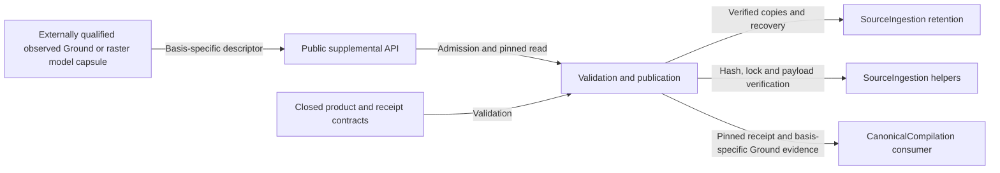

# Supplemental source relationships

This view states relationships at the supplemental owner boundary. The
[structure](../structure.md) routes to each internal part; qualification and
retention semantics remain with their owning contracts.
